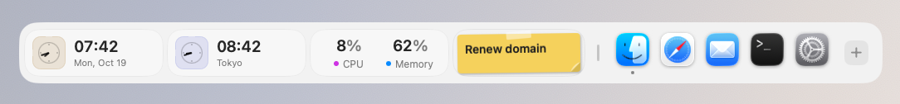

<div align="center">


# Dockling 码头

### A free Dock shelf for macOS with an optional Pro upgrade and a red panda desktop pet, in English and Simplified Chinese.

**Website: [docket.shiduo.app](https://docket.shiduo.app)** · [简体中文](README.md) | English

Put a shelf of live widgets, app groups and folders next to the macOS Dock,
or use it in place of the Dock.

[](#build-from-source)
[](project.yml)
[](LICENSE)

<br>



</div>

---

## What Dockling does

- **A shelf next to the Dock** with live widgets, app groups and folders, or use it in place of the Dock.
- **60+ widgets**: calendar, to-dos, focus timer, weather, radio, clipboard, screenshots, Calc and more. Click one for its details panel.
- **A red panda desktop pet** that stashes files, fetches new downloads and reminds you to stand up.
- **Window and app switching**: a ⌘Tab-style App Switcher, three window switcher styles and full-size previews.
- **Message island**: WeChat and other messages drop from the notch.
- **Layouts** switched by shortcut, Focus mode or ⌘ + scroll, and written back to Apple's Dock.

The interface is in **English and Simplified Chinese** and follows the system language. The basics are free; **Dockling Pro** is a one-time purchase, see the [website](https://docket.shiduo.app).

Dockling is an unofficial fork of [Docket](https://github.com/nparashar150/dockset) (MIT) that has grown into its own app.

## New in v1.0

- 🐼 **Red panda desktop pet**: lives on any screen edge; drop files on it to stash them, it fetches new downloads and cheers when a focus session ends
- 🎨 **Custom Dock icons** for any app, Option-drag an image onto it (Pro)
- ⌨️ **Typing sounds**: 7 keyboard and typewriter sounds, plus Mechvibes packs (Pro)
- 🌐 **Automatic input sources** per app
- 🪟 **App Switcher v2**: big icon grid with window thumbnails (Pro)
- 🔮 **New widgets**: Fortune, Pull a Tooth, Minesweeper
- 📌 **Pin to Desktop** and **system widgets** (beta)

Full notes: [changelog](docs/en/changelog.md). Every widget with screenshots: [screenshots](docs/en/screenshots.md).

## Features

More than fifty widgets, grouped by use. Mix them freely on one shelf.

- **Apps, files and quick access**: app groups, folders, Downloads, File Shelf, Clipboard, Screenshots, Photo Frame, Bookmarks, App Switcher, Shortcuts, Search.
- **Productivity and focus**: Calendar, Week Agenda, Reminders, Quick To-do, Sticky Note, Focus Timer, Habits, Stand Up reminders, Anniversaries, Time Progress, Slacker Clock, AI Assistant, Translate, Codex Usage, GitHub.
- **Mac control and system**: Battery (with charge limit and battery alerts), System Activity, Network Activity, Gauges, Volume, App Volume, Microphone, Quick Toggles, Wallpaper, Trash, Mail.
- **Handy tools**: Calc (calculator, unit converter and currency in one), Color Picker, Emoji, Capture, Recorder, AirDrop.
- **Media and fun**: Now Playing (Apple Music, browser tabs, NetEase Cloud Music, Xiaoyuzhou), Radio, Podcasts, Ambient Sound, Virtual Pet, the Red Panda's Basket, Water.
- **Time, weather and markets**: Clock and World Clock, Weather and forecasts, Lunar & Holidays, Stocks, Watchlist, Crypto.
- **Live Alerts**: a small capsule below the notch for volume, brightness and upcoming meetings.
- **Dockling Pro**: a one-time purchase that unlocks extra widgets and looks. The basics are always free.


## Install

1. Download the latest `.dmg` or `.zip` from the [Releases page](../../releases)
   and move `Dockling.app` to Applications.
2. **The build is not signed or notarized**, so macOS 26 warns the first time you open it:
   - Double-click it, then close the warning;
   - Open **System Settings > Privacy & Security** and click **Open Anyway** next to Dockling;
   - Authenticate and confirm.

   Or remove the quarantine attribute in Terminal:

   ```sh
   xattr -dr com.apple.quarantine /Applications/Dockling.app
   ```

3. **Look in the menu bar on first launch.** Dockling is an accessory app with no Dock icon and no main window.
   Settings, the widget library and layout switching live in the menu bar icon.

### Known limitations

- An ad-hoc signed accessory app gets no location prompt from macOS, so enter a city for the Weather widget in **Settings > Widgets**.
- Now Playing needs Dockling allowed under **Privacy & Security > Automation**; reading browser tabs also needs "Allow JavaScript from Apple Events" in the browser's Develop menu.
- Lunar dates, solar terms, the "Chinese" clock face and the End User License Agreement stay in Chinese in the English interface.

## Build from source

You need macOS 26 and Xcode. The Xcode project is generated from `project.yml` and is not in the repository:

```sh
brew install xcodegen
xcodegen generate
xcodebuild -scheme Docket -configuration Release build
```

Interface text lives in String Catalogs under `Resources/Localization`. Simplified Chinese is the source language and English is the translation. At runtime the development region in Info.plist is English, so languages Dockling does not ship fall back to English, and the Traditional Chinese and Hong Kong tables carry the Simplified text.


## License

[MIT](LICENSE) for the original Docket code. Dockling's own additions are covered by [LICENSING.md](LICENSING.md) and the [EULA](EULA.md).
Third-party attribution and trademarks are in [NOTICE.md](NOTICE.md).
Dockling is not affiliated with, endorsed by, or sponsored by Dockset, CoolDock, upstream Docket or their authors.
