<div align="center">


# Dockling 码头

### A free, open source Dock shelf for macOS, in English and Simplified Chinese.

**Website: [docket.shiduo.app](https://docket.shiduo.app)** · [简体中文](README.md) | English

Put a shelf of live widgets, app groups and folders next to the macOS Dock,
or use it in place of the Dock.

[](#build-from-source)
[](project.yml)
[](LICENSE)

<br>


<sub>Screenshots show the app's own English interface, taken on macOS by the screenshot tool in this repository (see "How the screenshots are made" below).</sub>

</div>

---

## What it is

Dockling (formerly Docket 中文版) is an **unofficial fork** of [Docket](https://github.com/nparashar150/dockset),
an MIT licensed open source macOS app. It started as a Simplified Chinese localization and has grown into its own app:

- The interface is available in **Simplified Chinese and English** and follows the system language.
  If your preferred languages include neither Chinese nor English (French, Japanese, German and so on),
  Dockling shows English; Traditional Chinese, Hong Kong and Taiwan show Simplified Chinese.
  You can also pick a language in **Settings ▸ General ▸ Language**.
- It builds for anyone who clones it: ad-hoc signing and its own bundle ID (`com.docket-zh.app`),
  so it can be installed next to upstream Docket.
- Dozens of new widgets, clock faces and weather views, shelf looks, per-widget conditions,
  shrink to fit, and three ways to switch layouts.

The basics it shares with upstream:

- **Follows the real Dock**: size, edge, magnification and auto-hide are read live from System Settings.
- **App groups**: drag one icon onto another and hold to make a group, like on iOS.
- **Layouts**: save several and write them back to Apple's Dock (only `persistent-apps` changes, with verification and rollback).
- **Click a widget to open its details panel** with more information and actions.

---

## Features

More than fifty widgets, grouped by use. Mix them freely on one shelf.

- **Apps, files and quick access**: app groups, folders, Downloads, File Shelf, Clipboard, Screenshots, Photo Frame, Bookmarks, App Switcher, Shortcuts, Search.
- **Productivity and focus**: Calendar, Week Agenda, Reminders, Quick To-do, Sticky Note, Focus Timer, Habits, Stand Up reminders, Anniversaries, Time Progress, Slacker Clock, AI Assistant, Translate, Codex Usage, GitHub.
- **Mac control and system**: Battery (with charge limit and battery alerts), System Activity, Network Activity, Gauges, Volume, App Volume, Microphone, Quick Toggles, Wallpaper, Trash, Mail.
- **Handy tools**: Calc (calculator, unit converter and currency in one), Color Picker, Emoji, Capture, Recorder, AirDrop.
- **Media and fun**: Now Playing (Apple Music, browser tabs, NetEase Cloud Music, Xiaoyuzhou), Radio, Podcasts, Ambient Sound, Virtual Pet, the Red Panda's Basket, Water.
- **Time, weather and markets**: Clock and World Clock, Weather and forecasts, Lunar & Holidays, Stocks, Watchlist, Crypto.
- **Live Alerts**: a small capsule below the notch for volume, brightness and upcoming meetings.
- **Dockling Pro**: a one-time purchase that unlocks extra widgets and looks. The basics are always free.

## Screenshots

<sub>Widgets on the shelves below show the widget library's own sample data, so nothing is read from the capture machine's calendar, music or files. Panels marked "sample data" do the same; the rest are live readings taken at capture time.</sub>

**Apps, files and quick access**


**Productivity and focus**


**Mac control and system**


**Handy tools**


**Shelf looks**: dark glass with monochrome widgets.


**Liquid looks** (Dockling Pro): Time Progress, Water, Focus Timer, System Activity and Battery as a glass of water that fills with progress, load or charge.


**Colors and backgrounds**: fifteen preset colors, a custom color or the system accent, on no background, a dark card or a gradient.


**World clocks with a city picker**


**New quick tools**: Text from Screen, QR Code, Color Picker, Mirror, Presentation Mode and Keyboard Lock, next to the AI Assistant card and Capture.


**Calendar, Week, Lunar and Holidays, Anniversary**: Calendar shows the next event, Week how busy the seven days are, Lunar the solar terms and make-up workdays, Anniversary counts the days.

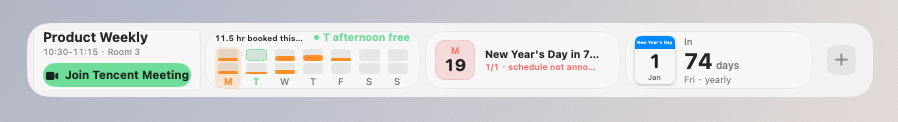

**Eight clock faces**: Standard, Analog, Flip, Pixel, LCD, Chinese, Neon and Photo.

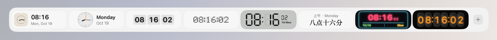

**Stocks, Watchlist, Crypto, gold and silver**: Stocks follows one symbol, Watchlist a list, and gold and silver show per gram in yuan by default.

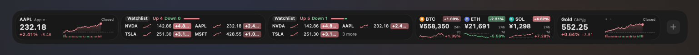

**Timers by scale**: Countdown, Stopwatch, Alarm and Focus Timer.

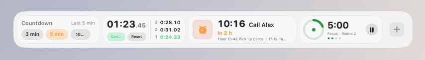

**Battery cells**: charge drawn as a sideways battery; rings are left to Ring Gauges.

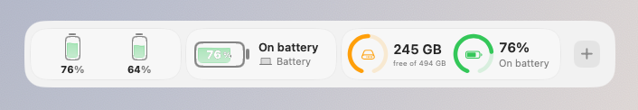

<p align="center">
  <br>
  <sub>Add Widget: category sidebar and Pro capsules</sub>
</p>

<table>
  <tr>
    <td width="50%" valign="top">
      
      <p align="center"><sub>Time Progress: day, week, month and year</sub></p>
    </td>
    <td width="50%" valign="top">
      
      <p align="center"><sub>Battery: the Mac and accessories (sample data)</sub></p>
    </td>
  </tr>
  <tr>
    <td width="50%" valign="top">
      
      <p align="center"><sub>AI chat that grows out of the notch (Jump mode)</sub></p>
    </td>
    <td width="50%" valign="top">
      
      <p align="center"><sub>Dockling Pro: features, trial, purchase and license key</sub></p>
    </td>
  </tr>
</table>

<table>
  <tr>
    <td width="50%" valign="top">
      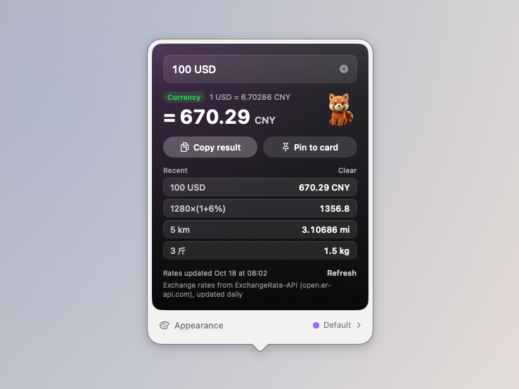
      <p align="center"><sub>Calc: currency, units and sums in one box</sub></p>
    </td>
    <td width="50%" valign="top">
      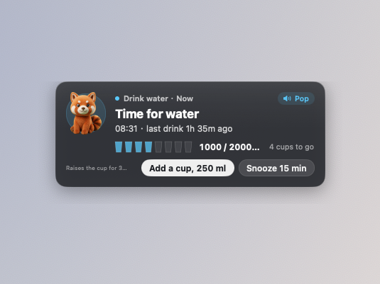
      <p align="center"><sub>Pop-up reminder card under the notch (sample data)</sub></p>
    </td>
  </tr>
  <tr>
    <td width="50%" valign="top">
      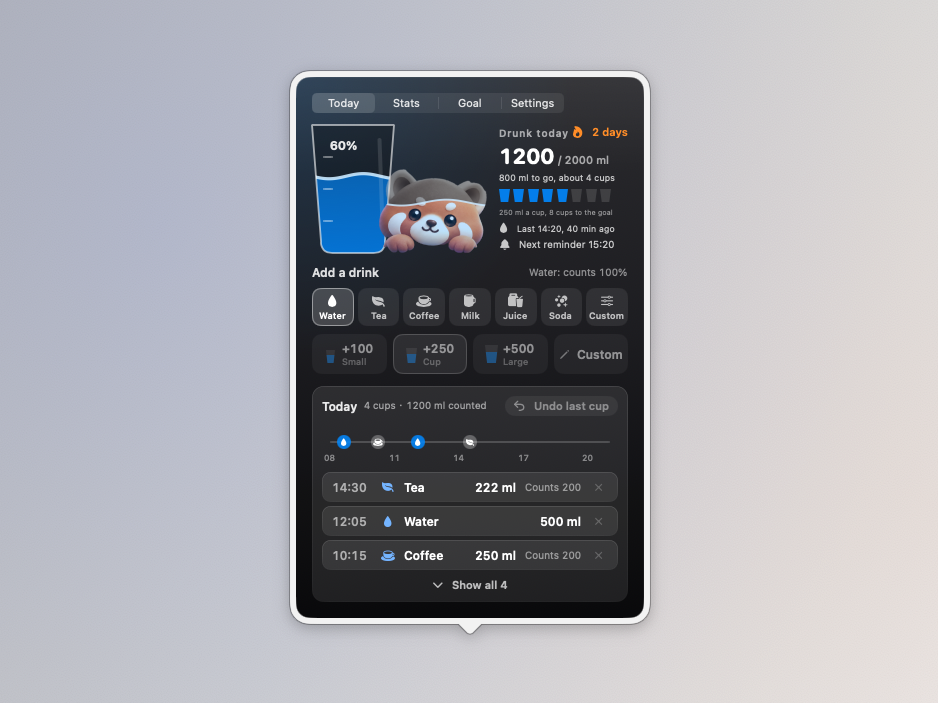
      <p align="center"><sub>Water: the cup page (sample data)</sub></p>
    </td>
    <td width="50%" valign="top">
      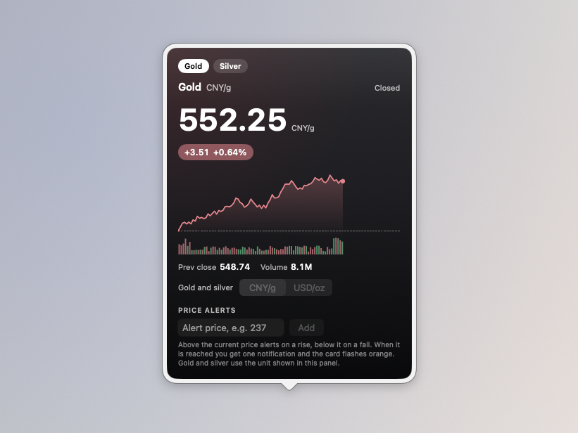
      <p align="center"><sub>Gold and silver, per gram or per ounce (sample data)</sub></p>
    </td>
  </tr>
  <tr>
    <td width="50%" valign="top">
      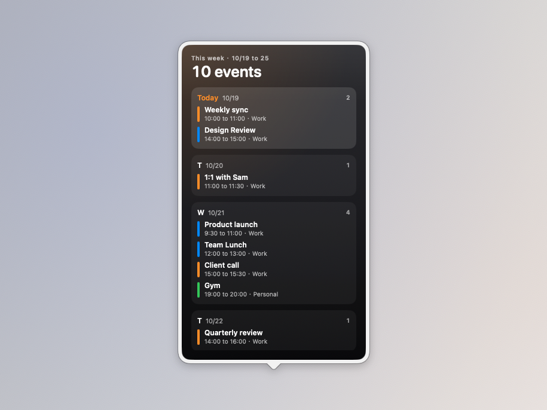
      <p align="center"><sub>Week: seven days at a glance (sample data)</sub></p>
    </td>
    <td width="50%" valign="top">
      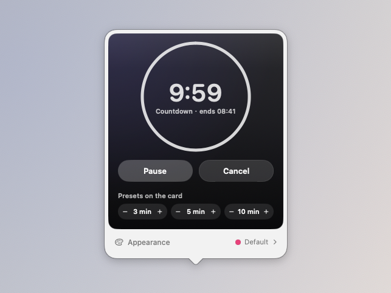
      <p align="center"><sub>Countdown: ten real minutes</sub></p>
    </td>
  </tr>
</table>

<p align="center">
  <br>
  <sub>Clipboard: recent copies, searchable, with starred items</sub>
</p>

## In development (next version)

- **Calc's badge becomes a red panda calculator face, the same in Chinese and English**: the card used to lead with a purple 算 character (a plus/minus symbol in English). Now it is a little calculator with a face: a deep purple-ink screen (not pure black in light mode) inside a red panda orange face frame, with two cream brow spots on top and cream cheeks in the lower corners, two white capsule eyes with the right one winking as a ^, and a 2×2 keypad of capsule keys + − × ＝ below. The first three keys follow the card's theme colour (purple by default; their symbols turn dark on pale themes such as yellow or mint) and ＝ is red panda orange. It is drawn entirely from shapes in proportion to its size, so the 40pt shelf row and the 26pt column use the same picture, it follows light and dark, and no symbol stroke is thinner than 1pt. The badge square (theme tint, thin edge, rounded corners) is unchanged, and VoiceOver still reads the card name Calc. The proportions, stroke widths and colours live in Core with tests. Not yet verified on a physical Mac.
- **New: Automatic Input Source Switching. Switch to an app and its input source comes with it, with a hint that drops from the notch; per-app rules are Pro**: Settings has a new Input Sources page between Shortcuts and General, off by default. Apps without a rule either Use the Default Input Source (the default, switching to the one you pick every time) or Remember the Last One (each app gets back the input source it had when you left, falling back to the default the first time). Per-App Rules (Pro) give an app its own input source, one rule per app shared by all its windows: a grid of large app icon cards with a glyph badge in the corner (拼, A, あ, 한 and so on, worked out from the input source's language); click a card to change its input source, hover for ⋯ to delete, and Add App picks from Applications or from running apps, or drag an app into the grid. When a rule's input source is removed the rule stays and the default is used for now (or the first keyboard input source when the default is gone too), the card shows a grey badge and "Removed, using XX for now", and it comes back by itself when the input source is reinstalled. Without Pro the rules area is blurred behind a small lock, Unlock Dockling Pro opens the paywall, and existing rules are kept but not applied. After a switch a Liquid Glass capsule drops from the notch with the glyph badge, the input source name and the app icon (0.25 s down, stays 1 s by default and adjustable, 0.2 s back up; a fade with Reduce Motion), shown Below the Notch (default), Beside the Cursor (needs Accessibility permission and uses the notch until it is granted) or Off. It shrinks to a sliver right of the notch with just the badge and app icon while the Shiduo shelf is open, sits below the menu bar on displays without a notch, and simply does not appear while full screen, the AI notch chat, a reminder popup, a message card or the island hint has the notch. Nothing switches or shows when Dockling itself becomes active or the input source is already right. Reading and switching input sources uses system APIs and needs no permission. Light and dark. Not yet verified on a physical Mac.
- **Fix: a few details in Automatic Input Source Switching**: Remember the Last One now drops the least recently used app when it reaches 200 apps (an app you use all the time whose input source never changed used to count as unused and go first); no "switched" hint when the system refuses the switch; the Beside the Cursor hint stays next to the cursor on a second display instead of being pushed to the edge of the main one; and it no longer pops up if the AI notch chat, a reminder popup or similar takes the notch while the cursor position is being read. Not yet verified on a physical Mac.
- **Fix: clicking an app that is already open on the shelf sometimes showed no window**: clicking a running app used to only bring it to the front, so Calendar, Mail, Notes, Music, Messages, Finder and other apps that keep running after their last window closes showed nothing, fully minimised windows were not restored, and sometimes the system refused the switch altogether. It now behaves like clicking Apple's Dock: an app with no windows opens a new one, a minimised window is restored, an app with windows comes to the front, a full-screen app switches to its Space, and an app hidden with ⌘H comes back; a running app still does not bounce. The app switcher card and panel, and widgets that open an app, work the same way. Not yet verified on a physical Mac.
- **Fix: text fields take ⌘A / ⌘C / ⌘X / ⌘V / ⌘Z / ⌘⇧Z; a panel reopened while fading out no longer stays invisible; a panel pinned to another Space moves to the current one; sticky notes save as you type**: Dockling has no Edit menu, so fields in panels (sticky notes, Calc, reminders and others), the AI notch chat, quick to-do, the group rename and folder popup search fields, text typed onto a screenshot, Settings and the widget library took typing but ignored Select All, Copy, Cut, Paste, Undo and Redo; the window now hands these keys to the field being typed in. With nothing selected in the field, ⌘C still belongs to the panel (Calc's Copy Result). Reopening a panel while its closing fade was still running (a quick second click, or going straight from one widget to another) let the old fade drop the window to zero opacity, open but invisible; opening now cancels the unfinished fade, and the AI notch chat panel gets the same fix. Even with "all Spaces" set, macOS sometimes pinned a widget panel or group window to one Space, so a click on another Space showed nothing; a window found off the current Space is now replaced by a fresh one placed where you are. A sticky note is saved half a second after you stop typing (not while an input method is composing) instead of only when you click away. Checked and left as they are: a long sticky note does not break the panel, which grows to its limit and then scrolls with its outline intact; a long Now Playing title is truncated to the panel's width and does not widen it. The shortcut logic lives in Core (EditShortcut) with tests. The approach follows several upstream Docket fixes, rebuilt on Dockling's own code. Not yet verified on a physical Mac.
- **Fix: frequent "Dockling wants to use your confidential information stored in "码头 Pro 授权" in your keychain" prompts**: Dockling is ad-hoc signed for now, so its signature changes with every update and macOS no longer recognises the license items the previous version stored in the keychain, asking for the login keychain password whenever they are read. Pro used to keep four separate keychain items (license key, instance, last validation, trial start), re-read all four every time it worked out its state (at launch, hourly, on wake and after checking online) and deleted each item before adding it again, so one moment could bring several prompts in a row. The four are now one keychain item, read once per run the first time it is needed and kept in memory afterwards, written only when a value really changes, and updated in place (added only when missing). The first launch of the new version reads the four old items, merges them into the new one and deletes them in one go, so you will still be asked once after updating. After Deny or a failed read, Dockling does not try again for the rest of the run, and an unreadable trial record never resets the trial or lets it start over. The AI assistant API keys and the GitHub token are likewise read at most once per run, with launch only checking that they exist. The merge, migration and write decisions live in Core (KeychainCache) with tests. Not yet verified on a physical Mac.
- **Fix: launching with the keychain locked left Pro inactive for the whole run**: the change above also treated a read that could not happen as final for the run, but a locked keychain that macOS cannot prompt for (an automatic relaunch while the screen is locked, or a login keychain not yet unlocked) is not the user choosing Deny, so a paying user stayed unactivated with Pro features locked until restarting Dockling by hand. Such temporary failures are no longer remembered: the license is read again the next time the state is worked out (hourly and on wake) and comes back as soon as it can be read. After Deny Dockling still does not ask again for the rest of the run, and old items that were already read are not read again, so no extra prompts appear. The trial state and whether a trial can start now come from the same read, so a paying user is never shown Start Trial when the license could not be read. The decisions live in Core (KeychainCache) with tests. Not yet verified on a physical Mac.

## New in v0.7.0: Dockling Pro, the message island, Calc currency Simple and Full, the AI assistant, retro cassettes and more

- **Calc's currency conversion, rebuilt: a free Simple page that just converts, and a Full page (Pro) with a multi-currency list, favourites, pinning, history, a keypad and a rotating card**: the Calc panel now has Currency and Math pages at the top (⌘1 / ⌘2) and opens on the one you used last. The Currency page comes in two versions. Simple (free, everyone's default) does one thing: an Amount row with a currency button on the left (flag, code and a menu arrow) and a large amount on the right, outlined in purple while you type, and a Converted to row below it whose currency starts as yuan and changes with a click, with a swap button between them (⌘⇧S). It converts as you type, with no need to press Return; the amount gets thousands separators as you type (10000 shows as 10,000; the input field always groups, while the card and result still follow the separator setting) and the result is rounded to the currency's own minor units (none for yen and won, three for the Kuwaiti dinar and similar). Click a currency to open a picker inside the panel and search by name, code, nickname or symbol (yen, hkd, bucks, $); common ones come first, ↑↓ chooses and Return confirms. Below are the rate both ways (1 USD = 7.1198 CNY and the reverse) and when it was updated, with "Offline, using the rates from" a date when there is no connection and Refresh at the top right (⌘R), then two buttons: Copy Result (⌘C, without separators) and To Math (⌘E, takes the result to the Math page). Simple shows no keypad, multi-currency list, favourites, pinning or history, and when the panel closes the card shows that conversion (without adding it to History). Full (Pro) is the whole set: From and To rows with currency names, sums in the amount (1299*3+50, with the worked-out amount underneath) or amounts that name their currencies (100 eur to jpy); ⌘D favourites shown as chips you click to switch to; pin to the card; Return saves to History (shared with the Math page), where a click reuses it; ⌘⇧C copies the whole line and ↑↓ in the amount changes the To row; a 4 × 5 keypad at the top right (⌘K); the multi-currency list (one amount in up to 8 currencies, add, remove, drag to reorder, click a row to make it the From currency); and rotating favourites on the card (with two or more favourites and nothing pinned, a new pair every 6 seconds, holding still on hover). A Normal / Full switch sits in the top bar next to Currency and Math. Without Pro you simply get Simple, with no lock, and Full carries a Pro badge that opens the paywall; with Pro or during the trial Full is the default, and the switch is remembered. When the trial ends or without Pro, favourites, the multi-currency list, history and the pinned line are kept as they are and come back when unlocked. The Math page (sums, unit conversion, history, pinning and its keypad) stays free, and it still converts currencies (100 usd to jpy) and pins to the card. Existing cards keep their settings, history and pinned line, and a migrated "100 USD to CNY" opens as the two rows. The panel is 340 wide, in light and dark. Not yet verified on a physical Mac.
- **New Message Island (Pro): messages from Messages, WhatsApp and WeChat open below the notch, Messages can be answered from the notch, and it makes way for Shiduo**: Settings ▸ General gets Message Island, off by default. When Messages, WhatsApp or WeChat notifies you, a Liquid Glass message card grows below the notch (designed for light and dark, with a fading black strip where it meets the notch): the app icon and name, an avatar (a coloured circle with the first letter of the name when there is no picture), the sender, the time and a two-line preview, with Reply, Later and Open ↗. Reply in Messages opens a field in the card, Return sends and Esc closes; it is sent through Automation (AppleScript) to the contact or group with that display name, and when there is none or more than one, nothing is sent and Messages opens instead; macOS asks once whether Dockling may control Messages. For WhatsApp and WeChat, Reply ↗ and Open ↗ open the app, clicking the system banner for you while it is still there so the chat itself opens. Several messages stack with "2 more" in the corner and "Next: WeChat · Wang · 09:31" at the bottom; Later keeps a message unread and moves on, and Open handles every message from that person. After a few seconds (4, 6 or 10) the card folds into small app icons with unread counts beside the notch, which open it again with a click; it stays open while the pointer rests on it, and opening the app yourself clears its unread count. A sender who hides previews shows as "New message" with a note on turning previews on. Messages come from the system notification banners: Accessibility watches the Notification Center banners, read-only, never blocking or changing a notification, and a banner whose structure it does not recognise is ignored silently. So the banner and the card both appear; setting these apps' notification style to None removes the duplicate but also leaves Dockling with nothing to read, as do Focus, Do Not Disturb, full-screen presentations and screen sharing, and no card appears over full-screen apps or presentations. With Dockling's own notch content: while the AI notch chat is open the card stays folded as unread counts and opens afterwards for messages from the last 20 seconds; it waits for a reminder card to close (up to 8 seconds); and while the card is open the island capsule and the AI notch entry step aside. It makes way for Shiduo and other notch apps automatically: reading only who owns each window and where it is (no Screen Recording needed), the card drops below their windows at the notch, waits while their panel is open and becomes a capsule beside the notch after 8 seconds; Position offers Make Way Automatically (default), Below the Notch or Capsule Beside the Notch (keeps the middle of the notch free and opens the card on click). Each app can be turned off on its own. Needs Accessibility, and Automation to reply in Messages. Not yet verified on a physical Mac.
- **Fix: a group tile sometimes did nothing when clicked**: an app group on the shelf (such as one holding the system apps) occasionally ignored a click and only opened after a few more clicks or after opening another group. Several causes are fixed: when the window could not be placed or was taken away by the system, Docket still thought it was open, so the next click was read as "click again to close" and the group never opened; now only a window that is really on screen counts, a hidden one simply opens again, and a placement that fails is retried once on the next pass. Reopening while the closing fade was still running (a quick second click, or going straight from one group to another) let the old fade drop the window to zero opacity, open but invisible; opening now cancels the unfinished fade. Double-clicking a tile no longer opens it and closes it again. Clicking before the pointer has rested on a tile grows the window from the middle of the shelf instead of a screen corner. The folder popup gets the same fixes. The logic lives in Core (PopupToggle) with tests. Not yet verified on a physical Mac.
- **Battery Cells hourglass gets its own panel (Pro)**: when the Battery widget uses the Battery Cells style with the Classic or Liquid look (the card draws an hourglass), its panel becomes an hourglass set: a 79×104 hourglass at the top right (where the liquid orb was), with sand running down and a bolt badge while charging, in the same colours as the card (green by default, red at 20% or below when not charging, yellow in Low Power Mode, or the chosen colour), held at 3 : 1 in Light mode so it never looks washed out; on the left the charge in 60pt figures and the status line, both turning red on a low battery warning. Today swaps the curve for 24 sand columns, one per hour, each as tall as the last charge logged that hour, with a grain on top of hours that charged, the current hour outlined and a small dot for hours still to come, and Low 38% · Charged 1 hr 20 min at the top right; before anything is logged it says Just started: one grain every 5 minutes instead of a lone line. Maximum Capacity, Cycle Count and Temperature become glass tiles: a sand ring for capacity (orange below 80%) and small sand icons for the other two. Charge Limit gets a sand switch and slider and a Pro capsule in light sand with dark brown text, and accessory rows show a small hourglass instead of a ring. The rest of the panel uses the warm gold sand colour (#E9B65C in Dark, darkened automatically to stay readable in Light), following the current appearance. Panels for the Charge and Icon only styles and for the Pixel, Particles and Red Panda looks are unchanged; the decision and the column and summary maths live in Core with tests; the paywall and website Pro lists note that Battery Cells include their own hourglass panel. Not yet verified on a physical Mac.
- **Fix: Sticky Note crashed while typing with a Chinese input method**: typing in the Sticky Note panel with a Chinese input method (while the pinyin was still being composed) could crash Docket, and opening the panel or ticking a checklist item could too. The panel tracked the text field's selection, and during composition that selection pointed into a longer, not yet committed version of the text, so converting its position went out of bounds. The panel now reads the system text field's selection as plain numbers, clamped to the text, and never touches that other version; saving when the field loses focus or the panel closes moves to the next run loop instead of mid-redraw; and old trash data with repeated ids is told apart when read, so Restore and Delete never pick the wrong sheet or remove two at once. Not yet verified on a physical Mac.
- **Liquid looks for Water, Time Progress and the Red Panda's Basket (Pro): the water reaches the card's edges, and Water's text is readable in every colour**: the liquid used to stop 10pt short on each side with its corners cut to a smaller radius, leaving a thick cream border in light mode; now it fills the whole card to its rounded corners, and the text on all three liquid cards keeps at least 12pt from the edge. Water's liquid look used white text with a faint dark outline everywhere, which was only about 2:1 on pale pink, lilac or light yellow water in light mode; now the text colour is picked separately for above the water and in the water, both at 4.5:1 or better: one deep shade of the same hue for the whole card in light mode, and in dark mode white above the water with deep text in pale water and white in deep water, switching at the waterline as the waves move; only mid-tone colours where neither works get the water nudged slightly within the same hue. The + becomes a solid disc with a white plus that reads above and below the water, and past the goal the caption reads "Goal met · 144%". Not yet verified on a physical Mac.
- **New Retro Cassette widget (Pro): Tape, Portable Player and Boombox, and Now Playing drops its cassette looks**: the three cassette looks of the medium Now Playing card become a Pro widget of their own, Retro Cassette, with one card per model under Media in the widget library, ready to add. On a bottom shelf it is a medium card 404 wide: Tape is an amber cassette on a glass card (the artwork as its label, two reels) beside the title, artist, previous / coral play / next and a thin progress bar; Portable Player is a cream body (reels in a little window, a grey-green LCD with the title and time) and Boombox a moss green body (two speakers, a tuning strip whose red needle shows the progress, a tape deck and a copper knob), each with three glass keys beside it. Tape can turn on Compact card (216 wide, Tape only) in Settings; Portable Player and Boombox do not fit in 216 points and do not offer it. On a shelf at the left or right it is a 76-wide column (a small cassette, the title and a play key). The reels only turn while playing with the card on screen and Reduce Motion off, slower as a reel fills, and hold still when paused or hidden. Clicking the card opens a 320-wide liquid glass panel: a glass tag at the top, Source: Music, that opens the source list (with Switch to whoever starts playing), and Open App beside it; a large body in the middle (the Tape label printed with A, the title and the time, the Portable Player with an LCD counter and a volume wheel on its side, the Boombox copper knob following the volume), and under Tape a row with the two tape packs and a counter, 01:42 · 04:05; glass keys for shuffle, previous, a coral play key, next and repeat, the play key staying 1pt down while playing and never glowing; a glass fader for volume; the next 3 songs as Side B in glass rows (Show All when there are more, Recently played for Spotify); drag the Tape counter row, the Portable Player progress bar or the Boombox tuning strip to jump there (not for read-only sources); and a Model switch at the bottom for Tape, Portable Player and Boombox. The base, keys and text follow light and dark, while the bodies are physical objects in fixed colours. Playback, controls and show-while-playing come from the same services as Now Playing, with the same source, auto-switch and pinned-source settings. Now Playing loses its Cassette look option and the picker in its panel, and keeps Full, Mini and Medium for free. A Medium card that used a cassette look becomes the matching Retro Cassette at launch, in the same place with its sources and colours, when Pro (or the trial) is unlocked, and a compact Tape stays 216 wide; without Pro it stays in Now Playing with the default look, without losing the card. The paywall and the website now list 15 Pro widgets. Not yet verified on a physical Mac.
- **Now Playing: Up Next sits right under the controls**: the "Up Next · Playlist "Music"" row at the very bottom of the player used to land in the panel's bottom fade, greyed out and cut in half, so it read like a caption. When there is a playlist to read, the cover now shrinks a little, the controls tighten, and the next 3 songs are listed right under them; each whole row plays from that song, with All N on the right. All turns the cover into a mini player pinned at the top (previous, play, next and progress), and the list fills the panel below it without making the panel taller, scrolling inside when longer. It lists up to 25 songs and then says how many more are in Apple Music; tap the mini player or Collapse to go back. Expanding and collapsing animate, and switch instantly with Reduce Motion on. Grey placeholder rows show while loading; Shuffle no longer makes the block disappear but says Apple Music decides the order with Turn Off Shuffle; on the last song it says nothing plays after this with Repeat All; and playing the whole library is titled Library. Spotify shows Recently Played in the same spot, with how many minutes ago at the end of each row and replay on hover, and the expanded list notes that Spotify doesn't let widgets read its queue. NetEase Cloud Music, QQ Music, Xiaoyuzhou and browser tabs can't be read, so the block doesn't appear and the cover stays large. Not yet verified on a physical Mac.
- **Sticky Note redesign: one-click checklists, a tear-off animation and a trash, and a bottom bar that no longer truncates**: Previous and Next in the bottom bar become icons (hover for ⌘[ / ⌘]), New and Tear Off keep an icon with a short label at 13pt, so nothing is cut off in Chinese or English, and the 2/3 stack marker moves to the top bar. A Checklist button (⌘⇧L) turns the selected lines, or the current line, into checkboxes and back again, dropping list markers such as "- milk" or "1. milk". More ways to write a box are recognised at the start of a line: [ ], [], 【】, - [ ], -[ ], * [ ], + [ ], [x] / [X] / [✓] / [√], and a bare ☐ □ ○ ☑ ✓. When you are not typing, items are drawn as circles you click to complete: the text is struck through in a lighter ink (about 5.0 contrast, never below 4.5), sinks below Done by default (switch it off in the ⋯ menu, which can also uncheck all or clear done items with undo), and the title shows progress such as 2/5; while typing, the box text is shown as written. Boxes it cannot read, like [1] or [a], are never rewritten silently; the bottom of the sheet asks once whether to make them checkboxes. Tear Off no longer asks first: the sheet tears from under the tape, curls up from the bottom right and flies into the trash in the top bar in about 0.5 s, or simply fades with Reduce Motion, and you can undo for 5 seconds. The trash icon shows a count; its list can restore a note (back on top), delete it permanently or empty the trash (with confirmation), keeping notes for 7 days, up to the last 30, with a resting red panda when empty. Checklists, tearing and the trash are free, and the 10 Pro paper colours are unchanged; the Liquid Glass frame follows Light and Dark while the paper keeps its colour. Existing notes read as before; checklist parsing, tearing and trash retention live in Core with tests. Not yet verified on a physical Mac.
- **Anniversary redesign: an hourglass countdown (Glass Hourglass is Pro)**: the single Anniversary card becomes an hourglass whose top holds what is left of this round, next to the event's little icon, its name with "to go" or "since", the day count in large type and a line like "Fri, Jan 1 · Every year". Within 7 days of the next one the sand turns warm orange, grains fall through the neck and a Soon tag sits by the number; on the day itself the red panda cheers among confetti with "Today". The sand stays a natural sand colour, with the event's colour only on the name and the caps; the grains hold still with Reduce Motion on or the shelf out of sight. Settings > Widgets > Anniversary adds Style: Line Hourglass, Glass Hourglass or Tear-off Calendar. Line Hourglass is free and the default for new cards, Glass Hourglass is Pro (drawn as Line Hourglass without Pro, opening the paywall when picked in Settings, with the choice kept), and cards already on the shelf keep their tear-off calendar. The multiple Anniversary card shows the nearest one in a light capsule in its colour with its name and day count, and the Next 12 Months timeline now uses event icons (recognised from names such as birthdays, anniversaries, a new job, graduation and festivals, otherwise an hourglass or a star), with a red mark for today, small hourglasses for the quarters and 13pt month labels; the rest are icons only, with the name and days on hover. The panel from the single card (340 wide) has a large hourglass, the day count with days, hours and minutes, this round's progress bar with its start and end, Date, Type and Repeat rows, the next three times, and Edit, Share image and Timeline at the bottom; the panel from the multiple card (328 wide) has All, Countdown and Count up tabs, a red Today capsule and a vertical timeline nearest first, with the nearest on a glass row with a small hourglass and past one-off dates under Already passed; click a row to open its page. Both are Liquid Glass and follow light and dark, without large areas of event colour in dark. Not yet verified on a physical Mac.
- **Quick To-do redesign: an input that understands times, Today / Later / Done groups, and two-way sync with Reminders (sync is Pro)**: the top of the panel becomes one large input. Type "Submit draft tomorrow 9am" and "tomorrow 9am" is highlighted in the accent colour, with the reminder time previewed on the line below; Return adds "Submit draft" with a reminder at that time. It understands today, tonight, tomorrow, weekdays, next Friday, 10/23, 9am, 3:30 pm and at 9, plus the Chinese forms, and never interrupts an input method while you pick characters; a date without a time means 9:00, and text with no time is added as it is to Later. One line at the top reads how many are left today and how many are done, over a thin progress bar, replacing the big title and the stat chip. The list has three groups, Today, Later and Done: the star, which allowed 3, becomes dragging into Today with no limit, and starred items from the old version land in Today; whatever was left over from yesterday moves to the top of Today the first time you open it each day, with a red time capsule, instead of asking whether to carry it over; items whose reminder falls today move up from Later; Done starts collapsed with Clear beside it. Each row is just a round check, a time capsule (red when overdue, orange for today, grey for later) and a small red flag for important ones, with the drag handle, Edit and Delete showing on hover, and dragging reorders within or across groups; right-click to move to Today or Later, mark as important, set a reminder or move it to Reminders. A checked circle fills with a little pop and slides into Done after about 0.4 seconds, Undo still works, and Reduce Motion switches it straight away; an empty list shows the red panda resting. The Quick To-do card title changes from Today's three to Today. A new Sync with Reminders switch at the bottom of the panel (Pro) picks a list and keeps titles, completion, reminder times and importance in step both ways, deleting on either side deletes on the other (finished reminders are kept), and only the first Quick To-do card with the switch on syncs; access to Reminders is only asked for when you turn it on, and without Pro the switch opens the paywall; moving a single to-do to Reminders stays free. The panel follows light and dark. Not yet verified on a physical Mac.
- **World Clock redesign: a good time to reach them, sky cells (Pro), city facts and a second time zone in the menu bar**: each city gets a red, yellow or green dot for whether it is a good time to reach them: green when it is 9:00 to 18:00 for both of you, red (Asleep) when it is 22:00 to 7:00 for them, and yellow otherwise (they start work soon or are off work, or it is early, after hours or late night for you), with daylight saving handled by the time zone rules. With 2 or 3 cities on the shelf card, each city gets its own cell colored like its sky right now (dawn, day, dusk and night, split by the real sunrise and sunset for built-in cities, with a few stars at night), a small landmark sketch in the corner, and white or dark grey text chosen to keep contrast at 4.5:1 or better. In the panel each city name gets a short note (such as "Capital of China"), and clicking a city opens a facts card: a sentence or two about the city, sunrise and sunset (polar day and night are called out), the local weather, the currency and exchange rate (from the rate service the calculator already uses; with no rate table only the currency name is shown, never a hard-coded number), the calling code, and a "Good time to reach them?" capsule with their local time, above the 12-hour strip as before. Coordinates, notes, introductions, currencies and calling codes for the 185 built-in cities ship with the app in Chinese and English, with no network needed. Settings, General, Menu Bar adds Show a Second Time Zone in the Menu Bar (off by default) with a city picker or Automatic (the first city in your World Clock list in a different time zone from here); the menu bar shows "● New York 03:56" and its menu lists each city's time and status, where clicking a row switches city. The panel and card stay Liquid Glass with semantic colors in light and dark, never below 13pt. The rules, sky phases, contrast, rate wording and city choice live in Core (WorldClockInfo, CityFacts) with tests. World Clock itself, the plain card, the contact dots, the facts card and the menu bar time zone are all free; only the sky cells look for several cities is Pro: with 2 or more cities, Settings, Widgets, World Clock adds Multi-city Look: Normal or Sky. Normal is free and the default for new cards (one cell per city on the regular Liquid Glass, with no sky colors, stars or landmarks, semantic text colors for light and dark, 13pt); Sky carries the Pro badge and opens the paywall when Pro is not unlocked. Cards already on the shelf keep the sky; without Pro they draw as Normal, with no lock and the setting kept, and go back to the sky once Pro or the trial is unlocked. The look rules live in Core (WorldClockLook) with tests. Not yet verified on a physical Mac.
- **Warm tips for Weather**: a short, friendly reminder picked from the weather data already at hand, in this order: rain and an umbrella (the 2-hour minute outlook, or within 12 hours an hourly chance of 50% or 0.3 mm, or today's chance of 60% when there is no hourly data), a cold snap (today's high 6 degrees below yesterday's, or tomorrow's below today's), a big day-night swing (10 degrees or more today), strong UV (index 6 or more in the next 6 hours), wind (force 6, gale from force 8), poor air (US AQI above 100, a mask above 150), and always a clothing suggestion last (by the feels-like temperature, mentioned when it is 3 degrees off the reading), such as "Rain this afternoon, take an umbrella" or "8° colder than yesterday, add a layer". Anything missing from the data is skipped. In the panel the red panda says the most important one in a speech bubble, for whichever city you are looking at; the wide Current card adds a line under its reading that moves to the next tip about every 8 seconds, falls back to a shorter wording, and is left out rather than squeezing anything when it does not fit, never below 13pt. A Warm tips switch, on by default, is in Settings and in the panel's Cities view. To do this the daily forecast also fetches yesterday and current conditions include the feels-like temperature. The rules and wording live in Core (WeatherTips) with tests. Free. Not yet verified on a physical Mac.
- **Second hand on the Clock widget's Standard face**: the small face on the left of the expanded card and the side-shelf column used to have only hour and minute hands; it now has a thin second hand (about 1.2pt, about 0.4 of the face's diameter, with a centre dot in the same colour) that steps once a second. Its colour follows the card's colour theme: the colour chosen in the colour panel (the system accent when following the system), or the clock's own amber by default, adjusted to stay readable on its own tinted badge on light and dark cards. On the Standard style the hand has its own Second hand on the dial switch (on by default, so an old card that had Show seconds off no longer hides it), and its colour comes from the same source as the big dial's second hand in the Clock panel, both the clock's amber by default. Other styles keep Show seconds (digital styles). The World Clock card and the city rows in the Clock panel keep just hour and minute hands. Hand angles, the second hand's size and colour rules live in Core (ClockHands) with tests. Free. Not yet verified on a physical Mac.
- **Add, delete and reorder cities in the Multiple cities weather panel**: the Multiple cities panel used to only list its cities, and changing them meant editing a comma-separated line in Settings. The panel now has a title and an Edit button that works like the World Clock: tap the red minus to reveal Delete and tap again to delete (or right-click), drag the handle on the right to reorder, and + Add City opens the search (the built-in city list, with the weather widget's own map lookup for anything else), returning to Edit once added. Up to 8 cities and at least 1; the first 3 are the ones on the card (the card still shows at most 3 side by side), and each row says On the card or Panel only. In Settings the field is now called Cities (card shows the first 3, up to 8). The single-city Cities editor gets the same red minus with the handle moved to the right, and revealing Delete and clicking it now actually deletes (the tap area was covering the button, the same bug the World Clock had); Current location stays and cannot be deleted, and + Add Current Location brings it back when it is missing. Adding, deleting, reordering, de-duplicating and the limit live in Core (WeatherCityList, WeatherPlaces) with tests. Not yet verified on a physical Mac.
- **Network Activity's Wi-Fi styles trimmed to Classic and Numbers, with a large signal ring at the top of the panel** (Numbers is Pro): the Wi-Fi styles used to be Classic, Numbers and two more that looked too much like Classic, so those two are folded into Classic, and the style picker, Settings, Add Widget and the style menu now offer only Classic (free) and Numbers (Pro). Cards already on the shelf with one of the folded styles turn into Classic when they load, keeping their place and other settings, and no longer count as Pro. The Numbers ring's figure grows to about 0.3 of the ring's diameter (never below 13pt on the card), with the Wi-Fi glyph below it made smaller and the pair moved up so it stays clear of the four dots at the bottom. In the Network Activity panel, the old signal row with its 44pt ring becomes a signal block under the header: a 104pt ring in the card's chosen style, with the strength in large type beside it (such as "Excellent", shrinking from 24pt to 15pt when space is short) and two lines below, "-52 dBm · 63%" and "Link 866 Mbps", worked out from the real signal and link rate; when not connected it says only "Not connected", and the second line is left out when there is no link rate. Text shrinks rather than truncates. Speeds, the 60-second chart, Who's Using the Network and Today are unchanged. The paywall's and website's Pro lists and the exclusive style count (19 is now 17) follow. The style migration and these lines are worked out in Core with tests. Not yet verified on a physical Mac.
- **⌥Tab window switcher (free)**: hold ⌥ and press Tab to bring up a Liquid Glass panel in the middle of the screen under the pointer, with thumbnails of every window (most recently used first) and the previous window already selected; Tab, ⇧Tab or the arrow keys move, releasing ⌥ switches, Esc cancels, and clicking a card switches straight away. Minimized windows are restored and windows on other desktops are switched to; cards are marked Minimized, Hidden or Desktop N (Other desktop when the number is not available). Start typing to search app names and window titles, including pinyin initials and full pinyin (once you are searching, releasing ⌥ no longer switches; press Return); before searching, W closes a window, M minimizes it and Q quits the app, and the list refreshes in place. Lots of windows wrap onto more rows and shrink, then scroll sideways. Settings, Shortcuts gets Window switcher: the shortcut (change or clear it), Current desktop only, Group by app, and Include minimized and hidden windows; ⌘Tab is unaffected. Needs Accessibility permission and stays off without it; without Screen Recording permission the cards show large app icons and no prompt appears. Not yet verified on a physical Mac.
- **App names in app groups no longer truncate to "Ado...026", and can be renamed or hidden**: the group window now shows short names by default, dropping vendor prefixes such as Adobe, Microsoft, Google and Apple and trailing years or version numbers ("Adobe Illustrator 2026" shows as "Illustrator", "Microsoft Word" as "Word"), and falls back to the full name when too little is left; when two apps in a group would get the same short name, the part that tells them apart is kept ("Photoshop 2025", "Photoshop 2026"). Names that do not fit wrap to two lines and only then truncate at the end. Right-clicking an app adds Rename…, plus Restore Original Name once it has one, saved per item in the group; Show Names can be turned off from the window's background, an icon or the group tile on the shelf (on by default), leaving just the icons with the full name in the tooltip. Renaming only changes the displayed name and works with the shelf locked. The short-name rules, collision handling and storage live in Core (AppShortNames) with tests, and existing setups load unchanged. Free. Not yet verified on a physical Mac.
- **Screenshot editing toolbar, with screenshot translation and pinning (translation and pinning are Pro)**: the Capture widget's After capture setting adds Edit, the default on new cards (existing cards keep their choice). After you drag out an area the screenshot stays in place with a Liquid Glass toolbar beside it: Rectangle, Ellipse, Arrow, Pen, Pixelate and Text with 6 colours and 3 sizes; Get Text recognises the text on your Mac and offers Copy, Send to Translate and Ask AI; Translate uses on-device system translation and lays the translation over each block of the original, with Original and Translation to switch between and Copy translation; then Undo, Save, Pin (a small window on top of everything that you can drag, zoom with the scroll wheel, fade with Option and the scroll wheel, and close with Esc), Copy, Cancel and Done (copy and close). Esc cancels, Return finishes, Command-Z undoes. The Translate panel gets Translate screenshot and the AI Assistant ask panel gets Ask AI about a screenshot, which puts the recognised text in the box; Settings, Shortcuts adds Screenshot editing and Screenshot translation, both unset by default. Markup, Get Text, Save and Copy are free. Screenshots are processed in memory and only written to the screenshots folder when you click Save. Not yet verified on a physical Mac.
- **Calendar panel gets a month view, plus highlighted weekdays, a month outline, event dots and week numbers**: the Calendar and Week panels get a month button in the header that swaps the week strip for the whole month, with ‹ › to change month and This month to come back; click a day to see its timeline, and the lunar line stays in each cell with the dots below it. Settings, Widgets, Calendar (and Week) add four options: Highlight weekdays, a row of seven checkboxes with Saturday and Sunday on by default, giving those dates a lighter accent colour in the week strip and month view; Outline this month in the month view and dim other months, on by default; Dot days that have events, on by default, with Use calendar colours for dots underneath (one dot per event in its calendar's colour, up to 3, grey when off); and Show week numbers in the month view, off by default, using ISO week numbers. The logic lives in Core (CalendarLook, MonthGrid) with tests. Free. Not yet verified on a physical Mac.
- **AI notch chat panel goes Liquid Glass with a one-line header, and widget library names no longer truncate (Notch Chat is Pro)**: the notch chat panel used to show the service name three times (header, service chip, web title bar); now it is one row with the red panda, the service name and how it opens, Reload, Open in Browser and the pin. With one service there is no chip; with several, the header is the chip switcher. The web page sits inset with rounded corners and even margins, follows the panel between dark and light, and keeps a credit line below. Hanging from the notch the panel stays black so it reads as part of the notch; below the capsule on an external display it is Liquid Glass and follows light and dark. The AI Assistant mini ask panel gets a Notch Chat switch with a Pro badge in its header that turns the notch entry in Settings, AI on or off when unlocked and opens the paywall otherwise; the widget library shows "Also works in the notch" (Pro) next to the AI Assistant heading, opening Settings, AI or the paywall. In the library the AI Assistant styles are now Wide and Square and Photo Frame styles Standard and Wide (the heading already names the widget; search results and Recommended show "AI Assistant · Wide"); Pro and New badges move to the top right of the preview and names get up to two lines at 13 pt or more, so nothing truncates in Chinese or English; searching "portal" still finds AI Assistant. Widgets already on the shelf are unaffected. Not yet verified on a physical Mac.
- **AI Assistant: set up the API in one click, and Jump becomes App and finds more Mac apps**: in Settings, AI, How AI Assistant opens, all three options (Web, API, App) can be clicked for every service. Clicking API before adding a key expands the row, puts the cursor in the key field and shows "Takes effect once you add a key", while Web keeps working; saving a key sends a tiny test request and switches to the API when it passes, explains why when the key is rejected and stays on Web, and deleting the key goes back to Web too. The expanded row has an API part and an App part: endpoint (all eleven built-in services have a default), key, model (an endpoint ID from Volcengine Ark for Doubao), a Get a Key link to each provider's official console and a Test Connection button; default models are now each provider's current ones (the old DeepSeek and Kimi defaults were retired). Jump is renamed App: it opens the Mac app, or the browser if it is not installed, looking up several candidate bundle IDs and app names in the Applications folders (Doubao, Kimi, Qianwen, Yuanbao, Wenxiaoyan, ChatGLM, Gemini, Grok and more); Choose App… picks one by hand, and the row says whether an app or the website will open. With an app installed, asking from the notch copies the question and opens the app. The table now starts with a one-line note per option, replacing the long footer that used to be cut off. Not yet verified on a physical Mac.
- **AI notch chat panel goes Liquid Glass with a one-line header, and widget library names no longer truncate (Notch Chat is Pro)**: the notch chat panel used to show the service name three times (header, service chip, web title bar); now it is one row with the red panda, the service name and how it opens, Reload, Open in Browser and the pin. With one service there is no chip; with several, the header is the chip switcher. The web page sits inset with rounded corners and even margins, follows the panel between dark and light, and keeps a credit line below. The panel is now Liquid Glass and follows light and dark both under the notch and below the capsule on an external display, with the web page and text following along; under the notch only a strip as wide as the notch stays black at the top and fades into the glass over about 12 pt, so it meets the notch without a hard black and white seam, and the header sits just below it. In light mode the small hint text is darker and your question bubbles and the Jump button use a deeper blue, all above 4.5:1 contrast. The AI Assistant mini ask panel gets a Notch Chat switch with a Pro badge in its header that turns the notch entry in Settings, AI on or off when unlocked and opens the paywall otherwise; the widget library shows "Also works in the notch" (Pro) next to the AI Assistant heading, opening Settings, AI or the paywall. In the library the AI Assistant styles are now Wide and Square and Photo Frame styles Standard and Wide (the heading already names the widget; search results and Recommended show "AI Assistant · Wide"); Pro and New badges move to the top right of the preview and names get up to two lines at 13 pt or more, so nothing truncates in Chinese or English; searching "portal" still finds AI Assistant. Widgets already on the shelf are unaffected. Not yet verified on a physical Mac.
- **Now Playing cassette looks: a compact Tape card and changing the look from the panel (Pro)**: with Tape chosen on the Medium card, Settings, Widgets, Now Playing adds a Compact card (216 wide) switch that narrows the card to 216 points, with a simplified cassette on the left (two reels, the tape still moving from left to right as the song plays) and the title and artist on two lines beside it; click the cassette to play or pause. While compact, Portable Player and Boombox are drawn as Tape (their bodies and keys do not fit in 216 points), and without Pro the card shows the default style. The Style menu keeps Full, Mini and Medium. The panel that opens from a Medium card gets a Cassette look row at the bottom: small pictures of Default, Tape, Portable Player and Boombox that change the card's look with one click, the three cassette looks marked Pro and opening the paywall without changing anything when Pro is not unlocked; the row is hidden for Full and Mini cards and on a shelf at the left or right. The Boombox speaker grilles are now drawn once, with only the cones moving while playing, which saves power. Not yet verified on a physical Mac.
- **Calendar panel folds free hours and the week strip shows the lunar calendar**: in the Calendar and Week panels, two or more whole hours in a row with nothing scheduled fold into one thin row such as "Free for 3 hr", which expands with a click, and an expanded stretch gets a faint Collapse button at its top that folds it again; the hour with the current-time line and the hour after it never fold, so the Focus gap stays visible. All-day events sit at the top, and a day with no timed events shows the red panda empty state with a New Event button instead of an empty timeline, plus a Focus button beside it when the day is today, doing the same as Focus in a timeline gap. In the Chinese interface the week strip gets a line of lunar dates under each day: the month name on the first day of a lunar month, solar terms in the accent colour, 休 on public holidays and 班 on make-up workdays; when the columns get narrow only terms, holidays and month starts remain. The line is hidden in the English interface. Folding and the lunar labels live in Core (AgendaFold, WeekLunar) with tests. Free. Not yet verified on a physical Mac.
- **Now Playing gets a Medium card and three cassette looks (Pro)**: Style adds Medium (404 wide, the same as the Codex Usage medium card), and Settings, Widgets, Now Playing adds Look: Default, Tape, Portable Player or Boombox, shown on the Medium card only. Default is free and stays the default; the three cassette looks are Pro: without Pro they are marked Pro in Settings and choosing one opens the paywall, and a card that already uses one shows the default style without losing the setting. Tape: a translucent amber shell with the current artwork as its label and two reels whose tape packs follow the playback position (left full, right empty when a song starts), with the title, artist, previous, play and next and the progress beside it. Portable Player: a cream body with the reels showing through a little window, a grey-green LCD with the title and progress, and previous, play and next as real keys you can press, the play key staying down while playing, all using the existing media controls. Boombox: a moss green body with copper-ringed speaker grilles left and right, a tuning strip and a tape deck in the middle, and speaker cones that pulse slightly while playing without reading the real volume. The reels and cones only move while playing with the shelf card on screen and Reduce Motion off, and hold still otherwise; the bodies are physical-looking and keep their colours in light and dark, printing only the small red panda mark and no brand names. On a shelf at the left or right the Medium card falls back to the default column. The Full (264 wide) and Mini (64 wide) cards are unchanged. Not yet verified on a physical Mac.
- **The Red Panda's Basket gets a Rings style (Pro)**: Settings, Widgets, The Red Panda's Basket now has Style: Basket or Rings. Basket stays the default; both read the same data and no new widget is added. Rings draws three concentric arcs open at the bottom, water, focus and habits from outside in, with a drop, a timer and a check at their starts in the panel; past 100% the arc carries on round a second lap in a deeper shade of its colour. The shelf card stays 58pt tall: the rings are 6pt thick and closer together, the small start icons are left off, and the middle of the innermost ring shows just the overall figure (such as "67", 13pt bold, no percent sign, at most 99; VoiceOver still reads "67 percent"), or the day's small leaf when every ring is closed. Small (78 wide) is just the rings; Medium (240 wide) puts three lines beside them, "Water 5/8 cups", "Focus 35/50 min" and "Habits 2/3", each after a dot in its ring colour; on a side shelf it is the rings alone. Water counts in cups, worked out from the Water widget's cup size, with millilitres (or ounces, if the Water widget uses them) in the panel. The panel shows the rings large with the red panda in the middle, the three figures against their goals, and the last 7 days as small rings. When every ring closes the red panda cheers and the panel says you earned a gold leaf, by the basket's existing gold, silver and bronze rules; full days in the last 7 light up as leaves with the current run, and a link at the bottom opens this month's basket and badges. The basket style's three colours change to the same palette: teal for water, coral for focus, bamboo green for habits, and the basket style's panel now shows water in ounces too when the Water widget is set to ounces. Not yet verified on a physical Mac.
- **Codex Usage upgrade: status on the card, sessions in the panel, a sound when Codex needs you (Pro)**: the card now comes in two styles. Small shows one status line (Working, Needs you, Done or Idle) over the 5-hour and weekly rings with their reset countdowns; Medium adds the red panda, whose pose follows the status, the project name and what Codex is doing, beside two progress bars. A small speaker appears next to the status when that status plays a sound. The panel lists the running sessions (project, the command it is running, how long this turn has taken), read from the session records in `~/.codex/sessions` on this Mac, and a session that needs you gets Go to Terminal, which brings the terminal running it to the front (Codex does not let other apps approve for it, so there is no Allow or Deny). Below are the usage details, today's and this week's sessions, time and tokens (anything that can't be read reliably is left out) and Open Terminal; Refresh, web usage, the 30-day token chart and the proxy move under More. Settings gets a Sound group: Needs you (on by default), Turn finished and Usage almost used up (at 80%, both off by default), with a choice of built-in macOS sounds such as Glass, Ping and Tink. Sounds play with system notifications, so Do Not Disturb and Focus silence them, each status change plays at most once, and Settings points you to the permission when notifications are off. Not yet verified on a physical Mac.
- **Swipe between cities in the weather panel**: in the panel that opens from the weather widget, a two-finger sideways swipe on the trackpad switches cities anywhere on the panel; inside areas that scroll sideways, such as Hourly, the swipe scrolls that content instead. Dragging left or right over the city name and the big temperature with a mouse also switches, hovering the top shows small arrows on both sides to click, and the Left and Right arrow keys work while the panel has focus. It stops at the first and last city with a slight bounce instead of wrapping around, and the content slides in from the side (a fade when Reduce Motion is on). The page dots stay, and each dot now has a 24pt click area. The city name at the top no longer gets cut off as a long full address; it shows just the city or county (Shijiazhuang rather than China, Hebei, Shijiazhuang, Chang'an), with the full name in the tooltip, and the city list does the same. The multi-city weather card on the shelf already shows its cities side by side without pages, so the card gets no swipe. Swipe distance and speed thresholds, direction, the edge bounce and short place names live in Core (WeatherCitySwipe, PlaceName) with tests. Free. Not yet verified on a physical Mac.
- **Add widgets right from Settings, Widget Manager**: the top half still lists the widgets on the current shelf layout, with drag to reorder and a switch to show or hide each, followed by one short line saying that turning one off only hides it and keeps its settings. A new search field in the middle filters both halves by Chinese or English name. The new Not Added half lists the widgets that are not on the shelf yet, folded by the widget library's categories with a count beside each; only the first category is open by default, matching categories open on their own while searching, and each shows 4 at first with "N more" for the rest. Turning a switch on adds that widget to the end of the shelf with the same default style as the library and moves it to the top half; a Pro widget shows the paywall instead while Pro is locked. Clock, World Clock, Countdown, Alarm, Time Progress, Notes, Shortcuts, Photos, Gauges and Stocks can be added more than once: each copy gets its own row at the top and they stay available below. Free. Not yet verified on a physical Mac.
- **Rest the pointer on a widget and swipe with two fingers to open its panel**: with the pointer on a shelf widget that has a detail panel, a two-finger trackpad swipe toward where the panel opens opens it, just like a click, and a swipe the other way closes the open panel. On a bottom shelf swipe up to open and down to close, on a top shelf the reverse, and on a side shelf swipe toward the middle of the screen; a floating shelf follows the direction its panels actually open. Directions are finger directions, the same with or without natural scrolling. App groups, folder groups and folders set to browse in a popup open the same way. Only the shelf's short axis counts, and only when it clearly outweighs the long axis, so swiping along a bottom shelf to switch layouts or scroll an overflowing shelf works as before; the swipe has to travel a little, each gesture fires once, momentum never fires again, and a mouse wheel never fires. Widgets that scroll inside their card (Sticky Note) and widgets without a panel are left alone. On side shelves a sideways swipe used to switch layouts; over a tile that opens it now opens or closes the panel, over apps and empty space it still switches, and Command-scroll always switches. Settings ▸ Shelf adds Swipe with two fingers to open panels, on by default. The rules live in Core (PanelSwipe) with tests. Not yet verified on a physical Mac.
- **Folder Group in the widget library keeps several folders in one tile (Pro)**: Apps and Folders gets Folder Group right after App Group. Click it to put an empty folder group at the end of the shelf (named Folder Group, or Folder Group 2 when that name is taken) and open it right away. An empty one is a faint plate with a dashed outline and a folder plus; with folders in it the tile shows a 2 by 2 preview of their icons with +N. Clicking it opens the existing folder popup with a row of folder tabs (13pt) under the header: click one to see what is in it, with sorting, search, subfolders, Quick Look and drag in and out working just as they do for a single folder, and it reopens on the folder you looked at last. The tab row ends with +, which opens a multi-select chooser to add several at once; folders dropped from Finder onto the tile, the tab row or an empty group's popup go in too, skipping anything that isn't a folder and paths already there. Drag tabs to reorder them; right-click a tab for Move Left, Move Right, Show in Finder and Remove from Group (which only takes it out of the group and leaves the folder alone), and a group stays even when empty. Folders with the same name show their parent folder on the tab. Right-clicking a folder group on the shelf adds Add Folder…, and renaming, tints and ungrouping work as before. With the shelf locked, removing, reordering and dropping folders from Finder inside the popup still work. A folder group only takes folders: dragging an app onto it doesn't combine, and it isn't listed under Add to Group for apps. Making App Groups and Folder Groups from the library is Pro, and without it a click opens the paywall; groups already on the shelf keep showing and working, with no lock. Folder-only rules, removing, reordering, remembering the last folder and the tab names live in Core (FolderGroups) with tests. Not yet verified on a physical Mac.
- **Lock the Shelf so nothing gets dragged by accident**: the menu bar menu gets a Lock the Shelf checkmark right under Position, and the same switch is in the shelf's empty-area right-click menu and in Settings, Shelf; it is off by default. While locked, items can't be reordered, dragged out of a group, or joined by apps and files dropped from Finder, and a floating shelf can't be moved; Remove, Ungroup, Add to Group, Add Spacer and Keep in Dock are greyed out in the right-click menu. The lock only covers the shelf itself: inside a group window, Remove from Group, dragging tabs to reorder, Move Left and Move Right, and dropping from Finder into the open window still work; dropping onto a group tile on the shelf and dragging an icon out of a group window are still blocked. Clicking to open, hovering, magnification, Open from the right-click menu and widget settings work as before. Trying to drag while locked gives the tile (or the whole floating shelf) a small shake, with no other marker. Which actions a lock allows and the shake's size live in Core with tests. Free. Not yet verified on a physical Mac.
- **Hover the shelf to see the layout name, click to switch**: with two or more shelf layouts, resting the pointer on the shelf brings up a small Liquid Glass capsule centred just outside it (above a bottom shelf, below a top one, on the inner side of a side shelf) with the current layout's name and page dots, such as "Work ● ○ ○", or "3 / 12" beyond 8 layouts. Click a dot or one of the small arrows to switch straight away; switching with Command-scroll, a two-finger swipe, a shortcut, the menu or a Focus flashes the capsule with the new name for about 1.5 seconds (instead of the old layout name toast). It fades about 0.8 seconds after the pointer leaves both the shelf and the capsule, stays up on the way over to it, and keeps out of the way while a group, folder popup or widget panel is open. The capsule lives in its own small window, so it never covers a tile and the shelf window does not change size. Hidden when there is only one layout. Settings ▸ Shelf adds Show layout name on hover, on by default and separate from the existing Command-scroll and swipe switch. When it shows, the page dots and the fade timing are in Core with tests. Free. Not yet verified on a physical Mac.
- **Hover over a running app on the shelf to preview its windows (Pro)**: Settings ▸ Shelf adds Show window previews on hover, off by default. With it on, rest the pointer on a running app's tile for about half a second and a Liquid Glass popup opens beside the tile (on whichever edge the shelf sits), headed "App · N windows", with a row of window thumbnails and each window's title at 13pt below; minimized windows are listed too and marked Minimized. Up to 8 are listed, with "N more windows" for the rest; 4 show at a time and the row scrolls sideways. Click a thumbnail to bring that window to the front (a minimized one is restored first), and hover a thumbnail for an × in its corner that closes that window, just like the red button, so the app still asks about unsaved changes. Thumbnails are taken one by one in the background with ScreenCaptureKit and reused for 4 seconds, so the shelf never stalls. Thumbnails need Screen Recording; without it the popup lists window titles as text cards with one line, Allow Screen Recording to see thumbnails, and a Grant button, and nothing asks for the permission at launch. Listing and switching windows use the same Accessibility permission as App Switcher, with a line of its own when it is missing. The popup closes once the pointer leaves both the tile and the popup, switches straight to another running app while open, and closes on a click on the tile without reopening until the pointer leaves it. It never shows alongside an app group, a folder popup or a widget panel, nor while you drag an icon, drag a floating shelf or resize with the grip. Without Pro the switch has a Pro badge, turning it on or clicking the badge opens the paywall and nothing pops up on the shelf; a switch already on stays saved and comes back with Pro or a trial. The hover delay, window order and cap, and the popup's direction and size live in Core (WindowPreview) with tests. Not yet verified on a physical Mac.
- **A Position menu in the menu bar switches where the shelf sits**: the menu bar menu gets Position under the Dock layout, with the current choice greyed at the right (for example "Beside · Bottom"), shown only while there is a shelf. Its submenu: Beside the Dock (on the current edge), Top of screen, Replace the Dock, Replace and auto-hide (the shelf hides itself and borrows no reserved space from the Dock, so it takes no screen space; it sets the macOS Dock to hide automatically and keeps it from popping up (auto-hide on and the show delay set to 1000 seconds, so touching the screen edge no longer brings it out over the shelf), and puts your settings back when Dockling quits, when you leave this choice, or on the next launch if Dockling did not get to it last time, removing the show delay again if you never set one rather than writing 0; to use the macOS Dock for a while, press Option-Command-D to keep it showing and press it again to hide it), and Floating (new: a horizontal bar that is not docked to an edge and reserves no space; hold an empty part of it to drag it anywhere, remembered per screen, and back on the current screen when a display is swapped or unplugged; group windows and panels open towards the middle depending on whether it is in the top or bottom half). Pinned › offers eight places (Top left, Top center, Top right, Left center, Right center, Bottom left, Bottom center, Bottom right), docking the shelf to that edge and aligning it left, centre or right. Edge › picks Bottom, Left or Right, and Reset position goes back to beside, bottom, centred and forgets floating positions. The current choice is ticked. The menu and Settings share one set of settings and stay in step; Settings also gets a Floating switch and Alignment (Left / Center / Right, Top / Bottom on a vertical shelf). Replacing still goes through the existing flow. Reading the choice, alignment offsets, clamping floating positions to the visible screen and falling back when the screen changes live in Core with tests. Free. Not yet verified on a physical Mac.
- **Click a folder on the shelf to browse it in a popup**: clicking a folder tile used to open a Finder window; now a Liquid Glass popup opens above the shelf (on whichever edge the shelf sits), following the light or dark appearance, about 6 columns wide and 2.5 rows tall with scrolling, and smaller on small screens. The header shows the folder's icon, name and item count, with sorting (Date Modified, Name, Size, Kind, newest first by default), a search field that filters by file name as you type, Open in Finder and Close. Each item has a large thumbnail (system icons for folders), a middle-truncated name and a relative time such as "27 minutes ago". Subfolders open inside the popup with a back button and the path in the header; files open in their default app and close the popup; files can be dragged out, and files dragged in are moved into the folder (copied across disks, skipped when the name is taken); the context menu has Open, Show in Finder, Copy, Quick Look and Move to Trash (with a confirmation). Space opens Quick Look, Esc or a click outside closes it, and only one of the popup, a group window and a widget panel is open at a time. Hidden files stay hidden and the list refreshes when the folder changes; a folder that can't be read says "No permission to read this folder" with an Open in Finder button. Settings, Shelf adds When clicking a folder: Browse in a popup (default) or Open in Finder; the Trash tile is unchanged. Sorting, filtering, relative time buckets and the hidden file rule live in Core with tests. Click anywhere outside or press Esc to close it: a click elsewhere (another app, the desktop, another spot on the shelf) closes it and still reaches whatever you clicked, clicking the tile again still closes it, and it stays open while you drag files or apps in or out or while Quick Look or a context menu is open; with text in a search field the first Esc clears the search. When the shelf auto-hides, it also closes once the pointer has been away from it and the shelf for 0.5 seconds; holding a mouse button (dragging, including from Finder or another app), Quick Look, an open menu or chooser, or typing with an input method doesn't count, and coming back to the window or the shelf cancels it. Free. Not yet verified on a physical Mac.
- **App Group in the widget library gathers several apps into one group**: the first item under Apps and Folders is App Group; click it to put an empty group at the end of the shelf (named Group, or Group 2 when that name is taken) and open it right away. An empty group's tile is a faint plate with a dashed outline and a plus; the opened group says "Drag apps here, or click + to choose", and + expands a multi-select app list inside the window (apps from Applications, your own Applications folder and the built-in apps, running apps first, with icons and search; apps already in the group are ticked and can't be picked again), added in one go. Existing group windows get a + as their last cell too. Dropping a .app from Finder onto a group's tile or into an open group adds it as well, skipping duplicates. Groups made from the library stay even when empty or down to one app; groups made by dragging one icon onto another still dissolve when one is left. Renaming, removing and tints work as before, there is no limit on how many apps a group holds, and the tile keeps its 2 by 2 preview with +N. With the shelf locked, Remove from Group and dropping apps from Finder into the group window still work. Click anywhere outside or press Esc to close it: a click elsewhere (another app, the desktop, another spot on the shelf) closes it and still reaches whatever you clicked, clicking the tile again still closes it, and it stays open while you drag files or apps in or out or while Quick Look or a context menu is open; with text in a search field the first Esc clears the search. When the shelf auto-hides, it also closes once the pointer has been away from it and the shelf for 0.5 seconds; holding a mouse button (dragging, including from Finder or another app), Quick Look, an open menu or chooser, or typing with an input method doesn't count, and coming back to the window or the shelf cancels it. Making one from the library is Pro (without it a click opens the paywall, and groups already on the shelf keep working); grouping by dragging one icon onto another stays free. Naming, keeping empty groups and skipping duplicates live in Core with tests. Not yet verified on a physical Mac.
- **Choose where running apps go**: in Settings, Shelf, the Show Running Apps switch becomes a five-way Running Apps choice: Don't show, Far left, Before apps, After apps and Far right, with After apps by default, which is how it looked before (after the pinned apps, behind a separator). Far left is the very start of the shelf, before the widgets; Before apps is after the widgets and before the pinned apps; Far right is the very end, with the Trash still last. On a vertical shelf Far left and Far right read Top and Bottom. A separator always sits between the running apps and whatever is next to them, and magnification, drag reordering and the gap opened for an icon dragged out of a folder all follow the new position. Older settings carry over: a switch that was off becomes Don't show and one that was on becomes After apps. The choice stays hidden in Widgets Only mode. The row order and the migration live in Core with tests. Free. Not yet verified on a physical Mac.
- **Panels become Liquid Glass and follow the light or dark appearance**: widget detail panels used to sit on one fixed dark graphite card; the card is now macOS 26 system Liquid Glass and follows Follow System, Light or Dark in Settings, letting the wallpaper show through with dark text in Light and staying see-through but dimmed in Dark. The sky backdrops of Weather and Clock become a faint tint on the glass, stock up and down colours take the shade that suits the appearance, and the Quick To-do box is glass too; with Reduce Transparency on, a solid surface is used instead. Radio, Photo Frame, Wallpaper, Perfect Day and the pixel, LCD, flip, neon and nixie clock faces keep their dark look. Text colours in the remaining panels follow in batches. Features and the Pro split are unchanged. Not yet verified on a physical Mac.
- **Now Playing: the panel buttons control NetEase Cloud Music, QQ Music and Xiaoyuzhou**: these apps have no AppleScript, so play/pause, previous and next used to post keyboard media keys, which need Accessibility; without it (or after an update left the old grant stale) the buttons did nothing. Now the buttons first send the system Now Playing command (the same route that reads the title and progress, no permission needed) and check the reading after the first press; if that does not work they press the app's own Play/Pause, Next or Previous menu item, and only then post media keys. Those two steps need Accessibility; without it a line under the buttons says so with a Grant button. Pressing a button no longer raises the system permission prompt. Route choice, the "did it work" check and menu item matching live in Core with tests. Not yet verified on a physical Mac.
- **Radio station finder redesign: genre chips and Load More in Search, plus a new World page with a dot map and a country list**: the lower half of the Radio panel is now Saved N / Search / World / Timer, and the page you had open is remembered as before. The six region chips (Chinese stations, Mainland, Hong Kong, Taiwan, Macau, Worldwide) move into a Scope menu at the right of the search field, with the same default and the same saved choice. Under the field is a scrolling row of genre chips: Popular, News, Music, Pop, Classical, Jazz, Rock, Electronic, Comedy & Storytelling and Sports; click the chosen one again to go back to Popular. Each chip maps to a set of English Radio Browser tags (Comedy & Storytelling asks for crosstalk, storytelling and comedy), and the answers are merged without repeats and sorted by listeners. At the bottom of the list, Load More (30 shown) fetches 30 more, adding "of about N" when the total is known. The World page switches between Map and List: the map is a dot map of the world on dark glass that draws only the land dots and no borders, lights countries with stations in three warm yellow levels by station count, snaps a click to the nearest country with stations and shows "Country · about N stations" with its 4 most listened stations to play or save, and All opens that country's top stations (with Load More and a Chinese only filter). The list shows the system emoji flag, the localized name, a count bar and "~N", sorts by stations or name and can be searched, for small countries that are hard to hit on the map. Country counts come from Radio Browser and are cached for a day; the dots are a small resource worked out offline from Natural Earth 110m (public domain), so no map data is parsed at run time. Empty results show the red panda, for example "No Chinese stations in this country yet". Requests are only made while the panel is open and are cancelled when it closes. Free, and the Pro split is unchanged. Tag mapping, merging, paging, country count parsing and click snapping live in Core with tests. Not yet verified on a physical Mac.
- **Adjustable item spacing, size while following the Dock, Focus Timer's Pro hint in view, and System Activity's Top Usage without scrolling**: in Settings, Shelf, the Size slider used to appear only with Match System Dock off; it now shows while following too, starting at the size converted from the Dock's icon size, and dragging it makes the size manual, with the Match button in the same row. A new Item Spacing slider runs from 2 to 16pt in steps of 1, 4pt by default (the old spacing, so existing shelves look the same); above 100% size the spacing still scales up, and small spacers follow it. In the Focus Timer panel, the free version's "7-day focus report Pro" row used to sit at the bottom of the collapsed Today section where almost nobody saw it; it now has its own row outside, with a red panda in front and an arrow after the Pro badge, and opens the paywall; the ring goes from 158 to 150 and the vertical spacing from 14 to 12, so the panel stays within 560pt. System Activity's Top Usage page uses 34pt rows instead of 44 (24pt icons, 50 by 24 Quit buttons) and still lists 5, the four readings are about 78pt tall instead of 91 and the spacing is 10 instead of 12, so the panel is about 553pt and fits without scrolling. The spacing range, default and reading of older settings live in Core with tests. The Pro split is unchanged. Not yet verified on a physical Mac.
- **App Switcher pins, hides, sorts and jumps to windows (Pro); Virtual Pet can be named (Pro); Slacker Clock handles night shifts (Pro)**: the App Switcher panel (the whole widget is Pro) is 320pt wide with "4 pinned · 6 running" under the title. A Pinned row holds up to 12 favourite apps that stay there even when closed (dimmed) and open with a click, with a dot under the ones running. The Running list sorts by Recently used, Name or Pinned first, shows a window count on each row, and its arrow expands the app's window titles; click one to jump to that window (a minimized one is restored first). Reading windows needs Accessibility permission; without it the expanded row shows one line and an Allow button, and pinning, hiding and sorting work as usual. Edit pins and unpins, moves pins up and down, hides apps you never want to see (Finder, say) or shows them again, and adds an app that isn't open from Applications; sorting and "N hidden · Manage" sit at the bottom, and a row's context menu switches, pins, hides from the switcher, hides the app or quits it. The card also puts pins first and leaves hidden apps out, and the sort can be changed in Settings too. Recently used is kept in memory only, so after Dockling restarts it starts from the app in front and the rest follow launch order. In Virtual Pet, click the name in the panel to rename the pet, up to 8 characters; the card, its hover and the care notifications use that name, and clearing it goes back to the character's name. In Slacker Clock an end time earlier than the start is a night shift that ends the next day: the panel reads "Night shift: 22:00 to 06:00 the next day", and the countdown, today's earnings and the liquid level stay right across midnight. A shift belongs to the day it starts, so that day's workday setting decides it, and This month counts the shifts already finished. While working the panel adds a progress bar and "4h 24m done · 3h 36m to go" (day shifts too), and a start and end at the same time is flagged and not saved. The Pro split is unchanged. Not yet verified on a physical Mac.
- **Quick Toggles gets a panel, and Keep Awake can time out**: Quick Toggles had no panel (clicking the card opened Control Center settings), its 30pt buttons had no labels so you had to hover to tell them apart, and Keep Awake was only on or off, so forgetting it kept the Mac awake for good. Clicking the card outside its buttons now opens a 320pt dark glass panel: the card's toggles as large buttons in three columns, each with its name and state (on, off, time left for Keep Awake, or what a one-shot action does, like Click to lock or Asks first), applied with one click just like the card. Below, Keep Awake for: 30 minutes, 1 hour, 2 hours or Always; Keep Awake then turns itself off when the time is up, changing the duration while it is on restarts the countdown from now, and Presentation Mode is never cut short. The card's tooltip shows the time left too. Edit opens the draggable checklist of all 21 toggles (tick to show, drag to reorder) and a Show names under the buttons switch that adds a two to four character name under each button. The duration and the names switch are in Settings as well; the defaults are Always and no names, as before. The five Pro tools are unchanged: locked ones show a Pro badge and open the paywall. Durations, time left, short names and state captions live in Core with tests. Not yet verified on a physical Mac.
- **Ring Gauges gets a panel, with an alert line per ring**: Ring Gauges had no panel (every ring opened Storage settings) and when a ring counted as nearly full was fixed in code. Clicking the card now opens a panel with one row per ring in the card's order, showing the reading and its alert line, with an arrow to the right place (Storage settings, Battery settings, or Activity Monitor for CPU and memory). Storage adds a segmented bar and a line saying how much Apps, Downloads and Trash take (measured in the background when the panel opens and kept for ten minutes; Downloads asks for permission the first time and Trash needs Full Disk Access, and anything unreadable counts as Other). CPU and memory list the top 3 processes, read only while the panel is open. Edit has the draggable checklist of rings and an alert line per ring, stepped with minus and plus: storage turns red below a share of free space (10% by default), battery below a level while on battery (10% by default as before, still orange below 20%), CPU and memory above a level (off by default). Past the line, the ring and its reading on the card turn red; the lines are in Settings too, listed only for rings on the card. The alert rules and the storage breakdown live in Core with tests. Not yet verified on a physical Mac.
- **Checklists in Settings can be reordered by dragging**: System Activity readings, Ring Gauges rings, Quick Toggles switches, Ambient Sound sounds and the small tiles under Slacker Clock used to be a column of switches in Settings: you could tick them but not order them, the card followed the order you ticked them in, and changing it meant unticking everything and starting over. They now share one draggable checklist: each row has a handle on the left and a check, ticked rows come first and go wherever you drag them, and the card follows at once; unticked rows sit below and can be dragged once ticked; the context menu has Move Up, Move Down and Move to Top. At least one stays ticked, and Quick Toggles' Pro tools still open the paywall when locked. Ring Gauges, Ambient Sound and Slacker Clock cards used to draw in a fixed catalog order and now follow your order too (the order you ticked them in was already saved, so after updating it may differ from before; one drag fixes it), and ticking card readings under Alerts in the System Activity panel no longer reshuffles your order. The ordering rules live in Core (OrderedChecklist) with tests. Not yet verified on a physical Mac.
- **Network Activity panel redesign; App Volume gets presets and Meeting Mode**: the Network Activity panel is 320pt wide with an MB/s / Mbps switch at the top that the card follows too (also in Settings). The line below shows the Wi-Fi name and this Mac's IP: click the name to copy it and Copy IP to copy the address; without Location access the name reads just "Wi-Fi", and a wired link reads "Wired". The current rates and the 60-second chart now show the peak. Who's Using the Network lists the top 5 apps with their download and upload speeds, read with the built-in nettop, with helper processes counted under their app; it only runs while the panel is open and the section hides when nettop can't be read. Today shows total download and upload, counted while Docket is open, reset at midnight and kept across restarts. A card set to one direction keeps the panel to that direction, and the Wi-Fi ring looks add a signal row. App Volume (a whole Pro widget, no new Pro features): + Add App puts apps that aren't playing into the list (up to 12) so you can set their volume or mute in advance, and they follow it as soon as they play. Meeting Mode at the top right lowers everything except meeting apps to 30% in one click (apps already lower or muted stay, and apps that start playing during the meeting are lowered too) and restores everything on the next click; changes made during a meeting last only for that meeting. Zoom, Tencent Meeting, WeChat, Feishu, DingTalk, Teams, FaceTime and others count as meeting apps, and you can change that by right-clicking a row, which also offers Mute and Remove from List. Unit conversion, today's totals, nettop parsing and ranking, choosing the IP, the preset list and Meeting Mode live in Core with tests. Not yet verified on a physical Mac.
- **Color Picker, Calc and Sticky Note get handier**: Color Picker adds Copy after picking: HEX, rgb(), hsl() or SwiftUI, with HEX in upper case, lower case or without #, used by the card, the panel and the Quick Toggles picker. The panel shows all four forms, click one to copy it; My Palette keeps starred colors (up to 24) that new picks never push out, and the card can show it instead of recent colors; right-click a recent color to copy, save or delete it, or Clear them all (the palette stays). Calc adds Decimals (Auto, 2 or 4) and a thousands separator switch (on for new cards, existing cards keep it off as before) in its panel and Settings, shared with the card; copying uses the shown decimals without separators. Sticky Note adds Font (Handwriting, Normal, Mono) and Text size (Small, Medium, Large), stacks up to 10 sheets instead of 3, and turns lines starting with [ ] into checklist items you tick in the panel, with Return starting the next item and the card drawing them as boxes; the 10 Pro paper colors stay Pro. The formatting, palette, decimals and checklist logic lives in Core with tests. Not yet verified on a physical Mac.
- **Capture gets a panel and settings; the Trash panel lists recently deleted items**: the Capture widget had no panel and not a single setting. Clicking the empty part of the card now opens a 320pt panel: big buttons for the actions on the card at the top; After Capture offers Save File, Copy, Both or Markup; new cards default to Both (save to the screenshots folder and copy to the clipboard) and existing cards keep Save File as before, and Copy alone saves no file; Format is PNG or JPG; Delay is none, 3, 5 or 10 seconds, where a delayed area capture lets you select first and then counts down, and a delayed window capture takes the window under the pointer when the countdown ends. New Record Area records a region chosen with Dockling's own selection, a single click records the whole screen, and clicking again stops. The panel shows the 3 newest screenshots, and clicking one opens it in markup (the same markup as the Screenshots panel). Buttons on the Card, collapsed by default, picks which actions the card shows (up to 4; new cards default to Area, Window, Text and Record Area, existing cards keep Record Screen as the fourth) and moves them left or right; Settings has the same options. Text capture stays Pro. The Trash panel (a whole-widget Pro, no new Pro features) adds Recently Deleted: the 5 items most recently moved to the Trash with how long ago and their original folder, each with Put Back and Show in Finder. It reads the original locations Finder records; without Full Disk Access it explains and links to Settings, and when the original location is unknown, the folder is gone, an item with the same name is already there or there is no write permission, it says so plainly and never replaces a file. Panel text is 13pt or larger. Settings, buttons, coordinate conversion, .DS_Store parsing and put-back decisions live in Core with tests. Not yet verified on a physical Mac.
- **File Shelf gets multi-select, missing-file marks and auto-removal; the AirDrop panel sends files itself**: in the File Shelf panel, Select lets you tick rows and then Drag Out (hold and drag, all selected files go together, copied as with a single drag), AirDrop, Compress or Move to…; after a move the shelf follows the files to their new place, and a new archive sits next to the first file and goes to the top of the shelf. The context menu adds Copy Path. Files that were moved or deleted turn grey with "Missing", and "Clear N Missing" removes them in one go. The bottom of the panel and Settings > Widgets offer "Remove from shelf after" 1 day, 3 days, 7 days or Never (Never by default, as before); files already on the shelf start counting when you turn it on. Removing, clearing and auto-removal only edit the list and never delete a file. File Shelf is still a Pro widget as a whole, with no new Pro items. The AirDrop panel is now one big drop target: drop files on it to open the system AirDrop sheet; "Choose Files to Send…" picks several files or folders; "Recently Sent" lists the last 5 files Docket (the card or the panel) sent successfully with Send Again, and says so when a file is gone. The receiving mode is under the title and opens System Settings, and Open AirDrop at the top right opens Finder's AirDrop window. When files were added, expiry and the sent history live in Core with tests. Not yet verified on a physical Mac.
- **Ambient Sound gets a level per sound and saved mixes; Stocks and Watchlist add, remove, reorder and take holdings in the panel (both still Pro as a whole)**: in the Ambient Sound panel each sound that is on has its own level (0% to 100%; the default 80% is the old loudness, with up to 25% more on top), the sounds that are off sit in a row of small icons to add with a click, and the icon at the start of a row turns that sound off; the master volume stays and sits over everything. My mixes saves the sounds that are on with their levels as a mix, up to 6 with your own names (up to 10 characters), switched in one click, with Rename, Replace with Current Sounds and Delete on right-click; the panel title and the card show the mix in use, and right-clicking the card switches mixes too. The sleep timer offers No timer, 15 minutes, 30 minutes, 1 hour and Custom (5 minutes to 8 hours), and the breathing guide starts collapsed. Stocks and Watchlist panels get Edit at the top right: search by symbol or name (Yahoo's search endpoint, the same source as the quotes; Chinese names come from a local table, and numeric codes like 600519 and 0700 become 600519.SS and 0700.HK) and click Add; remove with the red button (at least one stays), drag the handle on the right to reorder (Watchlist switches to your own order once you drag), or use Move Up and Move Down on right-click. Each Watchlist row has Holding for shares and an optional cost price: shares give today's P/L above, and a cost price adds a total P/L line; for gold and silver the cost isn't converted when you switch units, and a note under the cost field says so. The same settings are written as before, so the symbols, groups and holdings text fields in Settings still take pasted text, the old "NVDA 100" form still reads, and the new form is "NVDA 100 238" with the cost price last. Mixes, per-sound levels, reading and writing holdings, search and code conversion live in Core with tests. Not yet verified on a physical Mac.
- **Widget detail panels have one height cap, and the seven tallest panels use pages or folds**: a widget's detail panel used to be capped only by the screen, so a busy one could fill about two thirds of it. A panel (tail included) is now at most about 560pt and no taller than 60% of its screen's visible height, whichever is smaller, and scrolls inside past that; Calendar, This Week (the calendar planner) and AI Assistant are exempt because they already scroll their own timeline or conversation. The tallest panels move secondary content into a segmented control at the top or into folds that start collapsed, and remember the page and folds you leave open: Weather has Today, Indices, Hourly and 7 Days; Water collapses each drink's row under Today and the 7-day report under Stats; Stand Up collapses the 7-day chart; Focus Timer puts today's timeline and the 7-day stats in one Today fold; Radio keeps its main look with Favourites, Search and Sleep Timer below it, one open at a time and tapped again to collapse, opening Favourites the first time with the other two collapsed and remembering your choice after that, the timer segment showing the time left while it runs; Lunar & Holidays has Coming Up, Anniversaries, Do and Avoid and Month, showing 3 anniversaries first; System Activity splits the 24-hour chart and Top Usage into two pages. Habits also collapses its 7-day report. Features and the Pro split are unchanged. Not yet verified on a physical Mac.
- **Widget backgrounds trimmed to None, Dark and Gradient**: the Background row in the color picker had six choices (None, Dark, Frosted, Gradient, Dots and Lines), and Frosted, Dots and Lines were barely visible on the dark glass cards, so they are gone and None, Dark and Gradient remain. A card that had Frosted, Dots or Lines saved now shows as None without any error; just pick again. The Live preview card at the top of the color picker now draws the chosen background too, matching the card on the shelf. Gradient is still Pro and Dark is free, and the note that custom colors and the gradient background are Pro while preset colors are free stays. How backgrounds are read lives in Core with tests. Not yet verified on a physical Mac.
- **Crypto panel redesign, Crypto is now free; price alerts (Pro)**: a 320pt panel with a CNY ¥ / USD $ switch at the top and the currency and update time under the title. Each coin has a row with its badge, name and ticker, a 7-day line, the price and a 24-hour change chip in your up/down colours, with "24-hour change · Line is the last 7 days" and the CoinGecko credit at the bottom. Edit: search by name or ticker (Bitcoin, BTC, so); common coins appear instantly and from two letters CoinGecko is searched for the rest (after a 0.4 second pause, falling back to common coins with a note when offline). Coins you have say Added, and Return adds the first result. Under My coins, drag the handle to reorder and use the red button to remove, up to 12 and at least 1 (an empty list would fall back to the default three); the card still shows the first 4. The up/down colours switch is at the bottom. Price alerts are Pro: tap the bell next to a coin for Above and Below, each with a price and a switch; turning one on with no price fills in a round number 5% from the current price, and prices like 800,000 or 80万 are accepted. An alert compares in the currency it was set in, fetching that currency too. When it is reached you get a notification (opening it opens this card's panel) and the coin is outlined in gold on the card until you open the panel; the alert then turns off and keeps its price. Coins with an alert show a gold bell, and the browse view lists the next alert. Stale prices while offline never fire. Without Pro, alerts are listed with a Pro badge, the switches and prices open the paywall, nothing is checked or notified, and saved alerts are kept for when Pro is unlocked or on trial. Crypto leaves the whole-widget Pro list: 14 Pro widgets and 44 free ones now, with the paywall and the website updated. Alerts live in the card's alerts key (not shown in Settings) and are removed with their coin. Adding, removing and reordering, Chinese names, local and online search, alert storage, reaching a price, suggested prices and price input live in Core (CryptoWatch) with tests. Not yet verified on a physical Mac.
- **Photo Frame and Wallpaper panels redesigned, and Wallpaper is now free**: both panels are 320pt dark glass. Photo Frame shows one large picture (with "Next picture in 8 min" in the corner, or "Paused"), Previous, Pause and Next below it, and the next 8 pictures under "Up next"; hover one and click Skip to leave it out (it is marked Skipped and a click undoes it), click a photo to open it in Preview, or drag it out as a file. Settings, top right, ticks the folders to play (add as many as you like, free), lists skipped photos to restore one by one or all at once, and sets the interval (1 min, 10 min, 1 hr or daily), shuffle, and On this day first (photos from this day in past years go first). The card and the panel always show the same picture: Previous, Pause and Skip are kept in the card, carry on after a relaunch, and skipping a later picture never moves the one you are looking at. Wallpaper shows the current wallpaper large with a star to favorite it, Previous, Shuffle and Next, All and Favorites tabs (in Favorites the three buttons move through favorites only), and three columns of pictures to click to set and star. Wallpaper is now free as a whole; Auto Change, top right, is Pro: morning, midday and night times you can edit, the set picture or a random favorite at each time, and an option to follow sunrise and sunset for the city Weather uses. Without Pro the settings stay visible, nothing changes and nothing is rewritten. Every Wallpaper card on every layout is checked every 30 seconds from launch, so it works with the card in a folder or the shelf hidden. Not yet verified on a physical Mac.

- **Microphone & Camera panel (privacy indicator)**: click the Microphone card to open it. In Use lists every app using the microphone with its icon, name and how long it has been on, read from Core Audio's per-process input state, with helper processes folded into their app; a running camera gets its own row that only says Camera is on, without guessing which app it is. The big mute button sets the input volume to 0 and restores the earlier volume on the next click (shared with the Mute Microphone quick switch), with ⌃⌥⌘M by default (the old default ⌥⌘M clashed with the system Minimize All shortcut; cards still on the old default switch to the new one, and a shortcut you recorded yourself is kept); record another shortcut in the panel's settings or press Delete to clear it, and raising the volume elsewhere ends the mute. While muted the button and the card turn red (Card Turns Red When Muted can be switched off). Pick the default input device and set the input volume; the level meter really listens to the microphone, so it only runs after you tap Test level, for up to a minute, stops when the panel closes and records nothing. Notifications when an app starts using the microphone or the camera turns on (each can be turned off; once a minute per item at most, and nothing for what was already running when Dockling started). Used Today is kept on your Mac only, one row per app with its latest start and the day's total; Dockling Pro keeps 30 days of history to browse back, free shows today (older days stay stored and come back after unlocking). New keys notifyMic, notifyCamera, redWhenMuted and muteKey; the panel is 320 pt; the history, mute, alert, level and text logic live in Core with tests. Not yet verified on a physical Mac.

- **Downloads and Recent Screenshots panel redesign**: both panels are 320pt wide with a search field and filter chips at the top. Downloads filters by Images, Documents, Installers and Archives and shows the item count and total size; each file still downloading gets a card with its progress and time left, and the cross on the right cancels it after a second click (the browser is asked to cancel first; if it does not take the request the partial file goes to the Trash). Files are grouped into Today, Yesterday and Earlier with a file-type badge, hovering shows Show in Finder and Delete, and the context menu can copy and rename. Screenshots can be searched by name or date (10-20) and filtered by Today, This Week and Recordings; the newest one is shown large with Copy, Markup and Delete, and the older ones sit in a grid you can drag from. Both panels share multiple selection: click Select, click rows to tick them, double-click a name to rename it, then Move to (Documents, Desktop, recent folders or Choose Folder), Compress (one file becomes name.zip, several become Archive.zip) or Delete in bulk. Deleting always goes to the Trash, and moving or compressing never overwrites: clashing names get a number. Screenshot markup offers arrows, boxes, pixelation and text in red, yellow, green and white with undo; when done, Copy or Save as New (a new "name Markup.png" in the same folder), and the original is never changed. Clicking Done with markup that has not been copied or saved asks first. All free. Filtering, search, day groups, rename and clash rules, archive names, time left and the markup geometry live in Core with tests. Not yet verified on a physical Mac.

- **New Emoji panel: search, favourites, recents and skin tones**: open it from the "+" at the end of the Emoji card. The search box takes Chinese or English keywords (smile, heart, cat, 猫), suggests the English word while you search in Chinese, and Return copies the first result. Favourites sit 8 to a row and can be dragged to reorder, and Recently Used keeps up to 16. A click copies and says "Press ⌘V in a text field to paste"; a double-click inserts it at the cursor (this needs Accessibility; without it the emoji is only copied and the panel says so), and the context menu has Copy, Insert at Cursor, Skin Tone and Add to or Remove from Favorites. The default skin tone is set in one place, and pressing and holding one emoji picks a tone just for it. In Organize, clicking a search result stars or unstars it, favourites become a 6-column grid with a red button to remove and drag to reorder, up to 24, plus Clear Recents and Reset to Defaults (click twice to confirm). The card shows the first 9 favourites in their skin tones, and clicking an emoji on the card copies it, lights its cell for about a second, and counts it as recently used. The emoji data comes from Unicode 15.0 and the CLDR Chinese and English annotations, 1,870 emoji in all. All free. Search, skin tones and how favourites and recents are stored live in Core with tests. Not yet verified on a physical Mac.

- **Focus Timer panel redesign: task name, today's timeline and ambient sound**: write what this round is for at the top of the panel, and tap Settings to change the focus, short break and long break lengths and the rounds per set right in the panel; recent task names are one click to reuse (right-click to remove). A large ring shows the time left, dots for the round and the total length, with Pause and Reset below. An ambient row picks the sound and its volume: the chosen sound starts with focus and stops for breaks (turn off Stop sound during breaks to keep it), and also stops on pause or reset; it never takes over a mix you are already playing in the Ambient Sound widget, and once you stop it by hand it stays off for that round. The default is None. The Today timeline is drawn like the Posture one: one block per finished pomodoro, the current one lighter, a white line for now, 8 to 20 by default and wider when you focus earlier or later, with a line such as "4 pomodoros · No. 5 in progress" and today's total focus time. The 7-day focus report is now Pro; the free version shows today only, every day is still recorded, and the history is there as soon as you unlock. The four length presets are replaced by the steppers in the panel's settings. Not yet verified on a physical Mac.

- **A new Mail panel with your latest unread messages**: clicking the Mail card now opens a panel (it used to open Mail) listing the newest unread messages in your inbox, newest first, each with the sender, a dot for its account, the time (a clock time today, then Yesterday, a weekday or a date), the subject and a one-line preview. Click a message to jump to it in Mail; hover one and Mark Read replaces the time; Mark All as Read at the bottom needs a second click, and Open Mail is still there. Settings in the panel turn each account on or off (new accounts show by default), show 3, 5 or 10 messages, show the preview line, and mark a message read when you open it (off by default, so you click Mark Read); the last three are also in Settings, Widgets (new keys limit, summary, markReadOnOpen). When everything is read a cheering red panda says All read! When Mail is not open the panel says so and offers Open Mail, never opening it by itself; the first time, macOS asks you to let Dockling read and control Mail, and the panel offers Allow without that permission. It only reads while the panel is open, every 30 seconds. Filtering by account is Pro: with two or more accounts, chips for All and each account appear at the top; without Pro it shows All, picking an account opens the paywall, and your saved filter is kept. The paywall and the website list it. Parsing, picking, filtering, time labels and message links live in Core with tests. Not yet verified on a physical Mac.

- **Recorder panel redesign, Recorder is now free; on-device transcription, trimming and editing (Pro)**: a 320pt panel with a big record button (it names the folder, and turns into a stop button with the elapsed time while recording), and recordings grouped under Today · N, Yesterday and Earlier. The open recording has a play button, a waveform you can drag to play from any point, the current and total time, its transcript and Copy Text / Rename / Trim; the others fold into one line with a text preview or the time and length, and one being transcribed shows the sipping red panda with a "Transcribing 62%" bar. Rename right in the panel; file names still start with "录音 ", with colons and slashes swapped for full-width ones. Transcription is Pro: each recording is turned into text when you stop, using system speech recognition on your Mac only (requiresOnDeviceRecognition), never the internet, asking for Speech Recognition permission the first time; it tries the system language, then Simplified Chinese and English, and says "Can't transcribe · This Mac doesn't support on-device speech recognition" when none works. Text is split into paragraphs at pauses and kept in ~/Library/Application Support/com.docket-zh.app/recordings.json, nothing extra in the recordings folder, following renames and deletions. Edit (Pro) renames, trims by dragging both ends (at least 1 second, with "00:42 to 17:10" and "16:28 left"), plays the selection, resets, edits the text paragraph by paragraph with each start time, and offers Copy All Text, Save as New Recording (the selection becomes "<name> excerpt" with its text trimmed to match, the original untouched) and Delete This Recording (to the Trash); tapping Done with an unsaved trim asks whether to save it as a new recording or discard the trim. Free users keep recording, playback, seeking, renaming, deleting and the list; Transcribe, Trim and Edit carry a Pro badge and open the paywall, and existing text is kept for when Pro is unlocked or on trial. Recorder leaves the whole-widget Pro list: 16 Pro widgets and 42 free ones now, with the paywall and the website updated. The file being recorded no longer shows in the list, and closing the panel stops playback. Display names, rename cleanup, two-digit times, paragraph joining, trim range, waveform downsampling, day groups and the transcript store live in Core with tests. Not yet verified on a physical Mac.

- **The Lunar Calendar panel keeps lunar birthdays and anniversaries, converted to the Gregorian date every year**: the top of the panel shows today in both calendars ("Lunar 九月十一 · 丙午 year") with Add in the top right. A Do and Avoid block lists four things to do and four to avoid today, simplified from the twelve day officers, with the day's stem and branch beside it, for reference only. Birthdays and anniversaries are kept by name, kind (birthday, anniversary or other) and lunar month and day, converted every year and sorted by days to go, each row reading like "Lunar 十月初八 · 11/16 Mon" with the count, the nearest one highlighted. A leap-month date falls in that leap month in years that have one and in the month of the same number otherwise, and a 30th falls on the 29th when the month has only 29 days; both cases are spelled out on the row. Click a row to edit or delete it (delete takes a second click), up to 30. The Add page picks the lunar month and day on two wheels and works out at once where it falls this year and next and how many days are left; the reminder can be on the day, 1, 3 or 7 days ahead, or off, at a time in half-hour steps, with one notification on the day ahead and one on the day. On the day itself the card reads "It's Mom's birthday today" with the lunar date and a greeting, and a red panda takes the place of the date badge (a make-up workday that same day still comes first). Festivals and solar terms lists solar terms, traditional festivals (with their lunar date), public holidays (with how many days off) and make-up workdays together with dates and countdowns, listing a festival and the holiday of the same name only once. Switches for Do and Avoid, solar terms and make-up workdays sit under Show on the card on the Add page (Do and Avoid is the new showAlmanac key, also in Settings), and the existing month calendar with days off, workdays and solar terms folds away at the bottom. Dates are stored under events on the card and are not listed in Settings. All free. Date conversion, reminder times, Do and Avoid and the list live in Core with tests. Not yet verified on a physical Mac.

- **Five new Pro looks for Radio: Smoked Glass, LED Matrix, Porcelain Dial, Handheld Pixel and Ink Ruler**: choose them under Style in Settings, Widgets, under Style in the shelf's context menu, or in Add Widget. Smoked Glass layers frosted glass over champagne and rose light, LED Matrix is a black dot-matrix screen with warm yellow digits, Porcelain Dial is a soft warm-white dial, Handheld Pixel is a red LCD with a pixel red panda, and Ink Ruler is pure black and white with one red needle. Each look has a dark and a light version that follows whether the shelf and the panel are currently dark or light, and the station you are on is marked in the panel's favourites in each look's own way, labelled Playing. This step brings all five in: each can be chosen and plays, with the panel and the 212 by 62 card using the classic layout in the look's own colours for now, and the full artwork for each follows. Without Pro they draw as Classic like the retro skins, with no lock and the setting kept. Radio now has 8 Pro looks, and the paywall and website follow. Both colour sets and a contrast check live in Core with tests. Not yet verified on a physical Mac.

- **Radio: add your own stations, check favourites, and fade out on the sleep timer**: Add Station above the favourites takes an http/https stream address (an audio stream or an .m3u8 HLS playlist) and a name, or imports an .m3u, .m3u8 or .pls playlist with several entries at once; entries with the same name become one station with the extra addresses as backups, and when the main address fails while playing the backups are tried in order before reconnecting on the usual schedule. Each address is tested once before it is added (about 5 seconds); if it does not answer you are told and can still save it, and protocols the system player cannot play (RTMP, RTSP, MMS, FLV) are refused with a note. Stations you add are tagged Custom and can be renamed or removed. Opening the panel checks the favourites at most once a day (or click Check): every address of every station is tested in the background, 4 at a time with about 8 seconds each. A station whose addresses all fail is tagged May be down and a dismissible notice at the top says how many stations can't connect; click it for the list, and they are deleted only after you confirm. A station with a working backup is kept and that address moves to the front. When two or more stations were tested and not one address connected, the Mac is most likely offline, so nothing is tagged, the day's check does not count, and "You may be offline" shows next to Check. Nothing is ever deleted automatically. The sleep timer now fades the volume linearly to 0 over its last 30 seconds before pausing, then restores the volume so the next play is normal; adjusting the volume, changing station or pausing during the fade cancels it and turns that timer off. All free. Address rules, playlist parsing, the probe verdict, check results, backup order and the fade curve live in Core with tests. Not yet verified on a physical Mac.

- **Now Playing panel redesign, with QQ Music as a new source**: a source chip at the top (app icon, name, bouncing bars while playing and a disclosure arrow) beside Open in App, then large artwork (on dark glass with a glow of the artwork's main colour across the top, at most 15%), the title, artist · album, a progress bar (with a knob where it can be dragged; NetEase Cloud Music and QQ Music are read-only and have none), and previous / play / next (a solid white button with a dark glyph), with the Appearance row kept at the bottom. This also fixes the bright strip down the right edge where the old card reached past the panel's padding. Volume: Apple Music and Spotify use their own volume, and NetEase and QQ Music borrow App Volume for that app, shown only when screen and audio recording permission was already granted; without it there is no slider and no prompt. Clicking the source chip lists the open players and browser tabs; by default it switches to whichever starts playing, and that can be turned off in the panel to stay on the source you pick (new keys autoSwitch, pinned and qqmusic). Apple Music gets Favorite, Shuffle and Repeat (all or one) plus Up Next, the next 5 songs in the current playlist's order, click one to play from there, hidden while shuffling. Spotify gets Shuffle, Repeat and Recently Played (kept on this Mac only, up to 20, click to play again, with Clear); it has no Favorite or queue, and the panel says why and offers View in Spotify. QQ Music is a new source that works like NetEase (the system's Now Playing plus media keys) with read-only progress. With nothing playing there is a red panda empty state, Open X and the other open players, ready to resume. No unofficial NetEase or QQ sign-in APIs are used. All free. The switching rule, the volume route, Up Next and Recently Played live in Core with tests. Not yet verified on a physical Mac.

- **Calendar panel redesign, with new and edited events right in the panel**: the Calendar and Week widgets now open the same panel (their cards are unchanged): the date large with "Month 10 · today, 4 events", a week strip with a dot under each day for its events (up to 3) where clicking a day shows that day, and that day's timeline, 9 to 18 by default and wider when events start earlier or end later, with a white line at the current time and overlapping events side by side. On today's timeline every free stretch of 30 minutes or more is drawn as a dashed box reading "Free 2 hr" with a Focus button that starts a focus session sized to the gap and opens the Focus Timer panel (or just opens it if a session is already running, or points you to Add Widget when there is no Focus Timer widget). Below it, Upcoming lists the next 3 events. "+ New" takes a title, presets of 30 min, 1 hr, 2 hr or all day, an adjustable start time and the calendar to save to, and says which event the time overlaps or is clear of; the "Type it" field at the bottom understands Chinese phrases such as 明天下午 3 点开会 (today, tomorrow, the day after, weekdays, next week's weekdays, dates, morning, afternoon and evening, half past, and from X to Y) and fills the new-event form for you to confirm. Clicking an event lets you drag its ends to change the time (snapping to 15 minutes) or delete it (with a second click), both written back to the system calendar; for a repeating event only that occurrence changes, and read-only calendars cannot be edited. Full calendar access is needed, and without it the panel still offers Allow Access or Open System Settings. All free. Gaps, presets, conflicts, dragging and phrase parsing live in Core with tests. Not yet verified on a physical Mac.

- **Shortcuts holds several shortcuts on one card, with each one's result in the panel**: the card shows a row of up to 4 rounded icons and is as wide as the icons need; click one to run it, a running one turns into a stop button and one whose last run failed carries a red dot, while any beyond the first four live in the panel. The panel's header reads "5 chosen · first 4 on the card", followed by a preview of the card's row and one row per chosen shortcut: run or stop, when it last ran and how that went (Done, Running, or the reason it failed), plus any text the shortcut printed to standard output, which expands to the full text and can be copied (nothing is shown when there is none); a chosen shortcut that Shortcuts no longer has, renamed or deleted, says so. Edit searches every shortcut on the Mac by name, pinyin or initials, ticks shortcuts in or out, reorders them by dragging the handle, and Appearance gives each one of 8 colors and one of 6 icons, mirrored on the card; up to 12. A card set up with a single shortcut keeps it as the first in the list. All free. Not yet verified on a physical Mac.

- **A new Bookmarks panel: a four-column grid of icons, with adding, renaming, deleting and reordering right in the panel; group folders in Pro**: the panel swaps its one-per-row list for a four-column grid, each cell a 48pt rounded site icon (the page's own icon when one was read, otherwise the first letter on a colour from the host) above its name. A click opens it in the default browser; the context menu still copies the URL and refreshes the preview, and a Xiaoyuzhou link can still be added to Podcasts; the refresh button in the top right rereads every preview. "Paste a URL, press Return to add" at the top first reads the page's title and icon (the same link preview the card already uses) and shows a preview, and the link is only added on Add or a second Return; a line under the field says when the URL is not recognised, already there or the list is full. Edit in the top right lets you click a name to rename it (clearing it falls back to the page title), drag the handle on the left to reorder, and tap the red minus to slide out Delete, which removes the bookmark on a second click. Dragging a link onto the card adds it, and now dragging it onto the panel does too, with the same dashed drop outline and a dashed box at the bottom of the panel saying so; the limit goes from the 8 the card can show to 48, and the card still shows the first 8. Group folders are Pro: tabs for All, your groups and + across the top, a bookmark added under a group goes into it, and in Edit you select a row and use Move to Group or New at the bottom, or the context menu; a bookmark sits in one group at most, and deleting a group leaves its bookmarks in All. Without Pro the panel shows All only, + and Move to Group open the paywall, and the groups are kept untouched and come back when Pro is unlocked or on trial. Bookmarks stay under links (the comma-separated text in Settings and older versions still read it) and groups are stored separately under groups, not listed in Settings; older cards have none. The panel widens from 300 to 320pt with text at 13pt or larger, and the old 10pt note is gone. The paywall's Pro list and the website add bookmark groups. Adding, renaming, deleting, reordering within a group, and reading, moving and cleaning up groups live in Core with tests. Not yet verified on a physical Mac.

- **Weather panel redesign: a 2-hour rain bar, daily indices and city management in the panel (a second city onward in Pro)**: the panel is now 320pt of dark glass. The top shows the city name (marked when it is your current location), dots to switch cities and a Cities button; the big temperature sits beside the condition and today's high and low. Below it a 2-hour rain bar of eight 15-minute slots carries one line such as "Rain in about 40 min" with "Lasting half an hour" on the right; while it rains it says "Raining now" and "Stops in about 25 min", and with no rain due it says "No rain in the next 2 hours". Then three daily indices: clothing (by temperature, from T-shirt to heavy down), UV (WHO bands Low to Extreme with the index) and air quality (US AQI bands Good to Severe with the number, warm-colored from Light up). Wind (now short, such as "NE 3"), humidity, sunrise and sunset, the hourly strip (now the next 6 hours as a temperature line with the chance of rain underneath, still scrubbable to change the big figure and the sky) and the next 7 days all stay. MET Norway has no minute-level rain or air quality for China, so these come from Open-Meteo's free endpoints (forecast minutely_15 precipitation, hourly UV index and precipitation probability, air-quality us_aqi), at most once per place every 15 minutes; when they fail these parts hide and the rest of the weather is unaffected. Cities opens city management: search the built-in city list, or look up anything else with the weather widget's own map lookup before adding it; drag the handle to reorder, swipe left or right-click to delete, keeping at least one; the first city is the one the card shows (written back to the existing city key). Panel shows can turn off the rain outlook or the daily indices, or switch to °F. A second city onward is Pro, the same rule as the Multiple cities style: without Pro, adding a second city opens the paywall, cities already added are kept with a Pro badge and the panel shows only the first; a second city onward reads its current conditions, hours and days from Open-Meteo. Swipe left or right in the panel, or click a dot, to switch cities. New keys moreCities, showRain and showIndices; the Multiple cities style keeps its panel. The rain wording, the index bands, the Open-Meteo parsing and the city list live in Core with tests. Not yet verified on a physical Mac.

- **System Activity panel redesign: four readings, a 24-hour chart, quitting the top apps, and threshold alerts (Pro)**: the panel is 320pt wide. CPU, memory (used / total), network (download rate) and disk (free space) each get a reading with a small curve; below them a chart of the last 24 hours switches between CPU, memory, network and disk and marks the peak with its time (for disk, the moment free space was lowest). The 24-hour data rides on the existing once-a-second sampling, records one average per minute into a ring buffer of up to 1440 entries, and is written to ~/Library/Application Support/com.docket-zh.app/system-history.json every 10 minutes and on quit; the curve breaks where the Mac was asleep. The top 5 processes sort by CPU (percent of one core, as in Activity Monitor) or memory, with an app's helper processes folded into the app, shown with the app's name and icon; regular apps get a Quit button that first shows a red confirmation card (unsaved work may be lost) and then quits politely, like Command-Q, never forced. System processes and Dockling itself cannot be quit there, and processes are only read every 2 seconds while the panel is open. Alerts in the top-right corner opens Alerts & Settings: pick which readings the card shows (CPU, memory, network, disk, battery, at least one), and the card can now show network too (the rate in the numbers style, a log scale in bars, segments and liquid). Threshold alerts are Pro: each rule picks a metric, a threshold (CPU and memory 50% to 100%, network 1 to 200 MB/s, free disk 5 to 200 GB) and a duration of 1 to 60 minutes, and can be switched on and off, added (up to 8) or deleted; once the condition has lasted long enough you get one notification, it rearms only after the reading drops back, and the reading turns red on the card and in the panel while it is alerting. The three default rules (CPU above 90% for 5 minutes, memory above 85% for 10 minutes, free disk below 20 GB) start switched off. Without Pro the rules stay listed, any change opens the paywall, nothing is checked or sent and the card never turns red; the rules are left as they were and come back on unlock. Rules are stored in the card's alertRules key. Not yet verified on a physical Mac.

- **Radio is free now, with three retro skins in Pro: Wooden Tube Set, Transistor Portable and Digital Tuner Deck**: the whole Radio widget is free. The existing arc dial is called Classic, stays free and is the default; the three retro skins are Pro, chosen under Style in Settings, Widgets, under Style in the shelf's context menu, or in Add Widget. The Wooden Tube Set has a walnut-grain cabinet, an arched cream cloth grille, a horizontal FM 88 to 108 dial window with a thin amber needle and a dot under the scale for each favourite; the left bakelite knob turns with the volume, a click on the right knob tunes to the next station, and a magic eye sits on top of the grille, with the dial lamp brighter and the eye's shadow narrower while playing. The Transistor Portable has stitched dark leather, a chrome rim, a big perforated chrome grille over the left half and a vertical dial window on the right with a red needle across it, a thumb wheel peeking out of the top (click it to change stations) and a little slanted antenna. The Digital Tuner Deck has brushed metal, a green segment display (station name, seven-segment frequency, signal bars, ST and the preset number), two warm-lit VU meters and keys 1 to 5 for the first five favourites, the pressed one lit green; the meters move with time while playing and do not read the real level. Internet stations have no frequency, so the FM numbers on the dial are positions spread evenly from 88 to 108 in favourite order (five favourites sit at 90, 94, 98, 102 and 106), and the favourites list shows the same "FM 98.0" on the right. Clicking the dial window tunes to the nearest station, and the needle glides to the new station, or jumps straight there with Reduce Motion on, which also stills the meters. The transport keys become solid keys for each skin (ivory and amber knobs, chrome-ringed red, rounded metal keys with a green light) with dark icons, and the volume becomes a brass slot, a red bar or a fader with a scale. The 212 by 62 card shows a tiny cabinet on the left (a small dial and grille, a round grille with a vertical scale, a mini segment display) whose needle or digits follow the station, with the matching solid play key on the right. Everything is drawn in code with no new images; the red panda sticker reuses existing artwork. Without Pro a retro skin draws as Classic, with no lock and the setting kept, and comes back when Pro is unlocked or on trial; older cards have no skin saved and read as Classic. Media keys and Control Center no longer need Pro to control Radio, and Pro expiring no longer stops it. That makes 17 Pro widgets and 41 free ones; the paywall's Pro list now says "the retro Radio skins" instead of the whole widget, and the website comparison follows. Frequency positions, preset keys, meter readings and the free and Pro split live in Core with tests. Not yet verified on a physical Mac.

- **Countdown runs several timers at once and counts down to dates; Alarm adds Official workdays**: the Countdown panel gains More timers, each with its own name and length, started as soon as it is added, listed with the time left and when it ends, and able to pause, resume or be removed; each one pops its own card and plays its own chime when it ends. The original countdown is the first timer, so older cards need no migration. Date countdowns show how many days are left until a day (a birthday, an anniversary, a launch day) and can repeat every year (29 February falls on 28 February in common years); the red panda celebrates on the day. The card shows the nearest one: a ringing timer, then the one ending soonest, then a paused one; when no timer is running its header shows the nearest date and the three presets stay below. Alarm repeats gain Official workdays: silent on public holidays, ringing on make-up working weekends, using the same holiday schedule as the Lunar Calendar, Time Progress and Slacker Clock (bundled plus years fetched online), and falling back to Monday to Friday when a year's schedule is not out yet; existing Workdays alarms stay Monday to Friday. New keys timers and dates, and a new repeats code legal that older versions read as daily. Logic lives in Core with tests. Not yet verified on a physical Mac.

- **Stand Up detects time away: 5 minutes away from the Mac counts as a break**: locking the screen, closing the lid or sleeping, the screen saver, display sleep, switching to another user, or simply not touching the keyboard, mouse or trackpad (read from the system idle time, no extra permission needed) for the set time (5 minutes by default, or 2 or 10) now counts as a stand-up break by itself: the sitting timer resets, the break is added to today's count, the last 7 days and the timeline (at the moment you left), and no due card pops up; the timer starts again from the moment you come back. While you are away (from the moment the screen locks) no reminder fires, and a stand-up notification already scheduled is withdrawn. On the panel's timeline an automatic break is a lighter stretch labelled "Auto" when there is room, or a hollow dot when narrow, set apart from the solid white dot of a manual "I'm Up", and the legend gains an "Auto" key; while away the header reads "Away from the Mac · reminders paused". Widget settings add "Count time away from the Mac as a break" (on by default) and "Away this long counts as a break". Time away outside the reminder hours, such as locking up in the evening and coming back the next morning, only resets the timer and is not counted for today. Telling away from back (from a series of idle readings and lock or sleep events), when each card counts a break, where the timer restarts and the away stretches on the timeline live in Core with tests. Not yet verified on a physical Mac.

- **World Clock holds several cities, each with an editable list and a landmark line drawing**: the panel shows one card per city with its name, "7 hr behind Beijing" (half-hour zones read "5 hr 30 min"; the reference is the first city in the table for this Mac's time zone, or "local time" if there is none), the time in large figures and "Tue · Late night" or "Yesterday · Night", on that city's sky at this moment, with a white landmark drawing at about 24% in the top right corner: the Temple of Heaven for Beijing, the Oriental Pearl Tower for Shanghai, Big Ben for London, the Empire State Building for New York, Tokyo Tower, the Eiffel Tower for Paris, the Sydney Opera House, the Burj Khalifa for Dubai and Marina Bay Sands for Singapore, with a generic skyline for every other city; the drawings are code, stroked at a fixed 1.1pt. Clicking a card opens the next 12 hours below it, one card at a time. Edit in the top right reorders cities by their handles, and the red minus slides out Delete, which removes the city on a second click, keeping at least 1; + Add City at the bottom (up to 12) opens a shared city picker: a search field that takes Chinese, English, pinyin, country and time zone IDs, popular cities not yet added, and result rows with a small landmark, the Chinese and English names, the country and the local time, with cities already in the list ticked and not addable twice; system time zones missing from the built-in table can still be chosen. The city table grows from 51 to 185 cities with English names, countries, pinyin and stable IDs. The Clock panel's city switcher and the Settings window use the same picker (it replaces the old menu). The card shows the first cities of the list: in a 168x58 row, three columns for three or more, two rows with small landmarks for two, unchanged for one; in a column, up to three stacked. The list is stored under cities ("zone|name"); older cards build the first entry from zone and city, and writing copies the first entry back to zone and city so older versions still read it; the encoding is shared with the Clock panel's clockCities. Migration, encoding, offset and time-of-day wording, the city table and the landmark mapping live in Core with tests. Not yet verified on a physical Mac.

- **The Time Progress panel follows the card's style, with its own main view for each of the five** (Liquid and Four Bars are Pro): all five card styles used to open the same panel, a large figure over four span bars. Now Ring opens a large ring with ticks around it (12 months for the year, one per day for the month, 7 for the week, 24 for the day) and the days left, the day number and the week number beside it; Percentage opens a 72pt figure over a thick bar with a scale under it and the workdays left (public holidays off, makeup workdays counted); Liquid opens one large glass with hour marks (months for the year), four test tubes for the four spans and seven small cups for the week, where only the large glass moves and it stands still with the liquid motion switched off or Reduce Motion on; Progress bar opens the whole year as 12 rows with one bar per day, coloured for public holidays, makeup workdays, anniversaries and today, switching to one cell per day, hour or quarter hour for the month, week and day; Four Bars opens a larger 2 by 2 of the four spans with today brightest and no span switch. All five share the same modules: the four spans compared, this week's seven days, a dot for each of the year's 365 days (left out on Progress bar), the next four milestones (the weekend, the month end, the next solar term and the next public holiday, sorted by days, estimated from the festival day when next year's schedule is not out) and one plain line of facts (weekends or workdays left, the day number) beside a red panda. Anniversaries come from the Anniversary widgets on the shelf and are not marked when there are none; the calendar is not read. The day, week, month and year control writes the card's own span, the same as clicking its name; when Liquid or Four Bars is locked the card draws the Ring and the panel opens the Ring too. The panel goes from 300 to 320pt, text is 13pt or larger, and the Appearance > Color row stays at the bottom. Weeks now always start on Monday instead of following the system's first weekday, and the card's week progress and week number follow. The day marks, milestones, the line of facts and the weekends and workdays left live in Core with tests. Not yet verified on a physical Mac.

- **Countdown, Stopwatch and Alarm panels redesigned: big figures, a clear main button, and repeat days for alarms**: all three panels are 320pt wide, with captions at 13pt or larger, the same timer orange as their cards and dark text on solid buttons. Countdown: the name and In progress / Paused / Time's up at the top, then a 196pt progress ring with the time left (48pt monospaced digits) and when it ends; +1 min while running or paused; when time is up the ring shows a cheering red panda and "Time's up" with how long ago, and Restart sits beside Stop; Quick start offers eight common lengths that start with a click, the card's three presets marked with a dot; Custom steps by 1, 5 or 15 minutes up to 240; the card presets are edited under Edit card presets (instead of the row of 9pt plus and minus buttons). Stopwatch: mm:ss.cc in the middle of a 60-tick dial (it showed tenths before), with the running lap below; Lap or Reset on the left and a large Start / Stop / Resume on the right; a four-column lap table (lap, split, diff, total) with the fastest lap in green and the slowest in red, scrolling past 8 laps, and Copy laps puts the whole table on the clipboard as text. Alarm: the next alarm at 56pt with "Rings in 2 hr 7 min" and a dozing red panda; today's 24-hour timeline (a white line for now, orange dots for today's alarms, hollow rings for ones turned off); +15 min / +30 min / +1 hr add a one-time alarm; each alarm can repeat daily, on workdays, at weekends, on chosen days or just once, and rows show a 28pt time with seven small dots and a label such as Workdays under the name; a one-time alarm switches itself off once it has rung or been dismissed, and turning it back on moves it to the next time that clock time comes round. Repeat rules are stored separately under repeats in the widget's settings, so older alarms without it still ring every day and the card reads them as before. Skipping public holidays is not done yet. The quick start lengths, adding time, the lap table, repeat days and one-time alarms live in Core with tests. Not yet verified on a physical Mac.

- **Water's three styles each do one job: Ring is free, Character and Liquid are Pro** (Character and Liquid are Pro): Character and Liquid both used to be water rising, and looked alike. Ring is the free basic style, a clean progress ring with the figures; new Water widgets start with it, and the Add Widget panel now lists Ring, Character, Liquid in that order. Character no longer fills a cup: the red panda is the star and changes pose with today's progress, thirsty below 30% ("Still thirsty"), sipping from a green bamboo cup from 30% to 70% ("Sipping away"), sitting happily from 70% ("Almost full"), and cheering with a little confetti once the goal is met ("Goal met"). After 2 hours without a drink inside the reminder hours it droops with a "Thirsty" bubble and "No water for 2 hr", and after 5 hours it is still parched to the bone. The eight small cups become eight bamboo segments, one lighting up per share of the goal. Clicking + makes the panda raise the bamboo cup for a gulp for about 0.8 s while a "+250" floats up over the button; with Reduce Motion on, neither plays. The other five characters reuse their own thirsty, drinking, idle and cheering pictures. The two bamboo cup poses are new drawings in the same style as the existing red panda. Liquid turns the whole card into a glass of water: denser water (62% to 46% in front, was 30% to 14%), bubbles and a bright surface line, a tilt and a few droplets on the right when you click + that settle after 1.2 s (the Battery liquid slosh, reused), and a highlight along the top when full. The water follows the card's colour, and the white text gets a faint dark outline so it reads at any level. All three styles are the same size, 184 pt wide in a row and 112 pt tall in a column, and the goal under the column ring goes from 9 pt to 11 pt. Without Pro, placed Character and Liquid cards are drawn as the Ring with no lock, keep logging and reminding, and keep their saved style, which comes back by itself with a trial, a licence or a former supporter unlock; in Settings and the context menu, Character and Liquid carry the Pro mark and open the paywall. The stages, the thirsty rule, which picture to draw, how the style is read and the fallback live in Core with tests. Not yet verified on a physical Mac.

- **The Clock panel follows the card's look, one panel per style** (LCD, Neon and Nixie are Pro): the Clock used to open the same panel whatever the card looked like. Now a Pixel card opens a dot-matrix panel, an LCD card a seven-segment panel, Standard and Big digits a Classic panel, and Analog, Flip, Chinese, Neon and Nixie each get their own; when a Pro style is locked the card draws Flip and the panel opens Flip too, so the two always match. The panel is 320pt wide, and every version carries the same information with its own header and visual language: how much of today has gone (48 cells on Pixel, 24 on LCD and the rest, a thin bar on Classic and Analog) and how long is left; a world clock for three cities (London, New York and Tokyo by default, day from 6:00 to 18:00 local time, with the offset and yesterday or tomorrow, and a click on a city to change it); the lunar date and the next solar term; the week number and the day of the year; and the next event (from the system calendar, hidden without calendar access) and the next alarm (from the Alarms widgets on the shelf, hidden when there are none). Pixel has a dotted backing, a large dot-matrix time and small dot-matrix seconds in the theme color, with the colon blinking on odd seconds (steady with Reduce Motion on); LCD is pale grey glass with ink segments that leave faint unlit traces, alarm and sun or moon icons that light one and ghost the other, and no theme color; Classic keeps the sky and adds sunrise, sunset and day length (hidden when Weather has no location), three small world clock cards, and the zone and UTC on one line; Analog leads with a large dial with a second hand and draws small dials for the cities; Flip leads with flip cards drawn the way the card draws them (plain, folding or large with hours, minutes and seconds); Chinese leads with the time in large serif Chinese words and puts the lunar date and solar term up front; Neon has neon figures on a dark ground with the glow kept close to the strokes; Nixie is a row of warm orange tubes. Panel text is 13pt or larger, the Appearance > Color row stays at the bottom, and the chosen color tints the seconds and the current progress cell (except on LCD). The Calendar widget, the Calendar panel and the Clock panel now share one EventKit store. The look to panel mapping, today's progress, day and night and offsets for the world clock, the lunar date and solar terms, the week number, the next alarm and event, and the city setting live in Core with tests. Not yet verified on a physical Mac.

- **Stand Up redesign: a readable due card, and a panel with today's timeline and the last 7 days**: when a break is due, the card no longer turns pale pink all over (it washed out on light wallpapers and the white text was hard to read); it stays the usual dimmed dark glass, with a soft pink wash only behind the red panda. The title is now "Time to get up" (15pt bold), the subtitle just "Sitting 43 min" (11pt, no longer cut off), and "I'm Up" is a solid pink button with dark text (11pt); the vertical card shows "43 min" and the same button. The notification is titled "Stand Up" with "Time to stretch. Sitting 30 min" as its text. The panel is dark glass: a header with the status, a large title, how long you have been sitting and the red panda (stretching when due, dozing while you sit, lying low during Focus); three tiles for stand-ups today, the longest sit and the average sit; today's timeline across the reminder hours, with longer stretches in deeper pink, a white dot at each stand-up, "Now" and "Longest" marked, and a dashed outline after now; a 7-day bar chart with today in pink, brighter once the goal is met, and a dashed goal line; then the reminder hours, the interval, a solid pink "I Stood Up" button and the notifications-off note as before. Each stand-up (from the card or the panel) now also records today's stand-up times and the count for each of the last 7 days, and a new Daily stand-up goal setting (8 by default, 1 to 20) is added; stand-ups logged before this still count for today. Time away (locked or idle) is not recorded yet, so the timeline draws no away stretches. The stretches, longest, average and zero-filled 7 days live in Core with tests. Not yet verified on a physical Mac.

- **Battery cells become an hourglass, and Icon only gets a charge ring and a large figure** (Battery cells is Pro): with both the Classic and Liquid looks (the sloshing water of Liquid included), the Battery widget's Battery cells style now draws an hourglass instead of a battery, and the height of the sand in the lower bulb is the charge (just below the neck when full, with a thin layer even at 2%). While charging, the upper bulb holds the part not yet charged, dipping into a funnel in the middle, a thin stream and a few grains fall, two or three grains bounce up where they land, the pile rises slightly at its peak, and a bolt badge sits at the lower right; when not charging the upper bulb is empty and the sand lies flat. The sand moves only while charging and while the card is on screen, at 20 frames per second, and stays still with Reduce Motion on. By default it follows red, yellow and green (red at 20% or below when not charging, yellow in Low Power Mode, green otherwise); with a color chosen in Appearance > Color the sand takes that color throughout, and at 20% or below when not charging the sand keeps it while the figure and status turn red. Icon only used to show just device icons with no sign of the charge; now each device has a thin charge ring around its icon and a large percentage beside it, with a small bolt before the figure while charging, and the figure and ring turn red at 20% or below when not charging. When a slot is too narrow the % sign goes first, then the figure shrinks (never below 13pt); the card widens to 84pt per device, and in a vertical shelf the ring sits above the figure. Pixel battery, Energy particles, Red panda hug and the Charge style (its liquid water included) are unchanged; in the Red panda hug look, devices other than the Mac were already drawn as Liquid, so their Battery cells show the hourglass too, and saved settings stay as they were. The sand height, frame rate, sand color, red figure and % sign decisions live in Core with tests. Not yet verified on a physical Mac.

- **Battery's Status style is now called Charge, and the Liquid and Classic charge colors follow Appearance > Color**: the Battery widget's Status style was hard to read as a name, so it is now Charge, with the saved setting unchanged and existing cards as they were. Changing a Battery card's color in Appearance > Color used to show almost nothing, because the water and ring always followed the red, yellow and green of the charge. Now, with a color other than the default (a preset, a custom color or the system accent), the Liquid water, ring and highlight, the backing of the charging bolt, the water in Battery Cells and the Charge style, the Classic fill, the Classic ring and the Icons only glyphs, and the Pixel, Particles and Red panda hug batteries all take the chosen color, adjusted to stay readable on the card, and so does the large gauge in the Battery panel. At 20% or below and not charging it still turns red, the Liquid low battery drop still bulges up, and the Classic fill still turns orange and red; with the default color the red to green blend, Low Power Mode yellow and charging green are exactly as before. The color rules live in Core with tests. Not yet verified on a physical Mac.

- **Widget colors are easier to see: the expanded panel follows, and the card gets a wash of color at the top**: changing a color in Appearance > Color used to tint only the parts of a card that were one color already (progress bars, rings, icon tiles and figures), and the expanded panel barely changed, so a new color was hard to notice. Now, with a color other than the default, a shelf card gets a very faint wash of the color along its top edge, fading downward, and a thin matching outline, both at no more than 15% opacity on the same dark glass; a card with the gradient background skips the wash, and the other backgrounds are unchanged. The expanded panel gets the same faint wash at the top, and whatever in it stood for the widget's own color follows the choice: progress rings and bars, accent figures, primary buttons, selected states, switches, segmented controls, the main legend color and links. Accents that were fixed on the cards themselves change too: Alarms, Countdown, the Calendar date block, Radio, Volume and the Now Playing bars. Colors with a meaning stay as they are: red for up and green for down, warning orange and error red, the battery's red, yellow and green, weather, covers and photos, the colors of calendars and reminder lists, each habit's and anniversary's own color, and the red panda orange of the Pro lock. With the default color nothing changes on the card or in the panel. Text on a button in the chosen color switches between dark and white by brightness (the same line as the empty-state buttons, and dark whenever white would fall below 3:1). The color pickers in Settings and in the panel gain a live preview card with an icon tile, a figure, a progress bar and a button that changes the moment you pick a color; cards on the shelf already update live. The default fallback, label color and opacity cap live in Core with tests. Not yet verified on a physical Mac.

- **Appearance > Color gains Tint strength and Text color, and the preview card becomes a small panel you can use**: with a color other than the default, the color section gets two more segmented rows. Tint strength (Soft, Strong) sets the faint wash of color and the thin outline at the top of cards and expanded panels: Strong is exactly the previous look and the default, Soft is less than half and reaches less far; no setting goes above 15% opacity, so it stays dark glass and never glows. Text color (Auto, Theme) sets the text on things filled with the chosen color, such as primary buttons and selected segments: Auto picks dark or white by brightness and always reaches 4.5:1; Theme uses a darker or lighter shade of the same hue and falls back to Auto below 4.5:1, with a note in the preview. (Three strength levels were too close to tell apart, and White and Warm white almost always fell back on bright colors, so both were trimmed.) With the default color both rows still respond, switching to the system accent color. Both settings are stored in the widget's own configuration; older cards without them read as Strong and Auto, the old Medium reads as Strong, and the old White and Warm white read as Auto. The preview card becomes a mini panel with a title, a percentage, a draggable progress bar, a Today / This week / This month segmented control and the +10% button, all following the color, strength and text color as you change them. Colors with a meaning (red and green for up and down, warnings, battery, weather, photos) are unchanged. The strength to opacity mapping, the contrast check and the fallback live in Core with tests. Not yet verified on a physical Mac.

- **A cleaner Dockling Pro paywall: fewer words, bigger type, tiles**: the old paywall was a wall of small print, so it is laid out again from the design. At the top, the red panda in its crown (the same picture as the unlock animation) sits beside a large "Dockling Pro" title and two lines, "The basics are always free" and "Pro is a one-time purchase, no subscription", over a faint red panda orange glow on the same dark glass. Below are six tiles in two columns, each with an orange icon, a title and one short line: 18 Pro widgets, Liquid looks (8 sloshing water looks), Exclusive faces and characters (19 styles), Wi-Fi and battery looks, Colors and advanced styles, and Pro tools; the counts come from the Pro list rather than being typed in. The full list moves behind "See everything in Pro ›", which switches to a categorised list in the same window with a way back. The price card is bigger: "Launch price · N left" (read from the license relay's launch counter, or just "Launch price" when it cannot be reached), the price at 44pt with the next tier struck through beside it, a remaining bar at the top right, and one line "Then $9.90 · Full release $15.90 · Free updates"; once the launch licenses are gone or the tier changes it follows the same rules as the website, and "The final price is shown at checkout" stays under the card. Buying is a full-width orange button and "Try it free for 7 days, no card needed" a secondary one, with the trial, expired and activated states written under the buttons; licenses and gift codes fold into one link, "Have a license or gift code? Activate ›", which opens the field and the Activate button. No text is smaller than 13pt except the 12pt legal line, and the English interface is translated. Price tiers, the launch counter parsing and the tile counts live in Core with tests. Not yet verified on a physical Mac.

- **Podcasts keep older episodes, and the episode list has pull to refresh**: Xiaoyuzhou's show page lists only the newest batch of episodes, and each refresh used to replace the whole list, so anything that fell off the page disappeared. Episodes are now merged by id: an episode read again takes the new title, length and so on, episodes no longer on the page are kept, the list stays newest first, and each show keeps at most 500 episodes. Saved progress, the red new-episode dots and notifications work as before. Xiaoyuzhou's website has no way to page back to older episodes without signing in, so there is no "load more"; the end of the list says "Xiaoyuzhou's page does not list older episodes. New episodes since you subscribed are kept.", or "No older episodes" once every episode is saved. Pulling down past about 40pt at the top of the episode list and letting go refreshes the show, with an arrow and "Pull to refresh" / "Release to refresh" while pulling and a small spinner at the top while it refreshes; it works even when the list is shorter than the panel, and the refresh arrow beside the title stays. In the panel the show and episode titles are now 13pt and dates and lengths 12pt. Merging, sorting and the limit live in Core with tests. Not yet verified on a physical Mac.

- **Red panda empty states get a pose, a theme color, a prop and a hint each**: Habits, Anniversaries, Alarms, Radio, Podcasts, Bookmarks, Screenshots, Photos and Basket now each show the red panda in its own pose (cheering, eating bamboo, napping, sitting, hungry, some mirrored), with the widget's own theme color and a small round prop at the top right (a check, a heart, a bell, a note, a waveform, a bookmark, a viewfinder, a photo, a leaf). In the panel there is a faint wash of the theme color at the top, a soft shadow under the red panda, and a gentle breathing motion (about every 3 seconds, still with Reduce Motion on or when the panel is off screen). Under the title, one grey line says what to do next, such as "Start with one small goal, like an early night" or "Pick a folder to play as a slideshow". The button is a capsule in the theme color, with dark text on very light colors such as the Photos yellow and the Screenshots cyan. Panel text is larger: a 15pt title, a 12pt hint and a 13pt button, with the red panda slightly smaller to keep the balance and long lines wrapping onto at most two lines instead of being cut. Shelf cards stay compact and only change pose and button color, at 11pt or larger. Poses, mirroring, theme colors, props, hints, button text color and the breathing curve live in Core with tests. Not yet verified on a physical Mac.

- **Battery's liquid look gets three motions: a slosh on plug-in, a low-battery drop, and color that follows the charge** (Pro): Three motions for Battery's liquid look: the moment you plug in, the water sloshes once (settling over about 1.2 seconds) and a few droplets splash up and fall back; unplugging gives a small slosh. At 20% or below and not charging, the water turns red and a round drop bulges up at one side, slowly breathing. The water's color moves smoothly from red through orange and yellow to green with the charge, with Low Power Mode yellow and charging green still taking priority. Motion is kept small for the 58pt card and only runs while the card is on screen, at 30 fps during the slosh and 10 fps otherwise; with Reduce Motion on only the color changes. The liquid look is Pro and still falls back to Classic without it. Slosh decay, droplets, color interpolation, the low threshold and plug detection live in Core with tests. Not yet verified on a physical Mac.

- **Red panda's basket: the panel is redesigned to match the share picture**: the panel now uses the share picture's bamboo-grove green, with faint bamboo and the red panda in the top corner (waiting while the month has no leaves, cheering once it does). The title area has a small "Red Panda's Basket" over a large "‹ month ›" that switches months directly; "Back to this month" appears only when you are not on the current month, and the duplicate one (including the one in the empty basket) is gone. The three Today cards keep their rings; a missing habit gets a "+ New habit" pill (opening the Habits panel if you have one, otherwise Add Widget) and a missing Water or Focus Timer widget gets "+ Add widget"; with no source widgets at all the red panda empty state stays. The basket is the star: leaves in gold, silver and bronze at its rim, "Still an empty basket" or "N leaves in the basket" under it, and a three-line legend beside it (all three met, two met, one met), each with ×N, faded at 0. The 31-cell frequency strip becomes one line such as "19 days so far · 13 leaves", and an empty current month adds "Have a glass of water today and the first leaf arrives". The calendar matches the share picture: a missed day keeps a dashed leaf, today is a small green capsule with a faint dashed leaf, and days still to come show only the date; the "frequency" and "calendar" subheadings are gone. Two buttons stay fixed at the bottom and never scroll away: "Badges X / 30" opens a popover with the dock-tag badges and the rules that used to sit at the bottom of the panel, and "Share This Month" in red panda orange opens the system share menu, with Save to Desktop and Copy Image in the "…" button beside it or on right-click. In an empty current month the share button is grey and says "Have a glass of water, then share"; an empty past month says "No leaves this month". The panel width and the shared rows such as Appearance are unchanged. The panel's month title, the legend's conditions and the missing-item pills live in Core with tests. Not yet verified on a physical Mac.

- **Dockling Pro unlock celebration**: The first time a license key or gift code activates, a celebration card appears over a dimmed, blurred screen. The top is a deep purple to violet night scene: the red panda hops onto a glowing golden stage, bows, and catches a falling PRO crown, a PRO badge and golden halo spin, fireworks burst on the left and then the right, confetti, ribbons and gold stars fall, and the panda ends with a wave. The cream panel below holds the title "Unlocked, thank you!", a subtitle and a 2×3 grid of colored feature chips (Liquid look, Notch AI chat, Charge Limit, Virtual Pet, Text from Screen, and a "+N" counted from the Pro list). "Start your Pro journey", Esc or ⌘W closes it. It runs about 3 seconds with original sounds synthesized by a script in the repository (a whoosh, a pop, panned fireworks, rising dings and a success chord), and clicking the panda replays the bow with more confetti. It plays automatically only on the first activation, never again after a relaunch, revalidation or deactivate and reactivate; Settings > Dockling Pro > About Pro has "Replay unlock animation" and an "Unlock animation sounds" switch. With Reduce Motion on, it shows the final frame and plays only the success sound. The card follows Dockling's language setting in Chinese and English. Not yet verified on a physical Mac.

- **Water characters are earned by meeting the goal, and drinks can be named**: Water's characters now unlock in a mixed way. The red panda is free; the shiba unlocks after the goal is met on 3 days and the ginger cat after 7 days, counted in total rather than in a row, and both are kept for good, even when old records are trimmed or deleted. The penguin, otter and octopus stay Pro, and Pro opens all of them. In the panel's Settings tab, a shiba or cat still to be earned shows a small lock and "Goal days left to unlock: N" instead of opening the paywall; when one is earned, the Today tab shows a one-line note with a button to switch to it, without a system notification. Virtual Pet is Pro as a whole and its characters are unchanged. On the Today tab, "Add a drink" is now "Drinks", and the old Custom chip, which only had an adjustable share, now adds your own drink: a name (up to 8 characters), how much it counts (10% to 150% in steps of 10%) and one of 8 icons. Saved drinks appear as new chips, with Edit and Delete on right-click; the log and the timeline show the drink's name, and older custom entries still read "Custom". Chips wrap onto a new row instead of cutting names short. The paywall, the website's Pro list (now 19 exclusive styles) and the comparison table follow the new rule. Not yet verified on a physical Mac.

- **Updated Chinese and English screenshots**: The paywall shows the $6.90/$9.90/$15.90 tiers; Watchlist, Weather, Sticky Note and related widget images are refreshed, with a new gallery of the nine shared red panda empty states. The shots.yml languages input writes Chinese and English images to docs/images/zh and docs/images/en, reusing one build and bounding steps and frame waits. Not yet verified on a physical Mac.

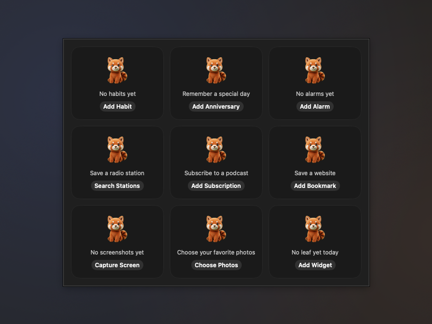

- **Red panda empty states with actions**: Habits, Anniversaries, Alarms, Radio, Podcasts, Bookmarks, Screenshots, Photos and an empty Basket share the existing red panda artwork, one caption and one working action. Buttons open add forms, search, subscription input, screen capture, folder selection or Add Widget. Narrow cards hide the caption and artwork before reducing to a button, without truncation. Not yet verified on a physical Mac.

- **System Now Playing for three audio sources**: Radio, Podcasts and Ambient Sound share one media session and pause the other two when starting. System controls support play, pause, toggle and stop; Radio switches stations, Podcasts navigate chapters or skip back 15 seconds and forward 30 seconds. Titles, show names, available artwork and progress appear in Now Playing. Live radio has no duration; stopping clears metadata and command handlers. Not yet verified on a physical Mac.

- **Readable offline quotes**: Stocks, Watchlist and Crypto keep offline captions at 9.5pt or larger. Narrow cards wrap or use "Offline", with the complete quote time in the tooltip and accessibility label. Weather's five Now captions and saved-style migration stay unchanged. Not yet verified on a physical Mac.

- **Time Progress and Habits are free, Watchlist gets bigger type, and Weather's seven styles become four**: Time Progress is now free: Ring, Percentage and Bars for everyone, while Liquid and the four-up grid stay Pro and are still marked Pro in Add Widget and the style menu; a Liquid or grid card already on the shelf no longer gets the lock overlay without Pro and draws as the ring instead. Habits is free for 3 habits: the fourth habit on and the 7-day report in the panel are Pro, and with 3 habits New Habit shows a lock and opens the paywall. Nothing is deleted for anyone who already has more than 3: the extra habits are dimmed with a lock in the panel and are read only (they can be viewed and deleted, not checked in, filled in, edited or moved into the first three), and when an earlier habit is deleted the next one moves up and becomes usable; on a side shelf the fourth row is dimmed and cannot be clicked too. Onboarding's Health adds Habits again; the Red Panda's Basket is still Pro, and the water, habit and focus it counts are now all free widgets. Whole Pro widgets go from 20 to 18. The wide Watchlist card goes from two columns of three to two columns of two (4 symbols), rows from 12pt to 18pt, and the symbol, price, change, the up and down count and Today are all at least 9.5pt and no longer shrink to fit; from a fifth symbol on, the last cell says "N more", and clicking the group name moves to the next group. The side shelf still shows one symbol per row. Weather goes from 7 styles to 4: Now gains a Caption option (city, conditions, wind, sunrise and sunset, or wind and sun times), Daily Forecast has a Days option (7 or 10), plus Hourly forecast and Multiple cities (still Pro). Conditions, Wind & sun times, Next 7 days and Next 10 days cards already on the shelf turn into the new style with the matching option when they load, at the same look and size. Within two hours of rain the Now style's caption says "Rain in about 40 min" first (from the hourly forecast's precipitation, rounded to 5 minutes), and goes back to the chosen caption once it is raining or the rain has passed. The Time Progress fallback, the free habit count and read only rules, the Watchlist rows and row height, the weather style migration and the minutes until rain live in Core with tests. Not yet verified on a physical Mac.
- **Sticky Note writing is bolder and larger, and readable on mid-tone paper**: the handwriting on the card was Hannotate W5 at 14 pt and shrank to 0.75 when it did not fit, which left barely 10 pt on a 58 pt card, with thin strokes that blurred on slate, kraft or coral paper. It now prefers the bolder Hannotate W7 at 15 pt (12 pt in a vertical shelf) and shrinks no further than 0.9, dropping a line with an ellipsis instead; when Hannotate is not installed (it is a download-on-demand font) it falls back to the rounded system font in semibold rather than the thin default. The ink is now chosen by contrast with the paper: whichever of the dark and light ink reads better, pushed towards black or white until it reaches the WCAG body text ratio of 4.5:1, with a test for every one of the sixteen papers; the large sheet you write on in the panel uses the same ink. Not yet verified on a physical Mac.
- **"Notifications are off · Turn on" next to reminder switches when macOS blocks them**: Stand-up, Water (when it is not using the pop-up card), stock price alerts, new podcast episodes, GitHub, Codex usage, Battery, makeup workday reminders and the virtual pet asked for permission once and never looked at the answer, so with Dockling's notifications turned off in System Settings the switch stayed on and nothing ever arrived. These switches now read the notification permission and, when it is off, show an orange "Notifications are off · Turn on" line that opens System Settings ▸ Notifications ▸ Dockling; nothing shows while the switch is off or permission has not been asked yet. Every place shares one view, and how the permission is classified and which switches count as notification switches live in Core with tests. Not yet verified on a physical Mac.
- **Market cards say "Offline · price at 10:32" when they cannot refresh**: Stocks, Watchlist and Crypto used to fade to 55% after a failed refresh without saying why. The card's bottom line now reads "Offline · price at 10:32" (with the date when it is not today; Watchlist puts the oldest stale time at the top right, Crypto gives up its 7-day line for it), and the card only fades to 70%. The panels show the same unplugged banner as Weather and GitHub at the top, with a button to fetch again right away (Crypto skips its five-minute wait). The time text and the oldest-time rule live in Core with tests. Not yet verified on a physical Mac.
- **Drop things straight onto AI Portal, Bookmarks and Sticky Note**: drag text or files onto AI Portal and a blue dashed outline reads "Ask AI about it"; dropping opens the ask panel with them in the field (plain text files bring their contents under a line with the file name, images and PDFs bring their path; when the notch chat is in web mode it goes to the clipboard to paste into the chat box). Drag a link onto Bookmarks and a teal outline reads "Add a bookmark"; dropping adds it at the end with its title from the link preview, and a duplicate or a full row of 8 beeps. Drag text onto Sticky Note and an orange outline reads "Add to the note"; dropping adds a line to the end of the front sheet. All three use the same four-colour dashed outline as File Shelf, AirDrop, Trash and Quick To-do. Composing the prompt, the duplicate check and adding a line live in Core with tests. Not yet verified on a physical Mac.
- **The English interface gives new widgets regional defaults**: English used to start with Chinese defaults. New Crypto widgets now price in US dollars outside mainland China, rises are green and falls red except in mainland China, Taiwan, Japan and Korea, gold and silver default to USD/oz, and the Slacker Clock's money uses the region's symbol ($ in the US, £ in the UK, € in the euro area). The Chinese interface is unchanged, and widgets already placed keep their own settings. The default bookmark that was translated to a second GitHub is now YouTube. The default rules live in Core with tests. Not yet verified on a physical Mac.
- **English reminder pop-up cards are no longer cut off**: in English the water line ended in "1000 / 2000…" and the hint below in "Raises the cup for 3…". The amount you have drunk is never truncated now, and "cups to go" moves to the next line when it does not fit; when the hint and buttons do not fit on one line, the hint takes its own line (up to two) with the buttons right-aligned below; the third line may wrap to two lines, and the English water and to-do hints are shorter. Not yet verified on a physical Mac.
- **Water reminders move to the background timer too, and clicking a pop-up card always opens its widget's panel**: a water reminder used to be scheduled only once the Water card had been drawn on the shelf, so a card in a folder or on another layout never reminded, and Snooze 15 minutes on the pop-up card scheduled nothing. Now, like countdowns, the background timer watches every Water widget on every layout (folders included) from launch, so reminders come with the shelf auto-hidden or the card on another layout, Snooze 15 minutes is picked up within a second, and a deleted Water card no longer fires once more on its old time; it still pops up once, never alongside a system notification. Clicking the body of a pop-up card (or a stock price or stand-up notification) now: slides an auto-hidden shelf out first and grows the panel from the card when it is on the shelf; grows it from the folder's tile when the card sits in a folder on the current layout, without opening the folder; and opens it as a free-floating panel at the top centre of the screen (where the pop-up card was) when the card is on another layout, only the Apple Dock is in use, or the card is hidden by its condition, without switching layouts. Changes in that panel are written back to the widget on its own layout, and it stays put when the shelf slides away. Where the panel hangs and how each second's water time is handled live in Core with tests. Not yet verified on a physical Mac.
- **Countdowns, alarms and reminders come due without their card on screen, countdowns and alarms pop a card too, and hovering a day shows the details**: countdowns, alarms, quick to-dos and reminders are now watched by one background timer in Dockling from launch, so they come due even when the shelf is auto-hidden or the widget sits in a folder or on another layout. Countdowns and alarms now also slide out the dark glass card: a countdown says "Noodles is done", when it ended and how long it ran, with Again (the same length once more) and Close; an alarm shows its name and time (a snoozed one also shows the time it was set for), with Snooze 9 minutes and Close, and snoozing on the widget and in its panel also moves from 10 to 9 minutes. The timers still chime on their own (every 4 seconds for 30 seconds on a countdown, for two minutes on an alarm, silent when the widget's sound is off); the speaker on the card names Glass or Sosumi and is struck through when the sound is off. Stopping, dismissing or snoozing on the widget tucks the card away, Esc on a countdown or alarm card means Close, and an alarm's card stays for its two minutes of ringing. Reminders are read from the system Reminders app (those due today with a time, from the lists the Reminders widgets are filtered to, only when one of them is on some layout, read again every 5 minutes, after midnight and when Reminders changes), and quick to-dos from the reminder times each to-do widget stores, so both pop up with the shelf away. Close to a due time and while something rings, Dockling asks macOS not to delay its timer, and saves power the rest of the time. Settings, Shelf, Sounds, Pop up a card when due adds Countdown and Alarm, on by default; turning one off keeps the chime and the orange card, just without the pop-up. Hovering the Calendar widget's day timeline or the Week widget no longer just swaps its title: a details card floats outside the widget with the title, the time (how long until, in progress or ended), the place or meeting service, the calendar's colour and name, and a Join meeting button while a linked meeting has not ended; the Week widget lists up to five events of that day with how busy it is. Moving the pointer onto the details keeps them up, a click on the widget tucks them away, and with Reduce motion they appear and disappear without fading. What just came due, whether it still rings, when to stay precise, which lists to read, the countdown and alarm card wording and the details card's text and placement live in Core with tests. Not yet verified on a physical Mac.
- **A batch of fixes: a stock alert opens that stock, metal alerts follow a unit switch, done to-dos are tucked away instead of deleted, and the Reminders panel adds Tomorrow and the next 7 days**: clicking a stock price alert notification opens that Stocks card's panel (the notification carries the widget id; water, stand-up and podcast notifications behave as before, every notification shares one handler, and a click that launches Dockling is caught too). After switching gold and silver between yuan per gram and dollars per ounce, alert prices you already set are converted with the exchange rate and 1 oz = 31.1035 g, keep their direction, and an alert that already fired does not fire again; if the rate has not arrived when you switch, the conversion waits for it, and until then those alerts are not compared against a price in the other unit. Quick To-do no longer deletes yesterday's finished items: they go to a collapsible "N tucked away" section at the bottom of the panel where you can view them, restore one as today's open item or delete it, and they are cleared 7 days after they were done; tucked away items are no longer marked for today and carry no reminder time. The global quick-capture box now finds a Quick To-do inside a group (one on the top level wins), and widgets inside groups no longer lose what they write. The Reminders panel adds Tomorrow and Next 7 Days below Overdue and Today, so an item pushed to tomorrow or next Monday moves to another section instead of vanishing; the notice only appears when it moves further out or loses its date, and the Reminders card on the shelf still covers today. Anniversary month abbreviations on the tear-off page and timeline are no longer hard-coded and come from the system date formats for the interface language (5月 in Chinese, May in English). With several sticky notes stacked, scrolling or swiping over the note flips forward and back (down for next, up for previous, one sheet per gesture; Command-scroll still switches layouts), and with Reduce Motion on the sheet changes at once without animation. Notification routing, alert price conversion, the tucked away list and its expiry, finding the to-do for quick capture, panel sections, month abbreviations and paging both ways are in Core with tests. Not yet verified on a physical Mac.
- **The AI Portal's mini ask panel gains clipboard relay, quick actions and saved prompts, widget panels get an Appearance row, and Battery's Status style draws a battery**: the small ask panel that opens from the AI Portal card now has the same row as the notch chat under its input box: Paste brings the clipboard's text into the box (on a new line after anything already typed, up to the first 20,000 characters), the Translate, Sum up, Polish and Explain quick actions, and saved prompts under Prompts. They use the input box first and the clipboard when it is empty, and the filled-in prompt goes to the chosen service like any question: API and web modes hand it to the notch chat (still Dockling Pro, so the Pro window opens until it is unlocked), jump mode opens the service with the question where it can or copies it first. With no text on either side it asks you to type or copy something. The line below previews the clipboard and brings it in when clicked, and Manage Prompts… opens Settings, AI. Both places share one view rather than two copies. Widgets with a color or background to choose now end their panel with an Appearance row showing a dot in the theme color and the current color and background (such as “Pink · Dark background”, or Default); click it to open the same Colors and Background block as Settings, Widgets right there, and the card on the shelf follows each change. The custom color and the gradient background are still Pro and locked until unlocked, a narrow panel fits fewer swatches per row and skips the preview cards, and the row starts collapsed every time the panel opens; picking in the system color panel no longer closes the widget panel. Battery's single-device Status style used to be a ring around the device icon; with the Classic and Liquid looks it is now a horizontal battery like Battery Cells (a battery outline with its terminal, filled to the charge, with water for Liquid), with the percentage inside it, inverted where it sits over the fill, a bolt before the number while charging, orange below 20% and red below 10% (the status line changes color with it), and the status and device name beside it, laid out for the 58pt card. Pixel, Particles and Red panda hug are unchanged, the saved settings are the same and existing cards simply draw the new way. What the quick action row shows, what the mini panel hands over, the appearance summary and swatch columns, and the battery's number, inversion and sizes are computed in Core with tests. Not yet verified on a physical Mac.
- **A card pops up when a reminder comes due, with quick actions, and quick to-dos can have a reminder time**: when a reminder, a water reminder or a to-do comes due, a dark glass card 380pt wide slides out under the notch. On the left is the character with a matching mood, the speaker in the top corner names that kind's sound (crossed out when it is set to Off, sounds are off, or Do Not Disturb, a Focus or screen sharing silences it this time), the first line says which kind and when, the big line is what to do, the third line is the time and where it came from, below are any others due at the same time, and the quick actions sit bottom right. Reminders (the ones with a time on the shelf's Reminders card) can be marked done, all done when there are several, or snoozed to 1 hour, tonight at 8 or the same time tomorrow, written straight back to Reminders. Water no longer sends a system notification while Dockling is running and shows this card instead, even when Dockling is not in front; the character follows the one chosen in Settings (the red panda has no drinking picture, so it stands), with eight small cups, drunk and goal, and cups to go, plus Add a cup (the cup size from Settings, logged as before, so the card's character raises its cup) or Later, 15 minutes. To-dos can be marked done (the red panda on the card still cheers for the last one) or put off 10 minutes. Each row in the Quick To-Do panel gains a small alarm, and Remind Me on its right-click menu: in 1 hour, tonight at 20:00, tomorrow at 9:00 or a custom date and time, or clear it; a row with one shows the alarm and time on the card, and existing lists load as before with no reminder. When a new day tidies the list, yesterday's finished rows go with their reminders; Move to today moves a reminder set for an earlier day to the same time today, or clears it if that time has already passed. Several of one kind due within a few seconds share one card, other kinds queue behind it with a layer showing underneath, and only one sound plays; Do Not Disturb, a Focus or screen sharing show the card without a sound. Left alone it tucks away after 30 seconds (fixed, not a setting), waits while the pointer is on it and stays at least 5 more seconds after the pointer leaves; Esc closes it while the pointer is on it, and clicking the card opens that widget's panel. On a display without a notch it sits centred under the menu bar; with Shiduo running the notch is left to it and the card sits under the menu bar on the right; it moves below the island when that is showing; with Reduce Motion it simply fades. Settings, Shelf, Sounds gains Pop up a card when due under Reminder sounds, one checkbox per kind, all on by default; turning Drink water off goes back to system notifications, and turning Reminders or To-dos off leaves just the sound. Merging, snooze times, storing and carrying over reminder times, whether to pop up, the auto-dismiss timer, the card's text and its placement are in Core with tests. Not yet verified on a physical Mac.
- **A soft chime when a reminder comes due, with a sound for each kind**: the switch and volume at the top of Settings, Shelf, Sounds now control all of Dockling's sounds (they used to cover only adding and removing widgets), and below them is a new Reminder sounds group: one switch, then a sound or Off for Reminders, Water and To-dos, each with Preview. The sounds are the alert sounds that come with macOS, Glass for reminders, Pop for water and Tink for to-dos by default. The water reminder's notification still carries a sound; while Dockling is running it plays the chosen sound instead of adding the system default on top, and with Off or the master switch off the notification is silent. On the Reminders card, a reminder with a time chimes the second it comes due; all-day reminders do not. Nothing plays during Do Not Disturb or a Focus or while the screen is being shared, several due within a few seconds chime once, and nothing catches up after the Mac wakes from sleep; Reduce Motion does not affect sound. Detecting a Focus needs Full Disk Access for Dockling, and screen sharing from meeting apps cannot be detected, so in those cases the chime still plays. Quick to-dos have no due time yet, so the to-do sound is kept for later and does not play for now. Choosing the sound, deciding whether to play, merging bursts and spotting what just came due live in Core with tests. Not yet verified on a physical Mac.
- **Red panda's basket: the monthly share picture is redesigned, and an empty month no longer shows a row of ×0**: the title now reads like "2026/10 basket" in English and 「2026 年 10 月的竹篮」 in Chinese, with spaces around the numbers, and the red panda in the top corner grows to 88pt, waiting while the month has no leaves and cheering once it does. An empty month says "Still an empty basket" on one line under the basket instead of over the weave, and the legend becomes "How to earn a leaf each day": all three met is a gold leaf, two of three a silver leaf, only one a bronze leaf, with two small lines below for fewer items (only two on: both met is gold too; only one on: met is bronze), matching the panel's rules. A month with leaves shows them in gold, silver and bronze at the basket's rim, "13 leaves in the basket" under it and the usual ×N per tier. The 31-cell frequency strip is replaced by one line, "18 days so far · 13 leaves", and an empty current month adds "Have a glass of water today and the first leaf arrives"; a past month counts all its days and days after today never count. In the calendar a missed day keeps a dashed leaf, today is a small green capsule with a faint dashed leaf, and days still to come show only the date. The bamboo moves to the top-right edge behind the red panda and no longer covers the calendar. The panel has since moved to the same basket and calendar (see the panel redesign entry), and its share button is greyed while this month has no leaves. Days so far, leaves so far, the empty-month check, the status line and each day's past, today or future state live in Core with tests. Not yet verified on a physical Mac.
- **Water panel: Today becomes a cup page, with the character standing beside the cup and filling up as before**: the panel keeps its four tabs (Today, Stats, Goal, Settings), and Today is now led by a large glass whose water level is today's progress, with drunk and goal beside it (such as 1250 / 2000 ml), how much is left in about how many cups, and eight small cups, then the last drink and the next reminder. The chosen character (all six work the same) stands beside the cup instead of peeking in small, and keeps the original water look: full colour below the surface, desaturated grey above, and a white wavy waterline between, at the same level as the cup, so both rise together when you drink. Its moods are unchanged: it raises a cup for three seconds after a drink, cheers when the goal is met, dozes outside the reminder hours or after three hours without water, and turns into a skeleton when parched until the next drink. Logging is the seven drink chips plus three cup buttons: Small 100, Cup and Large 500. Cup follows the cup size in Settings and the other two move aside to stay distinct, and Custom is still there; the selected drink and character are a little brighter with a white outline instead of a solid blue block. Below is today's timeline (one axis across the reminder hours with an icon per drink, now and the next reminder marked) and the list, which shows the newest three with Show all, Undo last cup at top right and a delete button on every row. The seven-day report moves into Stats; Stats, Goal and Settings are otherwise unchanged, and the character is picked in Settings with a lock on Pro characters. The card's Character style matches: the character stands beside the cup with the same grey and colour waterline, and the card grows from 200 to 224 wide. With Reduce Motion the rise and mood changes are instant and the panel's water holds still. Cup buttons, cups left, timeline ticks and the collapsed list live in Core with tests. Not yet verified on a physical Mac.
- **Unit Converter, Currency and Calculator merged into one card, 算 (Calc)**: the three cards looked alike, so you had to decide which kind of sum it was before you knew which to add. Now there is just Calc, and its panel has one field that works out what you typed. With a currency (100 USD, 100美元, ¥500 to EUR, $20, 1万日元) it converts money, with the same rate source as before and the cached table offline. With a unit (5 km, 3 斤, 72°F, 10 in to cm) it converts length, weight or temperature, by Chinese or English name. Anything else is a sum (3*4+2, brackets, powers), and 200+10% comes to 220. Give only one side and money goes to the other half of the currency pair in Settings (US dollar and yuan by default), while units go to the usual counterpart (km to miles, jin to kg, °F to °C). The card is 184 wide: a purple 算 badge, your input in small type with a Currency, Unit or Math tag at top right, and the result in large type with its unit. Click the number to copy it (without thousands separators); click elsewhere to open the panel. The panel has the field, the result (with the unit rate for money), Copy Result, Pin to Card (pin 1 USD to keep an eye on the rate) and a mixed recent list where a click works a line out again. Cards you already placed turn into Calc where they stand and keep their last input: the converter's unit pair becomes the default pair, the currency card's pair becomes the default currency pair, and the calculator keeps its sum. Add Widget lists only Calc, and searching for converter, currency or calculator finds it. All three were free and Calc stays free. Recognition, conversion, migration and the recent list live in Core with tests. Not yet verified on a physical Mac.
- **Volume, App Volume and Now Playing each do one job, and Mini, wide Photo Frame and the tall AI Door each get their own focus**: the three cards that touch sound are split, and Add Widget says which does what. Volume is where sound comes out and how loud: a row of output devices on top (MacBook speakers, AirPods, a display and so on, each with an icon for how it connects); click one and it becomes the system's default output, just like choosing it in Control Centre, with no trip to System Settings. With more than three devices the last slot is “…” and lists them all. Below is the master volume, and the speaker mutes. App Volume is for whichever app is too loud: each app playing sound gets a cell with its icon, name, percentage and its own bar in the icon's main colour; drag a cell left or right on the card to set it from 0 to 150%, with a small tick at 100% that it snaps back to, and press and hold the icon to mute. Changed apps come first, up to four cells, then “N more”. It really changes the sound, through the existing system audio tap: the first time an app moves off 100% macOS asks for audio recording permission, and if that is refused the line under the cells reads “Needs audio recording permission, click to open Settings”. Now Playing is just about the song, with no volume. The Mini style drops the cover and keeps the play key and a row of bouncing bars, which settle into a low row when paused and hold still with Reduce Motion. The wide Photo Frame is now “photo + on this day”: it cycles through photos in your library taken on this day in earlier years, with “On this day” and “2024.10.18 · Hangzhou” along the bottom and dots for the slideshow; the place is the photo's location looked up as a city, or just the date when that fails. It asks for Photos access the first time it appears on the shelf; without access, or with no photos from this day, it keeps cycling the folder and writes the date a picture carries. The standard Photo Frame is still just the photo. The tall AI Door is now one large red panda with “Ask AI” and the default service; clicking anywhere asks the default AI, and the service tiles stay on the wide card. Mini, wide and tall cards already on the shelf keep their style and width and simply draw the new way. Output device icons and order, the drag maths for app volume bars, the on-this-day date ranges, reading the date and coordinates from a picture, and the place and date text are computed in Core with tests. Not yet verified on a physical Mac.
- **Battery, Ring Gauges and System Activity no longer look like three rings, and System Activity and Network styles are trimmed**: Ring Gauges is now the only widget that draws rings, and its job is mixing any metrics: alongside storage and battery it can now show CPU and memory (tick them under the widget in Settings, Widgets; its heading in Add Widget says “Mix any metrics”). Battery's Percentage ring is renamed Battery Cells and the classic look draws an actual battery: with one device it is a horizontal battery filled to the charge, with the percentage and status beside it and a bolt while charging; with Bluetooth devices connected each gets an upright battery with its percentage below. It stays uncoloured until it drops below 20% (orange) or 10% (red), and a disconnected device is an empty dashed outline. The Liquid look draws a battery holding water; Pixel, Particles and Red panda hug are unchanged, and Battery Cells is still Pro. System Activity's Ring style is renamed Segments: an eight-step bar per reading that lights up with the load, next to a large number and its name. System Activity's Numbers and Numbers + graph are now one Numbers style, Network's Numbers only and With chart are now one Speed style, and the chart is a Show chart switch in Settings. Widgets already on the shelf move over on their own: old Percentage ring and Ring cards become Battery Cells and Segments, cards that had a chart keep the switch on, and sizes and positions do not change. The segment count, battery orientation and colours, and the gauge order live in Core with tests. Not yet verified on a physical Mac.
- **Widget panels are no longer cut off**: a panel used to take the height it measured the moment it opened and only had its position clamped to the screen, so a panel taller than the usable screen lost its top; content that arrives after opening (events, reminders, quotes) made it taller without the window growing, so its bottom was cut; and with several displays the screen was picked by the panel's corner, falling back to the main display when that corner was off screen. Panels now follow their content's height, up to the usable area of their screen minus a margin (on a bottom or top shelf, only the space on the shelf's open side, so the shelf stays uncovered); anything taller scrolls inside the panel, with a fade at the bottom hinting at more. The size and position are worked out again when content grows or shrinks after opening, when a setting changes and when displays change. Panels open on the screen of the widget they belong to and stay entirely on it, including near the ends of a side shelf. The content of each widget's panel is unchanged. Sizing and placement are computed in Core with tests. Not yet verified on a physical Mac.
- **Capture, Screenshots and Color Picker each do one job**: Capture is for actions, four buttons each with a short label: Area, Window, Text (the same tool as Text from Screen in Quick Toggles, still Dockling Pro and locked until unlocked) and Record (records the whole screen; the button turns red with a timer under it, click again to stop, and the file, named starting with “录屏”, goes to your screenshots folder; the first time, allow Screen Recording in System Settings). The card grows from 136 pt to 184 pt, the old full-screen button is gone (⇧⌘3 still works), and clicking empty space on the card still opens the system Screenshot app. Screenshots is for results: the newest capture large with how long ago it was taken, the next ones in a 2×2 grid beside it and “+N” in the last cell when they do not fit; drag any of them straight into a chat, an email or a folder, while the gaps around them still move the card. The card grows from 132 pt to 184 pt. Color Picker is for recent colors: a row of six swatches, click one to copy its HEX, with the newest color and an eyedropper below. The card grows from 136 pt to 160 pt. Text and Color Picker stay available in Quick Toggles, and their tooltips now say they are shortcut buttons; colors picked from Quick Toggles go into the Color Picker's recent colors too, one history shared by the card, its panel and Quick Toggles, with the colors a card kept before appended so none are lost. In Add Widget each of the three now says what it is for. The four actions, file names, the recording timer, the large-plus-grid layout and the shared color history live in Core with tests. Not yet verified on a physical Mac.
- **Water shows the level, Virtual Pet shows the pet, and characters leave Add Widget**: both cards used to be a character on the left, two lines of text and a round button, so side by side they looked like the same card twice. Water's Character style now leads with a glass: its level is today's progress, the chosen character shrinks to a head peeking over the rim (it still raises a cup after a drink, cheers at the goal, dozes outside reminder hours and turns into a skeleton when you have gone too long without water), and beside it are the big “1250 / 2000 ml” and a row of 8 small cups that lights at most 7 until the goal is met. The ring and liquid looks and the personal goal are unchanged. Virtual Pet's character grows to about 54pt, the full height of the card, next to “Red Panda · a bit hungry” and four small cells for Food, Mood, Energy and Clean, each with its own bar, the most urgent one in red. Click a cell to feed, play, put to bed (or wake) and wash; the card's old feed button is gone, and healing, reminders and the character are in the panel. The six characters are no longer listed as styles in Add Widget: Water lists Character, Ring and Liquid, Virtual Pet lists one card, and the character is chosen in the panel or in Settings ▸ Widgets. In Water the shiba and the ginger cat now unlock after 3 and 7 days of meeting the goal; the penguin, otter and octopus are still Pro. Cards already on the shelf keep their character and read back as the Character style with it, so they look the same. With Reduce Motion the level and the cups jump to the new value. The cup count, what each cell does and which one is marked live in Core with tests. Not yet verified on a physical Mac.
- **Drop targets say what dropping does, and Sticky Note becomes real paper**: With something dragged over File Shelf, AirDrop, Trash or Quick To-do, the dashed outline and the icon share one color, and the color is the outcome: File Shelf is teal, “Keep it here / 3 files”; AirDrop is system blue on a very faint fill, “Send to nearby devices / 3 files · release to pick a device”; Trash is red, “Move to Trash / 3 · you can still get them back” (the old “Release to delete” is gone, since nothing is deleted); Quick To-do is orange, “Add a to-do / Text, links or files”, and no longer covers the list. In a vertical shelf the icon sits on top and the outcome takes two lines; on release the card returns to normal, and the File Shelf and Quick To-do panels use the same colored outline. Sticky Note is now a paper card: small corners, a strip of tape on top, a curled bottom right corner, and handwriting in the system's Hannotate SC when it is installed (the system font otherwise). One note holds up to 3 sheets, each in its own color, with the sheets behind showing at the edge; tap “1/3” in the corner for the next one. Notes cannot be checked off and are never cleared. Paper colors are no longer 15 cards in Add Widget: they are picked in the note's panel (this sheet's color, Next, New Note, Tear Off) and in Settings, Widgets, and a color change applies to the top sheet only. The free colors are still Cream, Mint, Peach, Lavender and Lemon, the other ten stay Pro. Notes already on the shelf keep their color and text and read as one sheet. The drop prompts and the note stacking, flipping and migration live in Core with tests. Not yet verified on real hardware.
- **Stocks, Watchlist and Crypto each do one job, plus gold and silver**: Stocks follows one symbol. On the left are the ticker and its Chinese name, the price in large type, the change in percent and points; on the right is today's chart across the whole session (a morning's trading fills only the morning), a dashed line at the previous close (above it means up) and small volume bars along the bottom, with Trading or Closed in the corner. You can set price alerts: enter a price in the panel, above the current price for a rise or below it for a fall, as many as you like, or write AAPL>237 in Settings. The card draws a thin orange line and reads “2.1% to alert” in the corner; when the price is reached you get one notification and the card flashes orange. With several symbols the card rotates every 10 seconds (this can be turned off), with dots along the bottom; click a dot, or a symbol at the top of the panel, to jump to it. The Stocks card is 228 pt wide, or 124 pt with the chart off. Watchlist compares a group: on top are the group name, “Up 5 Down 3” and a red and green ratio bar; below are two columns of three rows sorted by change from highest to lowest (or as entered), each with the symbol, a small chart of today, the price and a solid change chip that deepens with the size of the move, and “N more” in the last slot when they do not fit. The card is 320 pt wide. Create groups in the panel with + Group (a name and a list of symbols, such as Tech or China A-shares), click a group name to switch, right-click to edit or delete, or click the group name on the card for the next one; Settings also takes “Tech=NVDA TSLA”. Fill in holdings in Settings (such as NVDA 100) to see today's P&L; without them that part stays hidden. Crypto gives each coin 96 pt: a round badge in the coin's colour with its letter, a solid 24-hour change chip, the price and a 7-day line underneath, dashed at the price 7 days ago, with the 7-day change in the corner. All three widgets share the same up/down colours setting, Stocks and Watchlist now default to red for up as well, and the green-for-up that Stocks had built in is gone. Stocks and Watchlist add + Gold and + Silver under the symbols setting (international futures GC=F and SI=F). The card names them Gold and Silver and by default shows CNY per gram at the USD/CNY rate (1 ounce = 31.1035 g), falling back to USD per ounce until a rate arrives; the panel and Settings switch to USD per ounce. Stocks, Watchlist and Crypto remain part of Dockling Pro. Sorting, the up/down count, chip depth, distance to an alert, one notification per alert, chart positions, groups, today's P&L and the precious metal conversion are computed in Core with tests. Not yet verified on a physical Mac.
- **Calendar, Week and Lunar & Holidays each do one job**: Calendar is about today and the next meeting. Next Event shows “in 25 min” and the start time, then the meeting name and “10:30-11:15 · Room 3”; when the event has a meeting link (its URL, or a Tencent Meeting, Zoom, Teams, Feishu or Google Meet link in the location or notes) a green Join button appears, and none without a link; the last line reads “Then 14:00 Design Review”, and a meeting under way shows “In progress · 20 min left”. Date + Agenda is replaced by the new Today's Timeline (300×62): one axis from 9:00 to 19:00 that grows by whole hours for earlier or later events, each event a block in its calendar colour sized by its length, overlaps on two rows, the past dimmed and a red line for now, with “3 left today” and “Next in 25 min” above it; pointing at a block shows its name, time and source, and clicking a block with a meeting link joins it. Placed Date + Agenda cards become Today's Timeline automatically. The Date style adds a row of dots, one per meeting, fading once it is over. Week now shows busy and free by time booked: two cells a day, afternoon on top and morning below, full at 4 hours, “21.5 hr booked this week” in the title and the freest afternoon left this week in green (workdays follow the public holidays and makeup days), today's column lightly shaded and past days dimmed; pointing at a day shows how long it is booked and when it is free from, with that day's events in the tooltip, and clicking a day opens it in Calendar (the first time asks for Automation access to Calendar). Lunar & Holidays says one thing at a time, by priority: a makeup workday coming up turns the line red, “Work next Saturday / 10/10 makeup workday”, with a notification at 20:00 the evening before; on a solar term or traditional festival it reads “Today: Frost's Descent” with the lunar date; otherwise “National Day in 12 days / From 10/1, 7 days off in a row”. Settings adds Remind ahead (3, 7 or 14 days, 7 by default), and the two switches are now Show solar terms and Makeup workday reminder. The panel shows this month's calendar (days off, makeup days, solar terms and festivals, today outlined) and the solar terms and holidays coming up. Holiday and makeup dates come only from the State Council data already in the app. Meeting link detection, countdowns, timeline layout, busy hours, the freest afternoon and the reminder priority are computed in Core with tests. Not yet verified on a physical Mac.
- **Clock styles trimmed from 12 to 8, and easier to extend**: Add Widget now lists eight Clock styles: Standard, Analog, Flip, Pixel, LCD, Chinese, Neon and Photo. LCD is the former Simple, renamed only. Look-alikes became options, set under the clock in Settings, Widgets: Big digits is now Standard with Size: Large and Weight: Bold; Seconds ring is Analog with Dial: Seconds ring; Folding flip is Flip with Flip motion: Fold; Minimal is Flip with Cards: Large with h, m, s, still Pro. Each option only shows under its own style. Clocks already on the shelf in Big digits, Seconds ring, Folding flip or Minimal are read as the matching style and options and look the same. In the code the clock styles are now one registry (name, Pro or not, options, mapping from old styles), so a new style is one entry plus one drawing view, and the Pro check follows the registry; the registry and the old-style mapping live in Core with tests. Not yet verified on a physical Mac.
- **Counting time left, split by scale**: Countdown covers “within minutes”, Alarm “a time today”, Time Progress “year, month, week, day as a percentage” and Anniversaries “by the day”, and each card in Add Widget now says which. The Countdown card is 168 pt wide: when idle, click 3, 5 or 10 min to start right away (edit the three presets in the panel; the last one used is highlighted). While running it shows a large figure, “Noodles · 3 min total” and a thin progress bar, with pause, resume and cancel on the card. When time is up the card turns orange, shakes for a while and plays a sound; click anywhere on it to stop. With Reduce Motion it only changes colour, and the sound can be turned off in Settings. One Alarm card now holds several alarms (a placed single alarm becomes the first in the list) and is 220 pt wide: the next one stands out, such as “14:30 Call Wang · In 2 h”, the later ones sit on one small line, and the bell turns the next one on or off. When an alarm rings the card turns orange with Snooze 10 min and Turn Off right on it; it chimes every 4 seconds for two minutes and stops by itself after ten. The panel is one list to add, delete, switch and edit alarms. Time Progress gains a Four Bars look showing year, month, week and today together. The Focus Timer is the only card that keeps a ring: a dot in the middle and a row of dots for the round. A finished focus session now moves straight into a break (a long break after a full set), and the break ends back on focus, waiting to start. During breaks the card turns green and says “Stand up and move”. Settings, Focus Timer adds “Remind me to stand up on breaks” (on by default): while it is on and the timer runs, the stand-up reminder stays quiet, and the end of a focus break counts as standing up. The Stopwatch is a wide figure with hundredths and the last three laps beside it, the fastest in green, with start, lap, pause and reset on the card; the narrow card shows only the figure, and the panel lists every lap. The stand-up reminder is now the red panda: it dozes while you sit, with “Sitting 48 min”, “Nudges you at 60 min” and six cells of time sat; when it is time the card turns pink, the panda stretches and I'm Up logs a break; while the Focus Timer runs the panda lies low. The next of several alarms, snoozing, laps and the fastest lap, the four percentages, focus rounds and the stand-up and focus hand-off are computed in Core with tests. Not yet verified on a physical Mac.
- **The single and multi Anniversaries cards now look nothing alike**: the single card is a tear-off calendar page. On the left a small white page has the name on a strip in the date's colour, the day in large type and the month below, in lunar terms for lunar dates; on the right are “since” or “to go”, the day count and a short line: “Year 8 · next anniversary in 214 days” when counting up, or the weekday and “yearly” or the year when counting down. On the day itself (a countdown that arrives, or an anniversary when counting up) the card takes a pale wash of the date's colour, the red panda cheers, it reads “Today” (or “8 years!”) and suggests clicking to make a share image. When the day changes after midnight the old page flips away and the new one shows; with Reduce Motion it simply fades. The setting “Show progress ring (single style)” is now “Show calendar page (single style)”; turned off, only the text remains. The multi card is now a Next 12 Months timeline: the title shows how many dates fall within the year, and the axis runs from today to a year from now with month ticks and quarter labels. Each date is a dot in its colour; the nearest is larger and labelled with its name and days, the others are labelled where they fit and otherwise drawn as dots. Count-ups sit on their next anniversary; dates more than a year away and one-off countdowns that have passed are left off. Clicking a dot (whichever is nearest) opens its page, clicking empty space opens the timeline, and pointing at a dot shows its name and date beside the title. The multi card is a fixed 236 pt wide and the single card 188 pt. On side shelves the single card is a tall tear-off page with the day count, and the multi card lists the nearest three on a short rail, each row opening its date. The widget library previews use the new looks. Positions on the axis, month ticks, label spacing, nearest-dot clicks and the page text are computed in Core with tests. Not yet verified on a physical Mac.
- **Reminders can be edited, in sync with Reminders and your iPhone**: the Reminders widget now reads and writes the system Reminders, which iCloud syncs to your iPhone. In the List style each row starts with a circle; click it to complete the reminder, and overdue circles and times are red, with “Yesterday” for yesterday's. Next Reminder shows a countdown such as “in 40 min · 15:00”, and hovering the card shows Done and Snooze 1 Hour (from the due time if it is still ahead, from now if it is late). Count is renamed Today Overview and shows two big numbers side by side, overdue (red when there are any) and due today; placed cards keep working, only a little wider. The panel can now edit: + New Reminder at the top; click a row to edit it in place (title, date and time, both optional, priority None, Low, Medium or High, and list), press Return to save, or delete it there; the context menu has Move to Tomorrow, Move to Next Monday, Snooze 1 Hour, Done, Edit and Delete, keeping the time of day. Saving something not due today says so in a line, and moving a due time moves its alert too. With a list chosen for the widget, the panel shows only that list and new reminders go into it. The card never raises a permission prompt; access is asked for the first time you open the panel. In Add Widget, widgets that need a system permission no longer show a small lock; the permission is named in the card's tooltip instead (Pro capsules are unchanged), and the Reminders heading says “Syncs with Reminders”. Relative times and the postpone dates are computed in Core with tests. Not yet verified on a physical Mac.
- **Quick To-do becomes “jot it down, clear it today”, apart from Reminders**: Quick To-do needs no permission and never syncs, with no dates or times, and its heading in Add Widget now reads “Jot it down, never synced”. The card shows Today's three: star up to three items in the panel (or right-click, Mark for Today) and the card shows them first, with how many are done out of how many are marked in the corner and a circle on each row to tick it off; with nothing marked it shows the first open items. Drop text, a link or a file on the card or the panel and a dashed outline reads “Drop to add a to-do”; links and files keep their address and open from a small button on the card and in the panel. Settings, Shortcuts adds Add a Quick To-do (not set by default): it opens a small field near the top of the screen, and Return adds the line to the first Quick To-do on the shelf; Esc or a click outside closes it. Each new day, items finished yesterday are put away on first display, and the panel asks about yesterday's unfinished ones: move them to today or give them up. With everything done, the card shows the red panda, “All clear today” and the streak of cleared days. Right-click, Move to Reminders creates a system reminder for today, tomorrow, a chosen date or no date, then removes the item; Reminders access is only asked for at that moment. Today's three, the daily clear-out and the streak are computed in Core with tests. Not yet verified on a physical Mac.
- **Anniversaries open differently from the single and multi cards, with a page per date and a share image**: the single card opens a page for the date it shows, with a large ring for this year's progress (and which year it is when counting up), the name, the day count, the start date and weekday, and the days to the next anniversary. Below are milestones: days 100, 520, 1,000, 1,314, 2,000, 3,000, 5,000 and 10,000 when counting up, or the days 100, 30, 7 and 1 days before when counting down, each with its date and weekday, ticked and dimmed once passed, with a dot on the next one; then the next four anniversaries (which one, the date and weekday, and the days left, with the lunar date for lunar events). “‹ Anniversaries” goes to the timeline, “Switch” changes the date pinned to the card, and the bottom has Edit (the existing editor), Share Image and Manage All Dates. The share image is a tall card in a dark gradient of the date's colour with the red panda, the name, the big number, the date range and “Dockling”; save it as PNG or copy it, free. The multi card still opens the timeline, now with a This Month summary on top (how many dates fall this month and the days to the nearest, click to open it); clicking a column on the card opens that date's page directly, and the column under the pointer lights up a little, on side shelves too. The timeline's context menu adds Open Its Page. Milestones, anniversaries and the month summary are computed in Core with tests. Not yet verified on a physical Mac.
- **No more white scroll bar over panels**: with “Always show scroll bars” or a mouse attached, dark panels such as New Habit, Anniversaries, To-do, Water, Radio and AI drew a light scroll bar over their icons and colours. These panels now hide the scroll bar and still scroll with a wheel or trackpad; New Habit fades out at the bottom to show there is more. Not yet tested on a real Mac.
- **Dockling Pro locks the rest, with trial reminders**: Text from Screen, QR Code, Presenting, Lock Keyboard and Low Power Mode in Quick Toggles are now really locked. Until Pro is unlocked they stay listed in Settings with the Pro capsule, and ticking one opens the Pro window; one already on a card is dimmed with a small lock and opens the Pro window instead of running. Presenting, Lock Keyboard or Low Power Mode left on from the trial can still be turned off. The AI notch chat opens the Pro window instead of the chat from the notch or the shortcut, and so does turning it on in Settings, AI; the AI card's red panda falls back to the old ask panel, opening websites and apps stays free, and asking in web or API mode opens the Pro window. The battery charge limit's switch and the install and update helper buttons open the Pro window; a limit that was on stops applying (the helper is told it is off, so the battery charges normally) and comes back by itself once Pro is unlocked. A one-time in-app notice appears when one day of the trial is left and again once it has ended, with a button that opens the Pro window to buy or enter a gift code; activated Macs and former supporters never see it. The Pro window lists the new Pro tools. Former supporters stay unlocked. Not yet verified on a physical Mac.
- **Dockling Pro covers more, and Add Widget groups cards by widget**: App Volume, Recorder, Stocks, Watchlist, Crypto, Wallpaper, Radio, File Shelf and Translate, alongside Slacker Clock, Ambient Sound, Podcasts, Trash, GitHub, App Switcher, Codex Usage, the Red Panda's Basket and Virtual Pet: 18 Pro widgets and 40 free ones. Time Progress is free, with Liquid and the four-up grid in Pro; Habits is free for 3 habits, with the fourth onward and the 7-day report in Pro. The multi-city Weather style and Battery Cells are Pro, badged in the library and style menus. A placed multi-city card shows the lock until Pro is unlocked; Battery Cells falls back to the free look. Sticky Note keeps its five lightest papers free (Cream, Mint, Peach, Lavender and the default Lemon), the other ten are Pro, and a placed note on a Pro paper falls back to Lemon. In Settings, Widgets, Colors and Background, the presets stay free while the custom color and the gradient background are Pro. Clearer card names: AI Portal (Wide) and AI Portal (Tall) for the AI Assistant, Standard Photo Frame and Wide Photo Frame for the photo frame; only the names changed, placed widgets are untouched. Each category in Add Widget now shows one small heading per widget (with a Pro capsule for whole Pro widgets and a style count), separated by a thin line; search results and Recommended stay flat, and the up and down arrow keys follow the rows as drawn. Onboarding no longer adds Radio, which is now Pro, and Entertainment adds Music and Photo Frame instead; Habits is free for 3 habits, so Health still adds it. Not yet verified on a physical Mac.

## Install

1. Download the latest `.dmg` or `.zip` from the [Releases page](../../releases)
   and move `Dockling.app` to Applications.
2. **The build is not signed or notarized**, so macOS 26 warns the first time you open it:
   - Double-click it, then close the warning;
   - Open **System Settings > Privacy & Security** and click **Open Anyway** next to Dockling;
   - Authenticate and confirm.

   Or remove the quarantine attribute in Terminal:

   ```sh
   xattr -dr com.apple.quarantine /Applications/Dockling.app
   ```

3. **Look in the menu bar on first launch.** Dockling is an accessory app with no Dock icon and no main window.
   Settings, the widget library and layout switching live in the menu bar icon.

### Known limitations

- An ad-hoc signed accessory app gets no location prompt from macOS, so enter a city for the Weather widget in **Settings > Widgets**.
- Now Playing needs Dockling allowed under **Privacy & Security > Automation**; reading browser tabs also needs "Allow JavaScript from Apple Events" in the browser's Develop menu.
- Lunar dates, solar terms, the "Chinese" clock face and the End User License Agreement stay in Chinese in the English interface.

## Build from source

You need macOS 26 and Xcode. The Xcode project is generated from `project.yml` and is not in the repository:

```sh
brew install xcodegen
xcodegen generate
xcodebuild -scheme Docket -configuration Release build
```

Interface text lives in String Catalogs under `Resources/Localization`. Simplified Chinese is the source language and English is the translation. At runtime the development region in Info.plist is English, so languages Dockling does not ship fall back to English, and the Traditional Chinese and Hong Kong tables carry the Simplified text.

## How the screenshots are made

Every image in this README is taken by the screenshot tool in this repository: `Tools/Shots` puts the app's real shelf and panels in real windows on screen, and `scripts/capture-shots.sh` captures them with `screencapture`. They are not mockups and no number is edited by hand.

Run `scripts/capture-shots.sh` for the Chinese interface (written to `docs/images/zh`) or `SHOTS_LANG=en scripts/capture-shots.sh` for English (written to `docs/images/en`). It needs Screen Recording permission for your terminal and takes a few minutes. The **Actions > Screenshots** workflow takes both sets on a GitHub macOS runner and uploads them as an artifact.

## License

[MIT](LICENSE) for the original Docket code. Dockling's own additions are covered by [LICENSING.md](LICENSING.md) and the [EULA](EULA.md).
Third-party attribution and trademarks are in [NOTICE.md](NOTICE.md).
Dockling is not affiliated with, endorsed by, or sponsored by Dockset, CoolDock, upstream Docket or their authors.
