<div align="center">


# Dockling 码头

### A free, open source Dock shelf for macOS, in English and Simplified Chinese.

**Website: [docket.shiduo.app](https://docket.shiduo.app)** · [简体中文](README.md) | English

Put a shelf of live widgets, app groups and folders next to the macOS Dock,
or use it in place of the Dock.

[](#build-from-source)
[](project.yml)
[](LICENSE)

<br>

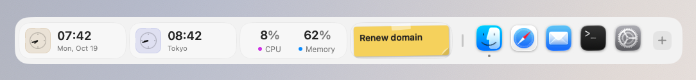

<sub>Screenshots show the app's own English interface, taken on macOS by the screenshot tool in this repository (see "How the screenshots are made" below).</sub>

</div>

---

## What it is

Dockling (formerly Docket 中文版) is an **unofficial fork** of [Docket](https://github.com/nparashar150/dockset),
an MIT licensed open source macOS app. It started as a Simplified Chinese localization and has grown into its own app:

- The interface is available in **Simplified Chinese and English** and follows the system language.
  If your preferred languages include neither Chinese nor English (French, Japanese, German and so on),
  Dockling shows English; Traditional Chinese, Hong Kong and Taiwan show Simplified Chinese.
  You can also pick a language in **Settings ▸ General ▸ Language**.
- It builds for anyone who clones it: ad-hoc signing and its own bundle ID (`com.docket-zh.app`),
  so it can be installed next to upstream Docket.
- Dozens of new widgets, clock faces and weather views, shelf looks, per-widget conditions,
  shrink to fit, and three ways to switch layouts.

The basics it shares with upstream:

- **Follows the real Dock**: size, edge, magnification and auto-hide are read live from System Settings.
- **App groups**: drag one icon onto another and hold to make a group, like on iOS.
- **Layouts**: save several and write them back to Apple's Dock (only `persistent-apps` changes, with verification and rollback).
- **Click a widget to open its details panel** with more information and actions.

---

## Features

More than fifty widgets, grouped by use. Mix them freely on one shelf.

- **Apps, files and quick access**: app groups, folders, Downloads, File Shelf, Clipboard, Screenshots, Photo Frame, Bookmarks, App Switcher, Shortcuts, Search.
- **Productivity and focus**: Calendar, Week Agenda, Reminders, Quick To-do, Sticky Note, Focus Timer, Habits, Stand Up reminders, Anniversaries, Time Progress, Slacker Clock, AI Assistant, Translate, Codex Usage, GitHub.
- **Mac control and system**: Battery (with charge limit and battery alerts), System Activity, Network Activity, Gauges, Volume, App Volume, Microphone, Quick Toggles, Wallpaper, Trash, Mail.
- **Handy tools**: Calc (calculator, unit converter and currency in one), Color Picker, Emoji, Capture, Recorder, AirDrop.
- **Media and fun**: Now Playing (Apple Music, browser tabs, NetEase Cloud Music, Xiaoyuzhou), Radio, Podcasts, Ambient Sound, Virtual Pet, the Red Panda's Basket, Water.
- **Time, weather and markets**: Clock and World Clock, Weather and forecasts, Lunar & Holidays, Stocks, Watchlist, Crypto.
- **Live Alerts**: a small capsule below the notch for volume, brightness and upcoming meetings.
- **Dockling Pro**: a one-time purchase that unlocks extra widgets and looks. The basics are always free.

## Screenshots

<sub>Widgets on the shelves below show the widget library's own sample data, so nothing is read from the capture machine's calendar, music or files. Panels marked "sample data" do the same; the rest are live readings taken at capture time.</sub>

**Apps, files and quick access**

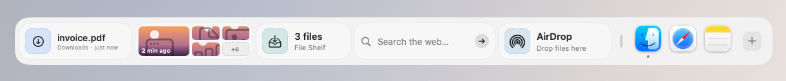

**Productivity and focus**

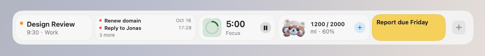

**Mac control and system**

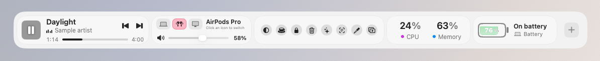

**Handy tools**

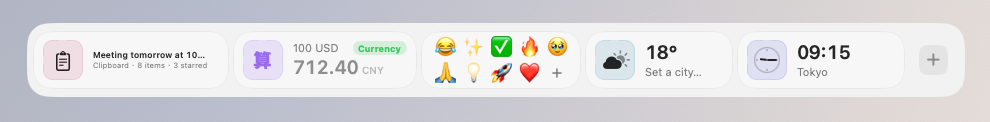

**Shelf looks**: dark glass with monochrome widgets.

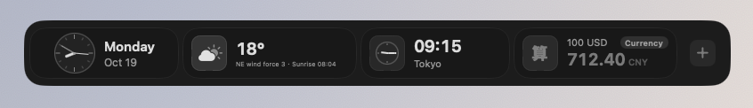

**Liquid looks** (Dockling Pro): Time Progress, Water, Focus Timer, System Activity and Battery as a glass of water that fills with progress, load or charge.

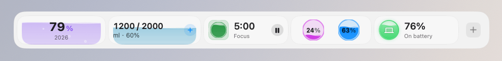

**Colors and backgrounds**: fifteen preset colors, a custom color or the system accent, on a dark, frosted, gradient, dotted or lined card.

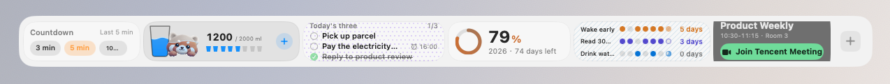

**World clocks with a city picker**

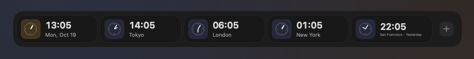

**New quick tools**: Text from Screen, QR Code, Color Picker, Mirror, Presentation Mode and Keyboard Lock, next to the AI Assistant card and Capture.

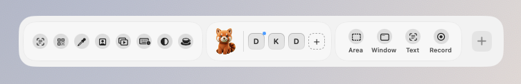

<p align="center">
  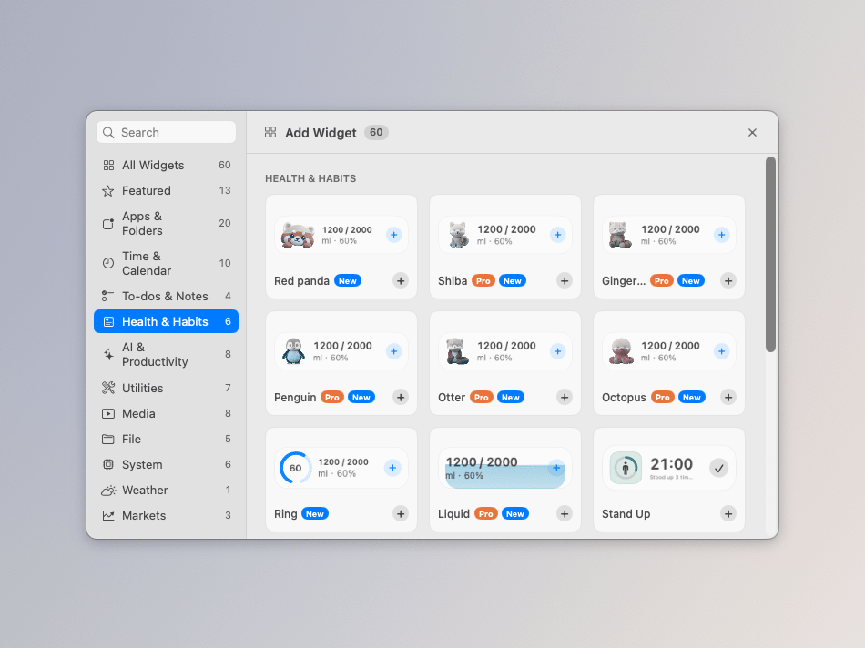<br>
  <sub>Add Widget: category sidebar and Pro capsules</sub>
</p>

<table>
  <tr>
    <td width="50%" valign="top">
      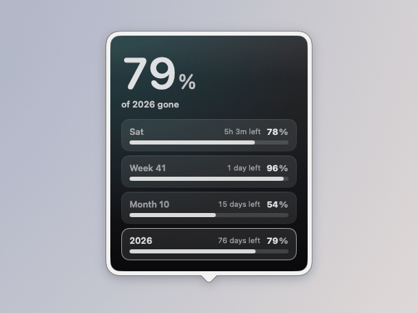
      <p align="center"><sub>Time Progress: day, week, month and year</sub></p>
    </td>
    <td width="50%" valign="top">
      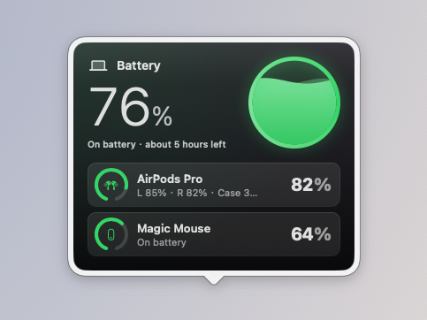
      <p align="center"><sub>Battery: the Mac and accessories (sample data)</sub></p>
    </td>
  </tr>
  <tr>
    <td width="50%" valign="top">
      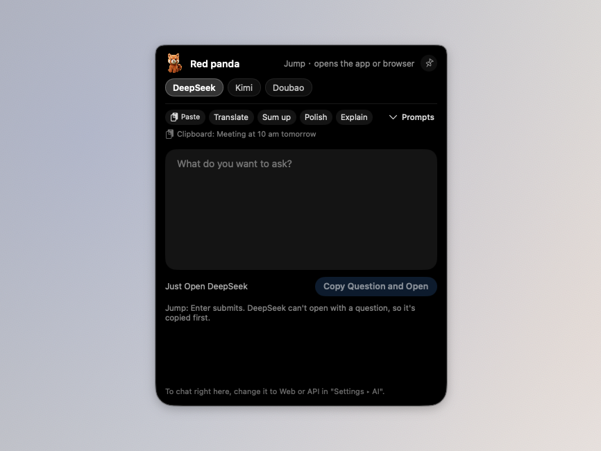
      <p align="center"><sub>AI chat that grows out of the notch (Jump mode)</sub></p>
    </td>
    <td width="50%" valign="top">
      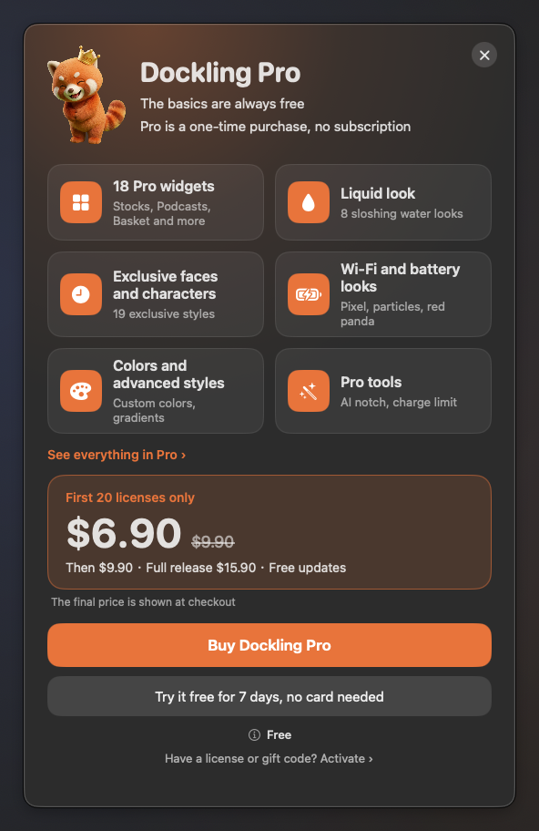
      <p align="center"><sub>Dockling Pro: features, trial, purchase and license key</sub></p>
    </td>
  </tr>
</table>

<p align="center">
  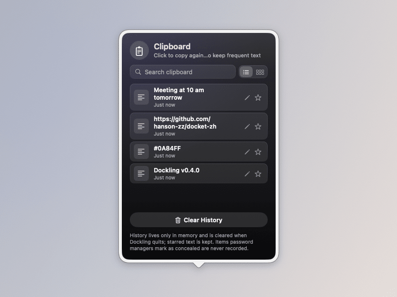<br>
  <sub>Clipboard: recent copies, searchable, with starred items</sub>
</p>

## In development (next version)

- **Water panel: Today becomes a cup page, with the character standing beside the cup and filling up as before**: the panel keeps its four tabs (Today, Stats, Goal, Settings), and Today is now led by a large glass whose water level is today's progress, with drunk and goal beside it (such as 1250 / 2000 ml), how much is left in about how many cups, and eight small cups, then the last drink and the next reminder. The chosen character (all six work the same) stands beside the cup instead of peeking in small, and keeps the original water look: full colour below the surface, desaturated grey above, and a white wavy waterline between, at the same level as the cup, so both rise together when you drink. Its moods are unchanged: it raises a cup for three seconds after a drink, cheers when the goal is met, dozes outside the reminder hours or after three hours without water, and turns into a skeleton when parched until the next drink. Logging is the seven drink chips plus three cup buttons: Small 100, Cup and Large 500. Cup follows the cup size in Settings and the other two move aside to stay distinct, and Custom is still there; the selected drink and character are a little brighter with a white outline instead of a solid blue block. Below is today's timeline (one axis across the reminder hours with an icon per drink, now and the next reminder marked) and the list, which shows the newest three with Show all, Undo last cup at top right and a delete button on every row. The seven-day report moves into Stats; Stats, Goal and Settings are otherwise unchanged, and the character is picked in Settings with a lock on Pro characters. The card's Character style matches: the character stands beside the cup with the same grey and colour waterline, and the card grows from 200 to 224 wide. With Reduce Motion the rise and mood changes are instant and the panel's water holds still. Cup buttons, cups left, timeline ticks and the collapsed list live in Core with tests. Not yet verified on a real Mac.
- **Unit Converter, Currency and Calculator merged into one card, 算 (Calc)**: the three cards looked alike, so you had to decide which kind of sum it was before you knew which to add. Now there is just Calc, and its panel has one field that works out what you typed. With a currency (100 USD, 100美元, ¥500 to EUR, $20, 1万日元) it converts money, with the same rate source as before and the cached table offline. With a unit (5 km, 3 斤, 72°F, 10 in to cm) it converts length, weight or temperature, by Chinese or English name. Anything else is a sum (3*4+2, brackets, powers), and 200+10% comes to 220. Give only one side and money goes to the other half of the currency pair in Settings (US dollar and yuan by default), while units go to the usual counterpart (km to miles, jin to kg, °F to °C). The card is 184 wide: a purple 算 badge, your input in small type with a Currency, Unit or Math tag at top right, and the result in large type with its unit. Click the number to copy it (without thousands separators); click elsewhere to open the panel. The panel has the field, the result (with the unit rate for money), Copy Result, Pin to Card (pin 1 USD to keep an eye on the rate) and a mixed recent list where a click works a line out again. Cards you already placed turn into Calc where they stand and keep their last input: the converter's unit pair becomes the default pair, the currency card's pair becomes the default currency pair, and the calculator keeps its sum. Add Widget lists only Calc, and searching for converter, currency or calculator finds it. All three were free and Calc stays free. Recognition, conversion, migration and the recent list live in Core with tests. Not yet verified on a real Mac.
- **Volume, App Volume and Now Playing each do one job, and Mini, wide Photo Frame and the tall AI Door each get their own focus**: the three cards that touch sound are split, and Add Widget says which does what. Volume is where sound comes out and how loud: a row of output devices on top (MacBook speakers, AirPods, a display and so on, each with an icon for how it connects); click one and it becomes the system's default output, just like choosing it in Control Centre, with no trip to System Settings. With more than three devices the last slot is “…” and lists them all. Below is the master volume, and the speaker mutes. App Volume is for whichever app is too loud: each app playing sound gets a cell with its icon, name, percentage and its own bar in the icon's main colour; drag a cell left or right on the card to set it from 0 to 150%, with a small tick at 100% that it snaps back to, and press and hold the icon to mute. Changed apps come first, up to four cells, then “N more”. It really changes the sound, through the existing system audio tap: the first time an app moves off 100% macOS asks for audio recording permission, and if that is refused the line under the cells reads “Needs audio recording permission, click to open Settings”. Now Playing is just about the song, with no volume. The Mini style drops the cover and keeps the play key and a row of bouncing bars, which settle into a low row when paused and hold still with Reduce Motion. The wide Photo Frame is now “photo + on this day”: it cycles through photos in your library taken on this day in earlier years, with “On this day” and “2024.10.18 · Hangzhou” along the bottom and dots for the slideshow; the place is the photo's location looked up as a city, or just the date when that fails. It asks for Photos access the first time it appears on the shelf; without access, or with no photos from this day, it keeps cycling the folder and writes the date a picture carries. The standard Photo Frame is still just the photo. The tall AI Door is now one large red panda with “Ask AI” and the default service; clicking anywhere asks the default AI, and the service tiles stay on the wide card. Mini, wide and tall cards already on the shelf keep their style and width and simply draw the new way. Output device icons and order, the drag maths for app volume bars, the on-this-day date ranges, reading the date and coordinates from a picture, and the place and date text are computed in Core with tests. Not yet verified on a real Mac.
- **Battery, Ring Gauges and System Activity no longer look like three rings, and System Activity and Network styles are trimmed**: Ring Gauges is now the only widget that draws rings, and its job is mixing any metrics: alongside storage and battery it can now show CPU and memory (tick them under the widget in Settings, Widgets; its heading in Add Widget says “Mix any metrics”). Battery's Percentage ring is renamed Battery Cells and the classic look draws an actual battery: with one device it is a horizontal battery filled to the charge, with the percentage and status beside it and a bolt while charging; with Bluetooth devices connected each gets an upright battery with its percentage below. It stays uncoloured until it drops below 20% (orange) or 10% (red), and a disconnected device is an empty dashed outline. The Liquid look draws a battery holding water; Pixel, Particles and Red panda hug are unchanged, and Battery Cells is still Pro. System Activity's Ring style is renamed Segments: an eight-step bar per reading that lights up with the load, next to a large number and its name. System Activity's Numbers and Numbers + graph are now one Numbers style, Network's Numbers only and With chart are now one Speed style, and the chart is a Show chart switch in Settings. Widgets already on the shelf move over on their own: old Percentage ring and Ring cards become Battery Cells and Segments, cards that had a chart keep the switch on, and sizes and positions do not change. The segment count, battery orientation and colours, and the gauge order live in Core with tests. Not yet verified on a real Mac.
- **Widget panels are no longer cut off**: a panel used to take the height it measured the moment it opened and only had its position clamped to the screen, so a panel taller than the usable screen lost its top; content that arrives after opening (events, reminders, quotes) made it taller without the window growing, so its bottom was cut; and with several displays the screen was picked by the panel's corner, falling back to the main display when that corner was off screen. Panels now follow their content's height, up to the usable area of their screen minus a margin (on a bottom or top shelf, only the space on the shelf's open side, so the shelf stays uncovered); anything taller scrolls inside the panel, with a fade at the bottom hinting at more. The size and position are worked out again when content grows or shrinks after opening, when a setting changes and when displays change. Panels open on the screen of the widget they belong to and stay entirely on it, including near the ends of a side shelf. The content of each widget's panel is unchanged. Sizing and placement are computed in Core with tests. Not yet verified on a real Mac.
- **Capture, Screenshots and Color Picker each do one job**: Capture is for actions, four buttons each with a short label: Area, Window, Text (the same tool as Text from Screen in Quick Toggles, still Dockling Pro and locked until unlocked) and Record (records the whole screen; the button turns red with a timer under it, click again to stop, and the file, named starting with “录屏”, goes to your screenshots folder; the first time, allow Screen Recording in System Settings). The card grows from 136 pt to 184 pt, the old full-screen button is gone (⇧⌘3 still works), and clicking empty space on the card still opens the system Screenshot app. Screenshots is for results: the newest capture large with how long ago it was taken, the next ones in a 2×2 grid beside it and “+N” in the last cell when they do not fit; drag any of them straight into a chat, an email or a folder, while the gaps around them still move the card. The card grows from 132 pt to 184 pt. Color Picker is for recent colors: a row of six swatches, click one to copy its HEX, with the newest color and an eyedropper below. The card grows from 136 pt to 160 pt. Text and Color Picker stay available in Quick Toggles, and their tooltips now say they are shortcut buttons; colors picked from Quick Toggles go into the Color Picker's recent colors too, one history shared by the card, its panel and Quick Toggles, with the colors a card kept before appended so none are lost. In Add Widget each of the three now says what it is for. The four actions, file names, the recording timer, the large-plus-grid layout and the shared color history live in Core with tests. Not yet verified on a real Mac.
- **Water shows the level, Virtual Pet shows the pet, and characters leave Add Widget**: both cards used to be a character on the left, two lines of text and a round button, so side by side they looked like the same card twice. Water's Character style now leads with a glass: its level is today's progress, the chosen character shrinks to a head peeking over the rim (it still raises a cup after a drink, cheers at the goal, dozes outside reminder hours and turns into a skeleton when you have gone too long without water), and beside it are the big “1250 / 2000 ml” and a row of 8 small cups that lights at most 7 until the goal is met. The ring and liquid looks and the personal goal are unchanged. Virtual Pet's character grows to about 54pt, the full height of the card, next to “Red Panda · a bit hungry” and four small cells for Food, Mood, Energy and Clean, each with its own bar, the most urgent one in red. Click a cell to feed, play, put to bed (or wake) and wash; the card's old feed button is gone, and healing, reminders and the character are in the panel. The six characters are no longer listed as styles in Add Widget: Water lists Character, Ring and Liquid, Virtual Pet lists one card, and the character is chosen in the panel or in Settings ▸ Widgets. Shiba, ginger cat, penguin, otter and octopus are still Pro. Cards already on the shelf keep their character and read back as the Character style with it, so they look the same. With Reduce Motion the level and the cups jump to the new value. The cup count, what each cell does and which one is marked live in Core with tests. Not yet verified on a real Mac.
- **Drop targets say what dropping does, and Sticky Note becomes real paper**: With something dragged over File Shelf, AirDrop, Trash or Quick To-do, the dashed outline and the icon share one color, and the color is the outcome: File Shelf is teal, “Keep it here / 3 files”; AirDrop is system blue on a very faint fill, “Send to nearby devices / 3 files · release to pick a device”; Trash is red, “Move to Trash / 3 · you can still get them back” (the old “Release to delete” is gone, since nothing is deleted); Quick To-do is orange, “Add a to-do / Text, links or files”, and no longer covers the list. In a vertical shelf the icon sits on top and the outcome takes two lines; on release the card returns to normal, and the File Shelf and Quick To-do panels use the same colored outline. Sticky Note is now a paper card: small corners, a strip of tape on top, a curled bottom right corner, and handwriting in the system's Hannotate SC when it is installed (the system font otherwise). One note holds up to 3 sheets, each in its own color, with the sheets behind showing at the edge; tap “1/3” in the corner for the next one. Notes cannot be checked off and are never cleared. Paper colors are no longer 15 cards in Add Widget: they are picked in the note's panel (this sheet's color, Next, New Note, Tear Off) and in Settings, Widgets, and a color change applies to the top sheet only. The free colors are still Cream, Mint, Peach, Lavender and Lemon, the other ten stay Pro. Notes already on the shelf keep their color and text and read as one sheet. The drop prompts and the note stacking, flipping and migration live in Core with tests. Not yet verified on real hardware.
- **Stocks, Watchlist and Crypto each do one job, plus gold and silver**: Stocks follows one symbol. On the left are the ticker and its Chinese name, the price in large type, the change in percent and points; on the right is today's chart across the whole session (a morning's trading fills only the morning), a dashed line at the previous close (above it means up) and small volume bars along the bottom, with Trading or Closed in the corner. You can set price alerts: enter a price in the panel, above the current price for a rise or below it for a fall, as many as you like, or write AAPL>237 in Settings. The card draws a thin orange line and reads “2.1% to alert” in the corner; when the price is reached you get one notification and the card flashes orange. With several symbols the card rotates every 10 seconds (this can be turned off), with dots along the bottom; click a dot, or a symbol at the top of the panel, to jump to it. The Stocks card is 228 pt wide, or 124 pt with the chart off. Watchlist compares a group: on top are the group name, “Up 5 Down 3” and a red and green ratio bar; below are two columns of three rows sorted by change from highest to lowest (or as entered), each with the symbol, a small chart of today, the price and a solid change chip that deepens with the size of the move, and “N more” in the last slot when they do not fit. The card is 320 pt wide. Create groups in the panel with + Group (a name and a list of symbols, such as Tech or China A-shares), click a group name to switch, right-click to edit or delete, or click the group name on the card for the next one; Settings also takes “Tech=NVDA TSLA”. Fill in holdings in Settings (such as NVDA 100) to see today's P&L; without them that part stays hidden. Crypto gives each coin 96 pt: a round badge in the coin's colour with its letter, a solid 24-hour change chip, the price and a 7-day line underneath, dashed at the price 7 days ago, with the 7-day change in the corner. All three widgets share the same up/down colours setting, Stocks and Watchlist now default to red for up as well, and the green-for-up that Stocks had built in is gone. Stocks and Watchlist add + Gold and + Silver under the symbols setting (international futures GC=F and SI=F). The card names them Gold and Silver and by default shows CNY per gram at the USD/CNY rate (1 ounce = 31.1035 g), falling back to USD per ounce until a rate arrives; the panel and Settings switch to USD per ounce. Stocks, Watchlist and Crypto remain part of Dockling Pro. Sorting, the up/down count, chip depth, distance to an alert, one notification per alert, chart positions, groups, today's P&L and the precious metal conversion are computed in Core with tests. Not yet verified on a real Mac.
- **Calendar, Week and Lunar & Holidays each do one job**: Calendar is about today and the next meeting. Next Event shows “in 25 min” and the start time, then the meeting name and “10:30-11:15 · Room 3”; when the event has a meeting link (its URL, or a Tencent Meeting, Zoom, Teams, Feishu or Google Meet link in the location or notes) a green Join button appears, and none without a link; the last line reads “Then 14:00 Design Review”, and a meeting under way shows “In progress · 20 min left”. Date + Agenda is replaced by the new Today's Timeline (300×62): one axis from 9:00 to 19:00 that grows by whole hours for earlier or later events, each event a block in its calendar colour sized by its length, overlaps on two rows, the past dimmed and a red line for now, with “3 left today” and “Next in 25 min” above it; pointing at a block shows its name, time and source, and clicking a block with a meeting link joins it. Placed Date + Agenda cards become Today's Timeline automatically. The Date style adds a row of dots, one per meeting, fading once it is over. Week now shows busy and free by time booked: two cells a day, afternoon on top and morning below, full at 4 hours, “21.5 hr booked this week” in the title and the freest afternoon left this week in green (workdays follow the public holidays and makeup days), today's column lightly shaded and past days dimmed; pointing at a day shows how long it is booked and when it is free from, with that day's events in the tooltip, and clicking a day opens it in Calendar (the first time asks for Automation access to Calendar). Lunar & Holidays says one thing at a time, by priority: a makeup workday coming up turns the line red, “Work next Saturday / 10/10 makeup workday”, with a notification at 20:00 the evening before; on a solar term or traditional festival it reads “Today: Frost's Descent” with the lunar date; otherwise “National Day in 12 days / From 10/1, 7 days off in a row”. Settings adds Remind ahead (3, 7 or 14 days, 7 by default), and the two switches are now Show solar terms and Makeup workday reminder. The panel shows this month's calendar (days off, makeup days, solar terms and festivals, today outlined) and the solar terms and holidays coming up. Holiday and makeup dates come only from the State Council data already in the app. Meeting link detection, countdowns, timeline layout, busy hours, the freest afternoon and the reminder priority are computed in Core with tests. Not yet verified on a real Mac.
- **Clock styles trimmed from 12 to 8, and easier to extend**: Add Widget now lists eight Clock styles: Standard, Analog, Flip, Pixel, LCD, Chinese, Neon and Photo. LCD is the former Simple, renamed only. Look-alikes became options, set under the clock in Settings, Widgets: Big digits is now Standard with Size: Large and Weight: Bold; Seconds ring is Analog with Dial: Seconds ring; Folding flip is Flip with Flip motion: Fold; Minimal is Flip with Cards: Large with h, m, s, still Pro. Each option only shows under its own style. Clocks already on the shelf in Big digits, Seconds ring, Folding flip or Minimal are read as the matching style and options and look the same. In the code the clock styles are now one registry (name, Pro or not, options, mapping from old styles), so a new style is one entry plus one drawing view, and the Pro check follows the registry; the registry and the old-style mapping live in Core with tests. Not yet verified on a real Mac.
- **Counting time left, split by scale**: Countdown covers “within minutes”, Alarm “a time today”, Time Progress “year, month, week, day as a percentage” and Anniversaries “by the day”, and each card in Add Widget now says which. The Countdown card is 168 pt wide: when idle, click 3, 5 or 10 min to start right away (edit the three presets in the panel; the last one used is highlighted). While running it shows a large figure, “Noodles · 3 min total” and a thin progress bar, with pause, resume and cancel on the card. When time is up the card turns orange, shakes for a while and plays a sound; click anywhere on it to stop. With Reduce Motion it only changes colour, and the sound can be turned off in Settings. One Alarm card now holds several alarms (a placed single alarm becomes the first in the list) and is 220 pt wide: the next one stands out, such as “14:30 Call Wang · In 2 h”, the later ones sit on one small line, and the bell turns the next one on or off. When an alarm rings the card turns orange with Snooze 10 min and Turn Off right on it; it chimes every 4 seconds for two minutes and stops by itself after ten. The panel is one list to add, delete, switch and edit alarms. Time Progress gains a Four Bars look showing year, month, week and today together. The Focus Timer is the only card that keeps a ring: a dot in the middle and a row of dots for the round. A finished focus session now moves straight into a break (a long break after a full set), and the break ends back on focus, waiting to start. During breaks the card turns green and says “Stand up and move”. Settings, Focus Timer adds “Remind me to stand up on breaks” (on by default): while it is on and the timer runs, the stand-up reminder stays quiet, and the end of a focus break counts as standing up. The Stopwatch is a wide figure with hundredths and the last three laps beside it, the fastest in green, with start, lap, pause and reset on the card; the narrow card shows only the figure, and the panel lists every lap. The stand-up reminder is now the red panda: it dozes while you sit, with “Sitting 48 min”, “Nudges you at 60 min” and six cells of time sat; when it is time the card turns pink, the panda stretches and I'm Up logs a break; while the Focus Timer runs the panda lies low. The next of several alarms, snoozing, laps and the fastest lap, the four percentages, focus rounds and the stand-up and focus hand-off are computed in Core with tests. Not yet verified on a real Mac.
- **The single and multi Anniversaries cards now look nothing alike**: the single card is a tear-off calendar page. On the left a small white page has the name on a strip in the date's colour, the day in large type and the month below, in lunar terms for lunar dates; on the right are “since” or “to go”, the day count and a short line: “Year 8 · next anniversary in 214 days” when counting up, or the weekday and “yearly” or the year when counting down. On the day itself (a countdown that arrives, or an anniversary when counting up) the card takes a pale wash of the date's colour, the red panda cheers, it reads “Today” (or “8 years!”) and suggests clicking to make a share image. When the day changes after midnight the old page flips away and the new one shows; with Reduce Motion it simply fades. The setting “Show progress ring (single style)” is now “Show calendar page (single style)”; turned off, only the text remains. The multi card is now a Next 12 Months timeline: the title shows how many dates fall within the year, and the axis runs from today to a year from now with month ticks and quarter labels. Each date is a dot in its colour; the nearest is larger and labelled with its name and days, the others are labelled where they fit and otherwise drawn as dots. Count-ups sit on their next anniversary; dates more than a year away and one-off countdowns that have passed are left off. Clicking a dot (whichever is nearest) opens its page, clicking empty space opens the timeline, and pointing at a dot shows its name and date beside the title. The multi card is a fixed 236 pt wide and the single card 188 pt. On side shelves the single card is a tall tear-off page with the day count, and the multi card lists the nearest three on a short rail, each row opening its date. The widget library previews use the new looks. Positions on the axis, month ticks, label spacing, nearest-dot clicks and the page text are computed in Core with tests. Not yet verified on a real Mac.
- **Reminders can be edited, in sync with Reminders and your iPhone**: the Reminders widget now reads and writes the system Reminders, which iCloud syncs to your iPhone. In the List style each row starts with a circle; click it to complete the reminder, and overdue circles and times are red, with “Yesterday” for yesterday's. Next Reminder shows a countdown such as “in 40 min · 15:00”, and hovering the card shows Done and Snooze 1 Hour (from the due time if it is still ahead, from now if it is late). Count is renamed Today Overview and shows two big numbers side by side, overdue (red when there are any) and due today; placed cards keep working, only a little wider. The panel can now edit: + New Reminder at the top; click a row to edit it in place (title, date and time, both optional, priority None, Low, Medium or High, and list), press Return to save, or delete it there; the context menu has Move to Tomorrow, Move to Next Monday, Snooze 1 Hour, Done, Edit and Delete, keeping the time of day. Saving something not due today says so in a line, and moving a due time moves its alert too. With a list chosen for the widget, the panel shows only that list and new reminders go into it. The card never raises a permission prompt; access is asked for the first time you open the panel. In Add Widget, widgets that need a system permission no longer show a small lock; the permission is named in the card's tooltip instead (Pro capsules are unchanged), and the Reminders heading says “Syncs with Reminders”. Relative times and the postpone dates are computed in Core with tests. Not yet verified on a real Mac.
- **Quick To-do becomes “jot it down, clear it today”, apart from Reminders**: Quick To-do needs no permission and never syncs, with no dates or times, and its heading in Add Widget now reads “Jot it down, never synced”. The card shows Today's three: star up to three items in the panel (or right-click, Mark for Today) and the card shows them first, with how many are done out of how many are marked in the corner and a circle on each row to tick it off; with nothing marked it shows the first open items. Drop text, a link or a file on the card or the panel and a dashed outline reads “Drop to add a to-do”; links and files keep their address and open from a small button on the card and in the panel. Settings, Shortcuts adds Add a Quick To-do (not set by default): it opens a small field near the top of the screen, and Return adds the line to the first Quick To-do on the shelf; Esc or a click outside closes it. Each new day, items finished yesterday are put away on first display, and the panel asks about yesterday's unfinished ones: move them to today or give them up. With everything done, the card shows the red panda, “All clear today” and the streak of cleared days. Right-click, Move to Reminders creates a system reminder for today, tomorrow, a chosen date or no date, then removes the item; Reminders access is only asked for at that moment. Today's three, the daily clear-out and the streak are computed in Core with tests. Not yet verified on a real Mac.
- **Anniversaries open differently from the single and multi cards, with a page per date and a share image**: the single card opens a page for the date it shows, with a large ring for this year's progress (and which year it is when counting up), the name, the day count, the start date and weekday, and the days to the next anniversary. Below are milestones: days 100, 520, 1,000, 1,314, 2,000, 3,000, 5,000 and 10,000 when counting up, or the days 100, 30, 7 and 1 days before when counting down, each with its date and weekday, ticked and dimmed once passed, with a dot on the next one; then the next four anniversaries (which one, the date and weekday, and the days left, with the lunar date for lunar events). “‹ Anniversaries” goes to the timeline, “Switch” changes the date pinned to the card, and the bottom has Edit (the existing editor), Share Image and Manage All Dates. The share image is a tall card in a dark gradient of the date's colour with the red panda, the name, the big number, the date range and “Dockling”; save it as PNG or copy it, free. The multi card still opens the timeline, now with a This Month summary on top (how many dates fall this month and the days to the nearest, click to open it); clicking a column on the card opens that date's page directly, and the column under the pointer lights up a little, on side shelves too. The timeline's context menu adds Open Its Page. Milestones, anniversaries and the month summary are computed in Core with tests. Not yet verified on a real Mac.
- **No more white scroll bar over panels**: with “Always show scroll bars” or a mouse attached, dark panels such as New Habit, Anniversaries, To-do, Water, Radio and AI drew a light scroll bar over their icons and colours. These panels now hide the scroll bar and still scroll with a wheel or trackpad; New Habit fades out at the bottom to show there is more. Not yet tested on a real Mac.
- **Dockling Pro locks the rest, with trial reminders**: Text from Screen, QR Code, Presenting, Lock Keyboard and Low Power Mode in Quick Toggles are now really locked. Until Pro is unlocked they stay listed in Settings with the Pro capsule, and ticking one opens the Pro window; one already on a card is dimmed with a small lock and opens the Pro window instead of running. Presenting, Lock Keyboard or Low Power Mode left on from the trial can still be turned off. The AI notch chat opens the Pro window instead of the chat from the notch or the shortcut, and so does turning it on in Settings, AI; the AI card's red panda falls back to the old ask panel, opening websites and apps stays free, and asking in web or API mode opens the Pro window. The battery charge limit's switch and the install and update helper buttons open the Pro window; a limit that was on stops applying (the helper is told it is off, so the battery charges normally) and comes back by itself once Pro is unlocked. A one-time in-app notice appears when one day of the trial is left and again once it has ended, with a button that opens the Pro window to buy or enter a gift code; activated Macs and former supporters never see it. The Pro window lists the new Pro tools. Former supporters stay unlocked. Not yet verified on a real Mac.
- **Dockling Pro covers more, and Add Widget groups cards by widget**: App Volume, Recorder, Stocks, Watchlist, Crypto, Wallpaper, Radio, File Shelf, Translate and Habits are now Pro, alongside Slacker Clock, Time Progress, Ambient Sound, Podcasts, Trash, GitHub, App Switcher, Codex Usage, the Red Panda's Basket and Virtual Pet: 20 Pro widgets and 40 free ones. The multi-city Weather style and the Battery percentage ring are Pro, badged in the library and the style menus; a placed one shows the small lock until Pro is unlocked. Sticky Note keeps its five lightest papers free (Cream, Mint, Peach, Lavender and the default Lemon), the other ten are Pro, and a placed note on a Pro paper falls back to Lemon. In Settings, Widgets, Colors and Background, the presets stay free while the custom color and the gradient background are Pro. Clearer card names: AI Portal (Wide) and AI Portal (Tall) for the AI Assistant, Standard Photo Frame and Wide Photo Frame for the photo frame; only the names changed, placed widgets are untouched. Each category in Add Widget now shows one small heading per widget (with a Pro capsule for whole Pro widgets and a style count), separated by a thin line; search results and Recommended stay flat, and the up and down arrow keys follow the rows as drawn. Not yet verified on a real Mac.

## Install

1. Download the latest `.dmg` or `.zip` from the [Releases page](../../releases)
   and move `Dockling.app` to Applications.
2. **The build is not signed or notarized**, so macOS 26 warns the first time you open it:
   - Double-click it, then close the warning;
   - Open **System Settings > Privacy & Security** and click **Open Anyway** next to Dockling;
   - Authenticate and confirm.

   Or remove the quarantine attribute in Terminal:

   ```sh
   xattr -dr com.apple.quarantine /Applications/Dockling.app
   ```

3. **Look in the menu bar on first launch.** Dockling is an accessory app with no Dock icon and no main window.
   Settings, the widget library and layout switching live in the menu bar icon.

### Known limitations

- An ad-hoc signed accessory app gets no location prompt from macOS, so enter a city for the Weather widget in **Settings > Widgets**.
- Now Playing needs Dockling allowed under **Privacy & Security > Automation**; reading browser tabs also needs "Allow JavaScript from Apple Events" in the browser's Develop menu.
- Lunar dates, solar terms, the "Chinese" clock face and the End User License Agreement stay in Chinese in the English interface.

## Build from source

You need macOS 26 and Xcode. The Xcode project is generated from `project.yml` and is not in the repository:

```sh
brew install xcodegen
xcodegen generate
xcodebuild -scheme Docket -configuration Release build
```

Interface text lives in String Catalogs under `Resources/Localization`. Simplified Chinese is the source language and English is the translation. At runtime the development region in Info.plist is English, so languages Dockling does not ship fall back to English, and the Traditional Chinese and Hong Kong tables carry the Simplified text.

## How the screenshots are made

Every image in this README is taken by the screenshot tool in this repository: `Tools/Shots` puts the app's real shelf and panels in real windows on screen, and `scripts/capture-shots.sh` captures them with `screencapture`. They are not mockups and no number is edited by hand.

Run `scripts/capture-shots.sh` for the Chinese interface (written to `docs/images/zh`) or `SHOTS_LANG=en scripts/capture-shots.sh` for English (written to `docs/images/en`). It needs Screen Recording permission for your terminal and takes a few minutes. The **Actions > Screenshots** workflow takes both sets on a GitHub macOS runner and uploads them as an artifact.

## License

[MIT](LICENSE) for the original Docket code. Dockling's own additions are covered by [LICENSING.md](LICENSING.md) and the [EULA](EULA.md).
Third-party attribution and trademarks are in [NOTICE.md](NOTICE.md).
Dockling is not affiliated with, endorsed by, or sponsored by Dockset, CoolDock, upstream Docket or their authors.
