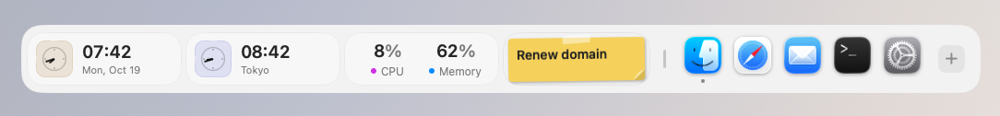

<div align="center">


# Dockling 码头

### A free Dock shelf for macOS with an optional Pro upgrade and a red panda desktop pet, in English and Simplified Chinese.

**Website: [docket.shiduo.app](https://docket.shiduo.app)** · [简体中文](README.md) | English

Put a shelf of live widgets, app groups and folders next to the macOS Dock,
or use it in place of the Dock.

[](#build-from-source)
[](project.yml)
[](LICENSE)

<br>



</div>

---

## What Dockling does

- **A shelf next to the Dock** with live widgets, app groups and folders, or use it in place of the Dock.
- **60+ widgets**: calendar, to-dos, focus timer, weather, radio, clipboard, screenshots, Calc and more. Click one for its details panel.
- **A red panda desktop pet** that stashes files, fetches new downloads and reminds you to stand up.
- **Window and app switching**: a ⌘Tab-style App Switcher, three window switcher styles and full-size previews.
- **Message island**: WeChat and other messages drop from the notch.
- **Layouts** switched by shortcut, Focus mode or ⌘ + scroll, and written back to Apple's Dock.

The interface is in **English and Simplified Chinese** and follows the system language. The basics are free; **Dockling Pro** is a one-time purchase, see the [website](https://docket.shiduo.app).

Dockling is an unofficial fork of [Docket](https://github.com/nparashar150/dockset) (MIT) that has grown into its own app.

## In development (next version)

- 🎚️ **Now Playing card trimmed to Compact and Full, opening the vinyl panel by default**: Compact is a 232×62 strip with artwork, title, artist, previous / play / next pinned to the right and a 2 pt progress line along the bottom. Full is 312×132 with a small turntable filling the card height (the arm drops and the record spins while playing, it stops and lifts on pause, and tapping the record plays or pauses) and a column with the title, artist, previous / a filled play button / next and the scrubber, clear of the arm. Old Mini and Medium cards become Compact at launch, old Full cards stay Full, and every other setting is kept; the "Compact layout" switch is gone and skip back / forward are listed for Full only. Both cards open a 320 pt vinyl panel by default, with the record as the centrepiece, the title, scrubber (lighter, thinner time digits) and controls below, and Recently Played / Up Next as a one-line summary that opens the list page, where the volume now lives. Under Appearance you can switch to a 300 pt compact panel (artwork beside the title, like, scrubber, controls, volume and a one-line queue summary). The old large-artwork Standard panel is retired, the notch music card is untouched, and the elapsed time no longer rolls its digits. Not yet verified on a physical Mac.
- 💿 **Vinyl look V2, free**: the turntable is about 250 tall and the panel 320 wide. The large cover card on the left is gone; the record is bigger and fully visible, with the album artwork as its round center label (the artwork's main color when there is none). It sits on a platter with a metal rim, embossed rings and a little thickness, the tonearm gains a two-tier pivot base, a counterweight and a headshell with a marker line, and the stylus lands exactly on the grooves with the recalculated geometry. The brushed metal platter and tonearm now use realistic artwork drawn to match the design (falling back to the drawn version if an image is missing). A small patch of very faint water shows at the sides of the platter (fine ripples and a soft reflection that grow livelier as the record turns, generated from time only, never from audio, with no broad glow), and the listening red panda lies at the lower left. The motion is closer to a real turntable: on play the arm swings from its rest to the outer groove, lowers gently, then the record starts turning; on pause the record slows to a stop, the stylus lifts slightly and the arm stays where it was; on resume the stylus lowers again and the record carries on from the paused angle; at the end of a track the stylus lifts and the arm glides back to its rest; a new track or a seek lifts the stylus, moves it and sets it down while the record keeps turning. With Reduce Motion on you see the end state as a still frame, and nothing redraws frame by frame once the panel is closed or covered, or the motion has settled. The title is 19pt with tighter spacing under the turntable; shuffle, previous, play/pause, next, repeat, volume, the source switcher and Up Next / Recently Played stay. Vinyl is free and is now everyone's default. The layout, stylus geometry, motion state machine live in Core with tests. Not yet verified on a physical Mac.
- 🎵 **Music and podcast stability fixes**: after a podcast fails to play (network down, audio link gone), pressing play again reloads it from the saved position instead of showing Playing with no sound. The vinyl record and the playing bars stop redrawing while the Now Playing panel is closed, fully covered by another window or on another desktop, and pick up again when it comes back. On the notch music card, when the length is unknown, the Playing / Paused line and the play button follow the same play state, so they no longer disagree. The rules live in Core with tests. Not yet verified on a physical Mac.
- 🔋 **More reliable battery readings**: when headphones, a mouse, trackpad or keyboard is connected but reports no battery level, the card, the hover text and the detail panel say "Battery level unavailable" instead of "Not connected" or a made-up percentage; a Mac whose built-in battery cannot be read at that moment says the same and does not keep the previous number. AirPods put back in the case or a mouse switched off are no longer drawn again from a System Information snapshot taken minutes earlier, and a reconnected device shows its live level right away; third-party accessories that only System Information knows are now read about every 90 seconds, so a switched-off one keeps its old level for one round at most. A reading not updated for more than 4 minutes is marked "Data out of date", and the hover shows when that reading was actually taken; a failed System Information read no longer makes an old reading look new. On the multi-device card and in the detail panel, devices with a level come first, out-of-date readings next, unreadable ones last. The logic lives in Core with tests. Not yet verified on a physical Mac.
- 🐕 **New casual game: Shiba Match (free)**: find it in the Casual Games category of the widget library. Twelve cards in 3 rows of 4 hide 6 pairs (shiba, paw print, bone, doghouse, tennis ball, food bowl). Click one card to turn it over and a second to compare: a match stays face up and can no longer be clicked, a miss stays up for about 0.8 seconds and then turns back (clicks during that pause are ignored, so fast clicking cannot get it out of step). There is no limit on turns; every second card counts as one move, the timer starts at the first card and stops when the last pair is found, and the best result is kept on this Mac (fewest moves, then the shorter time). The Dock cards, landscape and portrait, only show the shiba, the state (Not started / In progress · 3/6 matched / Done) and a Continue entry; click to play in a 340 wide panel with the shiba avatar, title and state at the top, round glass Restart (asks for a second click mid game) and Sound buttons at the right, frosted glass card backs with a faint paw print, a 3D flip, a small bounce on a match (a simple fade with Reduce Motion on), Time, Moves and Best capsules at the bottom and a shiba lying at the lower left that never covers a card or takes a click. When every pair is found a result card covers the table with a cheering shiba, the moves, the time, whether it is a new best, and Play again. Flips, matches and the finish use light system sounds, on by default. Every card has a VoiceOver label, and in the panel the arrow keys move between cards while Space or Return turns one over. Pinned to the desktop, the small size shows the state only and the medium and large sizes are playable. A game in progress carries on when you reopen the panel, and a damaged save starts a fresh game. The shiba art comes only from the existing shiba master art in the repository; the final card faces will be drawn later, and until then the shiba face uses the shiba master's small head and the others use the system's color emoji. Light and Dark follow the system and the panel height is left to the shared panel container. The rules, saving, records, the board size (rows and columns are parameters ready for a later 4×4 and 4×5, with no level switch in this version) and the sizes live in Core with tests. Not yet verified on a physical Mac.
- 🎮 **New Casual Games category in the widget library**: Minesweeper and Pull Tooth move from Tools into a new Casual Games category (listed right after Tools in the sidebar); widgets already on your Dock are unaffected. Not yet verified on a physical Mac.
- 🎵 **Music joins the notch island**: while Apple Music, Spotify, NetEase Cloud Music or another player is playing (the same song the Now Playing widget shows), a rounded cover thumbnail grows out of the left of the notch and a thin sound wave in the cover's main color out of the right, each side staying within the island's width limit while the notch itself stays solid black and joined to both sides. When paused, the wave turns into three still short bars and the cover dims slightly; the island tucks away after half a minute of pause (not while the pointer rests on the card), and it does not appear when nothing is playing or playback has stopped. Hover over it and, like the radio card, a glass card 380 wide and 150 tall grows straight down from the notch: a 96 pt rounded cover on the left, and a small red panda in headphones lying at the card's top right corner beside the title (clear of the cover, text and buttons, long titles make room for it, and it never takes a click); the title, artist, a thin progress bar with elapsed and remaining time (1:24 / -2:10, left out for live streams without a length) on the right; then previous, play or pause and next, with volume (only when Apple Music or Spotify reports one) and the real icon of the source app (a generic music note when it cannot be read; click it to open that app) at the right. A very faint glow in the cover's main color fades down from the top of the card. Clicking the cover or the title opens the Now Playing widget's panel (even from another layout or a folder, falling back to the Cassette widget), or the source app when there is neither. Music has the lowest priority among the island's activities: while Dockling's own radio plays, the radio is the main island and music becomes the small round island on the right, and the two swap when the radio is only lingering after a pause while music plays. The wave is a decorative motion driven by the play state only: it never reads the microphone or captures audio, and it holds still with Reduce Motion on. Settings > Notch Island lists a new Music activity: on by default for new installs (the island itself is still off by default) and off for anyone who already saved settings, so the island does not suddenly show more. State mapping, priority, time text, compact width, card geometry and where a click on the song opens live in Core with tests. Not yet verified on a physical Mac.
- 💿 **Now Playing panel gains an optional Vinyl look**: the Look section at the bottom of the panel has a new Panel style row with Standard and Vinyl. Standard stays the default, so nothing changes until you pick Vinyl (the Look summary then says Vinyl, and picking Standard again restores the original). Vinyl puts a turntable at the top: the real album artwork on a rounded glass card at the left, a record drawn in code behind it (fine grooves, two track gaps, the center label showing the artwork, or the artwork's main color when there is none), and a metal tonearm at the upper right. While playing, the record turns slowly at a steady speed and the tonearm rests on it, moving from the outer groove toward the center as the track progresses (it stays at the outer groove when the length is unknown); when paused, the record stops and the arm lifts back to its rest. A few very faint ripples sit under the record (pale blue-gray in light mode, deep blue-gray in dark mode, low opacity), spreading slowly while playing and still when paused. With Reduce Motion on, nothing spins or spreads: you see a still frame with the arm in place, and motion only runs while the panel is open and playing. Below are the title, artist and album, the favorite button where the source supports it, the progress bar with times at both ends, shuffle, previous, a large play/pause button, next and repeat (decided the same way as Standard, so controls the player cannot handle are not drawn, and browser tabs only get play/pause), the volume bar, and Up Next when there is a queue; the source switcher and Open in App at the top stay. Light and dark follow the system, Vinyl draws no dark backdrop, buttons and the artwork card use readable glass, the panel stays 320 wide and its height is left to the shared panel container. The style switch, turntable layout, tonearm angle, spin speed and ripples live in Core with tests. Not yet verified on a physical Mac.
- 💣 **Minesweeper panel refined from the mockup**: the levels stay Beginner (9×9, 10 mines) and Intermediate (16×16, 40 mines), and the panel stays 340 wide so it does not jump when you switch. A bigger red panda uses the six state images (idle while ready or playing, a raised paw on a mine instead of the gray skeleton, a cheer on a win), with the title "Minesweeper", the line "Find every mine and test your eye for detail!", and an orange "Play again" capsule at the top right; the levels sit in one segmented bar (Beginner / Intermediate, with "9×9 · 10 mines" in the hover tip); the readout says "10 mines left" with a "00:05" timer and a round sound button; the hovered square gets an orange outline, a new flag gives a small hop, and the mine you hit is red with a white edge; "Leaderboard" is now "Records on This Mac", folded by default into one line such as "Beginner · Best 00:28" and opening to the top five; a one-line tip, "Left-click to reveal · Right-click to flag · Find every safe square", shows until you finish your first game; when a game ends a glass result card covers the board (the red panda, "Oops! You hit a mine!" or "You did it!" with the time and any new record, plus "View Board" and "Play again"), with a little confetti right after a win that stays still with Reduce Motion on; behind it all is a very faint warm orange to misty purple wash with two faint paw prints. Light and Dark follow the system, glass with text on it uses the readable glass, and the height is left to the shared panel container (560pt at most, like other panels). The panel width, the first tip, the timer format and the result lines live in Core with tests. Not yet verified on a physical Mac.
- 🤖 **AI Assistant panel redone from the portrait mockup**: the header now shows a small app icon and "Dockling · AI Assistant", with the notch chat switch, assistant settings and AI settings still behind the gear on the right. When idle, a welcome area shows a large "Hello" and "What can AI help you with today?" at the lower left and the laptop red panda at the upper right (typing at the laptop while you write, a short cheer when an answer finishes). Below it, the quick actions you picked in settings sit in a 2 by 2 grid of glass tiles, each with a small colored icon (the defaults are now labeled "Ask from Screenshot / Summarize Clipboard / Translate Text / Improve Writing" and do the same as before), and "More" still holds the other quick actions and saved prompts. The input still grows with your text and keeps its 2000 character limit; the main button is now a full width red panda orange capsule, "Start Asking" (web and app modes still say "Ask on the web" or "Copy and open Doubao", with a line underneath explaining what happens), and the "Model:" menu at the bottom holds the service, how it opens and where answers appear. While an API answer is coming in, the welcome area becomes an "AI is thinking…" glass card (a spinner that turns into a still icon with Reduce Motion on, a faint static color band along the bottom, and a way to stop); when it finishes, a "Done" result card offers Copy, Try Again (answers the last question again) and Ask More (continues the same conversation and puts the cursor back in the input), and can open the full chat or be closed. The panel is now 380 wide instead of 420, glass with text on it uses the readable glass, Light and Dark follow the system, and the height is left to the shared panel container, scrolling inside the panel when there is a lot. Not yet verified on a physical Mac.
- 🐼 **AI Assistant shelf card refined from the Dock widget mockups**: same sizes as before, only the icons, model entry points and status changed. The wide card is for switching models quickly: the seated red panda on the left, a thin divider, then a row of rounded square model keys (each service's existing initial), with the current model in a warm orange outline on a pale orange fill and a small orange dot at the top right, and a thin dashed "+" at the end to manage more models. Clicking a key opens the assistant with that model (the notch chat switched to it for web or API, or its app or web page as before for Jump), and when the card is short on room it shows fewer keys in order while always keeping the current one and the "+"; every key has a 24pt tap area. The compact card is now a status companion with a different job from the wide one: no model keys, letters or chevron. The red panda at its laptop takes up most of it (its waiting pose while generating, a brief reaction when done or on error, and a status dot at its top right), next to a pane of readable glass with "Ask AI" and one line of hints. While idle the line rotates every 8 seconds through hints like "Try: Ask from Screenshot", taken from the quick actions ticked in Settings, or "Click to start asking" when none are; with Reduce Motion it stays on the first hint. Generating, Done and Error only reflect what Dockling can actually see (API answers); web and app modes keep showing hints. Clicking anywhere starts a question (the same opening logic as before), and the shelf right-click menu gains "Ask from Screenshot". Text stays at 13pt or larger; "Ask AI" always stays, and the hint line falls back to a short form and then truncates. Sizes are unchanged (108×62 on the bottom shelf, 76×112 in the sidebar). The keys are readable glass, with light and dark versions following the system. The AI panel and the notch quick result are unchanged. Key count by width, the current model, key labels, the status, the compact red panda pose and the hint rotation live in Core with tests. Not yet verified on a physical Mac.
- 🦷 **Pull a Tooth panel redone from the mockup, with the new Momo the Red Panda**: a tooth badge, "Momo the Red Panda" and the line "Pull a tooth. Find the sore one and the mouth snaps shut!" at the top (it switches to the game status once you start), with round glass buttons for sound and restart on the right. Below is a glass score card: "Safe pulls N / 11" on the left (the big number is pink and passes 4.5:1 contrast in the light look) and a trophy with "Best record N teeth · N wins" on the right. In the middle is the new red panda with its mouth wide open and both paws on its cheeks; the teeth are still drawn in code inside the mouth, recalibrated for the new art (both rows follow the curve of the lips), and every tooth has a tap area of at least 24pt. A glass hint bar at the bottom reads "Pick a tooth and try your luck! | 1 sore tooth among 12" and turns into "Play again" when the game ends. Hitting the sore tooth switches to a scrunched-up face and a short shake; winning switches to a cheer with a crown and a medal; each pull pops a little sparkle and the red panda flinches. With Reduce Motion on, only the picture changes: no shake, no flying teeth, no sparkle. The panel is now 380 wide so the teeth can be 24pt, with a soft lavender haze and faint paw prints on the glass, light and dark versions following the system, and its height handled by the shared panel container. The shelf card and the small, medium and large desktop cards use the new art too: small shows just the two rows of teeth, medium the mouth, large the eyes down to the paws, with the teeth inside the mouth and tap areas of at least 24pt in every size. The rules are unchanged (12 teeth, 1 sore tooth, best record, wins, sound switch); the crops and calibration live in Core with tests. Not yet verified on a physical Mac.
- 🏝️ **Notch island radio card rearranged**: the top of the card is as wide as the notch and grows straight down from its lower edge before widening, so there is no longer a gap between the two, while the sides stay below the menu bar and keep clear of the status icons on the right. The card is narrowed to fit its content at 340 pt (it was 372); the focus, timer, AI quick result and other cards are unchanged. The left side now shows the radio illustration for the look chosen in the radio widget (Classic Tuner when none can be read, falling back to the old cat radio when the image is missing), placed as a transparent image without the orange backing, with Handheld Pixel scaled by nearest neighbor so its edges stay crisp. The controls are now previous, play or pause (the primary button) and next, and previous uses the same station switching as the radio panel and the media keys. The right side shows the "CH 03 / 06" channel readout (the same numbering as the radio panel) and a playback waveform that stops when paused and holds still with Reduce Motion on; a long station name first shrinks its type (never below 13 pt) before truncating, the volume bar stays, and Light and Dark follow the system. Choosing the illustration and the channel readout live in Core with tests. Not yet verified on a physical Mac.
- 🌐 **Translate panel rearranged from the mockups (light two-pane layout)**: a top row with a "Source ▾" chip, a swap button and a "Target ▾" chip (showing "Smart · target language" when the smart direction is on). The Original card starts about two lines tall, grows with the text up to a limit and then scrolls inside the card, with an "N / 5,000" count, Read Aloud and Clear at the bottom. The Translation card uses a slightly larger type and an accent outline, with Read Aloud and Copy that stay disabled until there is a translation; double-clicking the translation copies it too, and the button shows a checkmark for a moment. Below sits a row of Paste, Screenshot and Translate (Translate is the primary button), which drops its icons rather than truncating when space is tight. Recent Translations only appears once there are some: each entry shows the original on one line and the translation on the next with an arrow, a click fills it back in, three are listed by default and "All N" expands to at most 20. The panel's Paste button translates at once; the clipboard is read only when you click, never polled. Changing languages keeps the text and translates it again in the new direction. The panel no longer sets its own height and leaves that to the shared container, scrolling inside when there is more; Light and Dark versions follow the system. The "translated on this Mac" note was checked: text translation, screenshot text recognition and reading aloud all run on the Mac. The count text, editor height and recent list length live in Core with tests. Not yet verified on a physical Mac.
- 📻 **Internet radio panel redone from the mockups (compact CH 03 layout)**: all nine looks share one compact header with the look's name as a small chip (tap it to open the look gallery), "CH 03 / 06", the station name in large type and "HLS · Live stream", plus a "Listening" status chip at the top right, all read live from the tuned station and your favorites. Below it each look draws its own visual about a fifth smaller than before (Classic Tuner half dial, Wooden Tube Set, Retro Portable vertical scale, Digital Tuner Deck segment display with VU meters, Smoked Glass, Amber Dot Matrix with a spectrum, Porcelain Dial you turn to tune, Handheld Pixel, and Mono Scale you drag to tune), then previous, play or pause, next, a volume bar with its percentage, and the Favorites N / Search / World / Timer segments. The favorites list opens with "My Favorites · N stations" and Add Station; the tuned station is outlined with a moving waveform and "Listening", other rows have a "..." menu, and removing a station moved to the right-click and "..." menus, so rows no longer carry a delete cross. The looks have new display names while the stored values stay the same, so existing settings still load; choosing a look is now a gallery of live, scaled-down previews drawn from the real views, with a Pro badge that never squeezes the name. Every look has a Light and a Dark version that follows the system, so the retro sets and Smoked Glass are no longer always dark. An optional radio illustration can sit at the top right (Resources/RadioArt/radio-art-look.png, about 64 pt) and is simply left out when the image is missing. The panel height is handled by the shared container and the content scrolls inside it; the listening red panda stays at the right of the header and holds still with Reduce Motion on. Not yet verified on a physical Mac.
- 🎧 **Podcast panel becomes an immersive player (UI 2.0)**: a top bar with a headphones icon, "Podcast" and the subscription count, plus Refresh and a "..." menu (refresh, mark all as played, open on the web, unsubscribe, add a subscription). With several subscriptions, switcher chips follow (small cover plus a short name, the selected one outlined, a drop-down on the right listing every show), so long show titles no longer get cut off. The player card puts the cover on the left and, on the right, a Continue or Playing tag, the episode title, host and show, and roughly how much has been played; below are the progress bar, elapsed and remaining time, back 15 seconds, a large play button and forward 30 seconds with captions, and a "Chapters | Open in Xiaoyuzhou" row. Recent Episodes shows two episodes with "Show All" to expand, each marked Playing, Unplayed, Listening with a percentage, or Played, with a new All / Unplayed / In Progress filter; "Show updated" and an episode's "Published" date are labelled separately. Covers are always shown whole, scaled to fit with a safe margin, never cropped and never drawn over (on the shelf card the new episode badge moved to the play button; on the card pinned to the desktop the playing bars and the new episode badge moved next to the show name). Every accent (selected outline, tag, progress bar, play button, Show All, episode icons and the ambient background) comes from the current cover's main colour, darkened in Light mode and brightened in Dark mode to at least 4.5:1 contrast, so each show gets its own colour; grey or missing covers fall back to neutral. The gradient is a separate layer behind the cover and follows the system appearance. The red panda no longer stays on screen: it appears only with no subscriptions or nothing to play, and cheers once for about 2.4 seconds when you finish a whole episode, as a still frame with Reduce Motion on. The panel still uses the shared container that caps its height and scrolls. Colour extraction and correction, gradient, status, filter, folding and short names live in Core with tests; subscriptions, saved and restored progress and episode history are unchanged. Not yet verified on a physical Mac.
- 🪟 **Widget panels stay on screen**: every widget's detail panel is sized to the usable area of its own screen (below the menu bar, above the Dock and the shelf) with 12 pt to spare at each end, and leaves room for the menu bar even when it is set to hide automatically. Taller content scrolls inside the panel while the Appearance row stays pinned at the bottom, and the top or bottom edge fades when there is more to scroll. Each opening starts at the top instead of where the last one was scrolled to, which used to look like the top of the panel was cut off. The panel is kept within the screen's left and right edges with its tail still pointing at the card, the same for a top or side shelf; on multiple displays it uses the card's screen, and it re-fits when the resolution, menu bar or Dock changes and when a section expands or collapses. The layout math lives in Core with tests. Not yet verified on a physical Mac.
- 🔋 **Battery widget touches**: when the Mac drops below 20% on battery, a red panda raising a paw appears in the corner of the battery card and in the panel header, and leaves once the adapter is connected or the charge recovers; on reaching full (100%, or the Charge Limit while it is in effect) the panda waves once and disappears after about 2.4 seconds. The rest of the time the battery views stay pure data. The "below 20%" notification is still switched in Settings > Battery reminders (on by default): it fires once when the level crosses the threshold, plugging and unplugging no longer repeat it, and it rearms only after the level is 5% above the threshold again. On the Multi-Device card, when earbuds, a mouse or another accessory connects, disconnects or drops below 20%, its ring gets a short highlight and the number briefly becomes an "Online", "Offline" or "Low" capsule for 2 to 3 seconds, with no notification (closing the AirPods case is not a disconnect; the case only reports Low). The battery panel ends with a small "Updated 15:32" line, the sampler's real sample time, hidden without data. Rings ease to new values in about 0.3 seconds and breathe softly while charging; with Reduce Motion on, the panda only swaps still frames and the rings stay still. The rules live in Core with tests. Not yet verified on a physical Mac.
- 🔋 **Battery widget refinements**: the mini card, the Multi-Device rings and the battery panel read the same sampler and refresh at the same moment, and a card that appears takes a fresh sample if the last one is more than 2 seconds old. Charge Limit no longer trusts the switch alone: the "Charge Limit · 80%" header carries a status pill (In effect, Not in effect, Not supported, Helper needed, Update helper, decided in Core with tests), and when the limit is not supported or not in effect an orange line says so, such as "This Mac cannot control charging. The limit you set is not in effect." Charge Limit is collapsed by default; expanding it shows the switch, limit, buffer and Compatibility and diagnostics, and the Pro feature list now carries a compatibility note. The Multi-Device icons have more contrast and hovering shows the device name, connection status and update time. The mini card reads "MacBook · 80%" over "Plugged in · Not charging". The battery panel is shorter: one header row with the big level, "MacBook · Plugged in" and a small "Not charging", with a numbered ring on the right; today's curve has a legend (Charge, Charging) and a marker for now; Maximum capacity and Cycle count sit in two columns below. Not yet verified on a physical Mac.
- 🔋 **Battery "Multi-Device" style**: four rings for the Mac, earbuds, charging case and mouse (falling back to a trackpad, keyboard or other accessory), with a dash when a level cannot be read rather than a made-up number; the existing styles are unchanged. Not yet verified on a physical Mac.
- 🐼 **Red panda in six states**: the red panda in the panels no longer uses one fixed picture each, but changes with what the feature is actually doing. The six states (idle, thinking, peek, alert, done, rest) use the new art in Resources/PandaStates at one size and one baseline, falling back to the older red panda pictures when a file is missing. Weather: idle on an ordinary day, a raised paw for rain or snow, strong wind and poor air, the bamboo drink kept for the UV tip, and back to idle when the alert ends. AI assistant (the header of the widget panel and of the full notch chat): idle while you type, thinking from asking until the answer streams, a short celebration of about 2 seconds when it finishes and a short alert when it fails; Web and App modes stay idle and never pretend to answer, and the mascot peeking from the notch after asking from the Dock is still the one you chose. To-do: idle with things to do, resting when the list is empty, done when today is cleared; a peek when you add one, a celebration when you tick one, at most once in 3 seconds when you tick several in a row. Water (the red panda in the Character style): idle when nearly full, an alert when you have not drunk for a long time during reminder hours, the sip, the + gulp, thirsty and skeleton pictures as before, and a celebration when the goal is met; other characters are unchanged. The focus timer still draws whichever of the six mascots you chose, with waiting, break and just-finished matching between the panel and the notch island. States cross-fade in about 0.3 seconds, done and alert only give one small bounce (about 0.9 seconds, never looping), Reduce Motion switches still frames only, and the red panda never takes a click. The older static red panda pictures in the other panels and widget cards (alarm, countdown, anniversary, calendar, lunar calendar, mail, recorder, microphone, music, radio list, sticky note trash, posture, Minesweeper, Codex, the empty states, the reminder popup and the notch message card) move to the same six: standing becomes idle, cheering done, resting rest, melted, hungry or sick alert, and Codex at work thinking. Drinking, eating and the skeleton scene pictures, the virtual pet, the desktop companion, the focus mascots, the notch red panda and the small stickers on the radio and cassette skins stay as they were. The unused fallback parameter of the live Calendar icon is also gone. Not yet verified on a physical Mac.
- 🐼 **Red panda scene art**: seven new scene pictures drawn on the same master, size and baseline as the six states (sunny, rain or snow, cold, hot, drinking, writing, recording), falling back to idle when a file is missing. The weather reminder card follows the real weather: sunny for a clear day, rain or snow when it is raining or snowing now or a rain tip is showing (it also replaces the raised paw for rain and snow alerts), cold when it feels 5°C or below, hot at 30°C or above, and idle for other weather, at night and when there is no weather data; strong wind and poor air alerts keep the raised paw, and the UV and hydration tip uses the new drinking picture. Water (the red panda in the Character style): the + gulp and the long-without-a-drink reminder use the drinking picture, while the sip, thirsty, skeleton and goal pictures are unchanged. To-do: adding an item now shows the panda writing it down (still at most once in 3 seconds); idle, rest and done are unchanged. Recording: while recording, the panda in the empty Recorder list and the "no app is using it" panda in the Microphone panel switch to recording into a microphone, and stay idle otherwise. Reduce Motion switches still frames only. Not yet verified on a physical Mac.
- 💻 **Red panda with a laptop in the AI assistant**: two new scene pictures (same master, size and baseline). The red panda at the top of the AI assistant panel types on a laptop while the input box has text, and looks up waiting with a three-dot bubble from asking until the answer finishes, replacing the old thinking pose; the short celebration when done, the short alert on failure and idle otherwise are unchanged. Falls back to idle when a file is missing, and Reduce Motion switches still frames only. Not yet verified on a physical Mac.
- 📻 **Red panda in the radio**: while a station is actually playing, the red panda shows up in the radio wearing headphones and listens along (the recording scene picture). In the Classic look it takes the radio icon's slot to the right of the channel number in the panel and the icon slot on the left of the card (same size, without crowding the station name or buttons); in the three retro looks and the five new looks it sits in the free space to the right of the station name in the panel, 40 pt, clear of the name, the controls and the dial scale above, and stays legible on the dark retro skins. Porcelain tucks its corner sticker away while playing, so there is only one red panda per panel. While connecting or buffering the panda waits, and when the stream cannot be reached (reconnecting) it raises a paw; after pause or stop it disappears and the radio looks as before, and the Add Widget preview never shows it. Reduce Motion switches still frames only. The rule lives in Core with tests. Not yet verified on a physical Mac.
- 🌤️ **Weather panel refinements**: the header keeps "Shijiazhuang · Current Location" and the City switcher, with a new i button that shows the data sources (MET Norway and Open-Meteo credits), the update time and a privacy note; the two source lines that sat at the bottom now live there, leaving one footer line such as "Updated 14:10 · MET Norway · Open-Meteo" with a refresh button, or "Offline, showing cached data" when the services cannot be reached. The red panda tip is now a compact reminder card: rain, strong wind and air quality alerts come first, poor air shows its AQI, and tapping it opens the Indices page with the US AQI value, band, scale and advice; on an ordinary day it shrinks to one short line and no longer repeats the temperature. Today's high and low and the feels-like temperature now sit beside the big figure (from Open-Meteo, hidden when missing). The Today page starts with Next 2 Hours, shown only when 15-minute rain data covers at least 90 minutes: a single "No notable rain" line when dry, rain bars only when rain is coming; wind, humidity, sunrise and sunset below are now matching 2×2 cards. Today, Indices and Hourly share the height of the tallest page, so switching no longer jumps, and dragging across the hours still moves the temperature, weather and sky. Not yet verified on a physical Mac.
- 🐼 **AI assistant: ask from the Dock, read the answer at the notch**: when you ask through an API from the AI card on the shelf, the panel closes and a result card about 420 points wide grows below the notch (180 to 300 points tall depending on the answer, scrolling inside when longer), with your chosen mascot peeking out of the notch onto its top edge. It first shows "ChatGPT is thinking", then streams the answer as it arrives, and ends with Copy answer, Follow up and Expand; a failure shows one line plus Retry and Expand. The header has the service glyph, name and a status pill (Thinking, Answering, Done, Failed), plus Pin, a More menu (Copy, Regenerate, Open in full chat, Settings) and Close. Follow up and Expand open the existing full chat in the same conversation, Follow up with the cursor in the input bar. When the notch is busy with a focus timer, a notification, a download or Shiduo, the same card shows as a floating window instead (top right below the menu bar, or below the island) without covering them. Closing the card does not stop the answer, and asking again while one is still streaming stops the old one (keeping what it wrote) and answers the new question. Web and App modes still copy and jump, with no card. Settings > AI adds Show answers in (Notch first or Widget panel, the latter keeping the old behaviour), Show the result after asking, and When the answer is done (keep it open, or close after 15 or 30 seconds, paused while the pointer is on the card). The widget panel follows the new mockup too: a 24 / 2000 counter in the input (over the limit it will not submit), the Clipboard chip with a shorter name, and one bottom row with a ChatGPT · API menu (service and mode together), Answers in: Notch (a short note in Web and App modes) and a red panda orange Ask button. Not yet verified on a physical Mac.
- 📅 **Live icons: Calendar** (Settings ▸ Shelf ▸ Live icons, a new Calendar switch, on by default): the Calendar icon becomes Dockling's own calendar, with today's weekday in a red header and the day of the month below it. From 30 minutes before your next event (Start countdown: 10, 15, 30, 45 or 60 minutes), a liquid level in the lower part drains from full to empty as the start approaches, in a restrained grey-blue that turns warm orange in the last 5 minutes. A small capsule at the bottom shows the countdown, "24 min" (13pt tabular digits; when it does not fit it reads "24m" or "24" rather than shrinking), then Starting in the last minute and In progress for a minute once it begins. The icon then gives a small emphasis and turns once clockwise in the plane of the screen (about 0.9 seconds, upside down halfway, where it switches to the next event) and settles on the new event's level and countdown. It never turns twice for the same event, turns at most once in 10 seconds when the calendar changes in bursts, and with Reduce Motion on it switches without turning. It is not an animation loop: it redraws only when the minute count changes or the level drops by a pixel, and in Low Power Mode only on the minute. Hovering the icon adds a small glass card beside the name with the rest of today's events (calendar colour dot, time and title, up to 4). Only today's timed events are read, excluding all-day ones and ones you declined or that were cancelled; notes are never read and nothing is uploaded. It reuses the existing calendar access without asking again, without access or with nothing left to count down today it still shows Dockling's calendar face (weekday and date, no liquid or capsule), and with the switch off the icon stays as the system draws it. Not yet verified on a physical Mac.
- 🐼 **AI Assistant panel refinements**: the input starts about 100 points tall (three lines), grows as you type and scrolls inside once it reaches 200 points. The row holds Screenshot Ask, Summarize Clipboard, Translate, Polish and More (the other quick actions, saved prompts and Edit Quick Actions), so nothing gets cut off. The bottom splits into two columns: on the left the current service always comes first with a check, then one other service and "…", with a line saying what will happen (app and web modes say you paste and send it there); on the right an Open With menu (unavailable modes are dimmed with the reason) and the single main button, Send, Ask on the Web or Copy and Open Doubao. Not yet verified on a physical Mac.
- 🐼 **AI Assistant redesigned to match the mockup**: the widget starts a request and the notch holds the conversation, and while a focus timer or a reminder is showing, the chat card moves below it. The widget panel now opens with the red panda, "AI Assistant" and the subtitle "Dockling · Quick workbench", with the notch chat switch and settings tucked into a … button; below is a large input box with "Enter to submit · Shift+Enter for a new line" in its corner, then four quick chips that default to Ask About a Screenshot, Summarize Clipboard, Translate and Polish (Summarize Clipboard uses only the clipboard and leaves the input box alone; assistant settings can still swap in the others). The bottom row has a segmented control for the first three enabled services (the rest go under …, and fewer are shown when space runs out), a mode capsule (API mode, Web mode or App mode; a click moves to the next usable one and skips API until a key is set) and Send. When collapsed, a black capsule reading "● AI Assistant" grows from the bottom of the notch, while an answer is being written it reads "ChatGPT is thinking" with three bouncing dots, and the red panda peeks up from its lower edge; its width follows the same rule as the notch island (13 point text, as wide as the notch when it fits, otherwise at most 70 points more on each side) and it sits entirely below the menu bar, so it never covers the menu bar icons on the right. The chat card is 400 by 520 points and sits 6 points below the menu bar instead of hanging from the notch. Its header has the red panda, "AI Assistant" with the current service underneath (click to switch when there are several) and an API / Web / App segmented control, where a mode that needs a key or has no web version is dimmed with the reason on hover. Your messages are light bubbles on the right with an avatar, answers are bubbles on the left with the red panda, with Copy, Follow Up (puts the cursor back in the input bar) and Regenerate below, and the input bar has + (quick actions, saved prompts and New Chat), "Ask a follow-up…" and ↑. In web mode, Reload and Open in Browser move to a row under the page. Everything is Liquid Glass in light and dark, text is at least 13 points, only the Send button uses the accent colour, and with Reduce Motion the capsule does not stretch, the panda does not rise and the dots stay still. Not yet verified on a physical Mac.
- 🌧️ **Focus ambient sound plays again, and the synthesised sounds are richer**: with the Ambient Sound widget set to show only while playing, starting focus made it appear, and it then switched the player to its own mix (or stopped it when no sound was picked), so the focus round counted as "you changed it" and never played again; this was the main reason nothing was heard. A widget appearing no longer changes what focus or a preview is playing. Without Pro, the hourly and on-wake lock check also stopped focus ambient sound; it now stops only what the Ambient Sound widget started, and media keys work for focus ambient sound. The widget's sleep timer no longer applies to focus or previews, a Mac with no usable output counts as a failure straight away, and after an output device change the sound fades back in from silence and still belongs to focus. Under the Ambient Sound row in the focus panel a small line now shows what is happening (playing, plays when focus starts, quiet during the break), and when a round skipped the sound because the Ambient Sound widget was playing, you stopped or changed it, or the audio device was not ready, it says so; picking another sound in the panel counts as asking for it. Picking any sound other than None in settings, or tapping Next, previews it for about 4 seconds. New installs start with Rain; existing choices, None included, are kept. All seven sounds are now layered: rain has a mid-range wash, a distant low rumble and two kinds of drops (sparse bright near ones and dense soft far ones) with intensity that drifts; waves have two overlapping layers whose length, height and rise vary at random, with foam on the crests and a steady undertow; wind has fast and slow gust layers and a slight howl in strong gusts; the fire has a low roar that follows its strength, flicker, crackles in bursts of one to five and the odd ember; white, pink and brown noise breathe very slightly, and white noise has its harshest highs taken off. Every variation is a random walk with no fixed period, drops and crackles have a half-millisecond attack, the output is DC-blocked, softened and soft-clipped, switching one sound fades over about 1.2 seconds and fading the whole mix in or out takes 1.5 seconds. Not yet verified on a physical Mac.
- 🖼️ **Separate panels for the Standard and Wide photo album**: the header reads Album · Standard or Album · Wide. The Standard panel centres on one photo, with "12 of 300" and the real time left until the next photo under it, and keeps Previous, Pause / Resume, Next and the 4×2 Up Next grid. The Wide panel matches the Wide widget's film strip: the main photo with the next two beside it, then the date taken, the place and On This Day (fields a photo lacks are left out), the same buttons in the same place, and a row of 4 previews you can scroll sideways for more. Hovering a thumbnail no longer covers it with a big Skip overlay; a small … menu in its corner offers Skip / Undo Skip and Open Original, and the hint that sat at the bottom of the panel is now a tooltip. Settings add Display: Show Whole Photo (the default, with a blurred copy behind portrait photos so no one is cropped out) or Fill and Crop, applied to the widget and the panel alike; existing cards without it show the whole photo, and older settings such as the interval still load. A missing folder permission, an empty folder and an unreadable folder each get a clear message. Both panels are 320 points wide, every album card keeps its own position, pause and skipped photos, and switching layout keeps the current photo and countdown. Not yet verified on a physical Mac.
- 🐾 **A livelier desktop pet**: all six mascots (red panda, Shiba, cat, penguin, otter and octopus) now breathe gently while sitting, idling or lying down, and every few seconds an idle pet may glance left and right, tilt its head, nod, do a little hop or a happy wiggle, picked by time so the same move does not repeat back to back. The five mascots with only a few pictures get stretching (a tall stretch), yawning and looking up (a slight lean back) and drooping (a little squash) made from their existing pictures. When placed freely the pet no longer just sits: now and then it walks a few steps to either side and back, keeping the remembered spot and staying within the visible screen. During a focus session it only breathes; with Reduce Motion it does not breathe, tilt or hop and only changes direction and pose; in Low Power Mode the resting refresh rate is halved and the small moves do not switch to full-rate drawing. Not yet verified on a physical Mac.
- ✦ **AI Assistant widget and Notch Chat work together**: the widget's ask panel is reorganised into a header (current service, a mode tag, the Pro Notch Chat switch and a settings gear), a large input box in the middle ("What can AI do for you?", with Enter to send · Shift+Enter for a new line in the corner; while a Chinese input method is composing, Return still only confirms the candidate), a row of quick action chips (Ask from Screenshot, Use Clipboard, Translate and Summarize by default; Polish and Explain can be swapped in from the settings page, up to four) and a footer (switch service, what sending will do, Send). Tile management, open modes and API keys move into an Assistant Settings page behind the gear. The widget and Notch Chat share the current service. In API and web mode, sending first closes the widget panel and then opens the chat from the notch; the request lives on the shared chat session, so closing the panel does not stop the answer. Web mode only copies the question and asks you to paste it, never claiming it was sent; app mode only hands off to the app. The Notch Chat header gains a mode tag and a close button, quick actions are collapsed by default so the conversation gets more room, every answer has Copy and the last one can be regenerated, and the input reads "Ask a follow-up…". Collapsed, hovering the notch shows "✦ AI Assistant", and while answering it shows "<service> is thinking" with three dots (still with Reduce Motion). When a notch island such as the focus timer or a download is showing, the chat panel opens below it instead of covering it. Not yet verified on a physical Mac.
- 🐼 **Notch Island follows your focus mascot, and the focus panel gets props**: the focus timer on the notch now follows the mascot chosen in the focus panel (the red panda without Pro, same as the panel), using that mascot's own art for the small head when collapsed and for focusing, paused (napping) and just finished or on a break when expanded; next to the focus ring, on the side where the red panda's bamboo pole stands, the Shiba, cat, penguin, otter and octopus each get a prop that floats gently while focusing and stays still with Reduce Motion, while the red panda keeps climbing its pole. All 20 notch pictures for the five mascots and their 5 props are in; if a picture is ever missing, the notch falls back to the hanging red panda (blinking only then), the collapsed head falls back to the panel picture, and a missing prop is simply not drawn. Not yet verified on a physical Mac.
- 💧 **AI quota water level now shows what is left, and supports Claude**: the water level in the live icons shows how much of the limit remains instead of how much is used, using whichever of the 5-hour and weekly limits is tighter, and falling back to the other when one has no data or is past its reset time; the percentage label shows what remains too. A new Claude switch (on by default) reads the account the Claude command-line tool is signed in to on this Mac (the keychain first, then ~/.claude/.credentials.json), read-only with nothing uploaded; the token goes only to Anthropic and is never refreshed by Dockling. Nothing is drawn when you are not signed in, and no API key is asked for. The first time it reads, macOS may ask whether Dockling may use that keychain item. It now follows the design: the water is tinted per app (blue for ChatGPT, deep orange for Claude, purple for Codex) with a bright surface line that sways gently at a low frame rate, pauses while the shelf is off screen and stays still with Reduce Motion; the percentage is now large bold white text in the lower-left corner; and hovering over an AI icon adds a glass capsule under its name with a countdown such as "Resets in 1d 18h". Settings now have an AI usage level switch with ChatGPT, Claude and Codex checkboxes (Codex gets its own switch, carried over from the old shared one) and a Show: choice of 5 hours, Weekly or Tighter (the default); with one limit fixed, nothing is drawn when that limit has no data. ChatGPT and Codex share the Codex usage data. Tuned after testing on a Mac: the water fills only the lower part of the icon (about 60% when full) so the app logo always shows, and is slightly translucent; the percentage stays inside the icon and shrinks if it does not fit; below 15% left the water turns warm red; and right-clicking the ChatGPT or Codex icon adds Show Quota Usage, which opens the AI usage panel, while a normal click still opens the app. Not yet verified on a physical Mac.
- 💬 **Live icons: unread messages**: Messages, WeChat and Mail show their unread count in the top-right corner, and the badge and icon bounce once when something new arrives (bursts within a second count as one). The count is read only from each app's own badge in the system Dock (Accessibility access needed); only the number is read, never the messages or the screen, and the icon stays as it is when no count can be read, so no made-up numbers. Two styles: Subtle (default) keeps the app's colours; Playful shifts colour with the count, blue for 2 to 3, purple for 4 to 6, magenta for 7 to 8 and red-pink for 9 or more, with a sparkle, flame or drip by the badge (still, not flashing). Settings, Shelf, Live icons has a checkbox per app, the style switch and a 0 to 9 preview. Mail also gets three states from the reference: three warm rays flash in the top-left when new mail arrives; an orange pencil sits in the bottom-right while a compose window is open (Accessibility, looking for a Send button in the window toolbar); a small spinning blue ring shows while mail is in the Outbox (AppleScript, counting Outbox messages only). The opening envelope would mean redrawing Apple's icon, so it is left out. With Reduce Motion nothing bounces or flashes and the ring stays still. Not yet verified on a physical Mac.
- 🧭 **Live icons: Chrome and Safari**: when the pointer rests on the icon, Chrome's coloured disc gives a small turn and springs back and Safari's compass dial sways twice and settles, with the frame staying still. While Chrome's current tab is loading, a thin blue arc now runs along the icon's edge and fades out when it finishes (the old whole-icon spin and launch spin are gone). Safari pages get the same arc while loading (read from the toolbar's Stop button, needs Accessibility permission). A blue download badge sits in the corner while a file is downloading into Downloads, with real progress for Safari, and a purple play badge with a soft glow while the browser plays sound. Nothing is drawn when the state can't be read, and there is no fake progress. Safari has its own toggle; with Reduce Motion nothing turns or runs, and the badges stay static. Not yet verified on a physical Mac.
- 🗑️ **Delete widgets in Widget Management**: each placed widget in Settings ▸ Widget Management now has a trash button (also in its right-click menu) that removes it from the shelf along with its settings after you confirm; the switch still just hides it. Not yet verified on a physical Mac.
- 🌗 **Radio, Photo Frame, Wallpaper and Perfect Day panels follow the appearance**: like every other panel they are light Liquid Glass with dark text in Light and a dark panel with white text in Dark, instead of always dark; text on photos and wallpapers stays white, and the shared basket image stays dark green. The Radio's Classic look and the LED Matrix, Porcelain Dial, Handheld Pixel and Ink Ruler skins follow Light or Dark (LED Matrix keeps its black display housing); the three retro skins and Smoked Glass are designed only for dark and stay dark when chosen. Not yet verified on a physical Mac.
- 🎞️ **Album Wide is now a film strip**: the photo showing now on the left, the next two stacked on the right, so it no longer looks like a wider Standard; the caption is always there, with the date and place when the photo has them, or the folder name and position when it does not. Not yet verified on a physical Mac.
- 🏝️ **Notch Island** (Pro): download progress, the focus countdown, the radio and a plug-in notice grow as a black island out of both sides of the notch, a second activity splits off as a small round island, and hovering expands a frosted glass card to pause, change station or set the volume; screens without a notch get the same shape centered at the top. Countdown card timers show there too (the one ending first when several run, with pause and end acting on that one), the meeting countdown joins the island right after timers, and the island tucks away while the volume or brightness hint shows, so it no longer overlaps the Live Alerts capsule. Not yet verified on a physical Mac.
- ✨ **Live icons** (off by default, Settings ▸ Shelf, with separate switches for Finder, Chrome and ChatGPT/Codex): the icons themselves move instead of wearing little badges. Chrome's icon spins steadily while the current tab is actually loading and eases back to rest when it finishes (needs permission for Dockling to control Chrome; without it the icon only spins once at launch); the ChatGPT and Codex icons hold a translucent water level showing how much of the Codex 5-hour limit is used, hidden when there is no data, and a soft white light travels around the icon's edge while Codex is working; Finder's whole icon becomes a red panda whose eyes follow your pointer (no Accessibility permission needed), drift back to center three seconds after it stops, and blink every few seconds, now and then twice. Nothing spins or flows with Reduce Motion on, the panda's eyes stay centered and don't blink, and Low Power Mode slows it down. Not yet verified on a physical Mac.
- 🦊 **Focus mascots**: pick a red panda, shiba, tabby, penguin, otter or octopus in the focus panel (red panda by default; the red panda is free, the other five are Pro), each with a waiting, focusing, break and just-finished look, and the Notch Island shows the mascot on the left and the time left on the right during focus; with the red panda the bamboo climb stays. Before a session starts, drag the big countdown left or right to set the length in 5 minute steps (5 to 90 minutes, with a trackpad tap at each step), choose a system sound for focus end and break end (preview, repeat or turn off), get a notification when a session ends, plus Skip and today's finished count. Not yet verified on a physical Mac.
- 🎋 **Hanging red panda**: while focus runs on the Notch Island, the collapsed island shows a little red panda head peeking out under the notch (with the red panda mascot); hover and the panda drops down from the notch, tail wrapped around a thin rope, holding a frosted glass timer (round, time left, pause or resume, end, progress bar). It keeps its eyes open, blinks every few seconds and sways gently during focus, dozes with a floating zZ and a dimmed time while paused, and grins on finish and during breaks; with Reduce Motion on it neither sways nor blinks. Countdown card timers keep their card. Not yet verified on a physical Mac.
- 🐾 **Pet steps aside for the shelf**: when the desktop pet curls up on the bottom edge and Dockling's shelf sits there too (including when it slides out from auto-hide), the pet moves beside the shelf instead of hiding behind it with only a few blades of grass or its ears showing; if neither side has room it stays out of sight. Not yet verified on a physical Mac.
- 🤝 **Makes way for Shiduo**: when Shiduo's notch shelf opens, Dockling's Notch Island tucks away and comes back once the shelf closes. Not yet verified on a physical Mac.
- 🐾 **Desktop pet follows your mascot**: with Pro, picking the shiba, ginger cat, penguin, otter or octopus in the focus panel turns the Dock pet into that mascot too: walking, running and carrying files alternate two bouncing frames, sleeping and curling up use its sleeping pose, cheers and waves its cheer, peeks its peek, hanging from the top edge, hugging a side edge and being picked up each have their own pose, and the rest of the time it sits. The red panda keeps its full frame-by-frame animation, and any missing picture falls back to the red panda. Not yet verified on a physical Mac.
- 👀 **Desktop pet peeks by the pointer and hides during calls**: Settings ▸ Widgets ▸ Desktop Pet adds Peek by Pointer (off by default): when the mouse stays still for about 20 seconds, your chosen mascot (the red panda without Pro, in its focus pose while focusing) peeks out at the lower left of the pointer, looking up at it and hides as soon as you move, type, click or scroll; it stays away while you are typing and also hides after about 3 minutes away. While still it is a single picture with no display refresh, and with Reduce Motion it only fades in. Hide During Calls (on by default) hides the pet and the peek while the microphone is in use (calls, meetings) and brings them back after you hang up; Dockling only checks whether the microphone is on and never records. The peek window takes no clicks or focus and stays out of screen sharing and recordings where macOS allows it. All six have their own peek art, falling back to the focus panel's standing picture if one is missing. Not yet verified on a physical Mac.
- 🐶 **The pointer companion now peeks over an edge, and the focus timer in the notch is narrower**: the mascot beside a resting pointer now peeks from behind an invisible horizontal edge, showing only its head, ears, both front paws and a little chest. All six use newly drawn edge-peeking art, scaled so their ear tips and the line where the front paws press down line up. The mask edge sits on that line, the round bottoms of the paws (and the tip of the Shiba's scarf) stay hidden behind it, a very faint contact shadow runs along it, and the head takes up about three quarters of what shows. The visible height is the same 40 points for all six (the whole 64 point picture before; the Shiba is about 47 points wide instead of 55, the otter, widest, about 57), and the figure leans 4 degrees towards the pointer. It rises 8 points from behind the edge, pauses with a slight squash, then settles with a 1.5 point bounce; with Reduce Motion it simply appears. The notch island's sides now take only the room their content needs, with 13 pt monospaced digits: for the focus timer the mascot side goes from 44 to 30 points and the time side from 70 to 45 (pausing no longer adds a pause sign, the digits just dim, so the width stays put; 57 for sessions of an hour or more); charging, download, meeting and radio get narrower too (icon side 40 to 28, charging 62 to 47, download 76 to 61, radio 44 to 30). The expanded card and the hanging timer now sit entirely below the menu bar, so in the menu bar the island only covers the notch itself and no longer hides status icons on either side. Not yet verified on a physical Mac.
- 🛠️ **AI Assistant and notch stability fixes**: when you ask again from the widget before the previous answer has produced any text, the replaced question is no longer sent to the model with the new one, so the model does not answer both. When the previous question failed, asking again sends the two questions as one message instead of two user messages in a row (which interfaces such as DeepSeek's reasoning model reject). While the notch AI chat panel is open, passing the pointer over the notch island no longer expands it into a card (it used to grow down into the panel and hide its buttons); it expands as usual once the panel closes. A countdown island that appears after the panel opens no longer pushes its remaining time strip into the top of the panel, which now slides down out of its way, and a quick result card that pops up while the plug-in neon animation plays goes to the fallback window and returns under the notch when the animation ends. On short screens where the panel no longer fits below the island, it gets shorter (down to 300 pt) and the messages scroll inside it instead of sliding back over the island. Tests now cover the replaced answer, the order when all six island activities appear at once, and the quick result card moving between the notch and the fallback window without losing the answer. Not yet verified on a physical Mac.

## New in v1.0

- 🐼 **Red panda desktop pet**: lives on any screen edge; drop files on it to stash them, it fetches new downloads and cheers when a focus session ends
- 🎨 **Custom Dock icons** for any app, Option-drag an image onto it (Pro)
- ⌨️ **Typing sounds**: 7 keyboard and typewriter sounds, plus Mechvibes packs (Pro)
- 🌐 **Automatic input sources** per app
- 🪟 **App Switcher v2**: big icon grid with window thumbnails (Pro)
- 🔮 **New widgets**: Fortune, Pull a Tooth, Minesweeper
- 📌 **Pin to Desktop** and **system widgets** (beta)

Full notes: [changelog](docs/en/changelog.md). Every widget with screenshots: [screenshots](docs/en/screenshots.md).

## Features

More than fifty widgets, grouped by use. Mix them freely on one shelf.

- **Apps, files and quick access**: app groups, folders, Downloads, File Shelf, Clipboard, Screenshots, Photo Frame, Bookmarks, App Switcher, Shortcuts, Search.
- **Productivity and focus**: Calendar, Week Agenda, Reminders, Quick To-do, Sticky Note, Focus Timer, Habits, Stand Up reminders, Anniversaries, Time Progress, Slacker Clock, AI Assistant, Translate, Codex Usage, GitHub.
- **Mac control and system**: Battery (with charge limit and battery alerts), System Activity, Network Activity, Gauges, Volume, App Volume, Microphone, Quick Toggles, Wallpaper, Trash, Mail.
- **Handy tools**: Calc (calculator, unit converter and currency in one), Color Picker, Emoji, Capture, Recorder, AirDrop.
- **Media and fun**: Now Playing (Apple Music, browser tabs, NetEase Cloud Music, Xiaoyuzhou), Radio, Podcasts, Ambient Sound, Virtual Pet, the Red Panda's Basket, Water.
- **Time, weather and markets**: Clock and World Clock, Weather and forecasts, Lunar & Holidays, Stocks, Watchlist, Crypto.
- **Live Alerts**: a small capsule below the notch for volume, brightness and upcoming meetings.
- **Dockling Pro**: a one-time purchase that unlocks extra widgets and looks. The basics are always free.


## Install

1. Download the latest `.dmg` or `.zip` from the [Releases page](../../releases)
   and move `Dockling.app` to Applications.
2. **The build is not signed or notarized**, so macOS 26 warns the first time you open it:
   - Double-click it, then close the warning;
   - Open **System Settings > Privacy & Security** and click **Open Anyway** next to Dockling;
   - Authenticate and confirm.

   Or remove the quarantine attribute in Terminal:

   ```sh
   xattr -dr com.apple.quarantine /Applications/Dockling.app
   ```

3. **Look in the menu bar on first launch.** Dockling is an accessory app with no Dock icon and no main window.
   Settings, the widget library and layout switching live in the menu bar icon.

### Known limitations

- An ad-hoc signed accessory app gets no location prompt from macOS, so enter a city for the Weather widget in **Settings > Widgets**.
- Now Playing needs Dockling allowed under **Privacy & Security > Automation**; reading browser tabs also needs "Allow JavaScript from Apple Events" in the browser's Develop menu.
- Lunar dates, solar terms, the "Chinese" clock face and the End User License Agreement stay in Chinese in the English interface.

## Build from source

You need macOS 26 and Xcode. The Xcode project is generated from `project.yml` and is not in the repository:

```sh
brew install xcodegen
xcodegen generate
xcodebuild -scheme Docket -configuration Release build
```

Interface text lives in String Catalogs under `Resources/Localization`. Simplified Chinese is the source language and English is the translation. At runtime the development region in Info.plist is English, so languages Dockling does not ship fall back to English, and the Traditional Chinese and Hong Kong tables carry the Simplified text.


## License

[MIT](LICENSE) for the original Docket code. Dockling's own additions are covered by [LICENSING.md](LICENSING.md) and the [EULA](EULA.md).
Third-party attribution and trademarks are in [NOTICE.md](NOTICE.md).
Dockling is not affiliated with, endorsed by, or sponsored by Dockset, CoolDock, upstream Docket or their authors.
