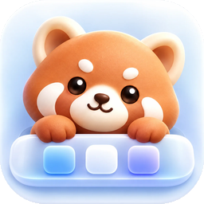

Warning: truncated output (original token count: 20184)
Total output lines: 174

<div align="center">



# Dockling 码头

### A free Dock shelf for macOS with an optional Pro upgrade and a red panda desktop pet, in English and Simplified Chinese.

**Website: [docket.shiduo.app](https://docket.shiduo.app)** · [简体中文](README.md) | English

Put a shelf of live widgets, app groups and folders next to the macOS Dock,
or use it in place of the Dock.

[](#build-from-source)
[](project.yml)
[](LICENSING.md)

<br>


</div>

---

> **Repository visibility notice (2026-11-27):** Dockling is moving toward **private development + a public product/support repository**. The public-facing repository will host product information, user feedback, issue reports, release announcements, and updates, not the complete source for new proprietary releases.
>
> **Important:** The current `docket-zh` repository is still public and includes source files and Git history. Until the split is completed, it must not be presented as a source-free showcase. Previously distributed MIT-licensed code and copies remain governed by their original licenses; making a repository private cannot revoke those rights. See [Licensing](LICENSING.md).

## What Dockling does

- **A shelf next to the Dock** with live widgets, app groups and folders, or use it in place of the Dock.
- **60+ widgets**: calendar, to-dos, focus timer, weather, radio, clipboard, screenshots, Calc and more. Click one for its details panel.
- **A red panda desktop pet** that stashes files, fetches new downloads and reminds you to stand up.
- **Window and app switching**: a ⌘Tab-style App Switcher, three window switcher styles and full-size previews.
- **Message island**: WeChat and other messages drop from the notch.
- **Layouts** switched by shortcut, Focus mode or ⌘ + scroll, and written back to Apple's Dock.

The interface is in **English and Simplified Chinese** and follows the system language. The basics are free; **Dockling Pro** is a one-time purchase, see the [website](https://docket.shiduo.app).

Dockling is an unofficial fork of [Docket](https://github.com/nparashar150/dockset) (MIT) that has grown into its own app.

## In development (next version)

- ⏳ **New widget, Time Insights (1.0, first stage)**: in Health & Habits, right next to the Focus Timer. The shelf card shows today's active time, the current app and its category, and a small bar that fills at 8 hours; clicking it opens today's overview (Active, Work, Other and Uncategorized, plus how much of the time in the foreground had no keyboard or mouse input), the top 5 apps and a one-line summary. It records only the frontmost app's name and time: switching apps, locking, sleeping, the screen saver, switching users and midnight all end a stretch, 5 minutes without input (adjustable in Settings) counts as away and isn't counted as active, and after a crash or force quit the open stretch ends at the last heartbeat, so nothing is counted twice. No keystrokes, no screenshots, no uploads. Records live in a local SQLite file (the system's own, with versioned migrations) and the last 90 days are kept. Pausing, excluding apps, clearing data and CSV export are all free, in the panel and in Settings ▸ Widgets ▸ Time Insights. Everything starts uncategorized and only a few built-in apps (such as Xcode, Figma and WeChat) get a category; browsers never count as work. Window titles, website domains, custom rules, a detailed timeline, weekly and monthly trends and the full export are Pro, and this version only describes them as coming soon: no titles or URLs are collected, and each will need its own consent once ready. Recording, splitting, idle deduction, deduplication, categories, migrations and export live in Core with tests. Not yet verified on a physical Mac.
- 📼 **New Retro Cassette model, Deck**: a fourth model with a matte charcoal body showing circuit traces, tiny screws and components in low-contrast gray. Along the top sit a round knob, an orange toggle (on while playing, off when paused) and three round glass keys (previous / play-pause / next, wired to the existing controls). In the middle is a black tape whose label lists the title and artist in 13pt monospaced type with the current track highlighted, plus the next two tracks from Up Next in the panel; a small square on the left reads side A, the two reels spin while playing and stop when paused, and the lower edge has a ribbed trapezoid with four small holes. A thin white light runs slowly around the tape bay while playing and fades out when paused; with Reduce Motion on, the reels and the light stay still. It is available on the 404-wide horizontal card, the side column, the panel, desktop cards and the library, and like Portable Player and Boombox it has no compact size; the body colors are fixed and do not follow light or dark mode. Not yet verified on a physical Mac.
- ✨ **Edge glow status cue**: a thin comet-like light with a very faint soft glow runs around the edge of the AI Assistant's "AI is thinking…" card, the notch chat input bar and the notch quick result card while an answer is being generated, around the AI input while it has the cursor, and around the ring of a running focus session. It fades in when things start and fades out when they finish, pause or the answer is done, after which its timeline stops so it costs nothing. It takes the accent color picked in the widget's appearance, or a soft white (dark) or gray (light) when none was picked, with no broad glow; it sits above the glass, so readable glass never darkens it. With Reduce Motion or Low Power Mode on, the light stays still. Settings ▸ Widgets ▸ Status cues adds an Edge glow toggle, on by default. The toggle, the motion rules, the phase and the tail segments live in Core with tests; the idea comes from border-beam-ios (MIT), the code is written here with no new dependency. Not yet verified on a physical Mac.
- 🐼 **Lively red panda (phase one)**: when the desktop red panda sits facing you, it switches to new cartoon expressions. Its eyes follow the pointer left, right, up and down (with a dead zone and hysteresis, returning to center when the pointer rests for a while or is far away). A click surprises it for about a second, petting makes it shy, four quick clicks make it dizzy for about two seconds (with a cooldown), it looks happy when cheering, and it gets sleepy just before dozing off as before; afterwards it goes back to following the pointer or looking ahead. Only the red panda is affected and only while sitting facing you; walking, side views, hanging, hugging and the other five mascots are unchanged. Settings ▸ Widgets ▸ Desktop Pet adds a Lively expressions toggle, on by default. With Reduce Motion on it does not follow the pointer, and expressions change without animation. It uses only the current pointer position, records nothing, and reuses the existing timer with no extra refresh. Front-facing and eyes-closed frames come later; until then the center view uses the original sitting frames and any missing frame falls back to the old look. The logic lives in Core with tests. Not yet verified on a physical Mac.
- 🐼 **Desktop companion 2.0 (off by default)**: Settings ▸ Widgets ▸ Desktop Pet adds three switches under Lively expressions, all off by default; they need Lively expressions and work while the red panda sits facing you on the Dock or the desktop. Typing companion: while you type, the red panda nods along (about 1.5 Hz, about 1.5°) and taps its front paws in turn, settling about a second after you stop. After about 3 seconds of steady typing it pulls out a little laptop, and puts it away about 5 seconds after you stop. It only reads the system's "time since last key press", never reads, records or uploads keystrokes, needs no new permission, and refreshes 20 times a second only while you type. Pointer swoop reaction: a pointer sweeping past quickly gives it a brief surprise, with about a 7 second cooldown, using only the current pointer position and recording no path. 3D head follow (experimental): the head tilts slightly toward the pointer (about 2° at most) using layers of the original art without changing its face, with the moving edges overlapping the base image so no seams show. Everything stays still in Low Power Mode or with Reduce Motion. The logic lives in Core with tests. Not yet verified on a physical Mac.
- 🦸 **Hidden members-only icons, Red Panda Heroes**: after unlocking Pro, Settings ▸ General ▸ App Icon shows an extra set of original hero red pandas at the end (Bamboo Blade, Forge Smith, Cloud Courier, Midnight Patrol, Storm Runner, Star Mage, Dock Captain, Shadow Ninja). The whole set stays hidden until unlocked, with all eight icons included. Not yet verified on a physical Mac.
- 🧹 **No more Appearance bar at the bottom of every panel**: the row is gone so panels are shorter. The Now Playing panel gets a ··· menu in its top-right corner with Up Next / Recently Played, volume steps and Panel style (vinyl / compact, Full card only). The vinyl panel is relaid out: title, artist · album, like and level bars and the progress bar on the right, with shuffle / previous / play / next / repeat in one row underneath. Not yet verified on a physical Mac.
- 💿 **Vinyl record styles**: in vinyl mode, the ··· menu offers Classic Vinyl, Clear and Glow. The record texture spins; the glass reflection and the glow ring stay still, and Glow only lights a thin outer ring. Not yet verified on a physical Mac.
- 🧹 **App icon changes**: removed Red Panda Dock and Red Panda Night; Classic is now called Light; only Light and Dark are free, the four crowns plus Halloween and Christmas are Pro. Removed icons, or Pro icons without a license, show Light. Not yet verified on a physical Mac.
- 🎨 **One appearance for all widgets**: Settings ▸ General ▸ Widget Appearance sets the color, background, tint strength and text color every widget follows by default; to make one widget different, turn off Follow General Appearance in Settings ▸ Widgets and adjust it there. Widgets that already had their own color keep it. Not yet verified on a physical Mac.
- 🎚️ **Now Playing card trimmed to Compact and Full, opening the vinyl panel by default**: Compact is a 232×62 strip with artwork, title, artist, previous / play / next pinned to the right and a 2 pt progress line along the bottom. Full is 312×62, the same height as the shelf row so nothing is clipped: a small turntable on the left (the arm drops and the record spins while playing, it stops and lifts on pause, and tapping the record plays or pauses), the title and artist in the middle, previous / a filled play button / next on the right and a progress line along the bottom; the left side follows the panel style, a turntable for the vinyl panel (with no artwork laid behind the card, so it does not fight the record) and plain artwork for the compact panel. Old Mini and Medium cards become Compact at launch, old Full cards stay Full, and every other setting is kept; the "Compact layout" switch is gone and skip back / forward are listed for Full only. The Full card opens a 420 pt landscape vinyl panel by default, with the record (about 140 pt across), metal tone arm and listening red panda on the left and the title, controls and a timed scrubber (lighter, thinner time digits) on the right, and Recently Played / Up Next as a one-line summary that opens the list page, where the volume now lives. Under Appearance you can switch it to a 300 pt compact panel; the Compact card always opens the compact panel and offers no vinyl option (artwork beside the title, like, scrubber, controls, volume and a one-line queue summary). The old large-artwork Standard panel is retired, the notch music card is untouched, and the elapsed time no longer rolls its digits. Not yet verified on a physical Mac.
- 💿 **Vinyl look V2, free**: the turntable is about 250 tall and the panel 320 wide. The large cover card on the left is gone; the record is bigger and fully visible, with the album artwork as its round center label (the artwork's main color when there is none). It sits on a platter with a metal rim, embossed rings and a little thickness, the tonearm gains a two-tier pivot base, a counterweight and a headshell with a marker line, and the stylus lands exactly on the grooves with the recalculated geometry. The brushed metal platter and tonearm now use realistic artwork drawn to match the design (falling back to the drawn version if an image is missing). A small patch of very faint water shows at the sides of the platter (fine ripples and a soft reflection that grow livelier as the record turns, generated from time only, never from audio, with no broad glow), and the listening red panda lies at the lower left. The motion is closer to a real turntable: on play the arm swings from its rest to the outer groove, lowers gently, then the record starts turning; on pause the record slows to a stop, the stylus lifts slightly and the arm stays where it was; on resume the stylus lowers again and the record carries on from the paused angle; at the end of a track the stylus lifts and the arm glides back to its rest; a new track or a seek lifts the stylus, moves it and sets it down while the record keeps turning. With Reduce Motion on you see the end state as a still frame, and nothing redraws frame by frame once the panel is closed or covered, or the motion has settled. The title is 19pt with tighter spacing under the turntable; shuffle, previous, play/pause, next, repeat, volume, the source switcher and Up Next / Recently Played stay. Vinyl is free and is now everyone's default. The layout, stylus geometry and motion state machine live in Core with tests. Not yet verified on a physical Mac.
- 🎵 **Music and podcast stability fixes**: after a podcast fails to play (network down, audio link gone), pressing play again reloads it from the saved position instead of showing Playing with no sound. The vinyl record and the playing bars stop redrawing while the Now Playing panel is closed, fully covered by another window or on another desktop, and pick up again when it comes back. On the notch music card, when the length is unknown, the Playing / Paused line and the play button follow the same play state, so they no longer disagree. The rules live in Core with tests. Not yet verified on a physical Mac.
- 🔋 **More reliable battery readings**: when headphones, a mouse, trackpad or keyboard is connected but reports no battery level, the card, the hover text and the detail panel say "Battery level unavailable" instead of "Not connected" or a made-up percentage; a Mac whose built-in battery cannot be read at that moment says the same and does not keep the previous number. AirPods put back in the case or a mouse switched off are no longer drawn again from a System Information snapshot taken minutes earlier, and a reconnected device shows its live level right away; third-party accessories that only System Information knows are now read about every 90 seconds, so a switched-off one keeps its old level for one round at most. A reading not updated for more than 4 minutes is marked "Data out of date", and the hover shows when that reading was actually taken; a failed System Information read no longer makes an old reading look new. On the multi-device card and in the detail panel, devices with a level come first, out-of-date readings next, unreadable ones last. The logic lives in Core with tests. Not yet verified on a physical Mac.
- 🐕 **New casual game: Shiba Match (free)**: find it in the Casual Games category of the widget library. Twelve cards in 3 rows of 4 hide 6 pairs (shiba, paw print, bone, doghouse, tennis ball, food bowl). Click one card to turn it over and a second to compare: a match stays face up and can no longer be clicked, a miss stays up for about 0.8 seconds and then turns back (clicks during that pause are ignored, so fast clicking cannot get it out of step). There is no limit on turns; every second card counts as one move, the timer starts at the first card and stops when the last pair is found, and the best result is kept on this Mac (fewest moves, then the shorter time). The Dock cards, landscape and portrait, only show the shiba, the state (Not started / In progress · 3/6 matched / Done) and a Continue entry; click to play in a 340 wide panel with the shiba avatar, title and state at the top, round glass Restart (asks for a second click mid game) and Sound buttons at the right, frosted glass card backs with a faint paw print, a 3D flip, a small bounce on a match (a simple fade with Reduce Motion on), Time, Moves and Best capsules at the bottom and a shiba lying at the lower left that never covers a card or takes a click. When every pair is found a result card covers the table with a cheering shiba, the moves, the time, whether it is a new best, and Play again. Flips, matches and the finish use light system sounds, on by default. Every card has a VoiceOver label, and in the panel the arrow keys move between cards while Space or Return turns one over. Pinned to the desktop, the small size shows the state only and the medium and large sizes are playable. A game in progress carries on when you reopen the panel, and a damaged save starts a fresh game. The shiba art comes only from the existing shiba master art in the repository; the final card faces will be drawn later, and until then the shiba face uses the shiba master's small head and the others use the system's color emoji. Light and Dark follow the system and the panel height is left to the shared panel container. The rules, saving, records, the board size (rows and columns are parameters ready for a later 4×4 and 4×5, with no level switch in this version) and the sizes live in Core with tests. Not yet verified on a physical Mac.
- 🎮 **New Casual Games category in the widget library**: Minesweeper and Pull Tooth move from Tools into a new Casual Games category (listed right after Tools in the sidebar); widgets already on your Dock are unaffected. Not yet verified on a physical Mac.
- 🎵 **Music joins the notch island**: while Apple Music, Spotify, NetEase Cloud Music or another player is playing (the same song the Now Playing widget shows), a rounded cover thumbnail grows out of the left of the notch and a thin sound wave in the cover's main color out of the right, each side staying within the island's width limit while the notch itself stays solid black and joined to both sides. When paused, the wave turns into three still short bars and the cover dims slightly; the island tucks away after half a minute of pause (not while the pointer rests on the card), and it does not appear when nothing is playing or playback has stopped. Hover over it and, like the radio card, a glass card 380 wide and 150 tall grows straight down from the notch: a 96 pt rounded cover on the left, and a small red panda in headphones lying at the card's top right corner beside the title (clear of the cover, text and buttons, long titles make room for it, and it never takes a click); the title, artist, a thin progress bar with elapsed and remaining time (1:24 / -2:10, left out for live streams without a length) on the right; then previous, play or pause and next, with volume (only when Apple Music or Spotify reports one) and the real icon of the source app (a generic music note when it cannot be read; click it to open that app) at the right. A very faint glow in the cover's main color fade…10184 tokens truncated…d the last one can be regenerated, and the input reads "Ask a follow-up…". Collapsed, hovering the notch shows "✦ AI Assistant", and while answering it shows "<service> is thinking" with three dots (still with Reduce Motion). When a notch island such as the focus timer or a download is showing, the chat panel opens below it instead of covering it. Not yet verified on a physical Mac.
- 🐼 **Notch Island follows your focus mascot, and the focus panel gets props**: the focus timer on the notch now follows the mascot chosen in the focus panel (the red panda without Pro, same as the panel), using that mascot's own art for the small head when collapsed and for focusing, paused (napping) and just finished or on a break when expanded; next to the focus ring, on the side where the red panda's bamboo pole stands, the Shiba, cat, penguin, otter and octopus each get a prop that floats gently while focusing and stays still with Reduce Motion, while the red panda keeps climbing its pole. All 20 notch pictures for the five mascots and their 5 props are in; if a picture is ever missing, the notch falls back to the hanging red panda (blinking only then), the collapsed head falls back to the panel picture, and a missing prop is simply not drawn. Not yet verified on a physical Mac.
- 💧 **AI quota water level now shows what is left, and supports Claude**: the water level in the live icons shows how much of the limit remains instead of how much is used, using whichever of the 5-hour and weekly limits is tighter, and falling back to the other when one has no data or is past its reset time; the percentage label shows what remains too. A new Claude switch (on by default) reads the account the Claude command-line tool is signed in to on this Mac (the keychain first, then ~/.claude/.credentials.json), read-only with nothing uploaded; the token goes only to Anthropic and is never refreshed by Dockling. Nothing is drawn when you are not signed in, and no API key is asked for. The first time it reads, macOS may ask whether Dockling may use that keychain item. It now follows the design: the water is tinted per app (blue for ChatGPT, deep orange for Claude, purple for Codex) with a bright surface line that sways gently at a low frame rate, pauses while the shelf is off screen and stays still with Reduce Motion; the percentage is now large bold white text in the lower-left corner; and hovering over an AI icon adds a glass capsule under its name with a countdown such as "Resets in 1d 18h". Settings now have an AI usage level switch with ChatGPT, Claude and Codex checkboxes (Codex gets its own switch, carried over from the old shared one) and a Show: choice of 5 hours, Weekly or Tighter (the default); with one limit fixed, nothing is drawn when that limit has no data. ChatGPT and Codex share the Codex usage data. Tuned after testing on a Mac: the water fills only the lower part of the icon (about 60% when full) so the app logo always shows, and is slightly translucent; the percentage stays inside the icon and shrinks if it does not fit; below 15% left the water turns warm red; and right-clicking the ChatGPT or Codex icon adds Show Quota Usage, which opens the AI usage panel, while a normal click still opens the app. Not yet verified on a physical Mac.
- 💬 **Live icons: unread messages**: Messages, WeChat and Mail show their unread count in the top-right corner, and the badge and icon bounce once when something new arrives (bursts within a second count as one). The count is read only from each app's own badge in the system Dock (Accessibility access needed); only the number is read, never the messages or the screen, and the icon stays as it is when no count can be read, so no made-up numbers. Two styles: Subtle (default) keeps the app's colours; Playful shifts colour with the count, blue for 2 to 3, purple for 4 to 6, magenta for 7 to 8 and red-pink for 9 or more, with a sparkle, flame or drip by the badge (still, not flashing). Settings, Shelf, Live icons has a checkbox per app, the style switch and a 0 to 9 preview. Mail also gets three states from the reference: three warm rays flash in the top-left when new mail arrives; an orange pencil sits in the bottom-right while a compose window is open (Accessibility, looking for a Send button in the window toolbar); a small spinning blue ring shows while mail is in the Outbox (AppleScript, counting Outbox messages only). The opening envelope would mean redrawing Apple's icon, so it is left out. With Reduce Motion nothing bounces or flashes and the ring stays still. Not yet verified on a physical Mac.
- 🧭 **Live icons: Chrome and Safari**: when the pointer rests on the icon, Chrome's coloured disc gives a small turn and springs back and Safari's compass dial sways twice and settles, with the frame staying still. While Chrome's current tab is loading, a thin blue arc now runs along the icon's edge and fades out when it finishes (the old whole-icon spin and launch spin are gone). Safari pages get the same arc while loading (read from the toolbar's Stop button, needs Accessibility permission). A blue download badge sits in the corner while a file is downloading into Downloads, with real progress for Safari, and a purple play badge with a soft glow while the browser plays sound. Nothing is drawn when the state can't be read, and there is no fake progress. Safari has its own toggle; with Reduce Motion nothing turns or runs, and the badges stay static. Not yet verified on a physical Mac.
- 🗑️ **Delete widgets in Widget Management**: each placed widget in Settings ▸ Widget Management now has a trash button (also in its right-click menu) that removes it from the shelf along with its settings after you confirm; the switch still just hides it. Not yet verified on a physical Mac.
- 🌗 **Radio, Photo Frame, Wallpaper and Perfect Day panels follow the appearance**: like every other panel they are light Liquid Glass with dark text in Light and a dark panel with white text in Dark, instead of always dark; text on photos and wallpapers stays white, and the shared basket image stays dark green. The Radio's Classic look and the LED Matrix, Porcelain Dial, Handheld Pixel and Ink Ruler skins follow Light or Dark (LED Matrix keeps its black display housing); the three retro skins and Smoked Glass are designed only for dark and stay dark when chosen. Not yet verified on a physical Mac.
- 🎞️ **Album Wide is now a film strip**: the photo showing now on the left, the next two stacked on the right, so it no longer looks like a wider Standard; the caption is always there, with the date and place when the photo has them, or the folder name and position when it does not. Not yet verified on a physical Mac.
- 🏝️ **Notch Island** (Pro): download progress, the focus countdown, the radio and a plug-in notice grow as a black island out of both sides of the notch, a second activity splits off as a small round island, and hovering expands a frosted glass card to pause, change station or set the volume; screens without a notch get the same shape centered at the top. Countdown card timers show there too (the one ending first when several run, with pause and end acting on that one), the meeting countdown joins the island right after timers, and the island tucks away while the volume or brightness hint shows, so it no longer overlaps the Live Alerts capsule. Not yet verified on a physical Mac.
- ✨ **Live icons** (off by default, Settings ▸ Shelf, with separate switches for Finder, Chrome and ChatGPT/Codex): the icons themselves move instead of wearing little badges. Chrome's icon spins steadily while the current tab is actually loading and eases back to rest when it finishes (needs permission for Dockling to control Chrome; without it the icon only spins once at launch); the ChatGPT and Codex icons hold a translucent water level showing how much of the Codex 5-hour limit is used, hidden when there is no data, and a soft white light travels around the icon's edge while Codex is working; Finder's whole icon becomes a red panda whose eyes follow your pointer (no Accessibility permission needed), drift back to center three seconds after it stops, and blink every few seconds, now and then twice. Nothing spins or flows with Reduce Motion on, the panda's eyes stay centered and don't blink, and Low Power Mode slows it down. Not yet verified on a physical Mac.
- 🦊 **Focus mascots**: pick a red panda, shiba, tabby, penguin, otter or octopus in the focus panel (red panda by default; the red panda is free, the other five are Pro), each with a waiting, focusing, break and just-finished look, and the Notch Island shows the mascot on the left and the time left on the right during focus; with the red panda the bamboo climb stays. Before a session starts, drag the big countdown left or right to set the length in 5 minute steps (5 to 90 minutes, with a trackpad tap at each step), choose a system sound for focus end and break end (preview, repeat or turn off), get a notification when a session ends, plus Skip and today's finished count. Not yet verified on a physical Mac.
- 🎋 **Hanging red panda**: while focus runs on the Notch Island, the collapsed island shows a little red panda head peeking out under the notch (with the red panda mascot); hover and the panda drops down from the notch, tail wrapped around a thin rope, holding a frosted glass timer (round, time left, pause or resume, end, progress bar). It keeps its eyes open, blinks every few seconds and sways gently during focus, dozes with a floating zZ and a dimmed time while paused, and grins on finish and during breaks; with Reduce Motion on it neither sways nor blinks. Countdown card timers keep their card. Not yet verified on a physical Mac.
- 🐾 **Pet steps aside for the shelf**: when the desktop pet curls up on the bottom edge and Dockling's shelf sits there too (including when it slides out from auto-hide), the pet moves beside the shelf instead of hiding behind it with only a few blades of grass or its ears showing; if neither side has room it stays out of sight. Not yet verified on a physical Mac.
- 🤝 **Makes way for Shiduo**: when Shiduo's notch shelf opens, Dockling's Notch Island tucks away and comes back once the shelf closes. Not yet verified on a physical Mac.
- 🐾 **Desktop pet follows your mascot**: with Pro, picking the shiba, ginger cat, penguin, otter or octopus in the focus panel turns the Dock pet into that mascot too: walking, running and carrying files alternate two bouncing frames, sleeping and curling up use its sleeping pose, cheers and waves its cheer, peeks its peek, hanging from the top edge, hugging a side edge and being picked up each have their own pose, and the rest of the time it sits. The red panda keeps its full frame-by-frame animation, and any missing picture falls back to the red panda. Not yet verified on a physical Mac.
- 👀 **Desktop pet peeks by the pointer and hides during calls**: Settings ▸ Widgets ▸ Desktop Pet adds Peek by Pointer (off by default): when the mouse stays still for about 20 seconds, your chosen mascot (the red panda without Pro, in its focus pose while focusing) peeks out at the lower left of the pointer, looking up at it and hides as soon as you move, type, click or scroll; it stays away while you are typing and also hides after about 3 minutes away. While still it is a single picture with no display refresh, and with Reduce Motion it only fades in. Hide During Calls (on by default) hides the pet and the peek while the microphone is in use (calls, meetings) and brings them back after you hang up; Dockling only checks whether the microphone is on and never records. The peek window takes no clicks or focus and stays out of screen sharing and recordings where macOS allows it. All six have their own peek art, falling back to the focus panel's standing picture if one is missing. Not yet verified on a physical Mac.
- 🐶 **The pointer companion now peeks over an edge, and the focus timer in the notch is narrower**: the mascot beside a resting pointer now peeks from behind an invisible horizontal edge, showing only its head, ears, both front paws and a little chest. All six use newly drawn edge-peeking art, scaled so their ear tips and the line where the front paws press down line up. The mask edge sits on that line, the round bottoms of the paws (and the tip of the Shiba's scarf) stay hidden behind it, a very faint contact shadow runs along it, and the head takes up about three quarters of what shows. The visible height is the same 40 points for all six (the whole 64 point picture before; the Shiba is about 47 points wide instead of 55, the otter, widest, about 57), and the figure leans 4 degrees towards the pointer. It rises 8 points from behind the edge, pauses with a slight squash, then settles with a 1.5 point bounce; with Reduce Motion it simply appears. The notch island's sides now take only the room their content needs, with 13 pt monospaced digits: for the focus timer the mascot side goes from 44 to 30 points and the time side from 70 to 45 (pausing no longer adds a pause sign, the digits just dim, so the width stays put; 57 for sessions of an hour or more); charging, download, meeting and radio get narrower too (icon side 40 to 28, charging 62 to 47, download 76 to 61, radio 44 to 30). The expanded card and the hanging timer now sit entirely below the menu bar, so in the menu bar the island only covers the notch itself and no longer hides status icons on either side. Not yet verified on a physical Mac.
- 🛠️ **AI Assistant and notch stability fixes**: when you ask again from the widget before the previous answer has produced any text, the replaced question is no longer sent to the model with the new one, so the model does not answer both. When the previous question failed, asking again sends the two questions as one message instead of two user messages in a row (which interfaces such as DeepSeek's reasoning model reject). While the notch AI chat panel is open, passing the pointer over the notch island no longer expands it into a card (it used to grow down into the panel and hide its buttons); it expands as usual once the panel closes. A countdown island that appears after the panel opens no longer pushes its remaining time strip into the top of the panel, which now slides down out of its way, and a quick result card that pops up while the plug-in neon animation plays goes to the fallback window and returns under the notch when the animation ends. On short screens where the panel no longer fits below the island, it gets shorter (down to 300 pt) and the messages scroll inside it instead of sliding back over the island. Tests now cover the replaced answer, the order when all six island activities appear at once, and the quick result card moving between the notch and the fallback window without losing the answer. Not yet verified on a physical Mac.
- 🎨 **Clearer names for the three color settings**: in Settings ▸ Shelf ▸ Look, Exclusive colors is now Shelf background color (with a small Pro badge). It only changes the shelf's base and gains Follow Default Widget Appearance (the system accent color when that is Default or follows the system), with a note when the Transparent look hides it. Settings ▸ General ▸ Widget Appearance is now Default widget appearance, and each widget's Color and background in Settings ▸ Widgets is now This widget's appearance, with the switch renamed Follow Default Widget Appearance and only one line about the inherited color while it is on. All three titles show their current state. Widget color is now Monochrome widgets, and its note says it grays out only the shelf's widgets while app icons keep their colors. Saved data is unchanged, so existing shelf colors, default appearance and per-widget colors are kept. Not yet verified on a physical Mac.

## New in v1.0

- 🐼 **Red panda desktop pet**: lives on any screen edge; drop files on it to stash them, it fetches new downloads and cheers when a focus session ends
- 🎨 **Custom Dock icons** for any app, Option-drag an image onto it (Pro)
- ⌨️ **Typing sounds**: 7 keyboard and typewriter sounds, plus Mechvibes packs (Pro)
- 🌐 **Automatic input sources** per app
- 🪟 **App Switcher v2**: big icon grid with window thumbnails (Pro)
- 🔮 **New widgets**: Fortune, Pull a Tooth, Minesweeper
- 📌 **Pin to Desktop** and **system widgets** (beta)

Full notes: [changelog](docs/en/changelog.md). Every widget with screenshots: [screenshots](docs/en/screenshots.md).

## Features

More than fifty widgets, grouped by use. Mix them freely on one shelf.

- **Apps, files and quick access**: app groups, folders, Downloads, File Shelf, Clipboard, Screenshots, Photo Frame, Bookmarks, App Switcher, Shortcuts, Search.
- **Productivity and focus**: Calendar, Week Agenda, Reminders, Quick To-do, Sticky Note, Focus Timer, Habits, Stand Up reminders, Anniversaries, Time Progress, Slacker Clock, AI Assistant, Translate, Codex Usage, GitHub.
- **Mac control and system**: Battery (with charge limit and battery alerts), System Activity, Network Activity, Gauges, Volume, App Volume, Microphone, Quick Toggles, Wallpaper, Trash, Mail.
- **Handy tools**: Calc (calculator, unit converter and currency in one), Color Picker, Emoji, Capture, Recorder, AirDrop.
- **Media and fun**: Now Playing (Apple Music, browser tabs, NetEase Cloud Music, Xiaoyuzhou), Radio, Podcasts, Ambient Sound, Virtual Pet, the Red Panda's Basket, Water.
- **Time, weather and markets**: Clock and World Clock, Weather and forecasts, Lunar & Holidays, Stocks, Watchlist, Crypto.
- **Live Alerts**: a small capsule below the notch for volume, brightness and upcoming meetings.
- **Dockling Pro**: a one-time purchase that unlocks extra widgets and looks. The basics are always free.


## Install

1. Download the latest `.dmg` or `.zip` from the [Releases page](../../releases)
   and move `Dockling.app` to Applications.
2. **The build is not signed or notarized**, so macOS 26 warns the first time you open it:
   - Double-click it, then close the warning;
   - Open **System Settings > Privacy & Security** and click **Open Anyway** next to Dockling;
   - Authenticate and confirm.

   Or remove the quarantine attribute in Terminal:

   ```sh
   xattr -dr com.apple.quarantine /Applications/Dockling.app
   ```

3. **Look in the menu bar on first launch.** Dockling is an accessory app with no Dock icon and no main window.
   Settings, the widget library and layout switching live in the menu bar icon.

### Known limitations

- An ad-hoc signed accessory app gets no location prompt from macOS, so enter a city for the Weather widget in **Settings > Widgets**.
- Now Playing needs Dockling allowed under **Privacy & Security > Automation**; reading browser tabs also needs "Allow JavaScript from Apple Events" in the browser's Develop menu.
- Lunar dates, solar terms, the "Chinese" clock face and the End User License Agreement stay in Chinese in the English interface.

## Build from source

You need macOS 26 and Xcode. The Xcode project is generated from `project.yml` and is not in the repository:

```sh
brew install xcodegen
xcodegen generate
xcodebuild -scheme Docket -configuration Release build
```

Interface text lives in String Catalogs under `Resources/Localization`. Simplified Chinese is the source language and English is the translation. At runtime the development region in Info.plist is English, so languages Dockling does not ship fall back to English, and the Traditional Chinese and Hong Kong tables carry the Simplified text.


## License

[MIT](LICENSE) for the original Docket code. Dockling's own additions are covered by [LICENSING.md](LICENSING.md) and the [EULA](EULA.md).
Third-party attribution and trademarks are in [NOTICE.md](NOTICE.md).
Dockling is not affiliated with, endorsed by, or sponsored by Dockset, CoolDock, upstream Docket or their authors.
