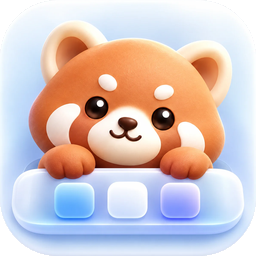
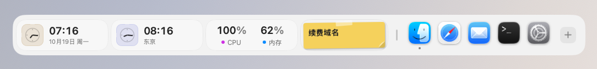
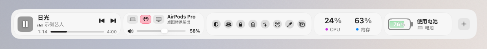

<div align="center">



# 码头 Dockling

### 免费下载、可升级 Pro 的 macOS 程序坞扩展栏，带小熊猫桌宠，简体中文界面。

**官网：[docket.shiduo.app](https://docket.shiduo.app)** · 简体中文 | [English](README.en.md)

[](#安装)
[](project.yml)
[](LICENSE)

<br>



</div>

---

## 码头能做什么

- **扩展栏**：贴在系统程序坞旁边，摆上实时小组件、应用分组和文件夹，也可以直接替代程序坞。
- **60 多种小组件**：日历、待办、专注计时、天气、收音机、剪贴板、截图、「算」（换算 + 汇率 + 计算器）等，点开有详情面板。
- **桌面宠物小熊猫**：住在程序坞上，帮你暂存文件、叼来刚下载的文件、提醒起来活动。
- **窗口与应用切换**：⌘Tab 式应用切换器、窗口切换三种样式和全尺寸预览。
- **消息灵动岛**：微信等消息从刘海弹出。
- **多套布局**：快捷键、专注模式、⌘ + 滚轮都能切换，还能写回系统程序坞。

基础功能免费；**码头 Pro** 一次性买断，解锁更多小组件、外观和工具，详见[官网](https://docket.shiduo.app)。

## 开发中（下一版）

- 🎚️ **正在播放卡片收成精简、完整两档**：原来的迷你、中、完整三档里，「中」只是把同一条横排拉宽到 404，比完整还占地方。现在「样式」里只有精简和完整：精简是 232×62 的横排小条，封面、歌名、歌手和固定在右边的上一首 / 播放 / 下一首，底边一条 2pt 进度线，点开是 300 宽的精简面板（封面和歌名横排、喜欢、进度、控制、音量，「刚才听过 / 接下来」收成一行摘要，点它再进列表）；完整是 264×132，左边一个小唱盘（银色唱盘、转着的唱片带封面标签、银色唱臂，播放时落针转动，暂停停转抬臂，点唱片也能播放暂停），右边歌名、歌手和控制，底下一条进度，不再大片留白。设置页去掉和样式打架的「紧凑布局」开关，快退快进和跳几秒只在完整卡片上列出。旧的迷你和中卡启动时自动变成精简，旧的完整不变，其他设置都保留。完整卡片点开照旧是标准或黑胶面板，刘海音乐卡片不受影响；面板里已播时间不再逐秒滚动数字，免得像被切掉一半。尚未在真机上验证。
- 💿 **黑胶模式 V2 精修，改为码头 Pro**：唱台加高到约 250、面板加宽到 340（标准样式仍是 320，外观不变）。去掉左边的大封面卡，唱片放大、轮廓完整，中心圆形标签是专辑封面（没有封面用封面主色）；唱片放在带金属边、压纹和一点厚度的唱盘上，唱臂换成两层转轴底座、配重和带指示条的唱头，唱针按重新算的几何正好落在音轨上；拉丝金属唱盘和唱臂改用按效果图画的写实素材（缺图时回退代码画法），唱盘两侧露出一小片很淡的水面（细波纹和柔和倒影，转得越快波纹越明显，只按时间生成、不读音频，不做大面积发光），左下角趴着听歌的小熊猫。动作更像真唱机：开始播放时唱臂从支架缓缓移到外圈、轻轻落针、唱片再起转；暂停时唱片慢慢减速停下、唱针微抬、唱臂停在原处；继续时重新落针，从暂停的角度接着转；放完时抬针、唱臂缓缓回到支架；切歌或拖进度时唱针抬一下移过去再落下，唱片不停。减弱动态效果时直接画终点静帧，面板关上、被挡住或动作结束后不再逐帧刷新。歌名 19pt，唱台和歌名之间留白收紧；随机、上一首、播放暂停、下一首、循环、音量、来源切换和「接下来 / 刚才听过」照旧。黑胶模式改为 Pro：面板样式旁带 Pro 标识，没解锁时选它弹付费墙并提示「黑胶模式是 Pro 功能，现在显示标准样式」，已经选过的照旧存着、先画标准样式，解锁或试用时自动回来。唱台布局、落针几何、动作状态机和 Pro 判断放在 Core 并有测试。尚未在真机上验证。
- 🎵 **音乐与播客稳定性修复**：播客播放失败（网络断开、音频地址失效）后再点播放，会从记下的进度重新载入，不再停在「正在播放」却没有声音；正在播放面板关上、被别的窗口整个挡住或切到别的桌面时，黑胶唱片和正在播放的小竖条停止刷新，回来接着转；刘海音乐卡片读不到时长时，「正在播放 / 已暂停」和播放键用同一个播放状态，不再一个写播放一个画暂停。判断放在 Core 并有测试。尚未在真机上验证。
- 🔋 **电池读数更可靠**：耳机、鼠标、触控板、键盘连着但读不到电量时，卡片、悬停说明和详情面板写「电量不可获取」，不再显示「未连接」或编一个百分比；Mac 有内置电池但这一刻读不到时同样写「电量不可获取」，不留上一秒的数。AirPods 收进盒子、鼠标关机后，不再从几分钟前的系统信息里把旧百分比画回来，重新连上马上恢复实时电量；只有系统信息知道的第三方配件改成约 90 秒读一次，关机后旧电量最多再留一轮。读数超过 4 分钟没更新时标「数据已过期」，悬停里的更新时间写这份读数真正读到的时刻；系统信息读失败不再把旧读数当成新的。多设备卡片和详情面板里有电量的设备排在前面，过期的其次，读不到的最后。判定放在 Core 并有测试。尚未在真机上验证。
- 🐕 **新增休闲小游戏「柴犬翻翻乐」（免费）**：在小组件库「休闲游戏」分类里。3 行 4 列 12 张牌、6 对图案（柴犬、爪印、骨头、狗窝、网球、饭碗），点一张翻开、再点一张比对，配上的一直翻着、不能再点，没配上停约 0.8 秒再翻回去（这期间的点击不算，快速连点不会乱）；不限翻牌次数，每翻第二张算一步，计时从第一次翻牌开始、配完停下，本机记最佳纪录（步数最少，步数一样比用时）。扩展栏横版、竖版卡片只显示柴犬、状态（未开始 / 进行中 · 已配对 3/6 / 完成）和「继续游戏」入口，点开 340 宽的面板玩：顶部柴犬头像、标题和状态，右边重新开始（进行中时要再点一次确认）和音效两个圆形玻璃键；中间牌背是磨砂玻璃加一个淡爪印，翻牌是 3D 翻转，配上时轻轻弹一下，减弱动态效果时改成淡入淡出；底部「用时」「步数」「最佳」三个胶囊，左下趴着一只柴犬（不挡牌、不拦截点击）；配完时牌桌上盖一张结果卡（举爪的柴犬、步数、用时、是否新纪录、再来一盘）。翻牌、配对、完成用系统轻音效，默认开。每张牌有读屏标签，面板里可以用方向键移动、空格或回车翻牌。钉在桌面时小号只显示状态，中号、大号能直接玩。进行中的盘关掉面板再打开可以接着玩，存档坏了就开新的一盘。柴犬只用仓库里已有的柴犬母版素材；牌面正式图之后补，缺图时柴犬脸用柴犬母版小头，其余用系统彩色 emoji。浅色、深色跟随系统，面板高度交给通用面板容器。规则、存档、纪录、棋盘规格（行列可配，为以后的中级 4×4、高级 4×5 留好，这一版不放难度切换）和尺寸放在 Core 并有测试。尚未在真机上验证。
- 🎮 **小组件库新增「休闲游戏」分类**：扫雷和拔牙从「小工具」移到新的「休闲游戏」分类（侧栏排在小工具后面），已经放在码头上的不受影响。尚未在真机上验证。
- 🎵 **刘海小岛新增「音乐」活动**：Apple Music、Spotify、网易云音乐等正在播放时（和「正在播放」小组件读同一首），刘海左边伸出圆角封面缩略图、右边一条细音波条，颜色取封面主色，每侧都不超过刘海小岛的宽度上限，刘海本体照旧纯黑、和两侧连成一体；暂停后音波变成三条静止短竖线、封面稍暗，暂停半分钟后收起（指针停在卡片上时不收），停止或没有播放时不显示。指针停在小岛上时，和刘海电台卡片一样从刘海下沿长出一张 380 宽、150 高的玻璃卡片：左边 96 点圆角封面，卡片右上角歌名旁趴着戴耳机的小熊猫贴纸（不挡封面、字和按钮，长歌名会给它让位，不拦截点击）；右边歌名、歌手、细进度条和两端的已播、剩余时间（1:24 / -2:10，直播流没有时长时不画）；下面上一首、播放暂停、下一首，右边音量（Apple Music、Spotify 读得到音量时才有）和来源 App 的真实图标（读不到时是通用音符，点一下打开那个 App）；卡片顶部一层很淡的封面主色光晕往下渐隐。点封面或歌名打开「正在播放」小组件的面板（在别的布局或文件夹里也行，没有时找复古卡带），一张都没有时打开来源 App。和其他活动一起出现时音乐优先级最低：码头自带的收音机在播时收音机是主岛、音乐是右边的小圆岛，收音机只是暂停后留着而音乐在播时两者对调。音波只是按播放状态的装饰性律动，不读麦克风、不采集音频，减弱动态效果时静止。设置 ▸ 刘海小岛的活动列表里多了「音乐」：新装默认勾上（总开关仍默认关），已经存过设置的老用户默认不勾，小岛不会突然多出来。状态映射、优先级、时间文字、收起宽度、卡片几何和点歌曲区域打开哪里放在 Core 并有测试。尚未在真机上验证。
- 💿 **正在播放面板加可选的「黑胶模式」**：在面板底部「外观」里多了一行「面板样式」，可选标准或黑胶模式，默认仍是原来的标准外观，选了才换（外观摘要里写「黑胶模式」，选回标准就恢复原样）。黑胶模式上面是一座唱台：左边真实专辑封面放在圆角玻璃卡里，后面一张代码画的黑胶唱片（细纹路、两道分轨空白，中心标签用封面图，没有封面时用封面主色），右上金属质感唱臂；播放时唱片匀速慢转，唱臂落到唱片上并按播放进度从外圈慢慢移向内圈（读不到时长时停在外圈），暂停时唱片停转、唱臂抬回支架；唱片下方几圈很淡的水波纹（浅色淡蓝灰、深色深蓝灰，低透明度），播放时缓慢扩散，暂停时静止；系统开了减弱动态效果时不转不扩散，只显示静帧和唱臂位置，只在面板打开并在播放时才动。下面是歌名、歌手 · 专辑、喜欢（支持的来源），进度条两端时间，随机、上一首、播放暂停大圆键、下一首、循环（和标准样式同一套判断，系统控制不了的键不画，浏览器标签页只有播放暂停），音量条，有歌单时接「接下来」；顶上来源切换和「在 App 中打开」照旧。浅色、深色跟随系统，黑胶模式不铺深色底，按钮和封面卡用可读玻璃，面板宽 320 不变，高度交给通用面板容器。样式开关、唱台布局、唱臂落针角度、转速和水波纹放在 Core 并有测试。尚未在真机上验证。
- 💣 **扫雷面板按效果图精修**：难度仍是初级（9×9、10 雷）和中级（16×16、40 雷）两档，面板固定 340 宽，换难度不跳。顶上小熊猫加大，用六状态图（准备、游戏中待机，踩雷举爪提醒、不再变成灰白小骷髅，赢了举爪庆祝），标题「扫雷」下一行「找出所有地雷，挑战你的观察力！」，右上小熊猫橙「再来一盘」；难度压成一条分段条（初级 / 中级，「9×9 · 10 雷」放在悬停提示里）；读数写成「剩余 10 雷」和「00:05」计时，右边音效圆钮；悬停的格子描一圈橙边，插旗时小旗轻弹一下，踩到的那格红底白边；「排行榜」改名「本机纪录」，默认折叠成一行「本机纪录 初级 · 最佳 00:28」，点开看前五；第一次打开有一行提示「左键揭开 · 右键插旗 · 找出所有安全格子」，玩完一局后不再显示；输赢时棋盘上盖一张玻璃结果卡（小熊猫、「哎呀！踩到地雷了！」或「挑战成功！用时 00:28 新纪录！」，「查看棋盘」「再来一盘」），刚赢时冒一小把彩纸，减弱动态效果时不动；底是很淡的暖橙到雾紫和两只很淡的爪印。浅色、深色跟随系统，带字玻璃用可读玻璃，高度交给通用面板容器（和别的面板一样最高 560）。面板宽度、首次提示、计时格式和结果文案放在 Core 并有测试。尚未在真机上验证。
- 🤖 **AI 助手面板按竖版效果图改版**：顶栏换成小 App 图标和「码头 · AI 助手」，右边齿轮里仍是刘海对话开关、助手设置和 AI 设置。空闲时上面是欢迎区，左下大字「你好」和一句「今天想让 AI 帮你做什么？」，右上是笔记本场景小熊猫（输入框有字时对着笔记本打字，答完短暂庆祝）；下面是 2×2 快捷操作玻璃块，每块一个彩色小图标，沿用设置页里勾选的那几个（默认改名为「截图提问 / 总结剪贴板 / 翻译内容 / 写作优化」，功能不变），「更多」里仍是其余快捷操作和常用提示词。输入框照旧伸缩、2000 字上限，主按钮改成整行宽的小熊猫橙实色胶囊「开始提问」（网页、App 方式照实写「去网页提问」「复制并打开豆包」，下面一句说明怎么处理），最底下「使用模型：」下拉里是服务、打开方式和回答位置。API 方式正在回答时，欢迎区换成「AI 正在思考…」玻璃卡（转圈，减弱动态效果时换成静止图标，底边一道很淡的静态色带，可停止生成）；答完换成「已完成」结果卡片，按钮是复制、再试一次（重新回答上一问）和继续提问（接着这次对话问，光标回到输入框），也可展开到完整对话或关掉。面板宽 420 改为 380，带字玻璃改用可读玻璃，浅色、深色跟随系统，不自设高度，交给通用面板容器，内容多时在面板里滚动。尚未在真机上验证。
- 🐼 **AI 助手扩展栏卡片按 Dock 小组件效果图精修**：尺寸不变，只改图标、模型入口和状态显示。横版是「多模型快速切换」：左边坐着的小熊猫，一道细分隔线，后面一排圆角方形模型键（用服务现有的首字母或首字），当前模型暖橙描边、浅橙底、右上一个小橙点，末尾细虚线「＋」管理更多模型；点模型键直接用那个模型打开助手（网页或 API 方式打开刘海对话并切到它，跳转方式照旧打开它的 App 或网页），卡片放不下时按顺序少画几块，当前那块和「＋」总留着，每块点击区 24pt。竖版改成「状态陪伴卡」，和横版分工：不放模型键、模型字母和箭头，对着笔记本的小熊猫占大头（生成中换抬头等回答那张，答完、出错短暂表态，右上角状态点），旁边一块读得清的玻璃写「问 AI」和一行提示；空闲时每 8 秒轮换「可以试试：截图提问」这类提示，取设置里勾选的快捷操作名，一个没勾时是「点一下开始提问」，减弱动态效果时只显示第一条不轮换；生成中、完成、出错只认码头拿得到的（API 方式的回答），网页和 App 方式一直显示提示。整块点一下开始提问（打开逻辑不变），右键扩展栏菜单里多了「截图提问」。字不小于 13pt，放不下优先留「问 AI」，提示行先缩成短的再截断；尺寸不变（横放 108×62、侧边栏 76×112）。模型键是读得清的玻璃，浅色、深色两版跟随系统。AI 面板和刘海快捷结果不变。按宽度取键数、当前模型、键上的字、状态、竖版小熊猫姿势和提示轮换放在 Core 并有测试。尚未在真机上验证。
- 🦷 **拔牙面板按效果图改版，换上新的小熊猫圆圆**：顶部牙齿徽章、「小熊猫圆圆」和副标题「点一颗牙拔下来，找到疼牙就合嘴！」（开局后换成当前状态），右上音效和重开两个圆形玻璃键；下面一条玻璃信息卡，左边「安全拔牙 N / 11」（大数字粉色，浅色外观下对比度过 4.5:1），右边奖杯「最高纪录 N 颗 · 赢 N 局」；中间是张大嘴、双爪捧脸的新小熊猫，牙仍由代码画在嘴里、按新图重新标定（两排顺着嘴形微微弯），每颗牙的点击区至少 24pt；底部玻璃提示条「点一颗牙，试试手气！ | 12 颗牙中有 1 颗疼牙」，结束后左边换成「再来一局」。拔到疼牙换成闭眼皱眉的表情再抖两下，赢了换成戴皇冠挂奖牌的欢呼；拔下一颗时冒一小簇星星、小熊猫轻轻缩一下；减弱动态效果时只换图，不抖、不飞、不冒星星。面板宽改为 380 才放得下 24pt 的牙，背景是玻璃上一层淡紫雾和很淡的爪印，浅色、深色两版跟随系统，高度交给通用面板容器。扩展栏卡片和钉在桌面的小、中、大卡片同步换新图：小号只画嘴里两排牙，中号画嘴，大号画眼睛到爪子，三档牙都在嘴里、点击区都至少 24pt。规则不变（12 颗、1 颗疼牙、最高纪录、胜场、音效开关），裁切和标定放在 Core 并有测试。尚未在真机上验证。
- 🏝️ **刘海小岛电台卡片重排**：卡片顶上一截和刘海同宽、紧贴刘海下沿往下长出来，两侧弯出去再铺满，中间不再断开一截，两侧仍在菜单栏下面、不挡右边的状态栏图标；宽度按内容收窄到 340 点（原来 372），专注、计时、AI 快捷结果等其他卡片不变。左边换成当前所选电台外观的收音机插画（读电台小组件的外观，读不到用经典调谐，缺图退回原来的小猫收音机），透明图直接放、不再垫橙色底，掌机像素最近邻缩放不糊边。控制改成上一台、播放暂停（主按钮）、下一台，上一台和电台面板、媒体键同一套换台逻辑。右边放「CH 03 / 06」台号（和电台面板同一套编号）和播放波形，暂停时静止，减弱动态效果时不动；台名太长时先缩小字号（不小于 13 点）再截断，音量条保留；浅色、深色跟随系统。插画选择和台号放在 Core 并有测试。尚未在真机上验证。
- 🌐 **翻译面板按效果图重排（轻量双区）**：顶部一排「源语言 ▾」胶囊、交换键、「目标语言 ▾」胶囊（智能方向时显示「智能 · 目标语言」）；「原文」卡的输入框默认约两行高，随文字长高到上限后在卡内滚动，底部「N / 5,000」字数、朗读和清空；「译文」卡字号大一号、描一圈强调色，右下朗读和拷贝，没有译文时两者不可用，双击译文也能拷贝，拷贝后按钮短暂显示对勾。下面一排「粘贴」「截图翻译」「翻译」（翻译是主按钮），放不下图标时只留文字，不截断。「最近翻译」有记录才出现，每条原文一行、译文一行、右侧箭头，点一下重新填入，默认列三条，「全部 N 条」展开到最多 20 条。点面板里的「粘贴」立刻翻译；只在点按时读一次剪贴板，从不轮询。切换语言保留原文并按新方向重新翻译。面板不再自设高度，交给通用容器，内容多时在面板里滚动；浅色、深色两版跟随系统。「由 macOS 在本机翻译」的说明已核对：文字翻译、截图识字和朗读都在本机完成。字数显示、输入框高度和最近记录条数放在 Core 并有测试。尚未在真机上验证。
- 📻 **网络电台面板按效果图重做（紧凑 CH 03 布局）**：九套外观共用一个紧凑头部，左上外观名小胶囊（点开外观画廊）、「CH 03 / 06」、台名大字和「HLS · 网络直播」，右上「正在收听」状态胶囊，数值都按当前台和收藏实时显示；下面是各外观自己的主视觉，比原来小约两成（经典调谐半圆表盘、木壳电子管、复古便携竖刻度、数码卡座段码屏加 VU 表、烟晶玻璃、琥珀点阵加频谱、白瓷转盘拖动换台、掌机像素、黑白刻度横尺拖动换台），再下面上一台、播放暂停、下一台和带百分比的音量条，分段「收藏 N / 搜索 / 世界 / 定时」。收藏列表上面一行「我的收藏 · N 个电台」和「添加电台」，当前台整行描边高亮、显示跳动的波形和「正在收听」，其余行右侧「…」菜单；删除改在右键菜单和「…」菜单里，行内不再有叉号。外观改了显示名（经典调谐、木壳电子管、复古便携、数码卡座、烟晶玻璃、琥珀点阵、白瓷转盘、掌机像素、黑白刻度），存的值不变，旧配置照常读；外观选择改成画廊，每套是真实视图缩小的实时预览，Pro 外观标角标、名字不被挤。九套都有浅色、深色两版，跟随系统，复古机身和烟晶玻璃不再固定深色。右上角可放收音机插画（Resources/RadioArt/radio-art-外观名.png，约 64pt），缺图就不显示。面板高度交给通用容器，内容多时在面板里滚动；听歌的小熊猫留在头部右边，减弱动态效果时照常静止。尚未在真机上验证。
- 🎧 **播客面板改成沉浸式播放器（UI 2.0）**：顶栏是耳机图标、「播客」和订阅数，右边刷新和「…」（刷新、全部标为已听、在小宇宙网页打开、取消订阅、添加订阅）；订阅多个节目时下面是切换胶囊（小封面加短名，选中描边，右侧下拉列出全部节目），长节目名不再被截断；当前播放卡左边封面、右边「继续收听 / 正在播放」标签、单集名、「主播 · 节目」和已收听约多少，下面进度条、已播和剩余时间、后退 15 秒、播放大按钮、前进 30 秒（按钮下有说明），底部「章节 | 在小宇宙打开」；「最近单集」默认两条，「查看全部」展开，每条标出正在播放、未听、收听中（带百分比）或已听完，新增「全部 / 未听 / 收听中」筛选；「节目更新于」和单集的「发布于」分开标注。封面一律按比例完整显示，四周留安全边距，不裁切、不叠任何东西（扩展栏卡片的新单集角标挪到播放键角上；钉在桌面的卡片把正在播放小竖条和新单集角标挪到节目名旁边）。所有强调色（选中描边、标签、进度条、播放键、「查看全部」、单集图标、背景氛围）都从当前封面取主色，浅色外观压暗、深色外观提亮到对比度至少 4.5:1，换节目就换颜色，灰白或没有封面时用中性色；背景渐变是封面背后单独一层，跟随系统浅色 / 深色。小熊猫不再常驻：只在没有订阅或节目没有可播单集时出现，听完一整集举爪一次约 2.4 秒，减弱动态效果时只换静帧。面板仍由通用容器限高、超出时滚动。取色、校正、渐变、状态、筛选、折叠和短名放在 Core 并有测试；订阅、进度保存与恢复、历史单集不变。尚未在真机上验证。
- 🪟 **小组件详情面板不再超出屏幕**：所有小组件的详情面板都按所在屏幕的可用区域（菜单栏下、程序坞和扩展栏上）定高，上下各留 12 点，菜单栏设成自动隐藏时也让出菜单栏；内容更高时在面板里滚动，底部「外观」栏钉住不随内容滚走，上面或下面还有内容时对应边缘淡出提示。每次打开都从顶上开始，不再停在上一次滚到的位置（之前看起来像顶上一截被截掉）。面板左右夹在屏幕内、尾巴仍指向卡片，扩展栏在顶部或左右侧同样处理；多显示器按卡片所在屏幕算，分辨率、菜单栏或程序坞变化和展开折叠时重新计算。计算放在 Core 并有测试。尚未在真机上验证。
- 🔋 **电池小组件体验增强**：Mac 电量低于 20% 又没接电源时，电池卡片角落和详情面板头部出现举爪提醒的小熊猫，接上电源或电量回来就消失；充满（100%，或到达生效中的充电上限）时小熊猫挥爪一次，约 2.4 秒后消失，其余时间仍是纯数据界面。「电量低于 20%」系统通知照旧在设置 ▸ 电池提醒里开关（默认开），跨过阈值只提醒一次，插拔电源不再重复，电量回到阈值以上 5% 才会再次提醒。多设备卡片上耳机、鼠标等配件连上、断开或电量跌破 20% 时，对应圆环亮一圈描边，数字处换成「已连上」「已断开」「电量低」小胶囊 2 到 3 秒，不发系统通知（充电盒合盖不算断开，只提示电量低）。详情面板底部一行小字「更新于 15:32」，是采样器真实的采样时间，没有数据时不显示。数值变化时圆环约 0.3 秒平滑过渡，充电时圆环下面一层光慢慢呼吸；系统开了减弱动态效果时小熊猫只换静帧，圆环不呼吸。判定都在 Core 并有测试。尚未在真机上验证。
- 🔋 **电池小组件精修**：迷你卡片、多设备圆环和详情面板读同一个采样器、同一时刻刷新，卡片出现时上一次采样超过 2 秒先补采一次。充电上限不再只看开关：标题行「充电上限 · 80%」右侧显示状态胶囊（生效中、未生效、不支持、需安装助手、需更新助手，判定放在 Core 并有测试），不支持或未生效时多一行橙色说明，例如「当前设备无法控制充电，设置的上限尚未生效。」；充电上限默认折叠，展开后是开关、上限、缓冲和「兼容性与诊断」；Pro 功能清单补了一句兼容性提示。多设备圆环图标更清楚，悬停显示设备名、连接状态和更新时间。迷你卡片改成「MacBook · 80%」，下面一行「接通电源 · 未充电」。详情面板压缩高度：顶部一行大号电量、「MacBook · 已接电源」和小字「未充电」，右侧圆环带数字；今日曲线加图例（电量、充电时段）和现在的标记；下面最大容量、循环次数两列。尚未在真机上验证。
- 🔋 **电池「多设备」样式**：四个圆环固定显示 Mac、耳机、充电盒和鼠标（没有鼠标时依次用触控板、键盘或其他配件），读不到电量时显示「-」，不编造数字；原有「电量」「电池格」「仅图标」不变。尚未在真机上验证。
- 🐼 **小熊猫六状态**：面板里的小熊猫不再各自写死一张图，按真实功能状态换样子，六种状态（待机、思考、探头、提醒、完成、休息）统一用 Resources/PandaStates 的新图，同一尺寸、底部对齐，缺图时回退原来的小熊猫。天气：平常天待机，下雨下雪、风大、空气差举爪提醒，紫外线那句保留抱竹筒喝水，提醒没了回待机。AI 助手（小组件面板和刘海完整对话的顶栏）：输入时待机，提交后到生成中是思考，答完短暂庆祝约 2 秒，失败短暂举爪提醒；网页和 App 方式一直待机，不假装在回答；Dock 提问后刘海里探头的仍是你选的吉祥物。待办：有事要做待机，清单空了休息，今天清空完成；记下一条探头一下，勾完一条庆祝一下，3 秒内连着勾只庆祝一次。喝水（角色样式的小熊猫）：快喝饱了待机，提醒时段里很久没喝举爪提醒，小口喝、点 + 喝一口、口渴和骷髅照旧，达标庆祝；其他角色不变。专注计时照旧按你选的六只吉祥物画，等开始、休息、刚完成在面板和刘海小岛上一致。状态之间约 0.3 秒淡入淡出，完成、提醒只轻轻弹一下（约 0.9 秒，不循环），系统开了减弱动态效果时只换静帧；小熊猫不拦截任何点击。其余面板和小组件卡片里原来的小熊猫静态图（闹钟、倒计时、纪念日、日历、农历、邮件、录音、麦克风、音乐、收音机列表、便签回收站、坐姿、扫雷、Codex、各种空状态、提醒弹窗、刘海消息卡片等）也统一换成这六张：站着换待机、欢呼换完成、歇着换休息，化了、饿了、病了换提醒，Codex 干活中换思考；喝水、吃东西、骷髅等场景动作，电子宠物、桌面伙伴、专注吉祥物、刘海小熊猫、收音机和磁带上的小贴纸照旧。另外清理了日历动态图标里已经不用的回退参数。尚未在真机上验证。
- 🐼 **小熊猫场景图**：新增七张和六状态同一母版、同尺寸、同底部锚点的场景图（晴、雨雪、冷、热、喝水、记下、录音），缺图时回退待机。天气提醒卡按真实天气换：白天晴是晴天图，正在下雨下雪或有降雨提醒时是雨雪图（雨雪告警也用它代替举爪），体感 5℃ 及以下是冷，30℃ 及以上是热，其他天气和夜里待机，没有天气数据时待机；风大、空气差告警照旧举爪，紫外线和补水那句换成新的喝水图。喝水（角色样式的小熊猫）：点 + 喝一口那一下和提醒时段里很久没喝（该喝水了）用喝水图，小口喝、口渴、骷髅、达标照旧。待办：记下一条那一下改成拿笔记下（和原来一样 3 秒内只表态一次），有事待机、空了休息、清空完成不变。录音：正在录音时录音面板空列表里的小熊猫、麦克风面板「没有 App 在用」那只换成对着麦克风录音，空闲照旧待机。系统开了减弱动态效果时只换静帧。尚未在真机上验证。
- 💻 **AI 助手里的小熊猫抱着笔记本**：新增两张场景图（同母版、同尺寸、同底部锚点）。AI 助手面板顶上那只在输入框里有字时对着笔记本打字，提交后到答完抬头等回答（头顶三个点），代替原来的「思考」；答完短暂完成、失败短暂提醒、其余待机不变。缺图时回退待机，减弱动态效果时只换静帧。尚未在真机上验证。
- 📻 **收音机里的小熊猫**：电台正在出声时，小熊猫戴着耳机出现在收音机里一起听（用录音那张场景图）：经典外观在详情面板台号右边原来收音机图标那一格、卡片左边图标那一格（同样大小，不挤台名和按钮）；三款复古外观和五款新外观在详情面板台名右边的空位，40pt，不挡台名和控件，也不碰上面的指针刻度，复古暗色皮肤里照样看得清；瓷白圆盘播放时把右下角贴纸收起，同一面板只放一只。正在连接、缓冲时小熊猫是等待的样子，连不上（重连中）举爪提醒；暂停或停止后小熊猫消失，回到原来的样子，不常驻；添加小组件里的预览不显示。系统开了减弱动态效果时只换静帧。判定在 Core 并有测试。尚未在真机上验证。
- 🌤️ **天气面板精修**：顶部保留「石家庄 · 当前位置」和「城市」切换，旁边新增 i 按钮，点开看数据来源（MET Norway、Open-Meteo 署名）、更新时间和隐私说明，原来底部两行来源说明收进去，底部只留一行「14:10 更新 · MET Norway · Open-Meteo」和刷新按钮，没连上时写「离线，显示缓存数据」。小熊猫提醒改成紧凑提醒卡：下雨、风大和空气质量告警排在最前，空气差时带 AQI 数值，点一下切到「指数」页看美标 AQI 的数值、档位、刻度和建议；没有特别天气时缩成一行短句，不再重复大字里的温度。大字旁补上今天最高最低温和体感温度（来自 Open-Meteo，没取到就不显示）。「今天」页先是「未来两小时」：15 分钟降水盖得住一个半小时才显示，无雨只占一行「暂无明显降水」，有雨才画降水条；下面风向风力、湿度、日出、日落改成统一的 2×2 小卡。「今天 / 指数 / 逐小时」三页叠在一起取最高的一页做高度，切换不再跳；逐小时拖动时温度、天气和天色跟着变照旧。尚未在真机上验证。
- 🐼 **AI 助手：Dock 提问后刘海直接给结果**：在货架的 AI 卡片里用 API 提问，面板收起，刘海下方自动长出约 420 宽的快捷结果卡片（高度随内容 180 到 300 点，长了在卡片里滚动），你选的吉祥物从刘海里探头趴在卡片上沿；先显示「ChatGPT 正在思考」，回答流式逐字出来，答完是「复制回答」「继续追问」「展开」，失败时一句原因加「重试」「展开」。头部是服务字牌、服务名和状态胶囊（正在思考 / 正在回答 / 已完成 / 失败），右边固定、「…」（复制、重新生成、在完整对话中打开、设置）和关闭。「继续追问」「展开」打开原来的完整对话（同一个会话，继续追问时光标进输入条）。刘海被专注计时、通知、下载等小岛或拾掇占着时改用同样的备用浮窗（屏幕右上角菜单栏下方，或小岛下方），不盖住它们；收起卡片回答照样答完，点刘海再看；上一条还在生成时又提问会停掉上一条（已出的字保留）马上答新问题。网页和 App 方式照旧复制后跳转，不弹卡片。设置 ▸ AI 新增「回答显示位置」（刘海优先 / 小组件面板，后者保持原来的做法）、「提交问题后自动展开结果」和「回答完成后」（保持显示 / 15 秒 / 30 秒后自动收起，指针在卡片上不倒计时）。小组件面板同步按新效果图：输入框右下角字数「24 / 2000」（超过不提交），快捷胶囊「剪贴板」改短名，底部一排是「ChatGPT · API」下拉（服务和打开方式在一起）、「回答位置：刘海」（网页和 App 方式换成一句说明）和小熊猫橙主按钮「提问」。尚未在真机上验证。
- 📅 **动态图标：日历**（设置 ▸ 扩展栏 ▸ 动态图标，新子开关「日历」默认开）：日历图标换成码头画的日历，红色页眉写星期、中间是几号，都按今天走。下一场日程开始前 30 分钟（「提前开始：」可选 10 / 15 / 30 / 45 / 60 分钟）起，图标下部一层液面随剩余时间从满降到底，平时是克制的灰蓝，剩 5 分钟以内变暖橙；底部小胶囊写倒计时「24 分」（13pt 等宽数字，放不下就写「24分」或「24」，字不缩小），不到 1 分钟写「即将开始」，开始后写「进行中」一分钟，然后先轻轻放大一下，整枚图标在屏幕平面上顺时针转一圈（约 0.9 秒，转到一半倒立时换成下一场），转完显示新场次的液位和倒计时；同一场绝不重复转，日程库一阵连着变时 10 秒内只转一次，系统开了减弱动态效果时不转直接换。不是动画循环：只在倒计时分钟数变、液面降 1 像素时重画，低电量模式只跟分钟。悬停日历图标时名称旁多一张玻璃小卡片，列今天剩下的日程（日历颜色彩点、时间、名称，最多 4 条）。只读今天的定时日程，不含全天和自己已拒绝或已取消的，不读备注、不上传；复用已有的日历权限，不另外弹框，没有权限或今天没有要倒数的日程时仍是码头的日历面（星期和日期，不画液面和胶囊），关掉开关时图标保持系统原样。尚未在真机上验证。
- 🐼 **AI 助手面板精修**：输入框默认约 100 点高（放 3 行），字多了跟着长，到 200 点后在框里滚动；一排是截图提问、剪贴板总结、翻译、润色和「更多」（其余快捷操作、常用提示词、调整快捷操作），不再被挤掉；底部分左右两栏：左边当前服务始终排第一、带勾，再露一个别的服务和「…」，下面一句说明这次会怎么处理（App 和网页方式写明「到那边粘贴发送」）；右边是打开方式下拉（不能选的灰掉写原因）和唯一的主按钮「发送」「去网页提问」「复制并打开 豆包」。尚未在真机上验证。
- 🐼 **AI 助手按效果图改版**：小组件负责发起，刘海负责对话，专注计时和提醒显示时对话卡片自动挪到它们下面。小组件面板顶上是小熊猫、「AI 助手」和副标题「码头 · 快捷工作台」，刘海对话开关和设置收进右边「…」；中间是大输入框，左下角写「Enter 提交 · Shift+Enter 换行」；下面四个快捷胶囊默认是截图提问、剪贴板总结、翻译、润色（剪贴板总结只用剪贴板里的文字，不动输入框；助手设置里仍可换成处理剪贴板、总结、解释）；底部一排是服务分段按钮（卡片上启用的前三个，其余收进「…」，放不下时少露一个）、模式胶囊（API 模式 / 网页模式 / App 模式，点一下换到下一种能用的，没填 API 密钥时跳过 API）和发送。刘海收起态是从刘海下沿长出的黑色胶囊「● AI 助手」，回答生成中是「ChatGPT 正在思考」加三个跳动的小点，小熊猫从胶囊下沿探头；胶囊宽度和刘海小岛同一套规则（13 点字，放得进刘海就和刘海同宽，放不下每侧最多加 70 点），整个在菜单栏下面，不盖右边的菜单栏图标。点开的对话卡片 400×520，放在菜单栏下面空 6 点，不再接在刘海上：顶上是小熊猫、「AI 助手」（下面一行小字是当前服务，几个服务时点开换）和 API / 网页 / App 分段控件（没填密钥或没有网页版的那一段变淡，悬停写原因）；我的提问是靠右带头像的浅色气泡，回答是靠左带小熊猫头像的气泡，下面有「复制」「继续追问」（光标回到输入条）和重新生成；底部输入条是「+」（快捷指令、常用提示词和新对话）、「继续追问……」和「↑」。网页模式的刷新和在浏览器打开挪到网页下面一行。全部是液态玻璃，跟随浅色 / 深色，最小 13 点字，只有发送按钮用强调色；减弱动态效果时胶囊不伸缩、小熊猫不升起、小点不跳。尚未在真机上验证。
- 🌧️ **专注环境音修好「没声」，合成声做细**：环境音小组件设成「正在播放时显示」时，专注一开始放声音它就冒出来，并把播放器换成自己的组合（没选声音时直接停掉），专注那一轮随即被当成「用户换了」不再放回，这是听不到声音的主要原因，现在小组件出现时不再改动专注或试听正在放的声音；没解锁 Pro 时每小时和每次唤醒的锁定检查也会把专注的环境音停掉，现在只停环境音小组件自己放的，媒体键也能控制专注的环境音；环境音小组件的定时关闭不再管专注和试听；没有可用输出设备时直接算失败，换输出设备后从 0 淡入、仍算专注放的。专注面板环境音一行下面多一行小字写当前状态（正在播放、开始专注时自动播放、休息时停下），这一轮因为让给环境音小组件、你手动停了或换了、声音设备没准备好而没放时写明原因，在面板里改选别的声音算明确要放；设置里选「不播放」以外的声音或点「换」时先试听约 4 秒；全新安装默认选雨声，老用户存过的选择（包括「不播放」）不动。七种合成声都改成多层叠加：雨声是中频沙沙声加远处低频、近处稀疏清脆和远处密集细小两种雨滴，雨势慢慢起伏；海浪是两层长度、高度、涨落快慢都随机的浪，浪头带泡沫，底下一直有暗涌；风声是快慢两层阵风，大风时带一点呼啸；篝火是随火势变化的低沉火声、火苗闪动、一阵一阵 1 到 5 下的噼啪和零星火星；白、粉红、棕色噪音有轻微的音量呼吸，白噪音压掉刺耳高频。所有起伏都是随机游走，没有固定周期；雨滴和噼啪带约半毫秒起音，总输出去直流、柔化高频、软削波，开关某种声音约 1.2 秒线性过渡，整体淡入淡出各 1.5 秒。尚未在真机上验证。
- 🖼️ **相册标准版与宽幅版面板分开**：顶栏写「相册 · 标准」或「相册 · 宽幅」。标准面板以单张为主，大图下面是「第 12 / 300 张」和真实剩余的换图时间，上一张、暂停 / 继续、下一张和「接下来」4×2 照旧；宽幅面板和宽幅小组件一样是胶片条，主图旁边上下两张接下来的小图，下面写拍摄日期、地点和那年今天（没有的字段不写），按钮位置和标准一致，最底下一行露 4 张预览，横着滑看更多。悬停缩略图不再盖一层大「排除」遮罩，改成右上角小「…」菜单（排除 / 撤销排除、打开原图）；原来面板底部那行说明挪进鼠标停留的提示里。设置新增「显示方式」：完整显示（默认，竖图两边垫一层同图模糊底，不裁人物）或铺满裁切，小组件和面板一起跟着变；老卡片没有这项时按完整显示，间隔等旧设置照读。没有文件夹权限、文件夹为空、读不了文件夹时各有一句清楚的提示。两种面板都是 320 宽，每张相册卡片的进度、暂停和排除各管各的，换样式时正在放的那张和倒计时不变。尚未在真机上验证。
- 🐾 **桌宠更活泼**：六只吉祥物（小熊猫、柴犬、橘猫、企鹅、水獭、八爪鱼）坐着、发呆、趴着时身子轻轻呼吸起伏；发呆时隔几秒随机穿插左右张望、歪头、点头、原地小跳、开心扭一下，什么时候做哪个按时间算，不连着重复。只有几张图的五只用现有帧加变换补出伸懒腰（往上拉长）、打哈欠和抬头看（微微后仰）、蔫了（压矮）。随意放置时不再一直死坐，偶尔在原处左右一小段里走几步再走回来，记住的位置不变，不出屏幕可见区。专注计时陪伴时只呼吸不乱动；开了减弱动态效果时不呼吸不转不跳，只换朝向和姿势；低电量模式下静止时刷新减半，小动作也不开高频刷新。尚未在真机上验证。
- ✦ **AI 助手小组件与刘海对话联动**：小组件提问面板重排成顶栏（当前服务、模式标签、「Pro 刘海对话」开关、设置齿轮）、居中的大输入框（「想让 AI 帮你做什么？」，右下写着 Enter 提交 · Shift+Enter 换行，中文输入法选字时回车照旧只确认选字）、一排快捷操作胶囊（默认截图提问、处理剪贴板、翻译、总结，可在设置页勾选换成润色、解释，最多四个）和底栏（切换服务、按提交会发生什么、发送）；字牌管理、打开方式和 API 密钥收进齿轮里的「助手设置」二级页。小组件和刘海对话共用当前服务；API 和网页方式提交后先收起小组件面板，再从刘海长出对话，请求挂在共享的会话上，收起面板也照样答完；网页方式只复制问题并提示「请粘贴后发送」，不假装已发送；App 方式只负责跳转。刘海对话顶栏加了模式标签和关闭按钮，快捷指令默认折叠，对话区更大，每条回答下面有复制，最后一条可重新生成，底部是「继续追问……」；收起时刘海下沿悬停显示「✦ AI 助手」，生成中显示「某服务 正在思考」加三个小点（减弱动态效果时不跳）。专注计时、下载等刘海小岛正显示时，对话面板挪到小岛下面，不盖住它。尚未在真机上验证。
- 🐼 **刘海小岛跟随所选吉祥物，专注面板加道具**：刘海上的专注计时改成跟着专注面板选的吉祥物走（没解锁 Pro 时和面板一样是小熊猫），收起时的小头、展开后专注中、暂停打盹、刚完成和休息各用这只吉祥物自己的图；专注面板进度环右边（小熊猫竹竿那一侧）给柴犬、橘猫、企鹅、水獭、八爪鱼各放一件道具，专注进行中轻轻浮动，开了减弱动态效果时不动，小熊猫照旧爬竹竿。五只的 20 张刘海图和 5 件道具已放入；以后缺图时刘海回退倒挂小熊猫（眨眼只在小熊猫时有），收起时的小头回退面板状态图，道具缺图就不画。尚未在真机上验证。
- 💧 **AI 额度水位改成剩余，并支持 Claude**：动态图标里的水位改成还剩多少额度（不再是已用多少），取 5 小时和每周里更紧的那个，某个窗口没数据或已过重置时间就看另一个；百分比小字也显示剩余。新增 Claude 子开关（默认开）：读本机 Claude 命令行已登录的账号（先读钥匙串，再读 ~/.claude/.credentials.json），只读不上传，令牌只发给 Anthropic，过期了不自己刷新；没登录时不画，不用填 API key。第一次读取时 macOS 可能弹框问是否允许码头使用钥匙串里的这一项。按效果图换了样子：水按 App 上色（ChatGPT 蓝、Claude 深橙、Codex 紫），水面一条亮线低帧率轻晃，扩展栏不在屏幕上时停，减弱动态效果时静止；百分比改成左下角白色粗体大字；鼠标停在 AI 图标上，名称下面多一颗玻璃胶囊显示「1天 18小时后重置」这类倒计时。设置里改成「AI 额度水位」总开关加 ChatGPT、Claude、Codex 三个勾选（Codex 拆出自己的开关，老设置照搬），「显示：」可选 5 小时、每周或取更紧的（默认），固定某个窗口时它没数据就不画；ChatGPT 和 Codex 共用 Codex 额度数据。按真机反馈收敛：水只占图标下半截（满额约六成高），上半截 App 标志始终露出，水稍透；百分比限制在图标里，放不下时缩小；剩余低于 15% 时水变暖红提醒；右键 ChatGPT、Codex 图标多一项「查看额度用量」，直接弹出 AI 用量面板，左键照旧打开 App。尚未在真机上验证。
- 💬 **动态图标：消息未读**：信息、微信、邮件图标右上角显示未读数，来新消息时角标和图标轻弹一次，1 秒内连着来的合并成一次。未读数只取系统程序坞上它们自己的角标（需要辅助功能权限），只读数字，不读消息内容、不截屏；读不到时图标保持原样，不画假数字。两种风格：简洁（默认）保持原色；趣味按未读数换色，2 到 3 条蓝、4 到 6 条紫、7 到 8 条紫粉、9 条及以上红粉，角标旁分别挂闪光、火焰、液滴（静态，不持续闪）。设置 ▸ 扩展栏 ▸ 动态图标里有三个 App 的勾选、风格切换和 0 到 9 条的预览。邮件另按参考图加三样：来新信时左上角闪三道暖光；开着写信窗口时右下角挂橙色铅笔（辅助功能看窗口工具栏有没有「发送」按钮）；发件箱里有信时挂一圈转动的小蓝环（AppleScript 只数发件箱封数）。信封开合要重画官方图标，不做。减弱动态效果时不弹不闪，小环静止。尚未在真机上验证。
- 🧭 **动态图标：Chrome 与 Safari**：鼠标停在图标上时，Chrome 中间的彩色圆盘轻转一下弹回，Safari 表盘轻摆两下停住，外壳都不动。Chrome 当前标签页在加载时，改成沿图标边缘走一道细蓝弧，加载完淡出（原来整个图标转圈和启动转一圈都去掉了）。Safari 网页加载时也走这道细弧（看工具栏「停止载入」按钮，要辅助功能权限）。「下载」文件夹里有正在下的文件时右下角挂蓝色下载徽标，Safari 带真实进度；浏览器在出声时挂紫色播放徽标加一圈柔光。读不到就不画，不画假进度。Safari 有自己的开关，减弱动态效果时不转不走弧，徽标静态照挂。尚未在真机上验证。
- 🗑️ **小组件管理可以删除**：设置 ▸ 小组件管理里每个已放上的小组件多了垃圾桶按钮（右键也有），确认后从扩展栏删掉并清掉设置；只想暂时不显示仍然用开关隐藏。尚未在真机上验证。
- 🌗 **收音机、相框、壁纸、完美一天面板默认跟随外观**：和其他面板一样，浅色外观下是浅色液态玻璃深色字，深色外观下是深色面板白字，不再固定深色；压在照片、壁纸上的字仍是白字，分享出去的竹篮图仍是深绿。收音机经典外观和灯阵、瓷白圆盘、掌机像素、墨白直尺跟着浅色/深色走（灯阵的黑色 LED 机身不变），三款复古皮肤和烟晶只有深色设计，选了仍是深色。尚未在真机上验证。
- 🎞️ **相册宽幅改成胶片条**：左边大图是正在放的这张，右边上下两格是接下来要放的两张，和标准那张纯照片一眼分得开；大图下沿始终有一行字，有拍摄日期写“那年今天”和日期地点，没有就写文件夹名和第几张。尚未在真机上验证。
- 🏝️ **刘海小岛**（Pro）：下载进度、专注倒计时、收音机和插电提示从刘海两侧长出黑色小岛，两件事同时进行时分出右边的小圆岛，悬停展开成液态玻璃卡片，可暂停、换台、调音量；无刘海屏幕在顶部居中显示同样形状。倒计时卡片的计时器也会上小岛（同时几个显示最先结束的，暂停、结束作用到那一个），会议倒计时并入小岛排在计时器之后，音量、亮度提示出现时小岛先收起，和灵动提示胶囊不再重叠。尚未在真机上验证。
- ✨ **动态图标**（默认关，设置 ▸ 扩展栏，访达、Chrome、ChatGPT/Codex 各有子开关）：图标本身动起来，不再贴小挂件。Chrome 当前标签页真在加载时图标匀速转，加载完缓缓停回原位（需要允许码头控制 Chrome，不允许时只在启动那一下转一圈）；ChatGPT 和 Codex 图标里有一层半透明水位，显示 Codex 5 小时额度已用多少，没有数据时不画，Codex 正在干活时一道白光沿图标边缘绕圈；访达图标整张换成小熊猫访达，两颗眼珠跟着鼠标指针看（不需要辅助功能权限），指针停下 3 秒后慢慢回正，每隔几秒眨一下眼，偶尔连眨两下。开了减弱动态效果时不转、不流动，小熊猫眼珠居中、不眨眼，低电量模式下放慢。尚未在真机上验证。
- 🦊 **专注吉祥物**：专注面板里可选小熊猫、柴犬、橘猫、企鹅、水獭、八爪鱼六只吉祥物（默认小熊猫，小熊猫免费，其余五只是 Pro），各有等开始、专注中、休息、刚完成四种样子，刘海小岛专注时左边是吉祥物、右边是剩余时间；选小熊猫时专注进行中照旧爬竹竿。专注没开始时左右拖剩余时间的大数字按 5 分钟一档定时长（5 到 90 分钟，每换一档触控板轻震），专注结束、休息结束各选一种系统提示音（可试听、可连响几次、可不响），结束时发本机通知，另有“跳过”和今日完成数。尚未在真机上验证。
- 🎋 **倒挂小熊猫**：专注计时在刘海小岛上收起时，选小熊猫的话左边是从刘海底下探出来的小脑袋；指针停上去，小熊猫用尾巴缠着细绳从刘海倒挂下来，爪子捧着液态玻璃计时牌（第几轮、剩余时间、暂停或继续、结束、进度条）。专注中睁眼、隔几秒眨一下、轻轻左右摆，暂停时闭眼打盹、头上飘 zZ、时间变淡，刚完成和休息时开心大笑；开了减弱动态效果时不摆不眨。倒计时卡片的计时器照旧是卡片。尚未在真机上验证。
- 🐾 **桌宠让开扩展栏**：桌宠蜷在屏幕下边缘时，码头扩展栏在底边（自动隐藏滑出来时也算）就挪到扩展栏旁边，不再躲在它后面只露出几根草或一对耳朵；两边都放不下时先不出来。尚未在真机上验证。
- 🤝 **给拾掇让位**：拾掇的刘海暂存架展开时，码头的刘海小岛先收起，暂存架收起后回来。尚未在真机上验证。
- 🐾 **桌宠跟随所选吉祥物**：解锁 Pro 并在专注面板选了柴犬、橘猫、企鹅、水獭或八爪鱼时，程序坞上的桌宠也换成那只：走路、跑、叼文件时两帧交替一颠一颠，睡觉、团起来时趴睡，欢呼、挥手时欢呼，探头时探头，吊在屏幕上边、抱着左右边、被拎起来也各有专门的样子，其余时候坐着；小熊猫仍是整套逐帧动画，缺图时回退小熊猫。尚未在真机上验证。
- 👀 **桌宠指针旁探头、通话时藏起**：设置 ▸ 小组件 ▸ 桌面宠物新增「指针旁探头」（默认关）：鼠标约 20 秒没动，所选吉祥物（没解锁 Pro 时是小熊猫，专注中换专注的样子）在指针左下方探出头，一动鼠标、按键、点按或滚动就收起，正在打字时不出来，人走开约 3 分钟也收起；静止时只是一张图，不开显示刷新，减弱动态效果时只淡入。新增「通话时藏起」（默认开）：麦克风在用（通话、开会）时桌宠和探头先藏起来，挂断后再出来，只看麦克风开没开，不录音。探头窗口不接鼠标、不抢焦点，系统支持时不进屏幕共享和录屏。六只都有专用探头图，缺图时回退专注面板的站姿图。尚未在真机上验证。
- 🐶 **指针旁的小伙伴改成扒边探头，刘海专注计时更窄**：鼠标停着时出现在指针旁的吉祥物改成从一条看不见的水平边后面扒边探头：只露头、耳朵、两只前爪和一点胸口，六只换成新画的扒边探头图，耳朵尖和前爪压边那条线统一对齐，遮罩边就放在这条线上，爪子圆底（柴犬还有垂下来的围巾尖）藏到边后面，边上一道极淡的接触阴影，头约占露出部分的四分之三；可见高度六只统一 40 点（原来整张 64 点，柴犬宽约 55 → 47 点，最宽的水獭约 57 点），整体朝指针歪 4 度；出场先从边下升起 8 点、停住轻轻压一下、再回弹 1.5 点落定，减弱动态效果时直接出现没有动画。刘海小岛两侧只留刚好放下内容的宽度，字统一 13 点等宽数字：专注计时左边吉祥物 44 → 30 点，右边剩余时间 70 → 45 点（暂停不再加暂停号、只调暗数字，宽度不变；一小时以上 57 点）；插电、下载、会议、电台的耳朵也一起收窄（图标一侧 40 → 28 点，插电 62 → 47，下载 76 → 61，电台 44 → 30）。展开后的卡片和倒挂计时牌整个挪到菜单栏下面，菜单栏那一条只占刘海本身，不再往两侧盖住状态栏图标。尚未在真机上验证。
- 🛠️ **AI 助手与刘海稳定性修复**：小组件里连续提问时，被新问题顶掉、还没出字的旧问题不再跟着发给模型，免得模型把新旧两个问题一起答；上一问出错没答上时，再问会把两问合成一条发出去，不再连发两条用户消息（DeepSeek 推理模型等接口会因此报错）。刘海 AI 对话面板开着时，指针经过刘海小岛不再展开成卡片（以前会往下长进面板、按钮被挡住），面板收起后照常展开；面板打开以后才出现的倒计时小岛（下面那条剩余时间）不再压进面板顶上，面板会平滑往下让开（屏幕矮、放不下原高时面板先缩短到最矮 300，消息在里面滚动，不压回小岛），插电霓虹动画播放时弹出的快捷结果卡片改放备用浮窗，播完回到刘海下。被顶掉的旧回答、六种小岛活动同时出现时的先后、快捷结果卡片在刘海和备用浮窗之间来回换不丢都补了测试。尚未在真机上验证。

## v1.0 新增

- 🐼 **桌面宠物小熊猫**：可停在屏幕四边，拖文件到它身上就暂存，下载完成叼过来，专注完成会欢呼
- 🎨 **程序坞自定义**：给任意 App 换显示图标，按住 Option 拖图片即可（Pro）
- ⌨️ **打字音效**：7 款机械键盘 / 打字机声音，可导入 Mechvibes 声音包（Pro）
- 🌐 **输入法自动切换**：切到哪个 App 就换成它的输入法
- 🪟 **应用切换器 v2**：大图标网格 + 窗口缩略图（Pro）
- 🔮 **新小组件**：卜卦（观音灵签 + 真黄历）、拔牙、扫雷
- 📌 **钉在桌面、系统小组件**（测试版）

完整更新记录见 [更新记录](docs/更新记录.md) 或 [官网更新页](https://docket.shiduo.app/changelog.html)。

## 小组件一览

| 分类 | 包含 |
| --- | --- |
| 应用与文件 | 应用分组、应用切换器、书签、下载、文件暂存、搜索、隔空投送、快捷指令 |
| 效率与专注 | 日历、提醒事项、邮件、专注计时、快速待办、便签、喝水、久坐提醒、时钟、世界时钟、倒计时、闹钟、时间进度 |
| Mac 控制 | 正在播放、音量、快速开关、壁纸切换、录音、麦克风、系统活动、网络活动、电池、圆环仪表 |
| 实用工具 | 剪贴板、算、表情符号、天气、GitHub、股票、加密货币、收音机、播客、Codex 用量 |
| 图片与截图 | 相册、最近截图、截图工具、取色器 |
| 小游戏 | 卜卦、拔牙、扫雷、电子宠物 |

每个小组件的详细说明和面板截图见 [小组件详解](docs/小组件详解.md)。

<table>
<tr>
<td></td>
<td></td>
</tr>
<tr>
<td></td>
<td></td>
</tr>
</table>

<sub>截图均为应用真实界面，由仓库自带的截图工具拍摄（见 [docs/截图说明.md](docs/截图说明.md)）。</sub>

## 安装

1. 从 [Releases](../../releases) 下载最新的 `.dmg`，把 `Dockling.app` 拖进「应用程序」。
2. 首次打开若提示无法验证：到 **系统设置 ▸ 隐私与安全性**，点码头旁边的 **仍要打开**。
   或在终端运行：`xattr -dr com.apple.quarantine /Applications/Dockling.app`
3. 码头没有程序坞图标，**设置和小组件库都在菜单栏的小熊猫图标里**。

需要 macOS 26 或更高版本。权限说明和已知限制见 [常见问题](docs/常见问题.md)。

## 从源码构建

```sh
brew install xcodegen
xcodegen generate
xcodebuild -scheme Docket -configuration Release build
```

默认 ad-hoc 签名，不需要开发者证书。更多构建说明见 [CONTRIBUTING.md](CONTRIBUTING.md)。

## 支持码头

码头的基础功能免费，Pro 解锁额外的小组件、外观和工具，是我用下班和周末时间做的。如果它让你的 Mac 用起来更顺手，欢迎请我喝杯咖啡 ☕，金额随意；不方便赞助也没关系，分享给朋友或在 GitHub 上点个星，同样是很大的鼓励。应用里也能找到：菜单栏图标 ▸ **支持码头…**，或 **设置 ▸ 通用** 底部的“赞助”。

<p align="center">
  
  &nbsp;&nbsp;
  
  &nbsp;&nbsp;
  <a href="https://ko-fi.com/hanson528"></a>
</p>

海外用户可以在 [Ko-fi](https://ko-fi.com/hanson528) 用 PayPal 或信用卡打赏。


## 致谢

- **[Docket](https://github.com/nparashar150/dockset)**：本分支的上游项目，MIT 许可，
  版权归其原作者所有。扩展栏、小组件框架和大部分小组件都来自上游；本分支负责中文本地化，
  并新增了上文列出的小组件和布局切换功能。
- **[Dockset](https://dockset.app)**：Docket 的灵感来源，是由独立开发者打造的**原创付费应用**。
  如果你喜欢这个想法，想要打磨更完善、有售后支持的正式产品，请购买 Dockset，支持独立开发者。
- 天气数据来自 **[MET Norway](https://api.met.no/)**，依 CC BY 4.0 许可使用。
- 逐日天气预报来自 **[Open-Meteo](https://open-meteo.com/)**，依 CC BY 4.0 许可使用。
- **[Codenotch](https://github.com/vinzdg/codenotch)**（MIT 许可）：Codex 用量小组件读取的接口和会话日志格式参考了它的源码。
- **[阿喵收音机 meowRadio](https://github.com/ca-x/meowRadio)**（MIT 许可，Copyright (c) 2026 ca-x）：收音机小组件的图标和“弧光调谐”面板的设计参考了它；电台目录来自 **[Radio Browser](https://www.radio-browser.info)**。
- 工程由 **[XcodeGen](https://github.com/yonaskolb/XcodeGen)** 生成。

本分支与 Dockset、CoolDock、Docket 上游及其作者均**无任何关联**，也未获得其认可或赞助。
README 的分类介绍方式参考了同类应用的常见写法，所有截图均为本应用自己的界面。
完整的署名与商标说明见 [NOTICE.md](NOTICE.md)。

## 许可证

[MIT](LICENSE)。第三方署名与商标说明见 [NOTICE.md](NOTICE.md)。

