<div align="center">


# 码头 Dockling

### 免费、开源的 macOS 程序坞扩展栏，简体中文界面。

**官网：[docket.shiduo.app](https://docket.shiduo.app)** · 简体中文 | [English](README.en.md)

在系统程序坞旁边放一条扩展栏，摆上实时小组件、应用分组和文件夹，
也可以直接用它替代程序坞。

[](#从源码构建)
[](project.yml)
[](LICENSE)

<br>


<sub>所有截图都是应用自己的界面，由仓库中的截图工具在 macOS 上实际拍摄（见文末“截图是怎么来的”）。</sub>

</div>

---

## 这是什么

码头（Dockling，原名 Docket 中文版）是 [Docket](https://github.com/nparashar150/dockset) 的**非官方简体中文本地化分支**。
上游 Docket 是一个 MIT 许可的开源 macOS 应用，本分支做了这些改动：

- 把所有用户可见的界面文字翻译成简体中文：菜单栏菜单、设置面板、小组件库、
  小组件卡片与详情面板、提示文字、弹窗、权限说明、空状态等；
- 调整构建配置，让任何人 clone 后都能直接构建（ad-hoc 签名、独立的 bundle ID
  `com.docket-zh.app`，可与上游英文版同时安装）；
- 新增二十多种小组件（相册、最近截图、下载、文件暂存、剪贴板、取色器、单位换算、
  截图工具、表情符号、搜索、音量、快速开关；v0.4.0 又加入壁纸切换、应用切换器、书签、录音、
  邮件、计算器、汇率换算、GitHub；v0.4.1 加入麦克风、圆环仪表、久坐提醒），时钟样式与天气扩展，
  扩展栏外观预设、单个小组件的条件显示与背景开关、放不下时自动缩小，
  以及三种切换布局的方式，见下方“新增功能：更快地切换布局”。

与上游一致的基础能力：

- **跟随真实的程序坞**：大小、所在边缘、放大效果和自动隐藏都实时读取系统设置。
- **应用分组**：把一个图标拖到另一个图标上并停留，即可像 iOS 一样建立分组。
- **布局**：可保存多套布局，并可写回系统程序坞（只改动 `persistent-apps`，带校验和回滚）。
- **点按小组件会打开详情面板**，显示更多内容和操作。

---

## 小组件一览

四十多种小组件，按用途分成五类，最后两节集中展示 v0.4.0 与 v0.4.1 新增的内容。每一类都可以自由组合，放在同一条扩展栏上。

<sub>下面每类第一张图是放着该类小组件的真实扩展栏，小组件显示的是小组件库自带的示例数据
（日历、提醒事项、音乐等需要授权的内容不会读取拍摄机器上的真实数据）；详情面板截图中
标注“示例数据”的同理，其余为拍摄时的实时读数。</sub>

### 应用、文件和快速访问

把常用应用、刚下载的文件和要来回拖动的文件都放在手边，不用再打开访达翻找。

**包含：** 应用图标与分组、应用切换器、书签、下载、文件暂存、搜索（网页搜索或查找文件）、隔空投送、快捷指令

- **应用切换器**：正在运行的应用图标（与 ⌘Tab 的范围相同），当前应用排在最前，点按即切换；
  放不下时最后一格显示“+n”，详情中列出全部应用，可隐藏或退出。
- **书签**：多个常用网址，点按用默认浏览器打开。在 **设置 > 小组件** 中编辑，每项写成
  “标题 网址”（例如 `必应 cn.bing.com`），用逗号分隔。不抓取网站图标，用标题首字代替。


<table>
  <tr>
    <td width="50%" valign="top">
      
      <p align="center"><sub>下载：最近下载的文件，点按打开，拖出即用</sub></p>
    </td>
    <td width="50%" valign="top">
      
      <p align="center"><sub>文件暂存：先把文件拖进来，稍后再拖出去</sub></p>
    </td>
  </tr>
</table>

### 生产力和日常专注

把今天的日程、待办和专注节奏放在眼前，一眼就知道接下来要做什么。

**包含：** 日历、提醒事项、邮件、专注计时（番茄钟）、喝水、久坐提醒、便签、时钟、世界时钟、秒表、倒计时、闹钟、时间进度

- **时钟样式**：8 个，标准、模拟表盘、翻页、像素、液晶、中文、霓虹、实景（液晶、霓虹、实景是 Pro），在 **设置 > 小组件** 的“样式”中选择；
  标准可选大小和粗细，模拟表盘可选指针或秒圈，翻页可选翻法和卡片。
- **邮件**：“邮件”App 收件箱的未读数量，点按打开“邮件”。通过 AppleScript 读取，只在“邮件”已运行时读取，
  首次使用会请求“自动化”权限；被拒绝时小组件会提示，并可一键打开对应的设置。


<table>
  <tr>
    <td width="50%" valign="top">
      
      <p align="center"><sub>专注计时：专注、休息、长休息交替进行</sub></p>
    </td>
    <td width="50%" valign="top">
      
      <p align="center"><sub>时间进度：今天、本周、本月、今年过去了多少</sub></p>
    </td>
  </tr>
</table>

### Mac 控制和系统工具

不用打开控制中心或活动监视器，常用的开关和系统状态就在扩展栏上。

**包含：** 正在播放（音乐）、音量、快速开关（暗色模式、锁屏、屏幕保护程序、清空废纸篓）、壁纸切换、录音、麦克风、系统活动、网络活动、电池、圆环仪表

- **壁纸切换**：选择一个文件夹（默认“图片”），上一张 / 下一张 / 随机切换桌面壁纸，卡片显示当前壁纸；
  详情中点按任意图片即设为壁纸。可选择应用到所有显示器或仅主显示器，只改变当前空间的壁纸。
- **录音**：一键开始 / 停止，显示录音时长，保存为 .m4a（默认“下载”文件夹，可在详情中更换），
  详情中列出最近的录音，可播放、拖出或删除。首次使用会请求麦克风权限。


<table>
  <tr>
    <td width="50%" valign="top">
      
      <p align="center"><sub>系统活动：CPU、内存、磁盘的最近一分钟</sub></p>
    </td>
    <td width="50%" valign="top">
      
      <p align="center"><sub>电池：Mac 和配件的电量（示例数据）</sub></p>
    </td>
  </tr>
</table>

### 实用小工具

一些随手就要用的小工具：找回刚才拷贝的内容、换算单位、插入表情、看看天气。

**包含：** 剪贴板、算（单位换算、汇率换算、计算器合一）、表情符号、天气、GitHub、股票、自选股

- **算**：单位换算、汇率换算和计算器合成一张，一个输入框自动认：带币种（100 USD、100美元）算汇率，
  带单位（5 km、3 斤、72°F）做换算，其余当算式（+ − × ÷、乘方 ^、百分号和括号），中文输入法的全角符号
  也能识别，输入有误时只提示。汇率来自 [ExchangeRate-API](https://www.exchangerate-api.com)
  （open.er-api.com，免费、无需密钥，每日更新），保存在本地，离线时使用最近一次的汇率并标明日期。
- **天气**：新增风向与风力等级、湿度，以及按城市坐标在本地计算的日出日落；新样式“风与日出日落”。
- **GitHub**：公开仓库的星标、议题、拉取请求等，默认显示本仓库。在详情中可填入个人访问令牌（可选），
  令牌只保存在钥匙串中，用于提高请求上限并显示未读通知数。


<table>
  <tr>
    <td width="50%" valign="top">
      
      <p align="center"><sub>剪贴板：最近拷贝的内容，点按即可重新拷贝</sub></p>
    </td>
    <td width="50%" valign="top">
      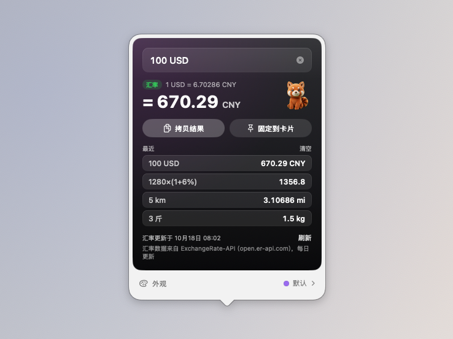
      <p align="center"><sub>算：汇率、单位换算和计算器合成一个输入框</sub></p>
    </td>
  </tr>
</table>

### 图片与截图

看看喜欢的图片，随时截图，最近的截图和取到的颜色都能直接拖走或拷贝。

**包含：** 相册、最近截图、截图工具、取色器


<table>
  <tr>
    <td width="50%" valign="top">
      
      <p align="center"><sub>相册：轮播一个文件夹里的图片</sub></p>
    </td>
    <td width="50%" valign="top">
      
      <p align="center"><sub>最近截图：拷贝、显示、删除，或直接拖进聊天窗口</sub></p>
    </td>
  </tr>
</table>

### v0.4.0 新增

效率工具、桌面与应用，以及新的外观预设。


<table>
  <tr>
    <td width="50%" valign="top">
      
      <p align="center"><sub>GitHub：公开仓库的数据，令牌可选</sub></p>
    </td>
    <td width="50%" valign="top">
      
      <p align="center"><sub>书签：点按用默认浏览器打开</sub></p>
    </td>
  </tr>
</table>

**外观预设**（**设置 > 扩展栏 > 外观**）：玻璃、清透玻璃、浅色玻璃、深色玻璃、磨砂、白色、黑色、透明
（透明即不绘制底板，每个小组件保留自己的卡片）。另有“小组件颜色：原色 / 单色”和“降低透明度”开关；
macOS 开启“降低透明度”时会自动使用不透明底板。下图是深色玻璃加单色，配模拟表盘时钟和“风与日出日落”天气：


### v0.4.1 新增

三种小组件，以及每个小组件自己的显示设置。


- **麦克风**：通过 Core Audio 读取默认输入设备是否正被某个应用使用，显示设备名称；设备支持时可一键输入静音。
  只读取状态，不录音，不需要麦克风权限。
- **圆环仪表**：存储空间（启动磁盘的可用 / 总容量，与访达的算法一致）和电池的圆环，可在设置中只保留其中一个。
  CPU 温度没有公开接口，因此不提供。
- **久坐提醒**：一个随坐着的时间填满的圆环，可设提醒间隔和提醒时段（默认 09:00 到 18:00），到时发送系统通知，
  并记录今天起身了几次。首次提醒时会请求通知权限。
- **条件显示**：右键小组件选择“显示条件”：始终显示、满足条件时显示或隐藏。目前支持条件的有：
  正在播放（仅播放时）、电池（仅使用电池时，可加电量阈值）、麦克风（仅使用中）、邮件（仅有未读时）。
  被隐藏的小组件列在扩展栏右键菜单和菜单栏的“已隐藏的小组件”中，点按即可恢复。
- **隐藏背景和边框**：右键小组件选择“隐藏背景和边框”，或在 **设置 > 小组件** 的“显示”中打开，
  只去掉这个小组件自己的卡片，便签纸色、封面等内容保留。
- **放不下时自动缩小**：**设置 > 扩展栏 > 行为** 中“放不下时”可选“横向滚动”（原有行为）或“自动缩小”。
  自动缩小最多缩到所选大小的一半，仍放不下时再滚动。

开启“自动缩小”后，比屏幕还长的一排小组件整体缩小，放在同一条扩展栏上：


<p align="center">
  <br>
  <sub>久坐提醒：下次起身时间与今日次数（示例数据）</sub>
</p>

以上 v0.4.1 功能已通过自动化构建和单元测试，但尚未在真机上逐项验证，见
[路线图](ROADMAP-zh.md)中的“需要在真机上验证”。

### v0.5.0 新增：Codex 用量


<p align="center">
  <br>
  <sub>Codex 用量：两种额度、重置时间和近 30 天 token（示例数据）</sub>
</p>

- **两个圆环**：Codex 的 5 小时额度和每周额度，旁边是距离重置的时间。可在设置中切换显示“已用”或“剩余”，
  70% 以上变橙色，90% 以上变红色。
- **Codex 在做什么**：读取 Codex 最新的会话日志，在圆环右上角用小圆点显示“正在工作”（蓝色闪烁）、
  “等你确认”（橙色）或“已完成”（绿色）。完成或需要你批准命令时可发送系统通知。
- **详情面板**：每个额度的进度条（白线是“匀速使用”应到的位置）、重置的具体时间、
  “按当前速度约几点用完”的预测，以及今天和近 30 天的 token 用量、可用的额度重置次数。
  可选显示 Spark 与代码审查的额外额度。
- **额度提醒**：用量第一次超过设定阈值（默认 80%）、95% 和用完时各提醒一次，不会每 5 分钟重复提醒。
- **代理**：国内访问 chatgpt.com 需要代理。从访达打开的应用读不到终端里设置的 `HTTPS_PROXY`，
  可以在详情面板填写 `127.0.0.1:7890` 或 `socks5://127.0.0.1:7891`；留空则使用系统代理。
- **离线缓存**：断网或被限流时显示上次的读数并标明时间，重试间隔逐步加长（最长 30 分钟），并遵守服务器的 Retry-After。
- **条件显示**：可设为只在 Codex 工作中或等你确认时出现在扩展栏上。

**它怎么读取**：直接使用你 Mac 上 Codex 已登录的 ChatGPT 账号（`~/.codex/auth.json`），不需要另外登录，
也不会修改这个文件；令牌只发送给 chatgpt.com。用的是 Codex 自己 `/status` 背后的接口，**不是 OpenAI 公开的 API**，
OpenAI 随时可能改动，到时小组件会提示“接口有变动”。用 API 密钥（而不是 ChatGPT 账号）登录的 Codex 没有这些额度，无法显示。
如果你把 Codex 的登录保存在钥匙串里（`cli_auth_credentials_store = "keyring"`），目前读取不到。

这部分的接口和日志格式参考了开源项目 [Codenotch](https://github.com/vinzdg/codenotch)（MIT 许可），见 [NOTICE.md](NOTICE.md)。
尚未在真机上验证。

### v0.5.2 新增：赞助者专属表盘、时钟显示秒

- **赞助者专属配色和表盘**：在“支持码头”窗口点“我已赞助，解锁专属配色和表盘”后，可在 设置 ▸ 扩展栏 ▸ 外观
  给扩展栏换上小熊猫橙、樱花粉、薄荷绿、海盐蓝、星空紫、琥珀金；时钟小组件多出霓虹、实景（辉光管）、
  简约（液晶）、极简（翻页）4 款表盘。这是 v0.5.2 当时的赞助者规则；下一版的 Pro 范围与授权规则见「开发中（下一版）」。
- **时钟显示秒**：翻页、像素、大号数字和专属表盘都会显示秒，可在小组件设置里关闭；
  另有大号数字、秒圈、中文三种免费样式。
- 扩展栏里的“小间隔”缩小为一个普通间距，新布局不再默认插入。

### v0.5.1 新增：快速待办、环境音、农历与假期、废纸篓、剪贴板收藏、更多快速开关

- **快速待办**：一份只属于码头的待办清单，不读写系统“提醒事项”，不需要任何权限。
  卡片上显示下一件要做的事和剩余数量，点勾即可完成；点开面板输入一件事按回车添加，
  双击文字可修改，完成的项目沉到底部，可一键清除，也可在设置里隐藏已完成的项目。
  可设为只在还有未完成待办时出现在扩展栏上。
- **环境音**：雨声、海浪、风声、篝火、白噪音、粉红噪音、棕色噪音，可以同时选几种混在一起播放。
  声音由程序实时合成，安装包里没有音频文件，也不会听出循环。面板里可以调音量、
  设定 15 分钟到 90 分钟后自动停止（渐弱结束）。切换耳机等输出设备时会自动接着播放。
- **农历与假期**：日期旁边显示农历和节气、传统节日（除夕、元宵、七夕、重阳…），
  以及“距元旦还有 N 天”。调休前一天提醒“明天调休，要上班”，放假前一天提醒“明天开始放假”。
  节气按太阳黄经在本机计算；放假安排内置 2026 年，之后的年份在国务院通知发布后自动更新
  （数据来自 holiday-cn），未公布时只显示节日当天并注明“放假安排未公布”。
- **废纸篓**：显示废纸篓占用的空间和项目数，把文件拖到卡片上即可移到废纸篓，
  右键可打开或清空。垃圾超过设定的大小（10 MB 到 5 GB 可选）就会有苍蝇绕着飞，
  垃圾越多、放得越久，苍蝇越多（每小时多一只），鼠标移上去会把它们吓跑。
  读取大小需要“完全磁盘访问权限”。苍蝇的灵感来自 BananaBin。
- **剪贴板收藏与搜索**：给常用文本加星标，星标内容会一直保留；面板顶部可以搜索历史和星标。
  打开“点按后直接粘贴”后，点一下就粘贴到前台应用（需要辅助功能权限）。
- **快速开关可自选**：在小组件设置里勾选要显示的开关：深色模式、保持唤醒、锁屏、屏幕保护程序、
  清空废纸篓、显示隐藏文件、隐藏桌面图标、显示文件扩展名、麦克风静音、推出所有磁盘、
  清空剪贴板、清洁屏幕和键盘、退出其他应用。参考了开源项目 OnlySwitch（MIT）。
- **赞助者专属配色**：在“支持码头”窗口点“我已赞助”后，可在 设置 ▸ 扩展栏 ▸ 外观
  给扩展栏换上小熊猫橙、樱花粉、薄荷绿、海盐蓝、星空紫、琥珀金。码头不联网验证，全凭诚信；
  所有功能仍然免费。
- 菜单栏图标默认不再显示布局名称（“日常”等），布局名称在菜单的子菜单里查看；
  想恢复可在 设置 > 菜单栏 中打开。

尚未在真机上验证。

### 新分工配图：日历、时钟、股票金银、计时、电池格、算、喝水杯子页、提醒弹出卡片

几类小组件重新分工以后的样子。扩展栏上的小组件和标注“示例数据”的面板用的是小组件库自带的示例数据，
「算」是拍摄时的真实汇率。

**日历、一周日程、农历与假期、纪念日**：日历看下一个日程，一周日程看七天忙闲，农历管节气和调休，纪念日数日子。

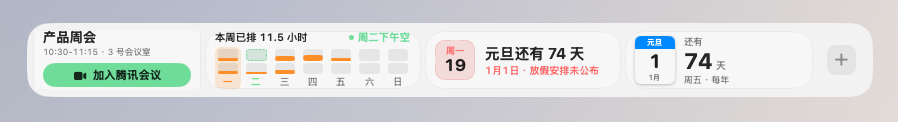

**8 款表盘**：标准、模拟表盘、翻页、像素、液晶、中文、霓虹、实景。

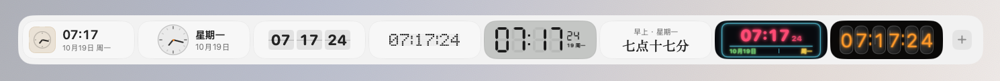

**股票、自选股、加密货币、黄金白银**：股票盯一只，自选股看一列，黄金白银默认按元/克。

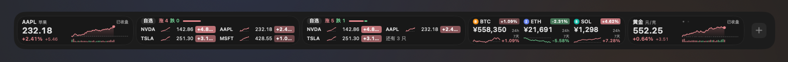

**计时按尺度分工**：倒计时、秒表、闹钟、专注计时。

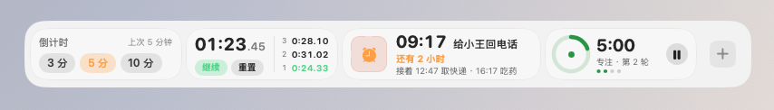

**电池格**：电量画成横向电池，圆环只留给圆环仪表。

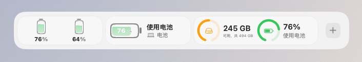

<table>
  <tr>
    <td width="50%" valign="top">
      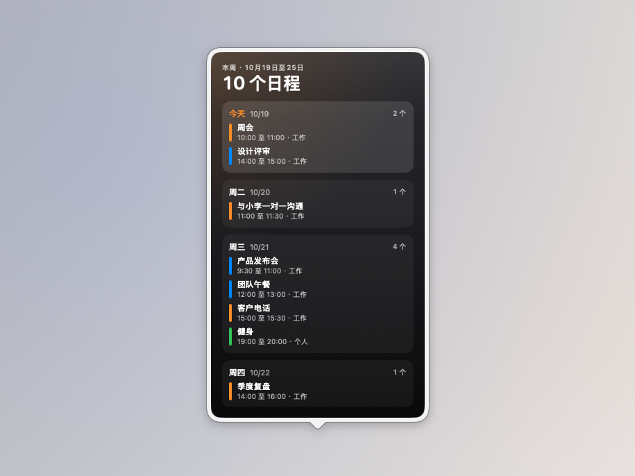
      <p align="center"><sub>一周日程：七天的日程和忙闲（示例数据）</sub></p>
    </td>
    <td width="50%" valign="top">
      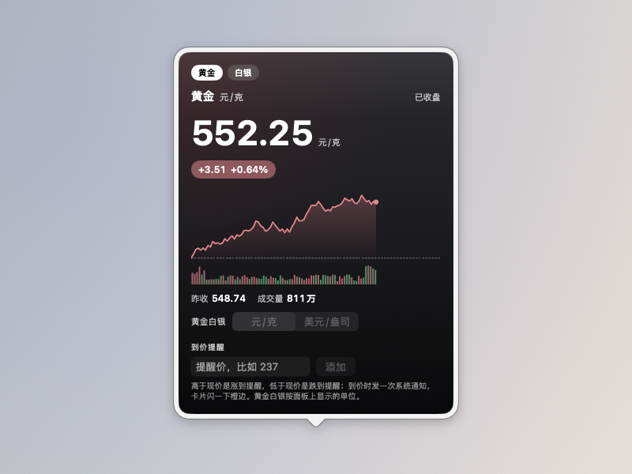
      <p align="center"><sub>黄金白银：元/克与美元/盎司可切换（示例数据）</sub></p>
    </td>
  </tr>
  <tr>
    <td width="50%" valign="top">
      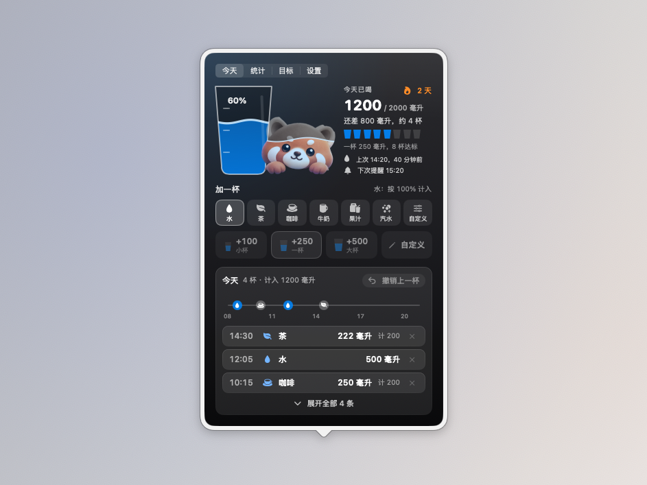
      <p align="center"><sub>喝水杯子页：水位就是今天的进度（示例数据）</sub></p>
    </td>
    <td width="50%" valign="top">
      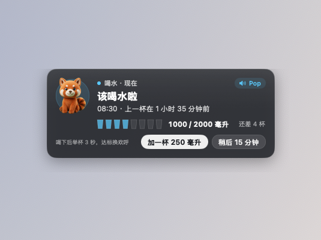
      <p align="center"><sub>提醒弹出卡片：从刘海下方滑出（示例数据）</sub></p>
    </td>
  </tr>
  <tr>
    <td width="50%" valign="top">
      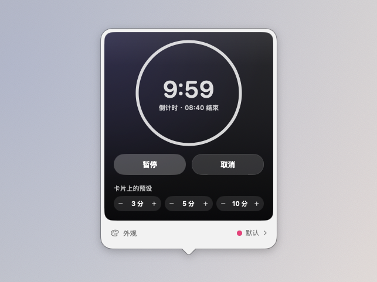
      <p align="center"><sub>倒计时：拍摄时真实在走的十分钟</sub></p>
    </td>
    <td width="50%" valign="top">
      
      <p align="center"><sub>算：一个输入框，带币种走汇率、带单位做换算</sub></p>
    </td>
  </tr>
</table>

### 新功能配图：液态外观、颜色与背景、世界时钟、快速开关新工具、AI 刘海对话、码头 Pro

下面是“开发中（下一版）”里几项新功能的实拍。扩展栏上的小组件用的是小组件库自带的示例数据，
世界时钟和码头 Pro 付费墙是拍摄时的真实状态。

**液态外观**（Pro 专属）：时间进度、喝水、专注计时、系统活动和电池都能换成一杯水，水位就是进度、占用或电量。

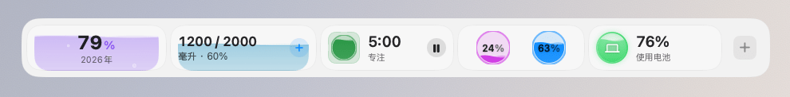

**颜色与背景**：每个小组件可以选十五种预设主色、自定义颜色或跟随系统强调色，背景可选无、深色、渐变。

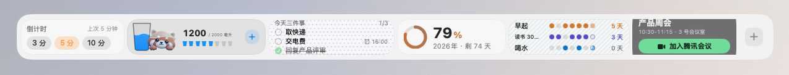

**世界时钟选城市**：从可搜索的城市列表里选，一张卡片一个城市。

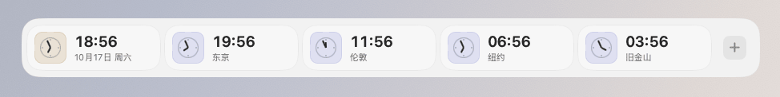

**快速开关的新工具**：截图识字、二维码、取色器、镜子、演示模式、只锁键盘，旁边是 AI 助手卡片和截图工具。

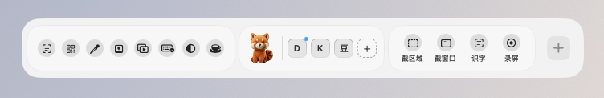

<p align="center">
  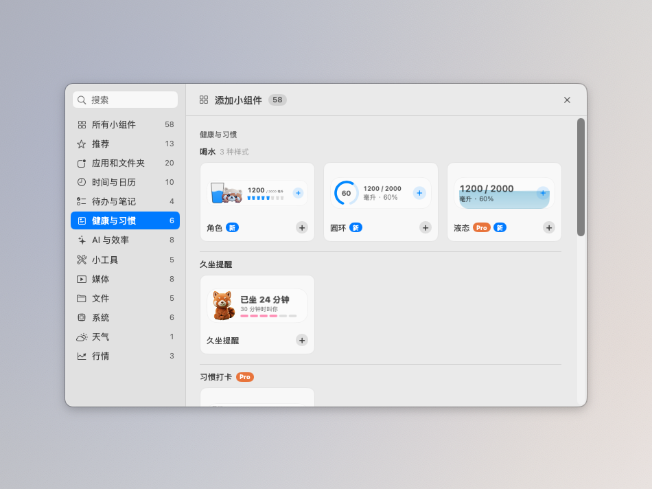<br>
  <sub>添加小组件面板：分类侧栏和 Pro 角标</sub>
</p>

<table>
  <tr>
    <td width="50%" valign="top">
      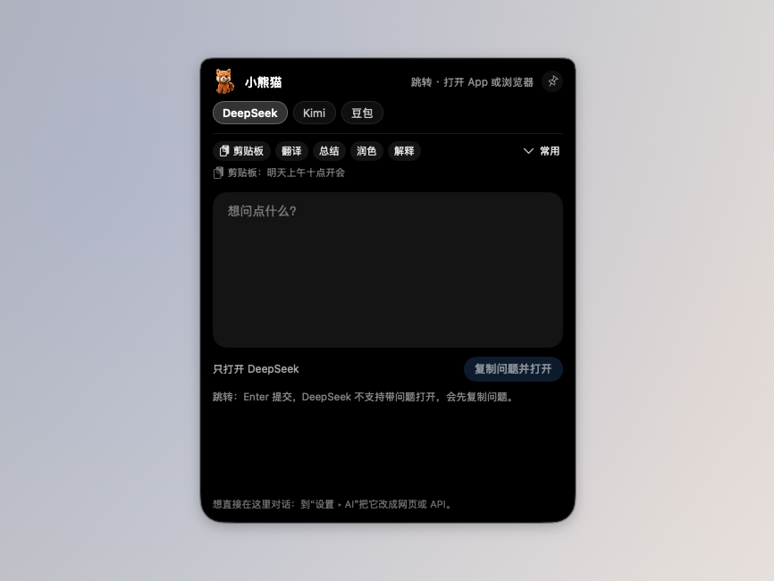
      <p align="center"><sub>AI 刘海对话：从刘海长出的对话面板（跳转模式）</sub></p>
    </td>
    <td width="50%" valign="top">
      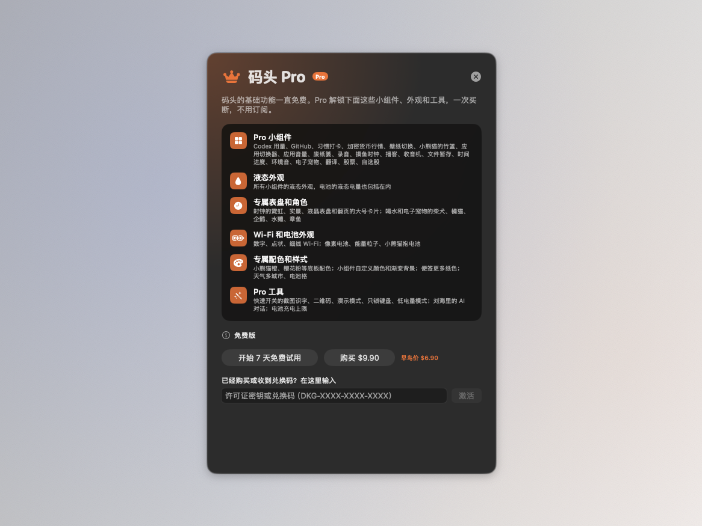
      <p align="center"><sub>码头 Pro 付费墙：功能清单、试用、购买和激活码</sub></p>
    </td>
  </tr>
</table>

### 开发中（下一版）

- **快速待办 v3：大号「今天」加进度环小熊猫，五色标签，勾掉有手感，「今天」清空有庆祝；重复待办是 Pro**：面板顶上是 48pt 的大输入框，左边橙色「＋」，认时间的逻辑不变；下面是 28pt 的「今天」和「10月26日 周一 · 已完成 2 / 5」，右边一圈完成进度环里坐着小熊猫，全部做完变绿。今天、稍后各一张玻璃小卡，行高 44pt、正文 15pt、组标题 15pt 粗；已完成折成底部一行带「清空」，已收起照旧留 7 天。五色标签（红橙黄绿紫）：行首一道细色条加同色圆圈；红色就是原来的「重要」，去掉小红旗，旧数据的重要读成红色，同步提醒事项时红色照旧映射成系统旗标；悬停行尾「···」、右键或 ⌘1 到 ⌘5 设颜色，⌘0 清除。红色免费，橙黄绿紫四色和按颜色筛选是 Pro，没解锁点了弹付费墙，已设的颜色照旧存着不改写。勾选时圆圈按标签色填满、轻弹一圈、划线，约 0.4 秒沉到已完成，底部深色撤销条停 6 秒，⌘Z 也能撤销；减少动态效果时直接换。拖动排序：悬停出把手，拖起来浮起带影子，目标位置让出一格橙色虚线空位，跨组照旧；⌥↑ / ⌥↓ 也能挪，⌘T 移到今天 / 稍后（键盘作用在鼠标停着或点选的那一行，输入框里组字时不抢键）。「今天」一组清空（稍后有没有都算）就庆祝：小熊猫欢呼加五色小彩点（不发光），写「连续 N 天」，下面最近 7 天小圆点。清单空的时候是歇着的小熊猫和 4 个「试试这样写」，点一下只填进输入框。扩展栏卡片：左边进度环写今天还剩几件，右边今天最前两条（13pt，圆圈按标签色，截止胶囊照旧），点圆圈约 1 秒后下一条顶上来；今天清空、清单空、拖入、竖排各有自己的样子。重复待办（Pro）：右键或「···」设每天 / 每周 / 工作日，勾掉后在「稍后」按规则生成下一次，到那天自动升进「今天」；没解锁时点了弹付费墙。截止胶囊、链接和文件、右键菜单、转成提醒事项、拖进来记一条、到点弹卡片、同步开关（Pro）、全局快捷键小框都照旧。尚未在真机上验证。
- **便签 v3（瘦身）：打开就写，清单写字时也是圆圈，字体字号纸色收进「Aa」**：便签定位成「随手纸」，没有日期、没有提醒，不做待办那一套。打开便签面板光标就在末尾（有清单也一样），新一张（新增 ⌘N）、翻页、撕掉之后同样直接能写。清单行写字时和不写字时一个样子：行首圆圈随时能点勾，不再在编辑时露出 `[ ]` 这类原始字；回车在这一条后面接下一条，空的一条上再回车退出清单，⇧↩ 普通换行，⌘↩ 存好收起编辑；输入法组字时回车照旧只上屏，不会误插一行。勾掉的项变淡墨加划线，留在原位，不再沉到底部（「⋯」里去掉了「已完成沉到底部」，保留全部取消勾选和清除已完成项）。字体、字号、这张纸的颜色收进工具条上的「Aa」弹层，面板主体留给纸；纸固定高度，长文本在纸里滚，工具条和底栏不被推走。停手半秒自动保存后，顶栏淡淡显示一下「已保存」。右键一行「发到快速待办」，加到扩展栏上第一个快速待办（和全局快捷键小框同一个），便签上原行保留。拷贝出去的仍是原文（`[ ] 牛奶`），存法不变，旧便签不用迁移。现有 Pro 纸色划分不变，没有新 Pro 项；面板液态玻璃跟随浅色 / 深色。尚未在真机上验证。
- **「算」的字牌换成小熊猫脸框计算器，中英文界面同一张**：卡片左边原来是紫色的「算」字（英文界面是加减乘除符号），现在是一台拟人的小计算器：深紫墨色的屏幕（浅色外观下不是纯黑）外面套一圈小熊猫橙红的脸框，上框两颗奶白眉斑、下框两角奶白腮，屏幕里两只白色竖胶囊眼、右眼眨成 ^；下面 2×2 胶囊键 + − × ＝，前三个键跟卡片的主题色走（默认紫，换成黄、薄荷这类浅色时符号自动换深色），「＝」是小熊猫橙红。全用形状按边长比例画，扩展栏横排 40pt 和竖排货架 26pt 是同一张图，跟随浅色 / 深色，符号线宽不细过 1pt。方底（主题色铺底、细边、圆角）不变，读屏照旧读卡片名「算」。比例、线宽和颜色放在 Core 并补了测试。尚未在真机上验证。
- **新功能「输入法自动切换」：切到哪个 App 就换成它的输入法，从刘海落下提示；按 App 规则是 Pro**：设置新增「输入法」页（在快捷键和通用之间），总开关默认关。没有规则的 App 可选「用默认输入法」（默认，每次切过去都换成选好的默认输入法）或「记住上次」（每个 App 用回离开时的输入法，第一次没有记录时用默认输入法）。「按 App 规则」（Pro）给 App 指定输入法，一个 App 一条、所有窗口共用：App 图标大卡片网格，右下角是输入法的字形徽章（拼 / A / あ / 한 等，按输入法语言推导），点卡片换输入法，悬停 ⋯ 删除，「添加 App」从「应用程序」选或从正在运行的 App 里选，也能把 App 拖进网格；规则指向的输入法被删掉时规则保留，暂用默认输入法（默认输入法也没了就用系统第一个键盘输入法），卡片显示灰徽章和「已删除，暂用 XX」，装回后自动恢复；没解锁时规则区盖模糊遮罩和小锁，点「解锁码头 Pro」打开付费墙，已有规则不生效也不改写。切换后从刘海落下液态玻璃小胶囊（字形徽章、输入法名、App 图标；落下 0.25 秒，停留默认 1 秒可调，收回 0.2 秒；减少动态效果时淡入淡出），位置可选刘海下（默认）/ 光标旁（要辅助功能权限，没权限时临时改用刘海下）/ 关闭；拾掇的收纳架展开时缩成刘海右侧一截，只显示徽章和 App 图标；没有刘海的外接屏放在菜单栏下方；全屏、AI 刘海对话、提醒弹窗、消息卡、灵动提示占着刘海时直接不显示。码头自己被激活、或已经是目标输入法时不切也不提示。读取和切换输入法用系统接口，不需要权限。浅色、深色都配好。尚未在真机上验证。
- **修复：输入法自动切换的几处细节**：「记住上次」满 200 个 App 时先丢的是最久没用的（以前常用但输入法一直没变的 App 会被当成最久没用先丢掉）；系统拒绝切换时不再提示「已切换」；「光标旁」的提示在副屏上贴着光标显示，不再被收到主屏边上；等光标位置那一会儿 AI 刘海对话、提醒弹窗等占了刘海时不再冒出来。尚未在真机上验证。
- **修复：点扩展栏上已经开着的 App 有时弹不出窗口**：以前点开着的 App 只是把它切到前台，日历、邮件、备忘录、音乐、信息、访达这类关掉最后一个窗口还在运行的 App 就什么都不出来，窗口全最小化时也不会还原，有时连切到前台都被系统拦下。现在和点系统程序坞一样：没窗口的开一个新窗口，最小化的还原，有窗口的切到前台，全屏的切到它那个桌面，按 ⌘H 藏起来的也会带出来；开着的 App 照旧不弹跳。应用切换器卡片和面板、小组件点开 App 也一样。尚未在真机上验证。
- **修复：输入框认得 ⌘A / ⌘C / ⌘X / ⌘V / ⌘Z / ⌘⇧Z；面板刚收起又点开不再透明打不开；面板被钉在别的桌面时挪到当前桌面；便签边打边存**：码头没有「编辑」菜单，面板（便签、「算」、提醒等）、AI 刘海对话、快速待办、分组改名和文件夹小窗的搜索框、截图标注打字、设置和小组件库里的输入框以前能打字，按全选、拷贝、剪切、粘贴、撤销、重做却没反应，现在窗口自己把这几个键交给正在输入的框；输入框里没选字时 ⌘C 照旧归面板（「算」的拷贝结果）。面板正在淡出时再点开（连点或从一个小组件直接点另一个），旧淡出会把窗口落到透明度 0，开着却看不见，现在打开会顶掉没走完的淡出，AI 刘海对话面板同样。设了「出现在所有桌面」，macOS 有时仍把小组件面板或分组窗口钉在某一个桌面，在别的桌面点开没反应，现在发现不在当前桌面就换一个新窗口重摆。便签停手半秒就保存（输入法选字时不存），不再等点到面板外面卡片才更新。核查：长便签不会撑破面板，面板随内容长高到上限后在面板里滚动、外框照旧；正在播放的长歌名按面板宽度截断，不会把面板撑宽，这两处没改。快捷键判断放 Core（EditShortcut）并写测试。思路参考上游 Docket 的几处修复，按码头现有代码实现。尚未在真机上验证。
- **修复：频繁弹出「码头想要使用你储存在钥匙串的“码头 Pro 授权”中的机密信息」**：码头目前是 ad-hoc 签名，每次更新签名都会变，macOS 不认旧版本存进钥匙串的授权项，读的时候就要求输入「登录」钥匙串的密码。以前 Pro 授权分成许可证、实例、上次校验、试用开始四个钥匙串项，每次计算状态（启动、每小时、唤醒、联网校验后）都把四项重读一遍，写的时候还先删再加，所以一次能连弹好几个。现在四样合成一个钥匙串项，每次运行只在第一次用到时读一次，之后都读内存，值真的变了才写，写的时候直接更新、没有才新建；第一次启动新版时把旧的四项读出来合并写进新项再一次删掉，所以更新后还会再问一次。点了「拒绝」或读取失败后这次运行不再去读，读不到试用记录时不会把试用期重置，也不让重新开始试用。AI 助手的 API 密钥和 GitHub 令牌同样每次运行最多读一次，启动时只看有没有、不读内容。合并、迁移和要不要写的判断放 Core（KeychainCache）并写测试。尚未在真机上验证。
- **修复：钥匙串锁着时启动码头，整次运行都显示未激活**：上面那条把「读不出来」也记成这次运行不再读，可钥匙串锁着、系统没法弹框（锁屏时自动重启、登录时钥匙串还没解锁）并不是用户点了拒绝，于是已购用户整次运行都显示未激活、Pro 功能被锁，要手动重启才恢复。现在这种暂时读不了的不记住，下次算状态（每小时、唤醒）时再读，读到就恢复；点了「拒绝」的照旧这次运行不再问，旧项里已经读出过的也不重读，免得再弹。试用状态和「能不能开始试用」改为取自同一次读取，不会在没读到授权时给已购用户显示「开始试用」。判断放 Core（KeychainCache）并补测试。尚未在真机上验证。

### v0.7.0 新增：码头 Pro、消息灵动岛、「算」汇率普通版和完整版、AI 助手、复古卡带等

- **「算」的汇率换算重做：普通版（免费）输入金额、选币种直接换算；完整版（Pro）加多币种列表、收藏、固定、记录、小键盘和卡片轮播**：「算」的面板顶上分成「汇率」「计算」两页（⌘1 / ⌘2），打开在上次用的那页。汇率页分两版。普通版（免费，所有人默认）只做一件事：上面「输入金额」一行，左边币种按钮（旗帜、代码、下拉），右边大号金额，点进去紫色描边；下面「换成」一行，目标币种默认人民币，点一下换别的；中间一个对调键（⌘⇧S）。打字就换算，不用按回车，金额边打边补千分位（10000 显示 10,000，输入栏始终补，卡片和结果仍跟千分位设置），结果按币种的标准小数位取整（日元、韩元 0 位，科威特第纳尔这类 3 位）。点币种在面板里打开选择器，可以搜中文名、代码、别名或符号（港币、hkd、美金、$），常用的在前，↑↓ 选、回车确定。下面写正反两向汇率（1 USD = 7.1198 CNY 和反向的一行）和更新时间，离线时写「离线，使用 某日 的汇率」，顶栏右边是刷新（⌘R）；两个按钮「拷贝结果」（⌘C，不带千分位）和「带去计算」（⌘E，把结果带到计算页接着算）。普通版不显示小键盘、多币种、收藏、固定和记录，关面板时卡片显示这一次换算（不进记录）。完整版（Pro）就是整套：「从」「到」两行带中文名，金额栏可以写算式（1299*3+50，下面小字写算出来的金额）或连币种写（100 eur to jpy）；⌘D 收藏、收藏排成一排点一下换过去；固定到卡片；回车记下进「记录」（和计算页共用），点一下复用；⌘⇧C 拷贝整句，金额栏里 ↑↓ 换「到」；右上角 4 × 5 小键盘（⌘K）；多币种列表（一个金额同时换成几种，最多 8 种，可增删、拖动排序，点一行设为「从」）；卡片轮播收藏（收藏两组以上、没有固定别的时每 6 秒换一组，指针停住）。顶栏「汇率」「计算」旁边有「普通 / 完整」切换：没解锁时直接是普通版，不盖锁，「完整」带 Pro 标，点了走付费墙；解锁或试用中默认完整版，随时切换，记住选择。试用结束或没解锁时收藏、多币种列表、记录、固定都原样存着，解锁后回来。计算页（算式、单位换算、记录、固定、小键盘）照旧免费，计算页里也照样能算汇率（100 usd to jpy）和固定到卡片。老卡片的设置、记录和固定的那条都照旧，迁移来的「100 USD to CNY」直接摆成两行。面板宽 340，浅色深色都配好。尚未在真机上验证。
- **新功能「消息灵动岛」（Pro）：信息、WhatsApp、微信的消息在刘海下展开，信息可在刘海里回复，和拾掇自动让位**：设置 ▸ 通用新增「消息灵动岛」，默认关。打开后，信息、WhatsApp、微信的通知到达时，刘海下方长出一张液态玻璃消息卡（浅色深色都配好，顶上一条渐隐的黑色接住刘海）：App 图标和名字，头像（拿不到时是名字第一个字的彩色圆），发件人、时间和两行预览，按钮「回复 / 稍后 / 打开 ↗」。信息点「回复」在卡片里展开输入框，回车发送、Esc 收起，用自动化（AppleScript）按显示名找联系人或群发送，找不到或有重名时不发、直接打开「信息」，第一次发送时 macOS 会问是否允许码头控制「信息」；WhatsApp、微信的「回复 ↗」「打开 ↗」跳到对应 App，系统横幅还在时替你点一下它，能直接定位到那个聊天。几条消息叠成一摞，右上角「还有 2 条」，底下「下一条：微信 · 王姐 · 09:31」；「稍后」留着算未读、换下一条，「打开」把这个人的几条一起处理掉。几秒后（4 / 6 / 10 秒可选）收起成刘海两侧的 App 小图标和未读数，点一下再展开，指针停在卡片上时不收，自己打开那个 App 后未读清掉；对方关了预览时只写「收到一条消息」和怎么打开预览。消息从系统通知横幅读来：辅助功能观察「通知中心」的横幅，只读，不拦截、不修改系统通知；横幅结构不是公开接口，认不出就静默不弹。所以横幅和卡片会同时出现，把这些 App 的通知样式改成「无」能去掉重复但码头也就收不到了，专注、勿扰、全屏演示、屏幕共享时横幅不出现同样收不到；全屏 App 和演示时不弹卡片。和码头自己的刘海内容：AI 刘海对话面板开着时不展开、只显示未读数，关上后最近 20 秒内到的再展开；提醒弹窗显示时排队等它收起（最多 8 秒）；卡片展开时灵动提示的小胶囊和 AI 刘海入口让位。和「拾掇」等刘海 App 自动让位：用窗口列表只读窗口的主人和位置（不要屏幕录制权限），它们在刘海附近有窗口时卡片落在下面，面板正展开时排队，最多等 8 秒改成刘海旁的小胶囊；位置可选「自动让位」（默认）、「刘海下方」、「刘海旁小胶囊」（不占刘海中间，点开才展开卡片）。可以单独关掉某个 App。需要辅助功能权限，回复信息需要自动化权限。尚未在真机上验证。
- **修复：分组格子有时候点了不弹出窗口**：扩展栏上的应用分组（比如把系统 App 收在一起的那组）偶尔点了没反应，要多点几下或先点别的组才出来。修了几处：窗口摆不上去或被系统收走后，还记着「开着」，再点被当成「再点一次关掉」，于是一直点不开，现在只认真的在显示的窗口，没显示就直接打开，摆不上去会下一轮再试一次；刚收起还在淡出时又点开（连点，或从一个组直接点另一个组），旧的淡出会把窗口透明度落回 0，开着却看不见，现在打开会顶掉没走完的淡出；双击格子不再第一下打开、第二下又关上；还没在格子上停过就点时，窗口从扩展栏正中长出来，不会跑到屏幕角落。文件夹小窗同样适用。判断放 Core（PopupToggle）并写测试。尚未在真机上验证。
- **电池格沙漏样式有了专属面板（Pro）**：电池小组件选「电池格」并且外观是经典或液态（卡片画沙漏）时，点开的面板换成一整套沙漏：右上角是 79×104 的大沙漏（原来液态圆球的位置），充电时细沙往下流、右下角闪电角标，沙子颜色和卡片一样（默认绿，20% 及以下未充电红，低电量模式黄，选了颜色是主题色），浅色外观下压到 3 : 1 不发虚；左边 60pt 大字电量和状态句，报警时数字和状态句变红。「今天」从曲线换成 24 根沙柱，一小时一根，高度是那个小时最后一次记下的电量，充过电的柱顶落一粒沙，现在这一小时描边，还没到的小时只有一粒小点，右上写「最低 38% · 充电 1 小时 20 分钟」；还没记录时写「刚开始记录，每 5 分钟落一粒沙」，不会只剩一条线。最大容量、循环次数、温度换成玻璃小格：容量是沙色圆环（低于 80% 变橙），循环和温度配沙色小图标。充电上限的开关、滑块换成沙色，Pro 标识换成浅沙底深棕字的胶囊；配件行的小圆环换成小沙漏。面板其余部分是品牌暖金沙色（深色 #E9B65C，浅色自动压暗到可读），浅色深色都按当前外观算。电量、仅图标样式和像素电池、能量粒子、小熊猫外观的面板不变；判定和沙柱、小结计算放 Core 并补测试；付费墙和官网 Pro 清单的「电池格」注明含专属沙漏面板。尚未在真机上验证。
- **修复：便签用中文输入法打字时闪退**：在便签面板里用中文输入法打字（拼音还没上屏时）会直接闪退，点开面板、勾选清单项时也可能碰上。原因是面板跟踪输入框的选区，组字时拿到的选区位置属于还没上屏的那版字，比便签里的字长，换算位置时越界。现在只读系统输入框的整数选区并夹在范围内，不再碰那版字；失焦和关面板时的保存挪到下一轮，不在界面刷新中途写；垃圾桶里编号重复的老数据读出来时自动分开，恢复、删除不会认错或一次删两张。尚未在真机上验证。
- **喝水、时间进度、小熊猫竹篮液态外观（Pro）：水铺满到卡片边，喝水的字在任何颜色下都看得清**：液态的水原来左右各少铺 10pt、四个角按缩小的圆角裁，浅色外观下露出一圈奶白的厚边；现在水铺满整张卡片、贴着卡片圆角，三种液态卡片上的字离卡片边至少 12pt。喝水液态原来一律白字加淡黑描边，浅色外观下淡粉、藕紫、浅黄的水上只有约 2:1，看不清；现在按水面上方和水里的实际底色分别挑字色，都过 4.5:1：浅色外观整张卡一种同色相深字，深色外观水面上方白字，水里浅色的水用深字、深色的水用白字，字在水面处随浪换色；只有两种字都不够的中间色才把水按同色相微调一点。+ 换成实心圆底白加号，水上水下都清楚；超过目标时副标题写「今天达标啦 · 144%」。尚未在真机上验证。
- **新小组件「复古卡带」（Pro）：磁带、随身听、收录机，「正在播放」去掉卡带外观**：原来「正在播放」中卡上的三种卡带外观搬成单独的 Pro 小组件「复古卡带」，在小组件库「媒体」里三种机型各占一格，直接添加。扩展栏横排是中卡 404 宽：磁带是玻璃卡片上一盒茶色磁带（封面当标签贴纸，两个转轮），旁边歌名、歌手、上一首 / 珊瑚播放键 / 下一首和细进度；随身听是奶油机身（小窗转轮、灰绿液晶写歌名和时间），收录机是苔绿机身（双喇叭、调台条上红指针走到哪就是进度、磁带仓和铜旋钮），两者右边各三个玻璃键；磁带可在设置里开「紧凑卡片（216 宽，只有磁带）」，随身听和收录机放不进 216 宽，不提供；扩展栏在左右两侧时是 76 宽的竖条（小磁带、歌名、播放键）。转轮只在播放、卡片看得见并且没开减少动态效果时转，卷越粗转得越慢，暂停和隐藏时静止。点卡片打开 320 宽的液态玻璃面板：顶上玻璃吊牌「来源：音乐」点开换来源（含「谁开始播放就切到谁」），旁边「打开 App」；中间是大机身（磁带标签上印「A 歌名」和时间，随身听带液晶计数和侧面音量拨轮，收录机的铜旋钮跟着音量转），磁带款下面一行两边带卷粗细加中间计数器「01:42 · 04:05」；玻璃键帽：随机、上一首、珊瑚播放键、下一首、循环，播放中珊瑚键锁住下沉 1pt、不发光；玻璃推子调音量；「接下来」列 B 面 3 首玻璃行（多于 3 首可「查看全部」，Spotify 是「刚才听过」）；拖磁带的计数行、随身听的进度条或收录机的调台条可以跳到那里（只读的来源不能拖）；最底下「机型」分段换磁带 / 随身听 / 收录机。底板、按键和字跟着浅色 / 深色，机身是实物质感、颜色不变。播放数据、控制和按条件显示都和「正在播放」共用同一套服务，来源、自动切换和固定来源设置也一样。「正在播放」去掉「卡带外观」选项和面板里的选择条，完整、迷你、中三档照旧免费；已经在用卡带外观的中卡，启动时如果已解锁 Pro（含试用）自动换成复古卡带对应机型，位置不变，来源、颜色等设置照搬，紧凑磁带还是 216 宽；没解锁的留在「正在播放」回到默认样式，卡片不丢。付费墙和官网 Pro 清单改为 15 个 Pro 小组件。尚未在真机上验证。
- **正在播放：「接下来」直接摆在控制键下面**：原来播放页最底下那行「接下来 · 歌单「音乐」」落在面板底部渐隐带里，发灰、只剩半截，像一行说明。现在有歌单可读时封面缩小一点、控制键收紧，控制键下直接列接下来的 3 首，每行整行可点、点了从这首开始放，右边「全部 N 首」；点「全部」后封面缩成迷你播放条吸顶（上一首、播放、下一首和进度都在），列表往下占满，面板高度不变，多了在列表里滚，最多列 25 首，再多写「还有 N 首」去 Apple 音乐里看，点迷你条或「收起」回去；展开收起有动画，打开「减少动态效果」时直接切换。读取中显示灰色占位行；随机播放时不再整块消失，改写「顺序由 Apple 音乐决定」和「关掉随机」；放到最后一首写「后面没有歌了」和「从头循环」；整库播放时标题叫「资料库」。Spotify 同一位置是「刚才听过」，行尾写几分钟前，悬停是重放，展开后底部说明接下来的队列 Spotify 不开放读取。网易云、QQ 音乐、小宇宙、浏览器读不到队列，整块不出现，封面照旧大图。尚未在真机上验证。
- **便签改版：一键清单、撕纸动画和垃圾桶，底栏不再截断**：底栏的上一张、下一张改成纯图标（悬停提示 ⌘[ / ⌘]），「新一张」「撕掉」图标加短字，13pt，中英文都不截断；叠放的「2/3」挪到顶栏。工具条加「清单」按钮（⌘⇧L），把选中的几行或当前行变成可勾项，再按一次变回普通字，「- 牛奶」「1. 牛奶」这类列表符号会去掉；行首认得的写法放宽到 [ ]、[]、【】、- [ ]、-[ ]、* [ ]、+ [ ]、[x] / [X] / [✓] / [√]，以及单独的 ☐ □ ○ ☑ ✓。不在写字时清单项画成圆圈，点一下即完成：划线、换成淡墨（对比度约 5.0，不低于 4.5），默认沉到「已完成」下面（「⋯」菜单可关，也能全部取消勾选、清除已完成项并撤销），标题旁显示进度 2/5；写字时照原样显示框子的字。[1]、[a] 这类认不出的写法不偷改，纸底问一次「这行变成可勾项？」。撕掉不再弹确认：纸从胶带下撕开、右下角卷起、飞进顶栏垃圾桶，约 0.5 秒，减少动态效果时直接淡出；底部 5 秒内可撤销。垃圾桶图标带角标，列表里能恢复（放回最上面）、彻底删除、清空（清空要确认），保留 7 天、最多最近 30 张，空的时候小熊猫歇着。清单、撕纸、垃圾桶都免费，10 种 Pro 纸色不变；外框液态玻璃跟随浅色 / 深色，纸色不变。旧便签照旧读出来，清单写法解析、撕掉和垃圾桶保留规则放在 Core 并补了测试。尚未在真机上验证。
- **纪念日改版：沙漏倒计时（玻璃沙漏 Pro）**：单个纪念日卡片换成一只沙漏，上半的沙是这一轮还剩多少，右边事件小图标、名字和「还有 / 已经」、大字天数和「1月1日 周五 · 每年」；离下一次 7 天以内沙变暖橙、沙粒往下落、数字旁写「临近」，当天换成小熊猫捧场加彩纸写「就是今天」。沙用自然沙色，事件色只用在名字和端盖上；打开「减少动态效果」或扩展栏看不见时沙粒不动。设置 ▸ 小组件 ▸ 纪念日新增「样式：线条沙漏 / 玻璃沙漏 / 撕页日历」，线条沙漏免费、是新卡片的默认，玻璃沙漏是 Pro（没解锁时画成线条沙漏、设置里选了弹付费墙，配置不丢），已经放好的卡片保持原来的撕页日历不变。多个纪念日卡片左边是最近一个的事件色淡胶囊写「名字 N 天」，右边「接下来一年」时间轴换成事件图标（按名字认生日、纪念日、入职、毕业、节日等，认不出用沙漏或星星），线头红竖标是今天，季度刻度是小沙漏，月份字 13pt，其余只画图标，悬停显示名字和天数。单个卡片点开的面板（340 宽）：大沙漏、大字天数和天 / 时 / 分三格、这一轮进度条和起止日子、日期 / 类型 / 重复三行、接下来三次，底部编辑、分享图、时间线；多个卡片点开的面板（328 宽）：全部 / 倒数 / 正数分段，今天红胶囊，竖向时间轴从近到远，最近一个是玻璃高亮行带小沙漏，过去不会再来的收进「已经过去」，点一行进它的专属页。都是液态玻璃，跟随浅色 / 深色，深色下不铺大面积事件色。尚未在真机上验证。
- **快速待办改版：顶部输入认时间，今天 / 稍后 / 已完成分组，与系统提醒事项双向同步（同步 Pro）**：面板顶上换成一个大输入框，写「明天 9 点交稿」时「明天 9 点」标成主题色，下面一行预览「明天 10/23 周五 09:00 提醒」，回车记成「交稿」并到点提醒；认今天、今晚、明天、后天、周X、下周X、10/23、X 点、X 点半、上午 / 下午 / 晚上，也认 tomorrow 9am、next friday 这类英文，输入法选字时不打断；只说了日期没说几点的按 9:00，认不出时间的整句照记、放进「稍后」。顶部一行「今天还剩 3 件 · 已完成 5」配一根细进度条，替代原来的大标题和统计块。清单分成今天、稍后、已完成三组：原来最多 3 条的星标换成拖进「今天」，不限条数，旧版本标过星的升级后就在今天；昨天没做完的每天第一次打开时自动排到今天最前面，截止胶囊标红，不再在顶部问顺延还是放弃；提醒时间到了今天的从稍后升进今天；已完成默认折叠，旁边「清空」。每行只留圆形勾选、截止胶囊（过期红、今天橙、以后灰）和重要的小红旗，拖动把手、编辑、删除悬停才出现，拖动排序也能跨组；右键可以移到今天 / 稍后、标为重要、提醒我、转成提醒事项。勾选时圆圈填色轻弹，约 0.4 秒后滑进已完成，撤销条照旧，开启减少动态效果时直接换；清单空时是歇着的小熊猫。快速待办卡片标题「今天三件事」改为「今天」。面板底部新增「同步到系统『提醒事项』」开关（Pro）：选一个列表，标题、完成、提醒时间、重要两边都会同步，两边各自删除也跟着删（已完成的提醒留着），只有清单里第一张打开开关的快速待办卡片同步；开关打开时才请求提醒事项权限，没解锁时点了弹付费墙；逐条「转成提醒事项」仍然免费。面板跟随浅色 / 深色。尚未在真机上验证。
- **世界时钟改版：现在适合联系吗、天空格子（Pro）、城市小知识、菜单栏第二时区**：每个城市旁多一个红黄绿圆点，说明现在适不适合联系对方：双方当地都在 9:00 到 18:00 是绿「适合」，对方当地 22:00 到 7:00 是红「对方在睡觉」，其余是黄（对方快上班、已下班，或你那边还没上班、已下班、是深夜），夏令时按时区规则自己算。扩展栏卡片放 2 到 3 个城市时每个城市一格，底色是当地此刻的天空（清晨、白天、黄昏、夜里四段，内置城市按当天真实日出日落分段，夜里有几颗星），右下角一枚小地标线稿，字按底色用白或深灰，对比度不低于 4.5。面板里城市名旁加一句备注（如「中国首都」），点开城市卡多一张科普卡：一两句介绍，日出日落（极昼极夜单独写）、当地天气、货币和汇率（读计算器已在用的汇率服务，没有汇率表就只写货币名，不写死数字）、电话区号，以及「现在适合联系吗」胶囊和对方当地时间，下面仍是未来 12 小时对照条；185 个内置城市的经纬度、备注、介绍、货币、区号中英两份随 App 内置，不联网。设置 ▸ 通用 ▸ 菜单栏新增「菜单栏显示第二时区」（默认关），可选城市或「自动」（世界时钟列表里第一个和这里有时差的城市），菜单栏显示「● 纽约 03:56」，点开列出各城市时间和联系状态，点一行换城市。面板和卡片沿用液态玻璃，浅色深色都按语义色，字不小于 13pt。判断、分段、配色对比度、汇率写法和选城规则放 Core（WorldClockInfo、CityFacts）并补测试。世界时钟整种、普通卡片、联系状态圆点、科普卡和菜单栏第二时区都免费；只有多城市的天空格子外观是 Pro：设置 ▸ 小组件 ▸ 世界时钟在放了 2 个以上城市时多一项「多城市外观：普通 / 天空」，普通免费、是新卡片的默认（每城一格，普通液态玻璃底，没有天空色、星星和地标，字用浅色 / 深色语义色，13pt），天空标 Pro、没解锁时选了弹付费墙；已经放好的卡片保持天空，没解锁时画成普通、不盖锁、配置照存，解锁或试用后自动回到天空。外观判断放 Core（WorldClockLook）并补测试。尚未在真机上验证。
- **天气加「暖心提示」**：根据已有的天气数据挑一句简短的提醒，按优先级：降雨带伞（2 小时分钟降水、12 小时逐小时降水概率 50% 或雨量 0.3 毫米起，没有逐小时时看今天降水概率 60%）、降温（最高温比昨天或明天比今天低 6 度起）、早晚温差大（今天温差 10 度起）、紫外线强（往后 6 小时指数 6 起）、风大（6 级起，8 级起说大风）、空气差（美标 AQI 超过 100，超过 150 说戴口罩），最后总有一句穿衣建议（按体感温度，和气温差 3 度起改说「体感」），比如「下午有雨，出门记得带伞」「比昨天冷 8 度，加件外套」。哪项数据缺了就跳过那项。展开面板顶上小熊猫用气泡说最要紧的那一句，多城市时按当前看的城市；「当前」样式的横排卡片在读数下面加一行，每约 8 秒换下一句，放不下整句换短句，再放不下就不显示，不挤原有内容，字不小于 13pt。设置和面板「城市」里新增开关「暖心提示」，默认开。为此每日预报多取昨天一天、当前天气多取体感温度。判断和文案放 Core（WeatherTips）并补测试。免费。尚未在真机上验证。
- **时钟「标准」卡片的小表盘加秒针**：横排展开和竖排时左侧小表盘原来只有时针、分针，现在多了一根细秒针（约 1.2pt，长约直径 0.4，带同色中心小圆点），每秒走一格；颜色跟卡片颜色主题：在颜色面板选了颜色就用选的（跟随系统时用系统强调色），没选用时钟默认的琥珀色，按同色的淡色徽章底在浅色、深色卡片上调到看得清。秒针在标准样式下由单独的「表盘秒针」开关控制（默认开，老卡片里关着的「显示秒」不再把它藏掉）；颜色和时钟面板大表盘的秒针同一个来源，没选颜色时两边都是时钟琥珀色；其他样式的「显示秒（数字类样式）」照旧。世界时钟卡片和时钟面板的城市行仍只有时针、分针。指针角度、秒针尺寸和颜色规则放 Core（ClockHands）并补测试。免费。尚未在真机上验证。
- **天气多城市能在面板里添加、删除、排序城市**：多城市样式的面板原来只列出城市，增删只能去设置里改一行逗号分隔的文字；现在面板顶上多了标题和「编辑」，进去和世界时钟一样：点红色减号露出「删除」再点才删（也可右键删除），拖右侧把手排序，「＋ 添加城市」进入搜索（内置城市表，表里没有的用天气原来的地图查找），加完回到编辑。最多 8 个、至少留 1 个，排在前 3 个的显示在卡片上（卡片仍最多并排 3 个），每行标「在卡片上」或「只在面板里」；设置里的城市列表改称「城市列表（卡片显示前 3 个，最多 8 个）」。单城市样式的「城市」管理同样加上红色减号、把手挪到右边，修好了露出「删除」后点不动的问题（点按区域盖住了删除按钮，和世界时钟同一个毛病）；「当前位置」那一项保留不能删，列表里没有时可点「＋ 添加当前位置」。增删、排序、去重和上限放在 Core（WeatherCityList、WeatherPlaces）并补测试。尚未在真机上验证。
- **网络活动的 Wi-Fi 样式精简为经典、数字两款，面板顶部换成信号大环**（数字是 Pro）：Wi-Fi 样式原来有经典、数字和另外两款，后两款和经典差别太小，并入经典，外观选择条、设置、添加小组件和样式菜单里只剩「经典」（免费）和「数字」（Pro）。已经放好、选的是并掉的两款的卡片读配置时自动换成经典，位置和其余设置不变，也不再算 Pro。数字款中央的数字放大到约环直径的 0.3（卡片小环里不小于 13pt），下面的 Wi-Fi 图标相应缩小，整组上提，不压底部四个圆点。网络活动面板里原来 44pt 小环的信号行，换成标题下面一块「信号大环」：104pt 的环按卡片选的样式画，右边是强度大字（「极好」这类，放不下时从 24pt 缩到 15pt），下面两行「-52 dBm · 63%」和「连接 866 Mbps」，都按系统读到的真实信号和连接速率算，没连上时只写「未连接」，读不到速率时不写第二行；字放不下时缩小，不截断。网速、60 秒曲线、谁在用网和今天累计都不变。付费墙和官网的 Pro 清单、专属外观数量（19 种改为 17 种）同步更新。样式迁移和这几行字的算法放在 Core 并补了测试。尚未在真机上验证。
- **⌥Tab 按窗口切换（免费）**：按住 ⌥ 按 Tab，鼠标所在屏幕正中弹出液态玻璃面板，列出所有窗口的缩略图（最近用过的在前），先选中上一个窗口；Tab / ⇧Tab 或方向键前后移，松开 ⌥ 切过去，Esc 取消，点卡片直接切。最小化的先还原，别的桌面的会切过去，卡片标「已最小化」「已隐藏」「桌面 N」（拿不到桌面号时标「其他桌面」）。弹出后直接打字搜索 App 名和窗口标题，也认拼音首字母和全拼（开始搜索后松开 ⌥ 不切，回车切）；没搜索时 W 关窗口、M 最小化、Q 退出 App，列表原地刷新。窗口多时自动换行、缩小卡片，再多横向滚动。设置 ▸ 快捷键新增「窗口切换」：快捷键（可改可清空）、只显示当前桌面、按 App 分组、包含已最小化和已隐藏的窗口；⌘Tab 不受影响。要辅助功能权限，没给时不启用；没有屏幕录制权限时卡片显示 App 大图标，不弹授权。尚未在真机上验证。
- **应用分组里的 App 名字不再被截成「Ado...026」，可重命名、可只显示图标**：分组窗口默认显示短名，去掉 Adobe、Microsoft、Google、Apple 等厂商前缀和结尾的年份、版本号（「Adobe Illustrator 2026」显示「Illustrator」，「Microsoft Word」显示「Word」），去完太短就用原名；同组两个 App 短名撞了会保留能区分的部分（「Photoshop 2025」「Photoshop 2026」）。名字放不下最多折两行，再长才在尾部省略。右键 App 新增「重命名…」，起过名的多一项「恢复原名」，名字按分组里的条目保存；右键窗口空白处、图标或扩展栏上的分组格子可开关「显示名字」（默认开），关掉只显示图标，悬停仍显示完整名字。重命名只改显示名，锁定扩展栏时也能用。短名规则、撞名处理和存取放 Core（AppShortNames）并补测试，旧配置照常读。免费。尚未在真机上验证。
- **截图编辑工具条，截图翻译和贴图（截图翻译、贴图 Pro）**：截图工具「截完后」新增「编辑」，新放的卡片默认就是它（老卡片保持原来的选项）。框选完截图留在原地，选区旁边出现一排液态玻璃工具条：矩形、椭圆、箭头、画笔、马赛克、文字，6 个颜色、3 档粗细；「取字」本机识别文字，小面板里可拷贝、送翻译或问 AI；「翻译」用系统本机翻译把译文按原文块的位置盖在截图上，可切原文 / 译文、拷贝译文；撤销、存文件、贴图（钉在屏幕最上层的小窗，拖动、滚轮缩放、⌥ 滚轮调透明度，Esc 关）、拷贝、取消、完成（拷贝并关闭）。Esc 取消、回车完成、⌘Z 撤销。翻译面板加「截图翻译」，AI 助手提问面板加「截图问 AI」（识别的文字带进输入框）；设置 ▸ 快捷键可设「截图编辑」「截图翻译」，默认不设。标注、取字、存文件、拷贝免费。截图只在内存里处理，点了「存文件」才写进截图文件夹。尚未在真机上验证。
- **日历面板加月历，设置里新增突出星期、本月轮廓、日程圆点和周数**：日历和一周日程面板头上多一个月历按钮，点一下把一周条换成整月，‹ › 翻月、「本月」回来，点哪天看哪天的时间轴，格子里照样有农历小字，圆点放在农历下面。设置 ▸ 小组件 ▸ 日历（一周日程同样）新增四项：「突出显示的星期」一排七个勾，默认周六、周日，被选的日子在一周条和月历里日期数字用淡一点的主题色；「月历框出本月，其他月份的日子变淡」默认开，本月那一片描一圈细线；「有日程的日子画小圆点」默认开，子项「圆点用日历的颜色」每个日程按所在日历的颜色画，最多 3 个，关掉统一灰点；「月历左边显示周数」默认关，按 ISO 周数。逻辑在 Core（CalendarLook、MonthGrid），有测试。免费。尚未在真机上验证。
- **AI 刘海对话面板换液态玻璃、顶栏合成一行，小组件库卡片名不再截断（刘海对话 Pro）**：刘海对话面板原来服务名写三遍（顶栏、服务胶囊、网页标题栏），现在合成一行：小熊猫、服务名和打开方式、刷新、在浏览器打开、图钉；只有一个服务时不画服务胶囊，几个服务时顶栏就是切换胶囊。网页圆角内嵌、四周统一边距，网页跟着面板换深色 / 浅色，下面一行写网页由谁提供。挂在刘海下面时面板仍是纯黑，和刘海连成一块；外接屏小胶囊下面换成液态玻璃，跟随浅色 / 深色。AI 助手迷你提问面板顶栏加「在刘海里对话」开关（带 Pro 标识），已解锁时切换设置 ▸ AI 里的刘海入口，没解锁时点了弹付费墙；小组件库「AI 助手」小标题旁加一句「也能在刘海里用」（Pro），点了打开设置 ▸ AI 或弹付费墙。小组件库里 AI 助手两种样式改名「横版」「竖版」，相册改名「标准」「宽幅」（小标题已写种类名，搜索结果和推荐里写成「AI 助手 · 横版」）；库卡片的 Pro、「新」角标挪到预览右上角，名字最多两行、不小于 13pt，中英文都不截断；搜「任意门」仍能找到 AI 助手。已放好的卡片不受影响。尚未在真机上验证。
- **AI 助手：API 一点就能设，「跳转」改名 App 并认得更多 Mac App**：设置 ▸ AI ▸ AI 助手的打开方式里，每个服务的「网页 / API / App」三段都能直接点。还没填密钥时点 API，这一行自动展开、光标落进密钥框，旁边写「填入密钥后生效」，先照常用网页；存好密钥会发一个极小的请求校验，通过就改用 API，密钥被拒时说明原因并留在网页，删掉密钥也回到网页。展开区分 API 和 App 两块：接口地址（内置十一家都有默认地址）、密钥、模型（豆包填火山方舟的接入点 ID），各家官方控制台的「获取密钥」链接和「测试连接」按钮；默认模型换成各家现行型号（DeepSeek、Kimi 原来的默认型号已下线）。「跳转」改名「App」：打开 Mac App，没装就用浏览器；按多个候选 bundle id 和「应用程序」文件夹里的 App 名（豆包、Kimi、千问、元宝、文小言、智谱清言、Gemini、Grok 等）查找，找不到时可以「选择 App…」手动指定，展开区写明会打开哪个 App 还是网页；装了 App 时在刘海里提问会复制问题再打开 App。表格最上面三种方式各一行短说明，原来表尾被裁掉的长说明不再出现。尚未在真机上验证。
- **AI 刘海对话面板换液态玻璃、顶栏合成一行，小组件库卡片名不再截断（刘海对话 Pro）**：刘海对话面板原来服务名写三遍（顶栏、服务胶囊、网页标题栏），现在合成一行：小熊猫、服务名和打开方式、刷新、在浏览器打开、图钉；只有一个服务时不画服务胶囊，几个服务时顶栏就是切换胶囊。网页圆角内嵌、四周统一边距，网页跟着面板换深色 / 浅色，下面一行写网页由谁提供。面板换成液态玻璃，挂在刘海下面和外接屏小胶囊下面一样跟随浅色 / 深色，网页和文字也跟着换；刘海下面只在面板顶上正对刘海留一条同宽的黑色，从刘海下沿往下约 12pt 渐隐到玻璃，和刘海接上不出黑白硬缝，顶栏让出这一条；浅色下说明小字加深、提问气泡和跳转按钮换深一档的蓝，对比度都过 4.5。AI 助手迷你提问面板顶栏加「在刘海里对话」开关（带 Pro 标识），已解锁时切换设置 ▸ AI 里的刘海入口，没解锁时点了弹付费墙；小组件库「AI 助手」小标题旁加一句「也能在刘海里用」（Pro），点了打开设置 ▸ AI 或弹付费墙。小组件库里 AI 助手两种样式改名「横版」「竖版」，相册改名「标准」「宽幅」（小标题已写种类名，搜索结果和推荐里写成「AI 助手 · 横版」）；库卡片的 Pro、「新」角标挪到预览右上角，名字最多两行、不小于 13pt，中英文都不截断；搜「任意门」仍能找到 AI 助手。已放好的卡片不受影响。尚未在真机上验证。
- **「正在播放」卡带外观：紧凑磁带卡、面板里直接换外观（Pro）**：中卡选了磁带时，设置 ▸ 小组件 ▸ 正在播放多一个「紧凑卡片（216 宽）」开关，卡片收窄到 216 宽，左边一盒精简磁带（两个转轮，卷带量照样随进度从左走到右），右边歌名、歌手两行，点磁带播放 / 暂停；紧凑开着时随身听和收录机也画成磁带（216 宽放不下机身和按键），没解锁 Pro 时退回默认样式。样式菜单不多一档，仍是完整 / 迷你 / 中。点中卡打开的面板底部新增「卡带外观」一条：默认、磁带、随身听、收录机四张小图，点一下就换这张卡片的外观，三种卡带带 Pro 角标，没解锁时点了弹付费墙、外观不变；完整、迷你卡片和扩展栏在左右两侧时不显示这一条。收录机喇叭的网罩改成只画一次，播放时只有纸盆在动，更省电。尚未在真机上验证。
- **日历面板时间轴折叠空闲时段，一周条加农历和节气**：日历和一周日程的面板里，那天的时间轴连着 2 小时以上没有日程的整点折成一条细行「空闲 3 小时」，点一下展开，展开后那段顶上有一个淡色「收起」，点一下重新折叠；现在线所在的那一小时和下一小时不折，「专注一下」的空档照样看得见。全天日程放在最上面，一天没有定时日程时不画整条空轴，换成小熊猫空状态和「新建日程」按钮，看的是今天时旁边还有「专注一下」，和时间轴空档里的专注入口是同一个动作。一周条每天数字下面多一行农历小字：初一写月名（如「十月」），节气日写节气名并用强调色，法定假日写「休」、调休上班写「班」，其余日子写初几；一列太窄时只留节气、休 / 班和初一。英文界面不显示这一行。折叠计算和农历选字在 Core（AgendaFold、WeekLunar），有测试。免费。尚未在真机上验证。
- **「正在播放」新增中卡和三种卡带外观（Pro）**：样式里多了一档「中」（404 宽，和 Codex 用量的中卡一样），设置 ▸ 小组件 ▸ 正在播放新增「外观：默认 / 磁带 / 随身听 / 收录机」，只在中卡上显示；默认样式免费，也是默认，三种卡带是 Pro，没解锁时设置里标 Pro、选了弹付费墙，已经选了的画回默认样式，配置不丢。磁带：茶色半透明外壳，当前封面做标签贴纸，两个转轮，左右两卷带子的粗细按播放进度变化（换歌时左满右空），歌名、歌手、上一首 / 播放 / 下一首和进度在旁边。随身听：奶油色机身，小窗里看得见转轮，灰绿液晶写歌名和进度，上一首、播放、下一首是能按的实体键，播放键在播时按下去锁住，调用原来的媒体控制。收录机：苔绿色横机身，左右铜圈喇叭网罩，中间调台条和磁带仓，播放时纸盆小幅胀缩，不读真实音量。转轮和纸盆只在正在播放、扩展栏卡片看得见、没开减少动态效果时动，其余时候静止；机身是实物质感，不随浅色 / 深色变，只印小熊猫小标，不出现品牌名。扩展栏在左右两侧时中卡回到默认的竖条样式。完整（264 宽）和迷你（64 宽）卡片不变。尚未在真机上验证。
- **小熊猫的竹篮新增「三环」样式（Pro）**：设置 ▸ 小组件 ▸ 小熊猫的竹篮多了「样式：竹篮 / 三环」，默认仍是竹篮，同一份数据，不新增小组件。三环是三条同心、开口朝下的弧，从外到内喝水、专注、习惯，面板大图的起点画水滴、计时、勾；超过 100% 用同色加深一档从起点再绕第二圈。扩展栏卡片保持 58pt 高，三条环加粗到 6pt、间距收紧，不画起点小图标，最内环中间只写总进度数字（如「67」，13pt 粗体，不带百分号，最多 99，读屏仍读「百分之 67」），全满时换成那一档的小竹叶；小卡只放三环（78 宽），中卡左边三环、右边三行「喝水 5/8 杯」「专注 35/50 分」「习惯 2/3」，每行前一个环色小圆点（240 宽），竖排是三环。喝水以杯数为主，按喝水小组件的一杯换算，毫升（喝水设成盎司时是盎司）写在面板里。面板是三环大图，中间小熊猫，下面三项数值与目标和近 7 天三环小格；三环全满时小熊猫欢呼，写「今天三环全满 · 得到一片金竹叶」，竹叶按竹篮原来的金银铜规则；近 7 天全满的日子点亮成竹叶，写连续几天，底下可以去看本月竹篮和徽章。竹篮原外观里三项的颜色也换成同一套：喝水青绿、专注珊瑚橙、习惯竹黄绿；竹篮样式面板里的喝水一行也跟着喝水小组件的单位，设成盎司时写盎司。尚未在真机上验证。
- **Codex 用量升级：卡片看状态，面板看会话，等你确认时响一声（Pro）**：卡片多了两种样式，小卡是一行状态（工作中 / 等你确认 / 已完成 / 空闲）加 5 小时和每周两个圆环、重置倒计时，中卡左边小熊猫随状态换姿势，写项目名和正在做什么，右边两条进度条；这个状态开着提示音时状态旁画一个小喇叭。点开面板列出正在运行的会话（项目、在跑什么命令、这一轮用了多久，从本机 `~/.codex/sessions` 的会话记录读），等你确认的那一行给「去终端」，把开着会话的终端叫到前面（Codex 不让别的程序替你点允许，所以不画允许 / 拒绝）；下面是用量详细、今天和本周的会话数、时长和 token（读不准的项直接不显示），底部「打开终端」；原来的刷新、网页版用量、近 30 天 token 和代理收进「更多」。设置里新增「声音」一组：等你确认（默认开）、一轮完成、额度快用完（用到 80% 时，默认关），可选 Glass、Ping、Tink 等 macOS 自带提示音；声音跟着系统通知走，勿扰和专注模式由系统静音，同一次状态变化只响一次，没有通知权限时设置里提示去授权。尚未在真机上验证。
- **天气面板左右滑切换城市**：点天气小组件弹出的面板里，触控板两指左右滑就能换城市，整个面板上都有效；落在逐小时这类能横向滚动的区域里时优先滚内容，不换城市。鼠标在顶部城市名和大字上左右拖也能换，悬停顶部时左右两侧出现小箭头可点，面板有焦点时按左右方向键也行。到头不循环，只轻轻回弹；切换时内容左右滑入（系统「减弱动态效果」打开时改成淡入淡出）。页码小圆点保留，每个点的点击区域加大到 24pt。顶部城市名不再截成「中国河北省石…」，只显示「石家庄」这样的城市或区县名，完整地名放在悬停提示里，城市列表同样处理。扩展栏上的多城市天气卡片本来就是几个城市并排显示、不分页，所以卡片不加滑动。滑动的距离和速度门槛、方向判断、到头回弹和短地名提取在 Core（WeatherCitySwipe、PlaceName）并写测试。免费。尚未在真机上验证。
- **设置 ▸ 小组件管理可以直接添加小组件**：上半照旧列当前布局扩展栏上的小组件，拖动排序、开关显示，底下一句「关掉只是从扩展栏隐藏，设置保留。」；中间新增搜索框，按中文名或英文名同时筛上下两半；下半「未添加」按小组件库的分类折叠列出还没放上去的小组件，分类旁写这一类还差几个，默认只展开第一类，搜索时有匹配的类自动展开，每类先列 4 个，「还有 N 个 ›」展开全部。打开开关就按小组件库同样的默认样式放到扩展栏末尾，它随即移到上半；Pro 小组件没解锁时弹付费墙、不添加。时钟、世界时钟、倒计时、闹钟、时间进度、便签、快捷指令、相册、圆环仪表、股票可以放多个，上半每个各占一行，下半照样能再加。免费功能。尚未在真机上验证。
- **指针停在小组件上，两指一滑打开面板**：扩展栏上有详情面板的小组件，指针停在卡片上，用触控板两指朝面板弹出的方向滑一下就打开，和点一下一样；反方向滑收起开着的面板。扩展栏在底部时上滑打开、下滑收起，在顶部反过来，在左右两边朝屏幕内侧滑打开；浮动扩展栏按面板实际弹出的方向。说的是手指的方向，开不开「自然滚动」都一样。应用分组、文件夹分组和设成小窗浏览的文件夹也能这样打开。只看扩展栏的短轴，而且短轴要明显大于长轴才算，底部扩展栏左右滑切换布局、滚动放不下的扩展栏照旧；要滑够一段距离，一次手势只触发一次，惯性不重复触发，鼠标滚轮不触发。卡片里能滚动的小组件（便签）和没有面板的小组件不受影响。左右两边的扩展栏上，横滑原本用来切换布局，指针停在能打开的格子上时改为开关面板，停在 App 和空白处照旧切换，⌘ + 滚轮始终切换。设置 ▸ 扩展栏新增「两指滑动打开面板」，默认开。判断逻辑在 Core（PanelSwipe）并有测试。尚未在真机上验证。
- **小组件库新增「文件夹分组」，一个格子收好几个常用文件夹（Pro）**：「应用和文件夹」里紧挨「应用分组」多了「文件夹分组」，点一下在扩展栏末尾放一个空的文件夹分组（默认叫「文件夹分组」，重名自动「文件夹分组 2」）并立刻打开。空组的格子是淡底虚线框加文件夹＋，放了文件夹以后格子是 2×2 的文件夹图标预览加 +N。点开是原来的文件夹浏览小窗，顶栏下面多一排文件夹标签（13pt），点一个就看它的内容，排序、搜索、子文件夹、快速查看、拖进拖出都和点单个文件夹一样；下次打开接着看上次选的那个。标签栏最后是「＋」，打开可多选的选择面板一次加几个；从访达把文件夹拖到格子上、标签栏上或空组的小窗里也能加进去，不是文件夹的跳过，同一路径的不重复加。标签可以拖动重排，右键有向左移、向右移、在访达中显示和从分组中移除（只是从组里拿掉，文件夹本身不动），组空了也保留；重名的文件夹在标签上带上一层的名字。扩展栏右键文件夹分组多一项「添加文件夹…」，改名、色调、取消分组照旧。锁定扩展栏时，小窗里的移除、重排和从访达拖文件夹进来照常。文件夹分组只收文件夹：App 拖到它上面不会合进去，「添加到分组」里也不列它。从库里新建应用分组和文件夹分组是 Pro，没解锁时点了弹付费墙；已经放好的分组照常显示和使用，不盖锁。只收文件夹、移除、重排、记住上次选的、标签名字在 Core（FolderGroups）并有测试。尚未在真机上验证。
- **锁定扩展栏，避免误拖**：菜单栏「位置」下面多一项「锁定扩展栏」勾选项，扩展栏空白处右键和设置 ▸ 扩展栏也有同一个开关，默认不锁。锁定后不能拖动排序、不能拖出分组、不能从访达拖 App 或文件进来合成分组，浮动扩展栏也拖不动；右键菜单里的移除、取消分组、添加到分组、添加间隔、在程序坞中保留变灰。锁只管扩展栏本身：分组窗口里的从分组中移除、拖动标签排序、右键左移右移，以及从访达拖进打开的分组窗口照常可用；拖到扩展栏上的分组格子、把图标拖出组窗口仍然拦着。点击打开、悬停、放大、右键打开、小组件设置照常。锁着时试图拖动，格子（或整条浮动扩展栏）会轻轻抖一下，不加任何标记。哪些操作在锁定下允许、抖动的幅度放在 Core 并有测试。免费功能。尚未在真机上验证。
- **悬停扩展栏时显示布局名，点一下切换**：扩展栏有两个以上布局时，指针停在扩展栏上，扩展栏外侧（底部扩展栏在上方，顶部在下方，左右在内侧）居中浮出一个液态玻璃小胶囊，写当前布局名和页码点，比如「工作 ● ○ ○」，布局超过 8 个时改写「3 / 12」。点某个点或两边的小箭头直接切换布局；用 ⌘ + 滚轮、双指轻扫、快捷键、菜单或专注模式切换时，胶囊也闪现约 1.5 秒显示新名字（这时不再另弹原来的布局名提示）。指针离开扩展栏和胶囊约 0.8 秒后淡出，挪到胶囊上去点的路上不会消失；分组、文件夹小窗或小组件面板开着时不出现。胶囊在自己的小窗口里，不挡扩展栏的格子，扩展栏窗口大小不变。只有一个布局时不显示。设置 ▸ 扩展栏新增开关「悬停显示布局名」，默认开，和原来的「⌘ + 滚轮 / 双指轻扫切换」各管各的。是否显示、页码点和淡出时机在 Core 并有测试。免费功能。尚未在真机上验证。
- **悬停扩展栏上正在运行的 App，弹出窗口预览（Pro）**：设置 ▸ 扩展栏新增「悬停显示窗口预览」，默认关。打开后鼠标停在正在运行的 App 格子上约 0.5 秒，在格子外侧（按扩展栏所在的边）弹出一个液态玻璃小窗，顶上写「App 名 · N 个窗口」，横排列出这个 App 的窗口缩略图，下面是 13pt 的窗口标题；最小化的窗口也列出并标「已最小化」。最多列 8 个，多出来写「还有 N 个窗口」，一次露出 4 张，横向滚动看其余。点缩略图把那个窗口提到最前（最小化的先还原），缩略图右上角悬停出现 ×，点了关掉那个窗口（和点红色圆点一样，有未存的改动时 App 自己会问）。缩略图用 ScreenCaptureKit 在后台逐个截，4 秒内再悬停同一个窗口直接用上次的，不卡扩展栏。缩略图要「屏幕录制」权限，没给时小窗只列窗口标题的文字卡，底下一行「打开屏幕录制权限后可看缩略图」和「去授权」，启动时不会主动弹权限；列窗口和切换窗口沿用应用切换器的辅助功能权限，没给时同样写一行说明。鼠标离开格子和小窗后收起；已经开着时移到另一个正在运行的 App 直接换过去；点了格子收起，指针离开前不再弹。和分组窗口、文件夹小窗、小组件面板互斥，拖动图标、拖动浮动扩展栏、拖手柄改大小时不弹。没有解锁时开关旁有 Pro 胶囊，打开开关或点胶囊弹付费墙，扩展栏上不弹；已经打开的开关照旧存着，解锁或试用后自动恢复。悬停延时、窗口排序和截断、弹出方向和尺寸在 Core（WindowPreview）并有测试。尚未在真机上验证。
- **菜单栏新增「位置」，一处切换扩展栏放在哪**：菜单栏一级菜单「系统程序坞布局」下面多一项「位置」，右边灰字写当前方式（如「并排 · 底部」），只在有扩展栏时出现。子菜单：和程序坞并排（贴当前边）、置顶显示、替换系统程序坞、替换并自动隐藏（扩展栏自己隐藏，不借系统程序坞的保留区，不占屏幕空间；会让系统程序坞自动隐藏且不再弹出（自动隐藏打开，弹出延迟改成 1000 秒，指针碰到屏幕边缘也不会出来和扩展栏抢位置），退出码头时恢复，离开这一档或上次异常退出没来得及恢复时也会恢复原设置，原本没设过弹出延迟的会删掉而不是写成 0；想临时用系统程序坞，按系统快捷键 ⌥⌘D 让它常驻，再按一次藏回去）、浮动（新：不贴边、不占保留区的一条横栏，按住空白处拖到任意位置，按屏幕记住，换屏或拔掉显示器时回到当前屏幕；组窗口和面板按它在屏幕上半还是下半朝中间弹出）；「固定 ›」八个位置（左上角、顶部居中、右上角、左侧居中、右侧居中、左下角、底部居中、右下角，扩展栏贴那条边并靠左、居中或靠右）；「贴哪条边 ›」底部、左边、右边；「重置位置」回到并排、底部、居中并清空浮动位置。当前方式打勾。和设置页共用同一份设置，两边互相同步；设置页另加「浮动」开关和「对齐」（靠左 / 居中 / 靠右，竖向为靠上 / 靠下）。替换仍走原来的流程。方式推算、对齐偏移、浮动位置夹在屏幕可见区内和换屏回退放在 Core 并有测试。免费功能。尚未在真机上验证。
- **点扩展栏上的文件夹，在小窗里浏览**：原来点文件夹格子会打开访达窗口，现在在扩展栏上方（按扩展栏所在的边）弹出一个液态玻璃小窗，跟随浅色/深色外观，约 6 列宽、2.5 行高可滚动，屏幕小时自动缩小。顶栏是文件夹图标、名称和项目数，右边有排序（修改时间、名称、大小、种类，默认修改时间新到旧）、按文件名实时过滤的搜索框、「在访达中打开」和关闭。每项是大缩略图（文件夹用系统图标）、中间省略的名字和「27 分钟前」这样的相对时间。点子文件夹在小窗里进入，顶栏出现返回和路径；点文件用默认 App 打开并关上小窗；文件可以拖出去，也可以把文件拖进小窗移到这个文件夹（同一块盘移动，跨盘拷贝，同名跳过）；右键有打开、在访达中显示、拷贝、快速查看和移到废纸篓（先确认）。空格快速查看，Esc 或点小窗外关闭，和分组窗口、小组件面板同一时间只开一个。隐藏文件不显示，文件夹有变化自动刷新；读不到时写「没有权限读取这个文件夹」并给「在访达中打开」。设置 ▸ 扩展栏新增「点文件夹时」：小窗浏览（默认）或在访达中打开，废纸篓格子照旧。排序、过滤、相对时间分档、隐藏文件规则在 Core 并有测试。点空白处或按 Esc 收起：点窗口外任意地方（别的 App、桌面、扩展栏其他位置）就收起，那一下照常交给被点的东西；再点一次格子仍是收起；拖文件或 App 进出、快速查看或右键菜单开着时不收，搜索框有字时第一次 Esc 先清空搜索。扩展栏自动隐藏时，指针离开窗口和扩展栏 0.5 秒也会收起；按着鼠标拖东西（包括从访达或别的 App 拖进来）、快速查看、菜单或选择面板开着、输入法组字时不算，指针回到窗口或扩展栏上就取消。免费功能。尚未在真机上验证。
- **小组件库新增「应用分组」，把几个 App 收进一个组**：「应用和文件夹」里第一张是「应用分组」，点一下在扩展栏末尾放一个空组（默认叫「分组」，重名自动「分组 2」），并立刻打开它。空组的格子是淡底加虚线框和「＋」；打开的组窗口写一句「把 App 拖进来，或点 ＋ 选择」，点「＋」在窗口里展开可多选的 App 列表（读应用程序文件夹、个人的应用程序文件夹和系统自带的 App，正在运行的排前面，带图标和搜索，已经在组里的打勾不能再选），选好一次加进去。已有的组窗口最后一格也是「＋」。从访达把 .app 拖到组的格子上或打开的组窗口里也能加进去，重复的跳过。从库里新建的组空着或只剩一个也保留；拖一个图标到另一个上合成的组照旧在只剩一个时解散。改名、移出、色调沿用原来的做法，数量不设上限，格子仍是 2×2 预览加 +N。锁定扩展栏时，组窗口里的从分组中移除和从访达拖 App 进来照常。点空白处或按 Esc 收起：点窗口外任意地方（别的 App、桌面、扩展栏其他位置）就收起，那一下照常交给被点的东西；再点一次格子仍是收起；拖文件或 App 进出、快速查看或右键菜单开着时不收，搜索框有字时第一次 Esc 先清空搜索。扩展栏自动隐藏时，指针离开窗口和扩展栏 0.5 秒也会收起；按着鼠标拖东西（包括从访达或别的 App 拖进来）、快速查看、菜单或选择面板开着、输入法组字时不算，指针回到窗口或扩展栏上就取消。从库里新建是 Pro 功能（没解锁时点了弹付费墙，已经放好的组照常显示和使用）；拖一个图标到另一个上叠成分组仍然免费。新建命名、空组保留和加入去重在 Core 里有测试。尚未在真机上验证。
- **正在运行的应用可以选放在哪**：设置 ▸ 扩展栏里原来的「显示正在运行的应用」开关换成五档选择「正在运行的应用」：不显示、最左边、应用前、应用后、最右边，默认「应用后」，也就是原来的样子（固定的 App 之后，隔一条分隔线）。最左边是扩展栏最开头、在小组件之前；应用前是小组件之后、固定的 App 之前；最右边是扩展栏最末，废纸篓仍在最后。竖向扩展栏里最左边、最右边写作最上边、最下边。分隔线始终在运行中的那一簇和两边相邻的内容之间，放大、拖动排序和从文件夹拖出图标时让位都按新位置算。旧设置自动迁移：原来关着的是「不显示」，开着的是「应用后」。仅小组件模式下这项照旧隐藏。拼接顺序和迁移在 Core 里，带测试。免费功能。尚未在真机上验证。
- **面板改为液态玻璃，跟随浅色/深色外观**：小组件详情面板原来是一张固定深色的石墨卡，现在卡片底换成 macOS 26 系统的液态玻璃，跟着设置里的「跟随系统 / 浅色 / 深色」走：浅色下壁纸透出来、深色字，深色下透光但压暗。天气和时钟的天色底改成玻璃上一层淡色，股票涨跌红绿按外观换深浅，快速待办小框也换成玻璃；系统「降低透明度」打开时换成实心底。收音机、相框、壁纸、完美一天和点阵、液晶、翻页、霓虹、辉光管这些表盘保持原来的暗色。其余面板的文字颜色分批跟上。功能和 Pro 划分不变。尚未在真机上验证。
- **正在播放：网易云音乐、QQ 音乐、小宇宙的面板按钮能控制了**：这三个 App 没有 AppleScript，以前播放 / 暂停、上一首、下一首靠模拟键盘媒体键，需要辅助功能权限，没给（或码头更新后旧授权失效）时按了没反应。现在先发系统「正在播放」命令（和读歌名、进度同一条路，不需要任何权限），第一次按完核对读数确实变了；不灵再点这个 App 菜单栏里的「播放 / 暂停」「下一首」「上一首」，找不到菜单项才模拟媒体键，这两步要辅助功能权限，没有时按钮下面写一行「按钮控制需要辅助功能权限」和「去授权」。按键时不再弹系统权限提示。走哪条路、怎么判断生效、挑哪个菜单项在 Core 并有测试。尚未在真机上验证。
- **收音机找台改版：搜索加流派标签和加载更多，新增「世界」页（点阵地图和国家列表）**：收音机面板下半截分段改成「收藏 N / 搜索 / 世界 / 定时」，原来记住的那页照旧。原来搜索页的 6 个地区标签（中文电台、大陆、香港、台湾、澳门、全球）收进搜索框右边的「范围」小菜单，默认值和记住的值不变。搜索框下面一排可横滑的流派标签：热门、新闻、音乐、流行、古典、爵士、摇滚、电子、相声评书、体育，再点一下选中的回到热门；一个中文标签对应一组 Radio Browser 英文标签（比如相声评书查 crosstalk、storytelling、comedy），分别查完合并去重、按收听量排。列表拉到底「加载更多（已显示 30）」每次再取 30 个，能知道总数时写「/ 约 N」。「世界」页顶上「地图 / 列表」切换：地图是深色玻璃上的点阵世界地图，只画大陆的点，不画国界，有台的国家按台数分三档暖黄点亮，点一下吸附到最近的有台国家，下面写「国家名 · 约 N 台」和收听最多的 4 个台，可以直接试听或收藏，「全部」进入这个国家的热门台（可加载更多、可只看中文台）；列表用系统 emoji 国旗、本地化国名、台数条和「约 N」，按台数或名称排，能搜国家或地区，小国在地图上点不准时用它。国家台数来自 Radio Browser，缓存一天；点阵是用 Natural Earth 110m（公有领域）离线算好的小资源，运行时不解析地图数据。没有结果时小熊猫提示，比如「这个国家还没有中文台」。请求只在面板打开时发，关掉就取消。免费功能，Pro 划分不变。标签映射、合并去重、翻页、国家台数解析和点击吸附在 Core 并有测试。尚未在真机上验证。
- **扩展栏间距可调，跟随程序坞时也能调大小；专注计时 Pro 提示挪到外面；系统活动「占用最高」不用滚**：设置 ▸ 扩展栏里「大小」滑杆原来只在关掉「与系统程序坞保持一致」后才出现，现在跟随时也有，默认停在程序坞图标大小换算出的值，拖一下就转成手动，「保持一致」按钮并进这一行。新增「小组件间距」滑杆，2 到 16pt，步长 1，默认 4pt（就是原来的间距，老用户外观不变），大小超过 100% 时间距仍按比例放大，小间隔跟着一起变。专注计时面板里，免费用户的「近七天专注统计 Pro」原来收在默认折叠的「今天」最底下，基本看不到，现在放到折叠外单独一行，行首小熊猫，Pro 标后带箭头，点了弹付费墙；圆环 158→150、竖向间距 14→12，面板仍在 560pt 内。系统活动「占用最高」页进程行高 44→34（图标 24、退出按钮 50×24），仍列 5 个，四格读数约 91→78pt，竖向间距 12→10，面板约 553pt，在限高内不用滚。间距的范围、默认值和旧配置读取在 Core 里，有测试。Pro 划分不变。尚未在真机上验证。
- **应用切换器能固定、隐藏、排序和跳到窗口（Pro）；电子宠物能起名字（Pro）；摸鱼时钟支持夜班（Pro）**：应用切换器（整种 Pro）面板宽 320pt，标题下写「固定 4 个 · 运行中 6 个」。「固定」一行放常用 App，没开也在（半透明），点了启动，开着的下面一个小点，最多 12 个；「正在运行」列表按最近使用、名称或固定在前排，每行右边是窗口数小角标，点箭头展开这个 App 的窗口标题，点一个跳到那个窗口（最小化的先还原）。读窗口要「辅助功能」权限，没给时展开处写一行说明和「去授权」，固定、隐藏、排序照常。右上角「编辑」里固定或取消固定、前后挪、把不想看到的 App（比如访达）隐藏或重新显示，还能从「应用程序」里添加没开的 App；底部是排序和「已隐藏 N 个 · 管理」，右键一行可以切换、固定、不在切换器显示、隐藏或退出。卡片也是固定的在前、隐藏的不出现；排序在设置里也能改。最近使用只记在内存里，码头重启后从当时的前台 App 记起，其余按打开先后。电子宠物面板点名字改名，最多 8 个字，卡片、悬停和照顾提醒的通知都用这个名字，清空回到角色名。摸鱼时钟的下班时间早于上班时间时算夜班，下班在第二天：面板写「夜班：22:00 至次日 06:00」，倒计时、今天收入和液态水位跨过午夜都对；这一班算在上班那天，那天是不是工作日决定上不上，本月已赚按下了班的班数算；上班中面板多一条进度和「已上 4 小时 24 分 · 还有 3 小时 36 分」（白班也有）；上班和下班一样时提示，不写入。Pro 划分不变。尚未在真机上验证。
- **快速开关新增面板，保持唤醒可定时**：快速开关原来没有面板，点卡片打开控制中心设置；卡片上 30pt 的圆钮没有字，只能靠悬停认；保持唤醒只有开和关，忘了关就一直不睡。现在点卡片圆钮以外的地方打开面板（320pt 深色玻璃）：卡片上那几个开关排成三列大按钮，每个写名字和状态（开、关、保持唤醒剩多久，一次性动作写「点按锁定」「会先确认」这类），点了就生效，和点卡片圆钮一样；下面「保持唤醒多久」选 30 分钟、1 小时、2 小时或一直，之后每次打开保持唤醒都按这个时长，到点自动关，正开着时换时长从现在起重新计，演示模式开着时不会中途关；卡片悬停也写剩多久。右上「编辑」进入 21 个开关的可拖动勾选列表（勾选决定卡片上有哪些、拖动排序），下面「卡片圆钮下显示名字」打开后每个圆钮下写两到四个字的短名字。时长和名字开关在设置里也能改；默认是一直、不显示名字，和以前一样。5 个 Pro 工具照旧，没解锁时大按钮带 Pro 标识、点了弹付费墙。时长、剩余时间、短名字和状态文字在 Core 并有测试。尚未在真机上验证。
- **圆环仪表新增面板，每个圆环可设警戒线**：圆环仪表原来没有面板，点哪个圆环都打开「储存空间」设置；什么时候算快满了写死在代码里。现在点卡片打开面板：卡片上的圆环按卡片的先后每个一行，写读数和警戒线说明，行尾箭头跳到对应的地方（存储去「储存空间」设置、电池去「电池」设置、CPU 和内存去活动监视器）；存储下面一条分段条和一行字写应用、下载、废纸篓各占多少（面板打开时在后台统计，十分钟内不重算；下载文件夹第一次会问权限，废纸篓要完全磁盘访问权限，读不到的那块算进「其他」）；CPU 和内存下面列占用最高的 3 个进程（只在面板开着时读）。「编辑」里圆环的可拖动勾选列表管显示哪些和先后，下面每个圆环一行警戒线，加减在几档里挪：存储剩多少以下变红（默认 10%），电池用电池时低于多少变红（默认 10%，和以前一样，20% 以下仍是橙色），CPU、内存超过多少变红（默认不变红）。过了线卡片上的圆环和读数变红；设置里也能改，只列卡片上有的圆环。警戒线判断和存储分段在 Core 并有测试。尚未在真机上验证。
- **设置页的勾选列表可以拖动排序**：系统活动的读数、圆环仪表的圆环、快速开关的开关、环境音的声音、摸鱼时钟下方的小格，设置里原来是一列开关，只能勾不能排，卡片上的顺序就是勾的先后，想调只能全取消再重勾。现在换成同一个「可拖动勾选列表」：每行左边拖柄、接着一个勾，勾上的排在前面，按住拖到哪就排到哪，卡片立刻跟着变；没勾的排在后面，勾上后才能拖；右键有上移、下移、移到最前。至少留一项，快速开关的 Pro 工具没解锁时照旧勾不上、弹付费墙。圆环仪表、环境音和摸鱼时钟的卡片原来固定按目录顺序画，现在也按拖好的顺序（以前勾选的先后存着，升级后顺序可能和原来不同，拖一下即可）；系统活动面板「提醒」里勾选卡片读数也不再打乱拖好的顺序。排序规则在 Core（OrderedChecklist）并有测试。尚未在真机上验证。
- **网络活动面板改版，应用音量加预设和开会模式**：网络活动面板宽 320pt，顶上「MB/s / Mbps」一键切换单位，卡片跟着变（设置页也能改）；下面一行写 Wi-Fi 名称和本机 IP，点名称拷贝名称、点「拷贝 IP」拷贝地址，系统没给定位权限读不到名称时只写「Wi-Fi」，有线写「有线网络」。此刻上下行和最近 60 秒曲线下面多了峰值；「谁在用网」列出前 5 个 App 和各自的上下行速度，用系统自带的 nettop 读，辅助进程算在它的 App 头上，只在面板开着时读，读不了就整块不显示；「今天」写累计下载和上传，码头开着时累计，零点清零，重启后接着加。卡片设成只看下载或上传时面板也只说那一个方向，Wi-Fi 圆环外观多一行信号。应用音量面板（整种 Pro，不新增 Pro 点）：「＋ 添加 App」先把没在出声的 App 加进列表（最多 12 个），先设好音量或静音，它一出声就按设好的来；右上「开会模式」一键把会议 App 以外的都降到 30%（本来更低或静音的不动，开会途中才出声的也降），再点恢复，开会时拖过的只算这一次；Zoom、腾讯会议、微信、飞书、钉钉、Teams、FaceTime 等算会议 App，右键一行可改；右键还能静音、从列表移除。单位换算、今天累计、nettop 输出解析和排名、本机 IP 挑选、预设列表和开会模式的算法在 Core 里并有测试。尚未在真机上验证。
- **取色器、算、便签更好用**：取色器加「取色后拷贝」：HEX / rgb() / hsl() / SwiftUI 四选一，HEX 再选大写、小写或不带 #，卡片、面板和快速开关里的取色按钮都按它拷贝；面板四种写法各一格，点哪格拷哪种；新增「我的色板」（点星收藏，最多 24 个，新取的颜色挤不掉，设置里可让卡片显示色板）；最近的颜色右键可拷贝、收藏、删除，右上角「清空」（色板不受影响）。算的面板和设置加「小数位：自动 / 2 位 / 4 位」和「千分位」开关（新卡片默认开，老卡片保持原样不带千分位），卡片一起变，拷贝结果按显示的小数位（不带千分位）。便签面板加「字体：手写 / 普通 / 等宽」「字号：小 / 中 / 大」，卡片跟着变；一张便签最多叠 10 张（原来 3 张，叠放翻页不变）；行首写 `[ ]`（或 `[]`、`【】`）就是可勾的清单项，面板里点框勾上或取消，清单项上回车接着下一项，卡片上画成 ☐ / ☑；10 种 Pro 纸色照旧是 Pro。格式、色板、小数位、清单的判断放在 Core 并补了测试。尚未在真机上验证。
- **截图工具加面板和设置，废纸篓面板列出最近扔的**：截图工具原来没有面板、没有一个设置项。现在点卡片空白处打开 320pt 面板：顶上是卡片上那几个动作的大按钮；「截完后」可选存文件、拷贝、两者、打开标注，新卡片默认两者（存进截图文件夹并拷贝到剪贴板），老卡片保持原样（存文件），只拷贝时不落文件；格式 PNG / JPG；延时不延时 / 3 / 5 / 10 秒，延时截区域先框好再倒数，延时截窗口倒数完截鼠标下面的窗口。新增「录区域」：用码头的选框框一块录屏，单击录整个屏幕，再点一次停止。面板下面是最近 3 张截图，点缩略图直接进标注（和最近截图面板同一个标注）；「卡片上的按钮」默认收起，勾选放哪几个（最多 4 个，新卡片默认截区域、截窗口、识字、录区域，老卡片保持原样，第 4 个仍是录屏）并左右调整顺序，设置页里也能改这几项。识字仍是 Pro。废纸篓面板（整种 Pro，不新增 Pro 点）加「最近扔的」：列最近扔进废纸篓的 5 个，写多久以前和原来所在的文件夹，每个可「放回」原处或在访达中「显示」；读的是访达记下的原位置，没有完全磁盘访问权限时给说明和去设置的按钮，不知道原位置、原文件夹不在了、原位置有同名的、没有写入权限时都写一句明确的提示，不覆盖任何文件。面板文字统一 13pt 起。设置、按钮、坐标换算、.DS_Store 解析和放回判断在 Core，有测试。尚未在真机上验证。
- **文件暂存能多选批量处理、标出找不到的、到期自动移出；隔空投送面板能直接发文件**：文件暂存面板右上「多选」，点行勾选，底下「全部拖出」（按住拖走，选中的一起过去，和单个拖出一样是拷贝）、「隔空投送」「压缩」「移到…」，移到以后暂存跟着文件走到新位置，压缩包放在第一个文件旁边并放进暂存最上面；右键多了「拷贝路径」。原文件被挪走或删了的标灰写「找不到了」，下面「清掉找不到的 N 个」一键清。面板底部和 设置 ▸ 小组件 里可选「放进来多久后自动移出」：1 天 / 3 天 / 7 天 / 不移出（默认不移出，和以前一样）；以前放进来的从打开这个选项时开始算。移出、清掉、自动到期都只移出列表，从不删文件。文件暂存整种仍是 Pro，没有新增 Pro 项。隔空投送面板整块就是拖放区，文件拖进来松手直接调起系统隔空投送；中间「选择文件发送…」可以多选文件或文件夹；「最近发过」列码头（卡片或面板）发送成功的最近 5 个，点「再发一次」重发，文件不在了就提示找不到；标题下写接收模式，点它打开系统设置，右上「打开隔空投送」打开访达的隔空投送窗口。放进来的时间、到期判断和最近发过的记录放在 Core 并补了测试。尚未在真机上验证。
- **环境音每种声音单独调音量、存组合；股票和自选股在面板里加股、删股、排序、填持仓（整种仍是 Pro）**：环境音面板里点亮的声音各有一条音量（0% 到 100%，默认 80% 就是原来的响度，最多再推高 25%），没点亮的排成一排小图标，点一下加进来，点行首图标关掉；总音量保留，压在所有声音上面。「我的组合」把点亮的声音和各自音量存成一个组合，最多 6 个，名字自己起（最多 10 个字），一点就换过去，右键可改名、用现在的声音覆盖、删除；面板标题和卡片上写正在用的组合名，右键卡片也能直接换组合。定时关闭改为不定时、15 分钟、30 分钟、1 小时和「自定义」（5 分钟到 8 小时）；呼吸引导默认收起。股票和自选股面板右上角加「编辑」：输入代码或名称搜索（Yahoo 搜索接口，和行情同一个来源；中文名查本地名表，600519、0700 这样的数字代码自动换成 600519.SS、0700.HK），点「添加」加入；红钮删除（至少留一只）、拖右边把手排序（自选股拖过后排序改为按填写顺序），右键也能上移下移。自选股每行点「持仓」填股数和可选的成本价，填了上面算今日盈亏，填了成本价再多一行持仓盈亏；黄金白银切换单位时成本价不换算，填成本价处有一行提示。改的还是原来的设置：设置页的代码、分组、持仓文本框照旧能粘贴，老的「NVDA 100」写法照常读，新写法是「NVDA 100 238」（最后是成本价）。组合、各自音量、持仓的读写、搜索和代码换算在 Core 里并有测试。尚未在真机上验证。
- **小组件详情面板统一限高，最高的 7 个面板分页或折叠**：点开小组件的详情面板原来只以整块屏幕为上限，内容多的能占到屏幕约三分之二。现在面板（含尾巴）最高约 560pt，且不超过所在屏幕可见高度的六成，取小的，超出时在面板里滚动；日历、本周（日历规划）和 AI 助手豁免，因为它们里面本来就有自己滚动的时间轴或对话区。最高的几个面板把次要内容挪进顶部分段或默认收起的折叠里，切到的页、展开的段都记住：天气分今天、指数、逐小时、7 天四页；喝水「今天」里每一杯的记录、「统计」里的近七天报告默认收起；久坐的近 7 天柱状图默认收起；专注计时的今天时间轴和近七天统计收进「今天」一段；收音机主视觉不动，我的收藏、搜索电台、定时关闭三段同时只开一段，再点一下收起，新用户默认打开「我的收藏」、其余两段收起，记住过的照旧，定时在走时那一段写剩下的时间；农历分近期、纪念日、宜忌、月历四页，纪念日先露 3 条；系统活动的 24 小时曲线和占用最高的进程分两页。习惯打卡的近七天报告也默认收起。功能和 Pro 划分不变。尚未在真机上验证。
- **小组件背景精简为无、深色、渐变三种**：颜色面板里的「背景」原来有无、深色、磨砂、渐变、网点、线条六种，磨砂、网点、线条在深色玻璃卡片上几乎看不出来，这次去掉，只留无、深色、渐变。以前选过磨砂、网点或线条的卡片读出来按「无」显示，不会出错，重新选一次就好。颜色面板顶上的「实时预览」迷你卡片现在也画出所选的背景，和扩展栏上的卡片一致。渐变背景仍是 Pro，深色免费，「自定义颜色和渐变背景为 Pro 专属，预设颜色免费」不变。背景的读取规则在 Core 里，有测试。尚未在真机上验证。
- **加密货币面板改版，加密货币改为免费；到价提醒（Pro）**：面板宽 320pt，顶上「人民币 ¥ / 美元 $」一键切换，副标题写计价和几点更新；每个币一行：币种圆标、中文名和代码、最近 7 天走势线、价格和 24 小时涨跌色块（跟着涨跌颜色走），底下一行写「24 小时涨跌 · 线是最近 7 天 · 红涨绿跌」和 CoinGecko 署名。右上「编辑」：搜索框里中文名、代码都能搜（比特币、BTC、so），常见币在本地马上列出，两个字母起再去 CoinGecko 搜其余币种（停手 0.4 秒才搜，联网失败时只列常见币并写明），已有的写「已添加」，回车加第一个；「我的币种」拖左边把手排序、红钮删除，最多 12 个、至少留 1 个（删光会退回默认三个），卡片照旧放前 4 个；最下面换「红涨绿跌 / 绿涨红跌」。到价提醒是 Pro：点币种旁的铃铛展开，「高于」「低于」各一个价和开关，打开时没写价就先填现价上下 5% 的整数，价可写 800,000 或 80万；提醒按设的那种计价比，另一种计价也会去取价；到了发系统通知（点开打开这张卡片的面板）、卡片上这个币描一圈金色直到打开面板，提醒一次后自动关掉、价格留着；设了提醒的币名字旁有金色铃铛，浏览态下面一行写最近要提醒的那条。断网时的旧价不触发。没解锁时提醒照样列出、带 Pro 标，开关和改价弹付费墙，不判断不通知，存着的提醒不改写，解锁或试用时回来。加密货币行情移出整种 Pro：现在是 14 个 Pro 小组件、44 个免费小组件，付费墙和官网同步。提醒存在卡片的 alerts 键（不进设置页），删掉币种时它的提醒一起删。增删排、中文名、本地与联网搜索、提醒的存取、到价判断、建议价和价格输入放在 Core（CryptoWatch）并补测试。尚未在真机上验证。
- **相册、壁纸面板改版，壁纸改为免费**：两个面板都是 320pt 深色玻璃。相册浏览态是一张大图（左下写「8 分钟后换下一张」，暂停时写「已暂停」），下面上一张 / 暂停 / 下一张，「接下来」露 8 张小图，悬停一张点「排除」就不再轮到它（刚排除的标「已排除」，点一下撤销），点照片在预览里打开、拖出去就是文件；右上「设置」里勾选轮播的文件夹（可以加多个，免费）、看已排除的照片并逐张或全部恢复、选间隔（1 分钟、10 分钟、1 小时、每天）、随机顺序、那年今天优先（照片图库里往年今天拍的排在最前面）。卡片和面板放的是同一张：上一张、暂停、排除都记在卡片里，重启后接着放，排除后面的照片时正在看的这张不跳。壁纸浏览态是当前壁纸大图（右上星星收藏），上一张 / 随机 / 下一张，「全部 / 收藏」标签（收藏标签里三个键只在收藏里换），三列小图点一下设为壁纸、点星星收藏。壁纸整种改为免费；右上「自动换」里的按时间自动换是 Pro：早上、中午、晚上三个时刻可改，到点放设好的那张或从收藏随机，可以跟着日出日落走（按天气定位的城市），没解锁时设置照样能看、不会换，配置不改写。从启动起每 30 秒看一次每个布局里的壁纸卡片，卡片在文件夹里或扩展栏隐藏时也换。尚未在真机上验证。

- **麦克风与摄像头面板（隐私指示）**：点麦克风卡片打开。「正在使用」列出每个在用麦克风的 App（图标、名字、已用时长），读 Core Audio 每个进程的输入状态，辅助进程并进主 App；摄像头开着单独一行，只写「摄像头开着」，不猜是哪个 App。全局静音大按钮把输入音量拉到 0，再点恢复静音前的音量（和快速开关的「麦克风静音」同一份），快捷键默认 ⌃⌥⌘M（原来的 ⌥⌘M 和系统「最小化全部窗口」冲突，存着旧默认的卡片自动换成新的，自己录过别的不动），可在面板设置里录新的或按删除键清除；静音中别处把音量调上去就算解除。静音后面板按钮和卡片变红（「静音时卡片变红」可关）。输入设备点选切换默认输入，输入音量滑杆；电平表要真的取声音，所以点「测电平」才开，最多一分钟，面板关上就停，不录下。有 App 开始用麦克风、摄像头亮起时发通知（各自可关，同一项一分钟内只提醒一次，码头刚启动时已经在用的不提醒）。「今天谁用过」只存在本机，每个 App 一行写最近一次开始的时刻和当天总时长；码头 Pro 使用记录保留 30 天可往前翻，免费只看今天（以前的照旧存着，解锁后能看）。新键 notifyMic、notifyCamera、redWhenMuted、muteKey；面板 320pt；记录、静音、提醒、电平和文案放在 Core 并补测试。尚未在真机上验证。

- **「下载」和「最近截图」面板改版**：两个面板都是 320pt，顶上搜索框和筛选胶囊。下载按图片、文档、安装包、压缩包筛，标题下写共几项、多大；正在下载的每个一张卡，写进度和「还剩 1 分钟」，右边的叉点两次取消（先让浏览器取消，浏览器不接时把残件移到废纸篓）；文件按今天、昨天、更早分组，行首是类型小标，悬停出「在访达中显示」和「删除」，右键能拷贝、重命名。截图能按文件名或日期（10-20、10月20日）搜，按今天、本周、录屏筛；最新一张大图下面「拷贝 / 标注 / 删除」，更早的排成网格拖出去就能用。两个面板共用多选：点「多选」后点行勾选、双击名字改名，底下批量「移到…」（文稿、桌面、最近选过的文件夹或选择文件夹）、压缩（一个文件压成同名 .zip，几个压成「归档.zip」）、删除；删除都进废纸篓，移动和压缩撞名自动加编号，不覆盖。截图标注：箭头、框、马赛克、文字，红黄绿白 4 种颜色，可撤销，画完「拷贝」或「存为新图」（同文件夹另存「名字 标注.png」），原图不动；有没拷贝、没存的标注时点「完成」会先问一句。全部免费。筛选、搜索、分天、改名撞名、压缩包名字、还剩多久和标注几何放在 Core 并补测试。尚未在真机上验证。

- **表情符号新面板：搜索、收藏、最近用过、肤色**：点表情卡片末尾的「＋」打开。搜索框中英文关键词都能搜（笑、心、cat、猫），中文搜时右边提示对应的英文词，回车拷贝第一个；收藏一排 8 个、可拖动排序，最近用过最多 16 个；点一下拷贝并提示「去输入框按 ⌘V 粘贴」，双击直接插到光标处（需要辅助功能权限，没有时只拷贝并说明），右键也有拷贝、插到光标处、选肤色、加入或移出收藏。默认肤色一处设，单个表情按住另选，记在这个表情上。「整理」里搜索结果点一下加星收藏或取消，收藏 6 列大格子，红钮移除、拖动排序，最多 24 个，还能清空最近用过、恢复默认（点两次确认）。卡片显示收藏的前 9 个并跟着肤色，点卡片上的表情拷贝后那一格亮约一秒就灭，也算进最近用过。表情数据来自 Unicode 15.0 和 CLDR 中英文注释，共 1870 个。全部免费。搜索、肤色、收藏和最近用过的存取放在 Core 并补测试。尚未在真机上验证。

- **专注计时面板改版：任务名、今天时间轴、环境音联动**：面板顶上直接写这一轮要做的事，点「设置」在面板里调专注、短休息、长休息和几轮一组，最近用过的任务名点一下沿用（右键可删）。大进度环写剩余时间、第几轮小点和共几分钟，下面是暂停和重置。环境音一行可以换声音、调音量：选好的声音在开始专注时自动播放，休息时停（可关掉「休息时声音停下」），暂停、重置时也停；环境音小组件正在放你自己的组合时不去抢，专注中手动停了这一轮也不再放回来；默认「不播放」。「今天」时间轴和久坐提醒同一种画法，每个完整的番茄一段，正在做的那段淡一点，白线是现在，默认 8 到 20 点，有更早更晚的自动往外扩，下面写「4 个番茄 · 第 5 个进行中」和今天已专注多久。近七天专注统计改为 Pro，免费版只看今天，记录照样每天都记，解锁后马上能看。原来的四个时长预设由面板设置里的加减代替。尚未在真机上验证。

- **邮件新增面板：最近未读一眼看完**：点邮件卡片打开面板（原来直接打开「邮件」），列出收件箱最近的未读，每封写发件人、账户小圆点、时间（今天写钟点，昨天、周几、几月几号）、主题和一行摘要，新的在前。点一封直接跳到「邮件」里那一封；鼠标停在一封上时右边换成「标已读」，一点就标；底部「全部标为已读」点两次才动手，「打开邮件 App」照旧在。右上「设置」里每个账户一个开关（关掉的不显示，新加的账户默认显示）、每次显示 3 / 5 / 10 封、显示一行摘要、点开后自动标已读（默认关，关着时要点「标已读」），后三项在 设置 ▸ 小组件 里也能改（新配置键 limit、summary、markReadOnOpen）。全部读完时是欢呼的小熊猫和「读完了！没有未读邮件，歇会儿」。「邮件」没开时只提示并给「打开邮件 App」，不会自己把它打开；第一次需要在系统设置里允许码头读取和控制「邮件」，没权限时面板给「去允许」。只在面板开着时每 30 秒读一次。多账户筛选是 Pro：两个以上账户时顶部出「全部 / 各账户」胶囊，没解锁时按「全部」显示，点某个账户弹付费墙，存着的筛选不丢；付费墙和官网同步。解析、挑选、筛选、时间写法和跳转链接放在 Core 并补测试。尚未在真机上验证。

- **录音面板改版，录音改为免费；本机转文字、裁剪和编辑（Pro）**：面板宽 320pt，顶上一个大录音钮（写存到哪个文件夹，录着时变成停止钮并显示时长），下面按「今天 · N 条」「昨天」「更早」分组。展开的那条有播放钮、可拖动的波形（拖到哪就从哪播）、当前和总时长、转写文字和「复制文字 / 改名 / 裁剪」；其余收起成一行，写一行文字预览或时间和时长；正在转文字的那条是喝水的小熊猫加「正在转文字 62%」进度条。改名直接在面板里改，文件名仍以「录音 」开头，访达里冒号、斜杠换成全角。转文字是 Pro：每条录完自动用系统语音识别转成文字，只在本机识别（requiresOnDeviceRecognition），不联网，第一次会请求语音识别权限；先用系统语言，不支持本机识别再试简体中文和英文，都不支持时写「无法转写 · 这台 Mac 不支持本机语音识别」；文字按停顿分段，存在 ~/Library/Application Support/com.docket-zh.app/recordings.json，不往录音文件夹里放别的文件，改名、删除时跟着走。编辑态（Pro）：改名、拖两端裁剪（最短 1 秒，写「00:42 至 17:10」「剩 16:28」）、试听选段、还原，逐段改文字（每段前写开始时间），「复制全部文字」「存为新录音」（选段另存一条「<原名> 选段」，文字跟着裁好，原来那条不动），「删除这条录音」移到废纸篓；裁了没存就点「完成」会问存为新录音还是不保存裁剪。免费用户录、听、拖进度、改名、删除和列表都照常，转文字、裁剪、编辑带 Pro 标，点了弹付费墙，已有的文字照旧存着，解锁或试用时自动回来。录音移出整种 Pro：现在是 16 个 Pro 小组件、42 个免费小组件，付费墙和官网同步。正在录的文件不再出现在列表里，关掉面板会停止播放。显示名、改名清理、两位数时长、分段拼接、裁剪范围、波形压缩、按天分组和文字存档放在 Core 并补测试。尚未在真机上验证。

- **农历与假期面板改版：农历生日和纪念日每年自动换算成公历**：面板顶上写今天的公历和农历（「农历九月十一 · 丙午马年」），右上「添加」。宜忌一块写今天宜四件、忌四件，按建除十二值日简化排出，旁边写日干支和值日，仅供参考。「生日与纪念日」按农历记名字、种类（生日、纪念日、其他）和农历月日，每年换成公历，列表按还有几天排，写「农历十月初八 · 11月16日 周一」和天数，最近的一条高亮；记的是闰月时，那年有这个闰月就按闰月过，没有就按同名的月过；记的是三十而那个月只有 29 天就按廿九过，这两种情况都在那一行写出来。点一行修改或删除（删除要点两次），最多 30 条。添加页两个滚轮选农历月日，下面马上算出今年和明年落在哪天、还有几天；提前提醒可选当天、1 天、3 天、7 天或不提醒，提醒时间每半小时一档，提前那天和当天各发一条系统通知。生日当天卡片写「今天是妈妈生日 / 农历十月初八 · 生日快乐」，左边换成小熊猫来送祝福（当天调休上班时仍先提醒上班）。「近期节日节气」把节气、传统节日（寒衣节写「十月初一」）、法定假日（写放几天）和调休上班排在一起，带日期和倒数，同名的节日和假期只列一条。宜忌、节气、调休补班三个开关在添加页「卡片上显示」里（宜忌新键 showAlmanac，设置里也有），原来的本月月历（休、班、节气）收在最下面点开看。生日存在卡片的 events 键，不在设置里列。全部免费。生日换算、提醒时间、宜忌和近期列表放在 Core 并补测试。尚未在真机上验证。

- **收音机新增 5 款 Pro 外观：烟晶、灯阵、瓷白圆盘、掌机像素、墨白直尺**：在 设置 ▸ 小组件 的「样式」、扩展栏右键菜单的「样式」或添加小组件面板里选。烟晶是磨砂玻璃叠层透出香槟和玫瑰色光斑，灯阵是黑底圆点 LED 屏和暖黄点阵数字，瓷白圆盘是暖瓷白拟态的大圆盘，掌机像素是红色液晶屏和像素小熊猫，墨白直尺是纯黑白排版加一根红指针。每款都有暗色和浅色两版，跟着扩展栏和面板当前是深色还是浅色自动切换；面板收藏里当前那一行按各自的样子标出，写「正在听」。这一版先把五款接进来：每款都能选、能播放，面板和 212 × 62 卡片暂用经典的布局换上各自配色，主视觉随后逐款换成设计稿的样子。没解锁时和复古皮肤一样画回经典、不盖锁，配置照旧存着。收音机现在共有 8 款 Pro 外观，付费墙和官网同步。两版配色和对比度检查放在 Core 并补测试。尚未在真机上验证。

- **收音机自己加电台、收藏失效检查、定时关闭渐弱**：收藏上方新增「添加电台」，可以粘贴 http/https 直播地址（音频流或 .m3u8 HLS）并填名字，也可以导入 .m3u、.m3u8、.pls 播放列表，一次解析多条，同名的地址并成一个电台、多出来的做备用地址，播放时主地址连不上就按顺序换下一条，一轮都不行再按原来的间隔重连。添加前先试连一次（约 5 秒），连不上会提示，仍然可以保存；RTMP、RTSP、MMS、FLV 这类系统播放器放不了的协议直接说明不支持。自己加的电台标「自定义」，可以改名、删除。打开面板时每天最多自动检查一次收藏（也可以点「检查」），在后台逐条试连每个电台的每条地址，同时最多 4 条、每条约 8 秒：所有地址都连不上的标「可能失效」，顶部出一条可关闭的提示「N 个电台连不上」，点开列出来，确认后才删除；还有备用地址连得上的保留，并把连得上的地址提到前面。测了两个以上电台却一条都连不上时多半是没联网，这次不标失效、也不算今天检查过，「检查」旁写「可能没联网」。不会自动删除任何东西。定时关闭到点前最后 30 秒音量线性渐弱到 0 再暂停，之后音量恢复原值，下次播放照常；渐弱时手动调音量、换台或暂停就取消渐弱并关掉这次定时。全部免费。地址判断、播放列表解析、试连判定、检查结果、备用地址顺序和渐弱曲线放在 Core 并补了测试。尚未在真机上验证。

- **「正在播放」面板改版，加 QQ 音乐来源**：顶部来源胶囊（App 图标、名字、播放中的小竖条、展开箭头）和「在 App 中打开」，下面大封面（背景是深色玻璃，顶上叠封面主色的光晕，不超过 15%），歌名、歌手 · 专辑，进度条（能拖的有圆点，网易云和 QQ 只读没有圆点），上一首 / 播放 / 下一首（白色实心钮、深色字形），底部保留外观行；顺手修掉原来卡片超出面板内边距、右边露出的一条亮边。音量条：Apple 音乐和 Spotify 用它们自己的音量，网易云和 QQ 借「应用音量」调这一路，只在已经给过录音权限时显示，没权限就不显示、也不弹权限。点来源胶囊列出开着的播放器和浏览器标签页，默认「谁开始播放就切到谁」，可以在面板里关掉，关了就停在你选的来源（新配置键 autoSwitch、pinned、qqmusic）。Apple 音乐有喜欢（红心）、随机、循环（全部 / 单曲），「接下来」按当前歌单顺序列 5 首，点一下从那首开始放，开随机时隐藏；Spotify 有随机、循环和「刚才听过」（只存在本机，最多 20 条，点一下重放，可清空），没有喜欢和队列，写明原因并给「在 Spotify 中查看」。新增 QQ 音乐来源，和网易云同一路（系统正在播放加媒体键），进度只读。没在播放时是小熊猫空状态、「打开 X」和其他开着的播放器，可以直接继续播放。不接任何网易云 / QQ 的非官方登录接口。全部免费。切换规则、音量走哪一路、接下来和刚才听过放在 Core 并补测试。尚未在真机上验证。

- **日历面板改版，面板里就能新建和改日程**：日历和一周日程两种小组件的面板换成同一套（卡片不变）：头上大日期和「10 月 · 今天 4 个日程」，一周条每天下面的圆点是日程数（最多 3 个），点哪天看哪天；那天的时间轴默认 9 点到 18 点，日程更早更晚时往外扩，现在的位置画一条白线，重叠的分两列；今天时间轴上 30 分钟以上的空档画成虚线框，写「空档 2 小时」和「专注一下」，点了按空档长度开一轮专注计时并打开它的面板（已经在计时就只打开面板，没放专注计时卡片就提示并打开小组件库）；下面是「接下来」最近 3 个日程。「＋ 新建」填标题，时间预设 30 分钟 / 1 小时 / 2 小时 / 全天，可改开始时间，选写进哪个日历，随时提示和哪个日程冲突或不冲突；底下「写一句」能直接写「明天下午 3 点开会」，认得今天、明天、后天、周X、下周X、几月几号、上午下午晚上、X点半、X点到Y点，认完带进新建表单确认。点开日程可拖两端改时间（按 15 分钟吸附）或删除（点两次），都写回系统日历，重复日程只改这一次，只读日历不能改；需要完整的日历读写权限，没有时照旧给「允许访问」或「打开系统设置」。全部免费。空档、预设、冲突、拖动和一句话解析放在 Core 并补测试。尚未在真机上验证。

- **快捷指令一张卡放多个，面板里看每个的结果**：卡片一排最多 4 个圆角图标，按个数算宽，点图标就运行，正在运行的换成停止键，上次失败的挂一个红点；多出来的只在面板里。面板头上写「5 个已选 · 前 4 个放在卡片上」，先是卡片那排的预览，再每个已选一行：运行或停止、上次运行时间和结果（已完成、正在运行、失败原因），快捷指令往标准输出打了文字的可以展开看全文、拷贝，拿不到就不显示；勾选了却在“快捷指令”里找不到的（改了名或删了）直接说出来。「编辑」里搜索系统全部快捷指令（名字、拼音、首字母都行），勾选加入、取消，拖动把手排序，「外观」给每个挑 8 种颜色之一和 6 个图标之一，卡片跟着变；最多 12 个。旧卡片的单个快捷指令自动成为列表第一项。全部免费。尚未在真机上验证。

- **书签面板改版：四列网格图标，面板里直接加、改、删、排；分组文件夹（Pro）**：面板从一行一条的列表换成四列网格，每格一个 48pt 圆角网站图标（读到网页图标就用，没有时是首字加按域名取的颜色）和名字，点一下用默认浏览器打开，右键照旧能拷贝网址、刷新预览，小宇宙链接能「加到播客」；右上的刷新按钮重读全部预览。顶部「粘贴网址，回车添加」先读网页标题和图标（和卡片上自动读的是同一套链接预览），出一张预览，点「添加」或再按一次回车才加进去；认不出、重复和放满会在框下写一行。右上「编辑」进入编辑：点名字直接改名（清空就退回网页标题），拖左边把手排序，点红色减号滑出「删除」再点才删。把链接拖到卡片上就能加入，现在拖到面板上也行，沿用原来的拖入虚线框，面板底部一个虚线框写着这件事；书签上限从卡片能放的 8 个提到 48 个，卡片照旧显示前 8 个。分组文件夹是 Pro：顶部标签「全部 / 自定义分组 / ＋」切换，在分组下添加的书签直接进那个分组，编辑态点一行选中后在底部「移到分组」或「新建」，右键也能移；一个书签最多在一个分组里，删掉分组书签还在「全部」。没解锁时面板只显示「全部」，点「＋」和「移到分组」弹付费墙，分组照旧存着不改写，解锁或试用时自动回来。书签照旧存在 links（设置里那串逗号分隔的文字和旧版本都能读），分组另存 groups，不在设置里列，旧卡片没有分组。面板宽 300 改 320pt，字不小于 13pt，原来那行 10pt 的说明去掉。付费墙和官网 Pro 清单加上书签分组。添加、改名、删除、按分组排序和分组的读写、移动、清理放在 Core 并补测试。尚未在真机上验证。

- **天气面板改版：2 小时降水条、生活指数、面板里管理城市（第 2 个城市起 Pro）**：面板改成 320pt 深色玻璃。顶部是城市名（当前位置会标出来）、城市切换圆点和「城市」按钮；当前温度大字旁边写天气和今天的最高最低。下面一条 2 小时降水条，15 分钟一格共 8 格，上面一句「约 40 分钟后有雨」，右边「持续半小时」；正在下时写「正在下雨」和「约 25 分钟后停」，2 小时内没雨写「2 小时内无雨」。再下面是生活指数三格：穿衣（按温度，短袖、薄长袖、薄外套、外套、厚外套、羽绒服、厚羽绒服）、紫外线（按世卫分档写弱、中等、强、很强、极强和指数）、空气质量（按美国 AQI 写优、良、轻度、中度、重度、严重和数值，轻度起数字变暖色）。原有的风（改成「东北 3 级」短写法）、湿度、日出日落、逐小时（改成接下来 6 小时的温度折线，下面写降水概率或无雨，按住左右拖照旧换大字和天色）、未来 7 天都保留。MET Norway 在中国没有分钟级降水和空气质量，这几块改用 Open-Meteo 免费接口补（forecast 的 minutely_15 降水、逐小时紫外线和降水概率，air-quality 的 us_aqi），同一地点 15 分钟最多请求一次，接口失败时这几块自动隐藏，原有天气不受影响。点「城市」进城市管理：搜索内置城市表，表里没有的用天气原来的地图查找确认能找到再添加；拖左边把手排序，左滑或右键删除，至少留 1 个；排第 1 的就是卡片显示的城市（同步回原来的 city）。下面「面板显示」可以关掉 2 小时降水提示、生活指数，或改用 °F。第 2 个城市起是 Pro，和多城市样式同一条规矩：没解锁时添加第 2 个弹付费墙，已经加了的不删、带 Pro 标，面板只显示第 1 个；第 2 个城市起的当前天气、逐小时和每日都来自 Open-Meteo。在面板上左右滑或点圆点切换城市。新键 moreCities、showRain、showIndices；多城市样式的面板保持原样。降水那一句的文案、生活指数分档、Open-Meteo 解析和城市列表放在 Core 并补了测试。尚未在真机上验证。

- **系统活动面板改版：四格读数、24 小时曲线、占用最高的 App 能退出，加超阈值提醒（Pro）**：面板宽 320pt，CPU、内存（已用 / 总量）、网络（下行速率）、磁盘（可用空间）四格读数各带一条小曲线；下面是最近 24 小时的曲线，可切 CPU、内存、网络、磁盘，标出峰值和几点几分（磁盘标可用最少的时候）。24 小时的数据搭在原来每秒一次的采样上，每分钟记一条平均值，最多 1440 条的环形缓冲，每 10 分钟和退出时写进 ~/Library/Application Support/com.docket-zh.app/system-history.json，合盖休眠的时段曲线断开。占用最高的 5 个进程按 CPU（占一个核心的百分比，和活动监视器一样）或内存排，同一个 App 的辅助进程并进 App，显示 App 名和图标；普通 App 每行有「退出」，点了先弹红色确认卡（没保存的内容可能会丢失），确认后像按 ⌘Q 一样礼貌退出，不强制结束；系统进程和码头自己不给退出；进程只在面板开着时每 2 秒读一次。右上「提醒」进入「提醒与管理」：勾选卡片上显示哪几项（CPU、内存、网络、磁盘、电池，至少留一项），卡片新增网络读数（数字样式写速率，条形、竖条和液态按对数折算）。超阈值提醒是 Pro：每条规则选指标、拖阈值（CPU、内存 50% 到 100%，网络 1 到 200 MB/s，磁盘可用 5 到 200 GB）、设持续 1 到 60 分钟，可开关、添加（最多 8 条）、删除；持续够了发一次系统通知，回落后才重新计时，正在提醒的读数在卡片和面板上变红。默认三条规则（CPU > 90% 持续 5 分钟、内存 > 85% 持续 10 分钟、磁盘可用 < 20 GB）都是关着的。没解锁时规则照样列出，改动弹付费墙，不判断、不提醒、卡片不变红，规则不改写，解锁后恢复。规则存在卡片的 alertRules 键。尚未在真机上验证。

- **收音机改为免费，加三款复古皮肤（Pro）：木壳电子管、晶体管便携、数码卡座**：收音机整种改为免费，原来的半圆表盘样式叫「经典」，免费，也是默认；三款复古皮肤是 Pro，在 设置 ▸ 小组件 的「样式」、扩展栏右键菜单的「样式」或添加小组件面板里选。木壳电子管是胡桃木纹机身、米色布纹拱顶喇叭网、横向 FM 88 到 108 刻度窗和琥珀细指针，刻度下的小圆点是每个收藏台的位置，左边胶木旋钮跟着音量转，右边旋钮点一下换下一台，喇叭网顶上一颗魔眼，播放时刻度灯亮一些、魔眼的阴影收窄。晶体管便携是深色皮革带缝线、镀铬边、占左半边的大圆形打孔喇叭网和右侧竖向刻度窗，红指针横切刻度，顶上露出一截竖拨轮（点一下换台），斜插一根小天线。数码卡座是拉丝金属面板、绿色段码屏（台名、七段数字频率、信号格、ST、预设号）、左右两只暖色背光的 VU 指针表和 1 到 5 琴键，琴键对应前 5 个收藏，按下的那颗亮绿灯，VU 表播放时按时间起伏，不读真实电平。网络电台本身没有频率，刻度上的 FM 数字是按收藏顺序在 88 到 108 之间均匀排的位置（五个收藏就是 90、94、98、102、106），收藏列表右边也写同样的「FM 98.0」；点刻度窗换到最近的那台，换台时指针动画移过去，打开「减少动态效果」时直接跳到位、VU 表静止。走带键换成各自的实心键（象牙和琥珀圆钮、镀铬圈和红色圆钮、圆角方形金属键带绿灯），图标一律深色，音量条也换成黄铜槽、红色条或带刻度的推子。卡片 212 × 62 左边换成迷你机身（小刻度窗加喇叭网、圆网加竖刻度、迷你段码屏），指针或数字跟着频道走，右边是同款实心播放键。全部用代码画，没有新图片，小熊猫贴纸复用现有素材。没解锁时复古皮肤画回经典、不盖锁，配置照旧存着，解锁或试用时自动回来；旧卡片没存皮肤，按经典读。媒体键和控制中心控制收音机不再需要 Pro，Pro 到期也不会停掉正在播的收音机。现在是 17 个 Pro 小组件、41 个免费小组件，付费墙的 Pro 清单把收音机整种改为「收音机复古皮肤」，官网对比表同步。频率排位、琴键、VU 表读数和皮肤的免费、Pro 划分放在 Core 并补测试。尚未在真机上验证。

- **倒计时可以同时跑多个计时器，还能倒数到某一天；闹钟加「法定工作日」**：倒计时面板下面多了「同时计时」，每个计时器有自己的名字和时长，加一个就马上开始，列表里写剩余和几点结束，能暂停、继续、删掉，到点各弹各的卡片、各响各的提示音；原来的那个倒计时就是第一个，旧卡片不用迁移。「日期倒计时」算到某一天还有几天（生日、纪念日、发布日），可选每年重复（2 月 29 日在平年按 2 月 28 日），当天小熊猫出来庆祝。卡片只显示最近的一个：在响的、最快到点的、暂停的；都没开始时卡片头上写最近那个日期还有几天，下面仍是三个预设。闹钟的重复多了「法定工作日」：法定节假日不响，调休上班的周末照响，放假安排和农历、时间进度、摸鱼时钟同一份（内置加联网取到的年份），那一年的安排还没公布时按普通周一到周五；旧闹钟的「工作日」仍是周一到周五。新键 timers、dates，repeats 里新写法 legal，旧版本读到时退回每天。逻辑放 Core 并补测试。尚未在真机上验证。

- **久坐提醒加离开检测：离开电脑满 5 分钟自动算一次休息**：锁屏、合盖或休眠、屏保、显示器睡眠、切换到别的用户，或一直没碰键盘鼠标触控板（读系统空闲时间，不需要额外权限），离开满设定时间（默认 5 分钟，可选 2、5、10 分钟）就自动算一次起身休息：久坐计时清零，记进今天的起身次数、近 7 天和时间轴（起身时刻是离开那一刻），不弹到点卡片；回来后从回来那一刻重新计时。离开期间（锁屏一开始就算）到点不提醒，已排好的久坐通知会撤回。面板时间轴里自动记的休息画成浅色的一段，够宽时写「自动」，窄时是一个空心点，和手动点「起来了」的实心白点区分，图例多一格「自动」；离开中头图写「离开电脑中 · 到点不提醒」。小组件设置里加「离开电脑时自动算一次休息」（默认开）和「离开多久算一次休息」。晚上锁屏、第二天早上回来这种不在提醒时段的离开只清零计时，不算进今天的次数。离开和回来的判断（空闲秒数序列、锁屏休眠事件）、每张卡片什么时候算休息、计时从哪一刻重来、时间轴的离开段放在 Core 并补了测试。尚未在真机上验证。

- **世界时钟改成多个城市、可编辑，每张城市卡配一枚地标线稿**：面板里每个城市一张卡，写名字、「比北京晚 7 小时」（半小时时区写「晚 5 小时 30 分」，参照名取本机时区在城市表里的第一个城市，找不到写「本地」）、时间大字和「周二 · 凌晨」「昨天 · 晚上」，底色是当地此刻的天空，右上角一枚白色约 24% 的地标线稿：北京天坛、上海东方明珠、伦敦大本钟、纽约帝国大厦、东京塔、巴黎埃菲尔铁塔、悉尼歌剧院、迪拜哈利法塔、新加坡滨海湾金沙，其他城市是通用天际线，线稿用代码画、描边固定 1.1pt。点一张卡展开未来 12 小时对照条，同一时间只开一张。右上「编辑」进入编辑：拖右侧把手排序，点红色减号滑出「删除」再点才删，至少留 1 个；底部「＋ 添加城市」最多 12 个，弹出共用的城市选择器：搜索框（中文、英文、拼音、国家、时区标识都认）、只列还没添加的常用城市、结果行带地标小图、中英文名、国家和当地时间，已添加的打勾不能重复，内置表没有的仍可选系统时区。城市表从 51 个扩到 185 个，带英文名、国家、拼音和稳定 id。时钟面板换城市和设置窗口也改用这个选择器（替换原来的菜单）。卡片显示列表前几个：扩展栏 168×58 三个以上分三列，两个时两行带地标小图标，一个保持原样；竖排最多三个上下排。城市列表另存 cities（"时区|名字"），旧卡片由 zone、city 生成第一项，写入时第一项同步回 zone、city，旧版本照样能读；编码和时钟面板的 clockCities 共用一套。存储迁移、编码往返、时差和昼夜文案、城市表和地标映射放 Core 并补测试。尚未在真机上验证。

- **时间进度面板跟着卡片样式走，五套各有主视觉**（液态、四格是 Pro）：原来五种卡片样式打开的是同一个面板（大数字加四行周期条）。现在圆环卡片开大圆环面板，环外一圈刻度（年 12 个月、月按天数、周 7 天、日 24 小时），旁边写还剩几天、第几天、第几周；百分比开 72pt 大数字加粗进度条，进度条下有刻度，右边写还剩几个工作日（法定假日不算，调休上班算）；液态开一大杯水，杯壁有小时（年按月）刻度，四个周期是四支试管、本周是七只小杯，只有大杯会动，关掉液态动效或打开「减少动态效果」时静止；进度条开整年 12 行、每天一根竖条，法定假日、调休上班、纪念日、今天各有颜色，周期换成月、周、日时改成一格一天、一小时或一刻钟；四格开放大的 2×2 四块，今天最亮，没有周期切换。五套共用同一组模块：四个周期对比、本周七天、今年 365 天点阵（进度条那套省掉）、接下来的四个节点（周末、月底、下一个节气、下一个法定假日，按天数排，下一年安排没公布时按节日当天估算）和一句只陈述事实的话（剩几个周末、几个工作日、第几天），旁边一只小熊猫。纪念日读码头上纪念日卡片里的日子，没有就不标；不读日历。日、周、月、年分段控件写的是卡片的周期，和点卡片上的名字一样；液态、四格没解锁时卡片画圆环，面板也开圆环。面板宽 300 改 320pt，字不小于 13pt，底部外观颜色行照旧。一周固定从周一开始，不再跟系统设置的每周第一天，卡片上的本周进度和第几周也跟着改。每天的标记、节点、一句话、剩余周末和工作日放在 Core 并补了测试。尚未在真机上验证。

- **倒计时、秒表、闹钟面板改版：大数字、清楚的主按钮，闹钟能选重复日**：三个面板都加宽到 320pt，说明文字 13pt 起，颜色和卡片同一个计时橙，实心按钮换成深色字。倒计时：头上名字和「进行中 / 已暂停 / 时间到」，中间 196pt 进度环写剩余（48pt 等宽数字）和几点结束；跑着或暂停时多一个「+1 分钟」，到点后环里换成欢呼的小熊猫和「时间到」，写已过几分钟，旁边「再来一次」；「快速开始」八个常用时长一点就开始，卡片上的三个预设带小圆点；「自定义」按 1、5、15 分钟一档加减，最长 240 分钟；卡片预设在「调整卡片预设」里改（原来面板上那排 9pt 的加减号）。秒表：60 格表盘中间是 mm:ss.cc（原来只到十分位），下面写正在跑的第几圈；左边「计次 / 重置」、右边大的「开始 / 停止 / 继续」；计次表四列（圈、单圈、比上圈、累计），最快那圈绿点绿字、最慢那圈红点红字，超过 8 圈在表里滚动，「复制计次」把整张表复制成文字。闹钟：头上下一个闹钟的 56pt 时间和「2 小时 7 分钟后响」，睡着的小熊猫点缀；今天的 24 小时时间轴（现在一根白线，今天会响的橙点，关着的空心圈）；「+15 分钟 / +30 分钟 / +1 小时」快速加一个只响一次的闹钟；每个闹钟可选每天、工作日、周末、自选几天或仅一次，行里 28pt 时间、名字下面七个小圆点和「工作日」这类说明；只响一次的闹钟响过或点了关掉就关上，再打开时改到下一次这个时刻。重复规则另存在小组件配置的 repeats 里，旧闹钟没有这项照样每天响，卡片读法不变。法定节假日跳过还没做。快速开始的时长、加时间、计次表、重复日和一次性闹钟的判断放在 Core 并补了测试。尚未在真机上验证。

- **喝水三种样式各管一件事：圆环免费，角色和液态是 Pro**（角色、液态是 Pro）：原来角色和液态都是“水往上涨”，看不出差别。圆环是免费基础款，干净的进度环加数字，新放的喝水默认用它，添加小组件面板里排第一，顺序改成圆环、角色、液态。角色样式不再画杯子涨水，主角是小熊猫，按今天的进度换姿势：30% 以下口渴“还渴着”，30% 到 70% 抱着绿色竹筒小口喝“小口喝着”，70% 以上坐好笑眯眯“快喝饱了”，达标举手欢呼加几条小彩带“达标啦”；提醒时段里 2 小时没喝，小熊猫打蔫、头上冒个“渴了”气泡，下面写“2 小时没喝了”，5 小时照旧渴成骷髅；原来的八个小杯换成八节竹子，喝够一格亮一节；点 + 时小熊猫举起竹筒喝一口约 0.8 秒，+ 上方飘一个“+250”，打开“减少动态效果”时不播。另外五个角色沿用各自的口渴、喝水、坐着、欢呼图。抱竹筒的两张小熊猫是新画的，和原来的小熊猫同一画风。液态样式整张卡片是一杯水，水更浓（前浪 62% 到 46%，原来 30% 到 14%），水里有气泡、水面一道亮线，点 + 时水面一斜、右边溅几颗水珠，1.2 秒后平复（复用电池液态的晃荡），满了顶上一道高光；水色跟卡片主题色，白字加一圈淡黑描边，水多水少都看得清。三种样式一样大，横排宽 184pt、竖排高 112pt，竖排圆环的目标从 9pt 提到 11pt。没解锁时已放好的角色和液态卡片都画成圆环、不盖锁，照常记水和提醒，配置不改写，试用、激活或老赞助者解锁后自动回到原来的样式；设置和右键菜单的样式里角色、液态带 Pro 标识，点了弹付费墙。分档、渴了、该画哪张图、样式读法和退回规则放在 Core 并补了测试。尚未在真机上验证。

- **时钟面板跟着卡片外观走，每种外观一套**（液晶、霓虹、实景是 Pro）：以前点开时钟，不管卡片是哪种外观都是同一个面板，现在像素卡片开点阵屏面板，液晶卡片开七段数码管面板，标准和大号数字开经典面板，模拟表盘、翻页、中文、霓虹、实景也各有一套；Pro 样式没解锁时卡片画成翻页，面板也开翻页，卡片和面板对得上。面板加宽到 320pt，几套共用同一组信息，只换头部和视觉语言：今天过了多少（像素 48 格、液晶和其余 24 格、经典和模拟表盘一根细条）和还剩多久，三座城市的世界时钟（默认伦敦、纽约、东京，当地 6 点到 18 点算白天，标时差和昨天明天，点城市就能换），农历和下一个节气、第几周和今年第几天，下一个日程（读系统日历，没给日历权限时不显示）和下一个闹钟（读码头上闹钟卡片，没有就不显示）。像素面板点阵纹理底、大号点阵时间、主题色小点阵秒，冒号按奇偶秒闪（减少动态效果时不闪）；液晶面板浅灰液晶底、墨色数码管带暗段残影，闹钟和日月图标亮一个留一个残影，保持单色；经典面板在原来的天空上加日出日落和昼长（天气没有定位时不显示）、三张世界时钟小卡，时区和 UTC 合成一行；模拟表盘头部一只带秒针的大表盘，世界时钟画小表盘；翻页头部按卡片画普通、折叠或大号带时分秒的翻页卡；中文头部是大号衬线中文报时（如「九点五十七分」），农历年月日和节气放在显眼处；霓虹暗底霓虹数字，光晕只贴着字；实景是一排暖橙辉光管。面板字不小于 13pt，底部「外观 › 颜色」一行照旧，选的颜色染秒数和进度当前格（液晶除外）。日历卡片、日历面板和时钟面板共用一个 EventKit store。外观到面板的映射、今天进度、世界时钟昼夜和时差、农历节气、第几周、下一个闹钟和日程、城市配置放在 Core 并补了测试。尚未在真机上验证。

- **久坐提醒改版：到点卡片看得清，面板加今天时间轴和近 7 天**：到点时卡片不再整张变成浅粉（浅色壁纸上发白，白字看不清），照常是压暗的深色玻璃，只在小熊猫身后铺一层渐隐的粉色淡底；标题改成「该起来走走了」（15pt 粗体），副标题只留「已坐 43 分钟」（11pt，不再被截断），「起来了」换成实心粉底深字按钮（11pt），竖排是「43 分钟」加同样的按钮。通知标题改为「久坐提醒」，正文「伸个懒腰吧，已坐 30 分钟」。面板换成深色玻璃：头图是状态、大标题、已坐多久和小熊猫（到点伸懒腰、坐着打盹、专注中趴着）；三格是今天起身次数、最长连坐、平均每次坐多久；今天时间轴按提醒时段画一条，坐得越久的段粉色越深，起身处一个白点，标出「现在」和「最长」，现在之后是虚线框；近 7 天柱状图今天是粉色、达标更亮，画一条目标虚线；下面保留提醒时段、间隔、实心粉色的「我起身活动了」和通知已关闭的提示。每次起身（卡片和面板的按钮）多记今天的起身时刻和最近 7 天每天的次数，新增设置「每天起身目标」（默认 8 次，1 到 20）；以前记的起身照旧算今天次数。锁屏或空闲的「离开」还没记，时间轴不画离开段。坐着的段、最长、平均、近 7 天补零的计算放在 Core 并补了测试。尚未在真机上验证。

- **电池格换成沙漏，「仅图标」加电量环和大号数字**（电池格是 Pro）：电池小组件「电池格」样式在经典和液态外观下都不再画电池（液态外观原来那块会晃的水也换成沙漏），改画一个沙漏，下泡的沙面高度就是电量（满电到颈口下方一点，2% 也留一层薄沙）。充电时上泡装着还没充进来的那部分，中间凹成漏斗，一道细流和几粒沙往下落，落点溅起两三粒，沙堆峰顶微微隆起，右下角一个闪电角标；不充电时上泡空、沙面平整。流沙只在充电、卡片看得见时动，每秒 20 帧，打开「减少动态效果」时静止。默认按红黄绿着色（20% 及以下未充电红、低电量模式黄、其余绿）；在 外观 ▸ 颜色 里选了颜色时沙子整体换成主题色，20% 及以下未充电时沙子不变，只把数字和状态字变红。「仅图标」样式原来只有设备图标，看不出电量，现在每台设备是图标外一圈细电量环，右边大号百分比，充电时数字前一道小闪电，20% 及以下未充电时数字和环变红；一格放不下时先去掉 % 符号，再缩小（最小 13pt），卡片按每台设备 84pt 加宽，竖排扩展栏里环在上、数字在下。像素电池、能量粒子、小熊猫和「电量」样式（含它的液态水）不变；小熊猫外观里非 Mac 的设备本来按液态画，所以电池格里也是沙漏，存的配置不变。沙量比例、帧率、沙色、数字变红和 % 是否省略的判断放在 Core 并补了测试。尚未在真机上验证。

- **电池「状态」样式改名「电量」，液态和经典的电量颜色能跟随 外观 ▸ 颜色**：电池小组件的「状态」样式不好懂，改叫「电量」（英文 Charge），存的配置不变，已经放好的卡片照旧。以前电池卡片在 外观 ▸ 颜色 里换颜色几乎看不出来，水和外圈始终按电量红黄绿。现在选了非默认颜色（预设、自定义或跟随系统强调色）时，液态的水、外圈和高光、充电闪电的底，电池格和「电量」样式里那截水，经典外观电量那一截、经典圆环和「仅图标」的图标，像素电池、能量粒子和小熊猫怀里的小电池，都换成所选颜色（按卡片深浅调到看得清），电池面板里的大仪表也一样。电量 20% 及以下、没在充电时仍是红色，液态的低电量圆滴照旧鼓出来，经典的一截照旧橙、红；默认颜色时红黄绿渐变、低电量模式黄、充电绿完全不变。取色规则放在 Core 并补了测试。尚未在真机上验证。

- **小组件颜色更容易看出来：展开面板跟着换色，卡片顶上加一抹主题色**：以前在 外观 ▸ 颜色 里换颜色，只染卡片上原本单色的进度条、圆环、图标底板和数字，展开面板几乎不变，选了也看不太出来。现在选了非默认颜色时，扩展栏卡片顶上多一抹很淡的主题色光晕（往下渐隐）和一圈细描边，透明度都不超过 15%，仍是深色玻璃；已选渐变背景的卡片不再叠光晕，其余背景照旧。展开面板顶上同样一抹淡光晕，各面板里表示「本小组件颜色」的进度环、进度条、强调数字、主按钮、选中态、开关、分段控件、图例主色和链接色跟着换成选的颜色；闹钟、倒计时、日历日期块、收音机、音量、正在播放的跳动条这些卡片上原来写死的强调色也一起换。红涨绿跌、警告橙和错误红、电量红黄绿、天气、封面和照片、日历和提醒事项列表自己的颜色、习惯和纪念日各自的颜色、Pro 小锁的小熊猫橙都保持原样。默认颜色时卡片和面板一点不变。主题色按钮上的字按亮度自动选深色或白色（和空状态按钮同一条亮度线，白字对比度不到 3:1 时也换深色字）。设置和面板里的颜色选择区多一张实时预览示意卡（图标底板、数字、进度条和按钮），点不同色块立刻跟着变；扩展栏上的卡片本来就会实时刷新。默认回落、字色和光晕上限放在 Core 并补了测试。尚未在真机上验证。

- **外观 ▸ 颜色加「色调强度」和「文字颜色」，预览卡变成能点的迷你面板**：选了非默认颜色后，颜色区多两行分段。色调强度分淡、浓两档，控制卡片和展开面板顶上那一抹主题色光晕和细描边：「浓」就是原来的样子（默认），「淡」不到一半、铺得更浅，不透明度任何一档都不超过 15%，仍是深色玻璃，不发光。文字颜色分自动、主题色两档，管主按钮和选中分段这类压在主题色上的字：「自动」按亮度选深色或白色，总能到 4.5 的对比度；「主题色」用同色系的深字或浅字，不到 4.5 时退回「自动」，预览里会说一句。（原来的三档强度差别太小，白和暖白在亮色上总退回自动、看不出区别，所以精简。）默认颜色时这两项也能点，点了自动改用系统强调色并生效。两项存在小组件自己的配置里，旧卡片没有这两个键时读出来就是「浓」和「自动」，旧的「中」读成「浓」，旧的白、暖白读成「自动」。颜色区的示意卡做成迷你面板：标题、百分比、可拖动的进度条、能切换的「今天 / 本周 / 本月」分段和「＋10%」按钮，实时跟着颜色、强度和文字颜色变。涨跌红绿、警告、电量、天气、照片这些有意思的颜色不受影响。强度到透明度的映射、对比度判断和退回逻辑放在 Core 并补了测试。尚未在真机上验证。

- **码头 Pro 付费墙改版：少字、大字、分块**：原来密密麻麻的小字清单看不清，付费墙按设计稿重排。顶部左边是戴皇冠的小熊猫（和解锁动画同一张图），右边大标题「码头 Pro」和两行「基础功能一直免费」「Pro 一次买断，不用订阅」，背后一抹淡淡的小熊猫橙光晕，仍是深色玻璃底。中间六个两列功能块，每块一个橙色图标、一个标题、一句短说明：18 个 Pro 小组件、液态外观（8 种会晃的水面）、专属表盘和角色（19 种外观）、Wi-Fi 和电池外观、配色和高级样式、Pro 工具，数量从 Pro 清单里数，不写死。完整名单收进「查看完整清单 ›」，在同一个窗口里切过去按分类列出，可以返回。价格卡放大：小字「首批特价 · 还剩 N 个」（从授权中转的首批计数接口读，拿不到时只写「首批特价」），44pt 现价旁边划线下一档，右上剩余进度条，下面一行「之后 $9.90 · 正式版 $15.90 · 免费更新」；首批卖完或换档后和官网一样按下一档显示，「实际价格以结账页为准」留在价格卡下面。购买是整宽橙色主按钮，「先免费试用 7 天，不用填卡」是次按钮，试用中、已结束、已激活等状态写在按钮下面；许可证和兑换码收成一行「已有许可证或兑换码？输入激活 ›」，点了才出现输入框和激活按钮。全部字号不小于 13pt，法律小字 12pt，英文界面同步翻译。价格档位、首批计数解析和功能块数量放在 Core 并补了测试。尚未在真机上验证。

- **播客单集累积保留，单集列表可下拉刷新**：小宇宙节目页只给最新一批单集，以前每次刷新会整批替换，掉出这一批的旧单集就看不到了。现在按单集 id 合并：同一集用新读到的标题、时长等，页面上已经没有的旧单集保留，按发布时间倒序，每个节目最多保留 500 集；已听进度、新单集红点和通知规则不变。小宇宙网页没有不需要登录就能取到更早单集的分页，所以不做「加载更多」，列表底部写明「更早的单集小宇宙页面没有提供，订阅后的新单集会一直保留」，已经保存全部单集时写「没有更早的单集了」。单集列表顶部向下过拉超过约 40pt 松手就刷新这个节目，过拉时显示箭头和「下拉刷新 / 松手刷新」，刷新中列表顶部显示小转圈；内容不足一屏也能拉，标题旁的刷新箭头照旧保留。面板里节目标题、单集标题调到 13pt，日期和时长 12pt。合并、排序和上限放在 Core 并补了测试。尚未在真机上验证。

- **小熊猫空状态改版：每格不同姿势、主题色、主题道具和一句提示**：习惯、纪念日、闹钟、收音机、播客、书签、截图、相册和竹篮九格的小熊猫换成各自的姿势（欢呼、吃竹子、打盹、坐着、饿了，部分左右镜像），每格有自己的主题色和右上角主题道具圆标（勾、爱心、铃铛、音符、声波、书签、取景框、照片、竹叶）。大面板里顶部有一抹很淡的主题色光晕，小熊猫脚下加软阴影并轻轻呼吸（约 3 秒一次，开启减少动态效果或面板不在屏幕上时静止），标题下多一行灰色提示告诉你下一步做什么，比如「先定一个小目标，比如早睡」「选个文件夹，轮流播放」；按钮换成主题色胶囊，相册黄、截图青这类很亮的颜色用深色字。面板里标题 15pt、提示 12pt、按钮 13pt，字放大后小熊猫略缩小，长句最多换两行不截断。扩展栏小卡保持紧凑，只换姿势和主题色按钮，字号不低于 11pt。姿势、镜像、主题色、道具、提示、按钮字色和呼吸曲线放在 Core 并补测试。尚未在真机上验证。

- **电池液态外观加三个动效：插电晃水、低电量圆滴、颜色随电量渐变**（Pro 专属）：电池液态外观的三个动效：插上电源那一刻水面晃一波（约 1.2 秒慢慢平下来），溅起几颗小水珠落回；拔掉电源轻晃一下。电量 20% 及以下、没在充电时水变红，水面靠一侧鼓起一个圆滴，慢慢呼吸。水色随电量从红经橙、黄平滑过渡到绿，低电量模式的黄色、充电时的绿色照旧优先。卡片约 58pt 高，幅度都很克制；只在卡片看得见时动，晃的那一下 30 帧，平时 10 帧；打开「减少动态效果」时只换颜色，不晃不溅。液态外观本身是 Pro，没解锁时照旧退回经典。晃荡衰减、水珠、颜色插值、低电量阈值和插拔判定放在 Core 并补了测试。尚未在真机上验证。

- **小熊猫竹篮的面板改版，和分享图用同一套竹篮**：面板换成和月度分享图一样的竹林深绿底，右上角淡淡的竹子和小熊猫（这个月还没有竹叶时在等，有收获时举手欢呼）。标题区小字「小熊猫的竹篮」，大字「‹ 2026 年 10 月 ›」直接左右切月，只有不在本月时才多一个「回到本月」，原来重复的那个（包括空篮子里的）去掉了。「今天」三项卡片保留进度环，没设习惯时直接给「＋ 新习惯」（有习惯打卡小组件就打开它的面板，没有就打开添加小组件），没放喝水或专注计时时给「＋ 放上去」（打开添加小组件）；一个来源小组件都没有时照旧是小熊猫空状态。竹篮当主角：左边竹篮，有收获时竹叶按金银铜插在篮口，篮下写「还是空篮子」或「篮里 N 片竹叶」；右边三行图例：满篮一天（三项全达标）、丰收一天（达标两项）、小有收获（达标一项），各带 ×N，0 片时淡显。原来 31 格的月度竹叶频率条换成一句「已过 19 天 · 收到 13 片竹叶」，空的本月加「今天喝杯水，第一片就来了」。日历和分享图一样：已过没收到留虚线叶，今天是绿色小胶囊加淡虚线叶，还没到的日子只写日期；「月度竹叶频率」「日历视图」这些小标题去掉了。底部固定两个按钮，不随滚动藏起来：「徽章 X / 30」点开徽章弹层（原来面板底部的码头木牌徽章和「怎么算」规则都挪进去了），「分享这个月」用小熊猫橙，点了是系统分享菜单，旁边的「…」或右键可以存储到桌面、拷贝图片；空的本月按钮置灰写「今天先喝杯水再分享」，空的往月写「这个月没有收到竹叶」。面板宽度和底部「外观」等通用部件不变。面板月份标题、三行图例的拿叶条件、缺项小胶囊放 Core 并补测试。尚未在真机上验证。

- **码头 Pro 解锁成功庆祝动画**：许可证或兑换码第一次激活成功时弹出一张庆祝卡片，背后屏幕变暗模糊。上部是深紫到紫罗兰的夜景，小熊猫站在发光的金色圆台上跳出来、鞠躬、戴上落下的 PRO 皇冠，PRO 徽章和金色光环旋转，左右烟花依次绽放，彩纸、彩带和金星落下，最后小熊猫挥手；下部是奶油白面板，标题「解锁成功，谢谢你！」、副标题和 2×3 彩色功能标签（液态外观、刘海 AI 对话、充电上限、电子宠物、截图识字，以及按 Pro 清单自动计算的「+N」），点「开启 Pro 之旅」或按 Esc、⌘W 关闭。全程约 3 秒，配有仓库脚本合成的原创音效（嗖、啵、左右声像的烟花、逐个升高的叮、成功和弦），点小熊猫会再鞠一躬并补一轮彩纸。只在第一次激活时自动播放，重启、重新校验、解绑后再激活都不再自动弹；设置 ▸ 码头 Pro ▸ 关于 Pro 可以「重看解锁动画」，也可以关掉「解锁动画音效」。开启「减少动态效果」时只显示最终画面并只播成功音。界面有中英两版，跟随码头的语言设置。尚未在真机上验证。

- **喝水角色改为达标解锁，饮料可以自己起名**：喝水的角色改成混合解锁：小熊猫免费；柴犬在喝水累计达标满 3 天、橘猫累计达标满 7 天时解锁（累计，不要求连续），解锁后永久保留，记录过期或删除也不收回；企鹅、水獭、章鱼仍是 Pro，已解锁 Pro 的全部可用。面板 设置 页的角色里，还没达标够的柴犬、橘猫带小锁，下面写“再达标 N 天解锁”，点了不弹付费墙；刚解锁时「今天」页出现一行“柴犬解锁啦”，可以一键换上，不发系统通知。电子宠物整种是 Pro，角色规则不变。「今天」页的“加一杯”改叫“饮料”；原来只能调比例的“自定义”换成自己添加饮料：点“自定义”填名字（最多 8 个字）、计入比例（10% 到 150%，每档 10%）和图标（8 个可选），保存后作为新的一格出现，右键可以编辑或删除；记录和时间轴显示饮料的名字，旧的自定义记录照常显示“自定义”。饮料一行放不下时换行，名字不截断。付费墙、官网 Pro 清单（专属外观改为 19 种）和对比表同步更新。尚未在真机上验证。

- **中英配图更新**：付费墙重拍为 $6.90/$9.90/$15.90 三档价格，自选股、天气、便签和相关组件配图同步更新；新增九种小熊猫空状态的共用视图实拍。拍摄使用 shots.yml 的 languages 输入，中英文各存到 docs/images/zh 和 docs/images/en；复用一次构建、逐步限时并为画面握手增加超时。尚未在真机上验证。

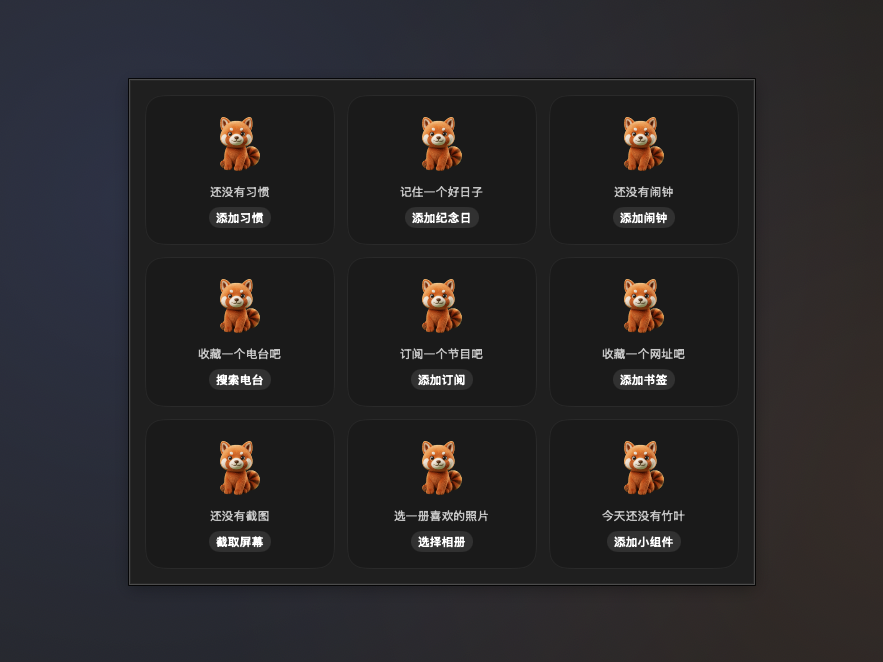

- **小熊猫空状态和操作入口**：习惯、纪念日、闹钟、收音机、播客、书签、截图、相册和无竹叶的竹篮统一使用现有小熊猫素材、一句说明和一个可执行按钮，分别接添加表单、搜索、订阅输入、截图、选相册或添加小组件。窄卡先收起说明和插图，保留按钮，不截断。尚未在真机上验证。

- **三个播放源接入系统正在播放**：收音机、播客、环境音共用媒体会话，开始播放会暂停另外两个；系统可播放、暂停、切换和停止，收音机前后台切台，播客按章节跳转或后退 15 秒、前进 30 秒，显示标题、节目名、已有封面和进度。直播无时长，停止时清空信息并释放系统命令。尚未在真机上验证。

- **行情离线文字保持可读**：股票、自选股和加密货币的离线说明统一为至少 9.5pt，不再随价格缩小；窄卡分行或缩短为「离线」，完整报价时间仍可悬停和用辅助功能读取。天气「当前」的五个副标题和旧设置迁移保持原样。尚未在真机上验证。

- **时间进度和习惯打卡改为免费，自选股卡片放大字号，天气七个样式并成四个**：时间进度整种免费，圆环、百分比、进度条随便用，液态和四格仍是 Pro，库卡片和样式菜单照旧标 Pro；没解锁时已经放好的液态、四格卡片不再盖小锁，退回圆环显示。习惯打卡改为免费 3 个习惯：第 4 个起和面板里的近七天报告是 Pro，满 3 个时「新建习惯」带小锁，点一下弹付费墙；已经有超过 3 个习惯的不删任何数据，超出的那几个在面板里画淡、带小锁，只能看和删除，不能打卡、补卡、编辑，也不能挪进前 3 个，删掉前面的习惯后它会顶上来变成能用的；竖排扩展栏上第 4 行同样画淡、不能点。新手引导的「健康」又会加上习惯打卡；小熊猫的竹篮仍是 Pro，它看的喝水、习惯、专注三项现在都是免费小组件。整种 Pro 的小组件从 20 个减为 18 个。自选股宽卡片从两列三行改为两列两行（一共 4 只），行高 12pt 改为 18pt，代码、现价、涨跌幅、涨跌统计和「今日」都不小于 9.5pt，放不下时不再缩字，第 5 只起最后一格写「还有 N 只」，点分组名换下一组；竖排扩展栏照旧一行一只。天气的样式从 7 个并成 4 个：「当前」多了「副标题」选项（城市、天气状况、风、日出日落、风与日出日落），「多日预报」有「天数」选项（7 天或 10 天），另外是「逐小时预报」和「多城市」（仍是 Pro）；已经放好的天气状况、风与日出日落、未来 7 天、未来 10 天卡片读取时自动换成新样式加对应选项，样子和大小不变。「当前」样式 2 小时内有雨时副标题先写「约 40 分钟后有雨」（按逐小时预报的降水量，取整到 5 分钟），已经在下或雨停了就照常显示选的副标题。时间进度回退、习惯的免费个数和只读规则、自选股的行数行高、天气样式迁移和「多久后有雨」放在 Core 并补了测试。尚未在真机上验证。
- **便签的字更粗更大，中间色的纸也看得清**：卡片上的手写字原来是手札体 W5、14pt，放不下时一路缩到 0.75 倍，在 58pt 高的卡片上只剩 10pt 出头，笔画又细，石板灰、牛皮纸、珊瑚这类中间色的纸上发虚。现在先用更粗的手札体 W7，字号放大到 15pt（竖排 12pt），最多只缩到 0.9 倍，放不下就少一行、尾巴省略；没装手札体（它是按需下载的字体）时回退系统圆体 semibold，不再是细的默认字。墨色改成按纸色算对比度：深墨、浅墨里挑对比度高的，不够 WCAG 正文 4.5:1 时再往纯黑或纯白推，十六种纸色都有测试保证够；面板里写字的大纸用的是同一套墨色。尚未在真机上验证。
- **系统通知被关时，提醒开关旁写明「系统通知已关闭 · 去开启」**：久坐、喝水（没交给弹出卡片时）、股票到价、播客新单集、GitHub、Codex 用量、电池、调休上班、电子宠物原来只请求一次授权、不看结果，用户在系统设置里关了码头的通知，开关开着却从不提醒。现在这些开关旁边读一下系统通知授权，被关了就显示一行橙色的「系统通知已关闭 · 去开启」，点一下打开 系统设置 ▸ 通知 ▸ 码头；开关本来关着、或者还没问过时不显示。所有地方共用同一个提示，授权状态的归类和哪些开关算“发通知”的在 Core 里，有测试。尚未在真机上验证。
- **行情断网写明「离线 · 10:32 的价」**：股票、自选股、加密货币刷新失败时原来只把卡片淡到 55%，不说为什么。现在卡片底行换成「离线 · 10:32 的价」（不是今天的带上月日，自选股取最早过期的那只写在右上角，加密货币让出 7 天线那一行），卡片只淡到 70%；面板顶上换成和天气、GitHub 一样的断网插头横幅，点右边马上重取一次，加密货币不用等五分钟的节流。时间文字和取最早那次的规则在 Core 里，有测试。尚未在真机上验证。
- **AI 任意门、书签、便签能直接拖东西进去**：拖文字或文件到 AI 任意门，蓝色虚线框写「拿去问 AI」，松手打开提问面板并把内容带进输入框（纯文本文件带内容，前面一行写文件名；图片、PDF 这类只写路径；刘海对话是网页模式时放进剪贴板，在对话框里粘贴）。拖链接到书签，青色框写「加一条书签」，松手加在最后，标题由链接预览取，重复的和放满 8 个时响一声。拖文字到便签，橙色框写「贴到便签上」，松手在最上面那张末尾追加一行。三张卡沿用文件暂存、隔空投送、废纸篓、快速待办那套四色虚线框。拼提问内容、去重和追加一行在 Core 里，有测试。尚未在真机上验证。
- **英文界面按地区给新小组件默认值**：英文界面原来也是中国的默认。现在新放的加密货币按地区计价（中国大陆以外用美元），涨跌颜色在中国大陆、台湾、日本、韩国以外默认绿涨红跌，黄金白银默认美元/盎司，摸鱼时钟的金额符号跟地区（美国 $、英国 £、欧元区 €）；中文界面不变，已经放好的小组件存着自己的设置，一个都不改。英文默认书签里被译成 GitHub 的哔哩哔哩换成 YouTube，不再有两条 GitHub。默认值的规则在 Core 里，有测试。尚未在真机上验证。
- **英文的提醒弹出卡片不再被截断**：英文下喝水那行「1000 / 2000…」和底下的「Raises the cup for 3…」放不下被截掉。现在喝了多少那串数字不截断，「还差几杯」放不下时挪到下一行；底下的说明和按钮放不下时说明单独占一行（最多两行），按钮靠右排在下面；第三行的说明允许折成两行；喝水和待办的英文说明也缩短了。尚未在真机上验证。
- **喝水提醒也交给后台计时器；点弹出卡片总能打开那张小组件的面板**：喝水提醒原来要喝水卡片在扩展栏上显示过才排得上，卡片放在文件夹里或别的布局里时不提醒，弹出卡片上点了「稍后 15 分钟」也不会重新排。现在和倒计时一样由后台计时器从启动起看着所有布局（含文件夹）里的每个喝水小组件，扩展栏自动隐藏、卡片不在当前布局也照样提醒，「稍后 15 分钟」下一秒就排上，删掉的喝水卡片不再按旧时间弹一次；仍然只弹一次，弹卡片时不会再和系统通知各来一回。点弹出卡片主体（以及点股票到价、久坐的系统通知）时：卡片就在扩展栏上，扩展栏自动隐藏着会先滑出来，面板从卡片的位置长出来；卡片收在当前布局的文件夹里，面板直接从文件夹那一格长出来，不用先打开文件夹；卡片在别的布局里、只用系统程序坞或卡片被条件隐藏着，面板以独立浮动面板挂在屏幕顶部正中（弹出卡片刚才的位置），不切换布局，面板里的改动照样写回那个布局里的小组件，扩展栏滑走时它也不跟着收。面板挂在哪里、喝水每秒交来的时间怎么处理放在 Core 并补了测试。尚未在真机上验证。
- **倒计时、闹钟和提醒到点不再要卡片在屏幕上，倒计时和闹钟也弹卡片；日程悬停浮出详情**：倒计时、闹钟、快速待办和提醒事项的到点改由码头里的一个后台计时器从启动起一直看着，扩展栏自动隐藏、卡片放在文件夹里或别的布局里也照样到点。倒计时和闹钟到点时也弹出那张深色玻璃卡片：倒计时写“泡面 时间到”、几点到点和共几分钟，按钮是「再来一次」（同样的时长重新计）和「关闭」；闹钟写闹钟名、时刻（稍后再响的那次写原定时刻），按钮是「稍后 9 分钟」和「关闭」，卡片和面板上的稍后也一起从 10 分钟改成 9 分钟。提示音照旧由计时器自己响（倒计时 30 秒、闹钟两分钟内每 4 秒一声，卡片设置里关了提示音就不响），卡片右上角的喇叭写 Glass 或 Sosumi，关了提示音时划掉；在小组件卡片上点了停、关掉或稍后，弹出的那张跟着收起；倒计时和闹钟的弹出卡片按 Esc 等于「关闭」，闹钟的卡片陪它响完两分钟才自动收起。提醒事项从系统提醒事项读今天到期、带具体时刻的那些（列表跟各张提醒事项卡片的筛选走，任一布局里有提醒事项卡片才读，每 5 分钟、过了午夜和系统提醒事项有改动时重读），快速待办读每张待办卡片存着的提醒时间，扩展栏不在也弹。快到点和正在响时请系统别推迟码头的计时器，其余时间照常省电。设置 ▸ 扩展栏 ▸ 音效的「到点弹出卡片」多了倒计时和闹钟两个勾选，默认开，关掉时照样到点响、卡片照样变橙，只是不弹。日历的今日时间线和一周日程悬停时不再只是换掉标题，而是在卡片外侧浮出一张详情：标题、时间（还有多久、进行中或已结束）、地点或会议来源、日历颜色和名字，有会议链接、还没开完的带「加入会议」按钮；一周日程列出那天最多五个日程和排了多久、几点以后全空。指针从卡片移到浮出详情上不会收起，在卡片上点一下收起；打开减少动态效果时直接出现和消失，没有淡入淡出。谁刚到点、还在不在响、要不要准时、读哪些列表、倒计时和闹钟卡片上的字、浮出详情的文字和摆放放在 Core 并补了测试。尚未在真机上验证。
- **一批小修：股票通知点开就是那只股票，切单位提醒价跟着换，待办第二天收起而不是删，提醒事项面板多了明天和之后 7 天**：股票到价的系统通知点一下，打开那张股票卡片的面板（通知里带着小组件 id；喝水、久坐、播客这些通知照旧，所有通知共用同一个处理，码头没在运行时点通知启动也接得住）。黄金白银在元/克和美元/盎司之间切换后，已经设好的提醒价按汇率和 1 盎司 = 31.1035 克换算过去，方向不变，已经通知过的不会再响一遍；切的时候汇率还没取到就先记着，汇率到了再换，在那之前这几条提醒不拿元/克的数去比美元/盎司的价。快速待办前几天做完的不再在第二天直接删掉，而是收进面板底部的「已收起 N 项」，点开能看、能恢复成今天没做完的、能单条删掉，做完 7 天后自动清掉，收起的不再算今天三件事，也不带提醒时间；放在分组里的快速待办，全局快捷键小框也能找到（扩展栏顶层的优先），分组里的小组件写下的东西也不再丢。提醒事项面板在已过期、今天下面多了「明天」和「之后 7 天」两段，推到明天、推到下周一的那条换一段留着，不会一改就消失；改到更远或去掉日期时才提示看不到了，扩展栏上的提醒事项卡片仍只管今天。纪念日撕页和时间轴的月份缩写不再写死，按界面语言交给系统的日期格式（简体中文 5月，英文 May）。便签叠了几张时，指针停在便签上用滚轮或触控板也能前后翻（往下下一张、往上上一张，一下手势翻一张，按着 Command 照旧切换布局），打开减少动态效果时直接换成那一张，不做动画。通知去向、提醒价换算、已收起的存取和期限、快捷键找待办、面板分段、月份缩写和前后翻页放在 Core 并补了测试。尚未在真机上验证。
- **AI 任意门的迷你提问面板补上剪贴板接力、快捷指令和常用提示词，卡片面板底部可以直接改外观，电池「状态」样式画成电池**：点 AI 任意门卡片打开的迷你提问面板，输入框下面多了和刘海对话一样的一排：「剪贴板」把剪贴板里的文字带进输入框（输入框有字时另起一行接在后面，太长只带前 20000 字），翻译、总结、润色、解释四个快捷指令和「常用」菜单里的常用提示词，文字先取输入框、空着时用剪贴板，套好的提示词照平时提问交给选中的服务：API 和网页模式交给刘海对话（照旧是码头 Pro，没解锁时弹付费墙），跳转模式能带问题的带着打开、其余复制再打开；两边都没有文字时提示先写字或复制；下面一行是剪贴板预览，点一下也能带进去，「管理常用提示词…」打开 设置 ▸ AI。两处用的是同一份界面，不是各写一份。有颜色或背景可选的卡片，点开的详情面板底部多了一行「外观」，右边是主题色小圆点和当前的颜色、背景（如「粉 · 深色背景」，没调过写「默认」），点开就地显示和 设置 ▸ 小组件 里同一块颜色与背景，改了扩展栏上的卡片立刻跟着变，自定义取色和渐变背景照旧是 Pro、没解锁带小锁，面板窄时色块一排少放几个、不画预览卡片，每次打开面板都是收起的；在系统颜色面板里取色不会把详情面板关掉。电池单设备的「状态」样式原来是设备图标外一圈百分比圆环，经典和液态外观现在和电池格一样画一块横向电池（电池形外轮廓、正极小凸起、按电量填满，液态里是水），百分比写在电池里，压在电量那一截上的数字自动反色，充电时数字前面一道闪电，低于 20% 变橙、10% 变红（状态那行字跟着变色），旁边是状态和设备名，按 58pt 高的卡片排版；像素电池、能量粒子、小熊猫照旧，存的配置不变，旧卡片打开就是新画法。快捷指令条显示什么、迷你面板交出去什么、外观摘要和色块列数、电池里的数字、反色和尺寸放在 Core 并补了测试。尚未在真机上验证。
- **提醒到点弹出一张卡片，带快捷动作；快速待办可以设提醒时间**：提醒事项、喝水、待办到点时，从刘海下方滑出一张宽 380pt 的深色玻璃卡片：左边是带表情的角色，右上角的喇叭写出这一类的音色（选了不响、音效关着，或者这次因为勿扰、专注、屏幕共享不响时划掉），第一行是哪一类和什么时候，大字是要做的事，第三行是时间和来源，下面是同时到点的几条，右下是快捷动作。提醒事项（扩展栏上提醒事项卡片里带具体时刻的那些）可以完成、有几条时全部完成、推迟到 1 小时后 / 今晚 8 点 / 明天同一时刻，直接写回系统提醒事项；喝水在码头运行时不再发系统通知，改为弹这张卡片（码头不在前台也会出现），角色跟设置里选的走（小熊猫没有喝水图，用站着的那张），写出八个小杯、已喝 / 目标和还差几杯，可以「加一杯」（跟设置里一杯的容量，走原来的记录，卡片上的角色照样举杯）或「稍后 15 分钟」；待办可以完成（勾掉最后一项时卡片上的小熊猫照样欢呼）或「稍后 10 分钟」。快速待办面板每一条行尾多了个小闹钟，右键也有「提醒我」：1 小时后、今晚 20:00、明天 9:00 或自定义日期和时刻，也能清除；设了的那一条在卡片上带小闹钟和时刻，旧数据照常读出、没有提醒时间。新的一天收拾清单时，昨天做完的连同提醒一起收起；点「顺延到今天」时，定在昨天的提醒挪到今天的同一时刻，那个时刻已经过了就清掉。几秒内同一类到点的几条合成一张，别的类排在后面，底下叠一层，只响一声；勿扰、专注、屏幕共享时只出卡片不响。不点的话 30 秒后自动收起（固定，不进设置），指针停在卡片上时不收，移开后至少再留 5 秒；指针在卡片上时按 Esc 关闭；点卡片主体打开对应小组件的面板。外接屏没有刘海时放在菜单栏下方居中，检测到「拾掇」在运行时刘海让给它，卡片放到菜单栏下方靠右，灵动提示正显示时让到它下面；打开减少动态效果时直接淡入淡出。设置 ▸ 扩展栏 ▸ 音效的提醒音效下面加了「到点弹出卡片」，三类各自一个勾选，默认都开；关掉喝水时改回原来的系统通知，关掉提醒事项或待办时只响一声。合并去抖、推迟时间、提醒时间的存取和顺延、该不该弹、自动收起计时、卡片上的字和摆放位置放在 Core 并补了测试。尚未在真机上验证。
- **提醒到点轻响一声，三类各选音色**：设置 ▸ 扩展栏 ▸ 音效最上面的开关和音量改为码头所有音效的总开关（原来只管添加和移除小组件），下面新增「提醒音效」：一个总开关，提醒事项、喝水、待办各选一个音色或「不响」，旁边可试听。音色只用 macOS 自带的提示音，默认提醒事项 Glass、喝水 Pop、待办 Tink。喝水提醒的系统通知照旧带提示音，码头在运行时换成所选音色播放、不再叠一声系统默认音，选了「不响」或关了总开关时通知不带声音；提醒事项卡片上带具体时刻的提醒到点那一秒轻响一声，只有日期的全天提醒不响。勿扰或专注模式开着、屏幕正在被共享时不响，几条在几秒内一起到点只响一声，合盖睡眠醒来不补响；减少动态效果不影响音效。专注模式要给码头“完全磁盘访问权限”才判断得了，会议软件的共享屏幕判断不了，这两种情况照常响。快速待办还没有到点时间，待办的音色先留着、现在不会响。选音色、该不该响、合并去抖和刚到点的判断放在 Core 并补了测试。尚未在真机上验证。
- **小熊猫竹篮的月度分享图改版，空月不再一排 ×0**：分享图标题统一写成「2026 年 10 月的竹篮」（数字两侧留空格），右上角的小熊猫放大到 88pt，这个月还没收到竹叶时是等待的样子，有收获时举手欢呼。空月的竹篮下面单行写「还是空篮子」，不再压在藤条上断成两行；右侧图例换成「每天怎么拿竹叶」：三项全部达标是金竹叶、三项达标两项是银竹叶、只达标一项是铜竹叶，下面两行小字写只开了两项时都达标也是金叶、只开了一项时达标算铜叶，和面板里的规则一致。有收获的月份竹叶按金银铜的颜色插在篮口，篮下写「篮里 N 片竹叶」，右侧照常是三档 ×N。原来看不出意思的 31 格频率条换成一行「已过 18 天 · 收到 13 片竹叶」，空的本月写「已过 18 天 · 收到 0 片 · 今天喝杯水，第一片就来了」，往月按整月天数算，今天之后的日子不算。日历里已过没收到的日子留虚线叶，今天是绿色小胶囊加一片淡虚线叶，还没到的日子只写日期不画叶；竹子装饰挪到右上角页边、小熊猫后面，不再盖住日历。面板随后也换成同一套竹篮和日历（见「小熊猫竹篮的面板改版」一条），本月一片竹叶都没有时分享按钮置灰。已过天数、收到几片、空月判断、状态行和日历每格的已过/今天/未来放 Core 并补测试。尚未在真机上验证。
- **喝水面板的「今天」页换成杯子页，角色站在杯子旁边照旧涨水**：面板保留今天、统计、目标、设置四个标签，「今天」换成以一只大玻璃杯为主角的页面，水位就是今天的进度，旁边写已喝和目标（如 1250 / 2000 毫升）、还差多少约几杯和八个小杯，再下面是上次喝水和下次提醒。选的角色（六只都一样）站在杯子旁边，不再缩成小探头，身上还是原来那套水位效果：水面以下全彩、以上发灰，中间一条白色波浪水面，水位和杯子同步，喝一杯两边一起涨；表情照旧，喝下后举杯三秒、达标欢呼、提醒时段外或三小时没喝打盹，很久没喝渴成骷髅，喝一杯就复活。加水是饮品七格加三只杯量按钮：小杯 100、一杯、大杯 500，「一杯」跟设置里的一杯容量走，另外两只跟着让开，还有自定义；选中的饮品和角色只亮一点加白描边，不再是大块的蓝。下面是今天的时间轴（提醒时段一根横轴，每一杯一个小图标，标出现在和下次提醒）和记录，默认显示最新三条、可展开全部，右上角撤销上一杯，每条可单独删除。近七天报告挪进统计标签，统计、目标、设置的内容不变，角色在设置标签里选，Pro 角色带小锁。卡片的角色样式也一样：角色站在杯子旁边带灰彩水位线，卡片宽 200 改为 224。打开减少动态效果时涨水、换表情不做过渡，面板水面静止。杯量按钮、还差几杯、时间轴刻度和记录收起放 Core 并补测试。尚未在真机上验证。
- **单位换算、汇率换算、计算器合并成一张「算」**：三张卡原来长一个样，得先想好是哪种算才知道放哪张。现在只有一张「算」，点开是一个输入框，输入什么自动认：带币种（100 USD、100美元、¥500 to EUR、$20、1万日元）走汇率，汇率来源照旧，离线时用缓存；带单位（5 km、3 斤、72°F、10 in to cm）走单位换算，长度、重量、温度的中英文叫法都认；其余当算式（3*4+2、括号、乘方），200+10% 按加一成算成 220。只写一头时，币种按设置里的币种对换（默认美元和人民币），单位换成常用的另一制（公里换英里、斤换公斤、华氏换摄氏）。卡片宽 184，左边紫色“算”字牌，上面一行小字是输入、右上角标“汇率”“单位”或“计算”，下面是大号结果和单位；点结果数字就复制（不带千分位），点别处打开面板。面板里有输入框、结果（汇率时写出单价）、拷贝结果、固定到卡片（固定一条 1 USD 就能一直看着汇率）、三种混排的最近记录，点一条再算一次。已经放好的三种旧卡片自动变成「算」，位置不变，保留最后一次输入：单位换算原来的那对单位留作默认，汇率换算原来的币种对变成默认币种对，计算器的算式照旧。添加小组件面板只列「算」，搜“单位换算”“汇率”“计算器”都能找到。三张原来都免费，合并后仍免费。识别、换算、迁移和最近记录放在 Core 并补了测试。尚未在真机上验证。
- **音量、应用音量、正在播放分工，迷你、相册宽幅、AI 任意门竖版各有重点**：三张碰到声音的卡片各管一件事，添加小组件面板里的小标题后面写明。音量管“从哪儿出声、总共多大声”：上面一排输出设备（MacBook 扬声器、AirPods、显示器等，按连接方式配图标），点一下就切成系统的默认输出，和控制中心里选一样，不用再跳去系统设置，设备多于三个时最后一格是“…”，弹出全部设备；下面一根总音量，点喇叭静音。应用音量管“谁吵关谁”：正在出声的应用每个一格，图标、名字、百分比和自己的音量条（颜色取应用图标的主色），在卡片上左右拖那一格就能调，0 到 150%，100% 处有一道小刻度，拖回去会吸住，按住图标静音；调过的应用排在前面，最多四格，放不下写“还有 N 个”。这是真的在调：走原来的系统音频接入，第一次把某个应用调离 100% 时系统会要录音权限，被拒绝时卡片下面那行字变成“需要录音权限，点这里打开设置”。正在播放只管这首歌，不放音量；“迷你”样式不铺封面，只留播放键和一排跳动的小竖条，暂停时停成矮矮一排，打开“减少动态效果”时不跳。相册宽幅换成“照片 + 那年今天”：读照片图库里往年今天拍的照片轮播，下沿写“那年今天”和“2024.10.18 · 杭州”，右边是轮播圆点；地点按照片的位置反查成城市，查不到就只写日期；第一次出现在扩展栏上时请求“照片”权限，没给权限或今天没有往年的照片时照旧轮播文件夹，图片自带拍摄日期时同样写在下沿；相册标准仍是纯照片。AI 任意门竖版换成一只大的小熊猫加“问 AI”和默认服务，点哪里都是用默认 AI 提问，字牌留给横版。已经放好的迷你、宽幅、竖版卡片样式和宽度都不变，打开就是新画法。输出设备的图标和排序、应用音量条的拖动换算、“那年今天”的日期范围、拍摄日期和坐标的读取、地点和日期的写法放在 Core 并补了测试。尚未在真机上验证。
- **电池、圆环仪表、系统活动不再三个圆环撞脸，系统活动和网络活动样式精简**：圆只留给圆环仪表，它的定位是任意拼装多个指标，除了存储空间和电池，现在也能拼 CPU 和内存（在 设置 ▸ 小组件 里勾选，添加面板的小标题写着“任意拼装多个指标”）。电池的“百分比圆环”改名“电池格”，经典外观直接画一块电池：只有一台设备时是一块横向电池，填充就是电量，旁边写百分比和状态，充电时中间有闪电；连了蓝牙设备时每台一块竖电池，下面写百分比；平时不上色，低于 20% 变橙、10% 变红，没连上是空的虚框。液态外观画成装着水的电池，像素电池、能量粒子、小熊猫抱电池照旧；电池格仍是 Pro。系统活动的“圆环”改名“竖条”：每个读数一根八格的竖条，亮几格就是占用多少，旁边是大数字和名字。系统活动的“数字”和“数字 + 图表”合并成“数字”，网络活动的“仅数字”和“带图表”合并成“网速”，要不要图表在设置里用“显示图表”开关。已经放好的卡片自动对上新样式：原来的百分比圆环和圆环卡片直接换成电池格和竖条，原来带图表的卡片开关是打开的，大小和位置都不变。竖条亮几格、电池横竖和颜色、圆环仪表的指标顺序放在 Core 里并补了测试。尚未在真机上验证。
- **点开小组件的面板不再显示不全**：面板原来按打开那一刻量到的高度定尺寸，只把位置夹进屏幕，所以内容比屏幕可用高度还高时顶上一截出了屏幕；日程、提醒、行情这类打开后才读到的内容让面板变高时，窗口也不跟着变，下面一截被切掉；多显示器时按面板左下角找屏幕，面板落到屏幕外就退回主屏。现在面板高度随内容变化，上限是所在屏幕的可用区域减去边距（底部和顶部扩展栏只算扩展栏开口那一侧，不盖住扩展栏），超出的部分在面板里滚动，底边淡出提示下面还有；内容打开后变高变矮、改了设置、插拔显示器时都会重新算尺寸和位置；按小组件所在的屏幕摆放，整个面板夹在这块屏幕里，竖排扩展栏靠近屏幕上下两端时同样如此。各小组件面板里的内容没有改动。尺寸和位置的计算放在 Core 并补了测试。尚未在真机上验证。
- **截图工具、最近截图、取色器各管一件事**：截图工具只管动作，四个按钮各带两个字：截区域、截窗口、识字（和快速开关里的截图识字是同一套，照旧是码头 Pro，没解锁时带小锁）、录屏（录整个屏幕，按钮变红并在下面计时，再点一次停止，文件以“录屏”开头存到截图文件夹；第一次需要在系统设置里允许屏幕录制），卡片宽 136pt 改为 184pt，原来的“截取全屏”按钮去掉（⇧⌘3 照旧可用），点卡片空白处照旧打开系统的“截屏”App。最近截图只管结果：最新一张画大并写多久以前，右边 2×2 四格放后面几张，放不下时最后一格写“+N”，每张都能直接拖进聊天窗口、邮件或文件夹，卡片四周的空隙照旧能拖动卡片，卡片宽 132pt 改为 184pt。取色器只管最近颜色：一排六个色板，点一下拷贝 HEX，下面是最新颜色和吸管按钮，卡片宽 136pt 改为 160pt。快速开关里的识字、取色按钮照旧可选，悬停提示写明是“快捷按钮”；快速开关取到的颜色也记进取色器的最近颜色，卡片、面板和快速开关共用一份历史，以前记在取色器卡片里的颜色接在后面，一个不少。添加小组件面板里三张卡片的小标题后面写明各管什么。四个动作、文件名、录屏计时、大图加四格的排法和共享取色历史放在 Core 并补了测试。尚未在真机上验证。
- **喝水看水位，电子宠物看角色，角色不再占添加面板**：两张卡片原来都是“左边一只角色、右边两行字、一个圆按钮”，放在一排像同一张卡放了两次。喝水的角色样式改成以杯子和水位为主：左边一只玻璃杯，水位就是今天的进度，选的角色缩小到杯边探个头（喝一杯举杯、达标欢呼、提醒时段外打盹，很久没喝照旧渴成骷髅），右边是大数字“1250 / 2000 毫升”和一排 8 个小杯，没达标时最多亮 7 个、达标才 8 个全亮；圆环、液态外观和个性化目标不变。电子宠物的角色放大到约 54pt 占满卡片高度，旁边是“小熊猫 · 有点饿了”，下面饱食、心情、精力、清洁四个小格各带一条进度条，最要紧的那一格标红；点格子直接喂、玩、睡（睡着时叫醒）、洗，卡片上原来的喂食按钮去掉了，看病、提醒和换角色在面板里。两种小组件的 6 个角色都不再作为样式列在添加小组件面板里：喝水只列“角色”“圆环”“液态”三张，电子宠物只列一张，角色在面板或 设置 ▸ 小组件 里选；喝水的柴犬、橘猫改为累计达标 3 天、7 天解锁，企鹅、水獭、章鱼仍是 Pro。已经放好的角色卡片原样保留角色，读出来就是“角色”样式加原来的角色，样子不变。打开“减少动态效果”时水位和小杯直接跳到新值。小杯数、四格对应的动作和标红哪一格放在 Core 并补了测试。尚未在真机上验证。
- **拖入类卡片写明“放下去会怎样”，便签变成真的纸**：文件暂存、隔空投送、废纸篓和快速待办拖着东西停在上面时，虚线框和图标同色，颜色就是结果：文件暂存青色“暂存在这里 / 3 个文件”，隔空投送系统蓝很淡的底“发送给附近设备 / 3 个文件 · 松手选设备”，废纸篓红色“移到废纸篓 / 3 个 · 之后还能拿回来”（原来的“松开以删除”改掉，因为不是真删），快速待办橙色“记一条待办 / 文字、链接、文件都行”，不再盖住清单；竖排时图标在上、结果拆两行；松手后卡片回到平时的样子，文件暂存和快速待办的面板也换成同色虚线框。便签换成纸感卡片：小圆角、顶上一条胶带、右下角卷起，字优先用系统的手札体（没有就用系统字体）；一张便签最多叠 3 张，每张一种颜色，后面露出纸边，右下角“1/3”点一下翻到下一张；便签不能勾选，也不会自动清空。纸色不再作为 15 张样式卡列在添加小组件面板里，改在便签面板（这张纸的颜色、下一张、新的一张、撕掉）和 设置 ▸ 小组件 里选，换颜色只改最上面这张；免费色仍是奶油白、薄荷绿、蜜桃、薰衣草、柠檬黄，其余十种照旧是 Pro。已经放好的便签照旧是原来的颜色和内容，读出来就是一张。拖入提示的文字颜色和便签叠放、翻页、迁移放在 Core 并补了测试。尚未在真机上验证。
- **股票、自选股、加密货币行情分工，新增黄金白银**：股票只盯一只：左边是代码和中文名、大号价格、涨跌幅和涨跌额，右边是当日分时（按交易时段铺满，盘中只画到现在）、昨收虚线（线在虚线上方就是涨）和底部的成交量小柱，右上角写盘中或已收盘。可以设到价提醒：在面板里填提醒价，高于现价是涨到、低于现价是跌到，可多条，也能在设置里写 AAPL>237 这种；卡片上画一条橙色细线，右上角写“距提醒价 2.1%”，到价时发一次系统通知，卡片闪一下橙边。设了多只时每 10 秒自动轮播（可在设置里关掉），底部圆点指示，点圆点或面板顶部的代码直接换。股票卡片宽 228pt，关掉图表是 124pt。自选股管一组：顶部是分组名、“涨 5 跌 3”和红绿比例条，下面两列、每列三行，按涨跌幅从高到低（也可按填写顺序），每行是代码、当日迷你走势、现价和涨跌幅色块，幅度越大色块越深，放不下时最后一格写“还有 N 只”；卡片宽 320pt。分组在面板里点“＋ 分组”新建（名字加一串代码，比如 科技、A股），点分组名切换，右键可编辑或删除，卡片上点分组名换下一个；设置里也能写“科技=NVDA TSLA”。在设置里填上持仓（比如 NVDA 100）才显示今日盈亏，没填这一块收起。加密货币行情每币 96pt：币种圆标（币自己的颜色和首字母）、24 小时涨跌实心色块、价格，下面是 7 天迷你线，虚线是 7 天前的价格，右下写 7 天涨跌。三个小组件用同一个“涨跌颜色”设置，股票和自选股也默认红涨绿跌，原来股票写死的绿涨去掉了。股票和自选股的代码设置下面多了“＋ 黄金”“＋ 白银”两个快捷项（国际期货 GC=F、SI=F），卡片上直接写“黄金”“白银”，默认按美元兑人民币汇率换算成元/克（1 盎司 = 31.1035 克），没取到汇率时照旧显示美元/盎司，面板和设置里可以切到美元/盎司。股票、自选股、加密货币行情照旧是码头 Pro。排序、涨跌统计、色块深浅、离提醒价多远、到价只提醒一次、分时坐标、分组、今日盈亏和贵金属换算放在 Core 并补了测试。尚未在真机上验证。
- **日历、一周日程、农历与假期分工，各管一件事**：日历只管今天和下一个会。“下一个日程”第一行写“还有 25 分钟”和开始时间，下面是会议名、“10:30-11:15 · 3 号会议室”，日程带会议链接时（日程的 URL，或地点、备注里的腾讯会议、Zoom、Teams、飞书、Google Meet 链接）出现绿色的“加入腾讯会议”这类按钮，没有链接就不显示，最下面一行是“之后 14:00 设计评审”，正在开的写“进行中 · 还剩 20 分钟”。“日期 + 日程列表”换成新的“今日时间线”（300×62）：9 点到 19 点一根轴（日程更早或更晚就整点往外扩），每个日程按时长画成日历颜色的色块，重叠的分两行，过去的部分变暗，红线是现在，标题写“今天还剩 3 个”和“下一个 25 分钟后”；鼠标停在色块上标题换成会议名、时间和来源，有会议链接的色块点一下就加入。已经放好的“日期 + 日程列表”卡片自动换成今日时间线。“日期”样式下面加一排小点，一个点一个会，开完的变淡。一周日程改成按占用时长看忙闲：每天两格，上半格下午、下半格上午，填满是 4 小时，标题写“本周已排 21.5 小时”，右边绿色标出本周剩下工作日里最空的下午（按法定假日和调休算工作日），今天整列浅底、过去的日子变暗；鼠标停在某天，标题换成那天排了多久、几点以后全空，悬停提示列出那天的日程；点某天在日历里打开那天（第一次会请求控制“日历”的自动化权限）。农历与假期同一张卡按优先级只说一件事：接下来几天有调休要上班时整行变红，写“下周六要上班 / 10月10日 调休补班”，前一天晚上 8 点再发一次通知；节气、传统节日当天写“今日霜降 / 农历九月十四”；平常写“国庆还有 12 天 / 10月1日起 连放 7 天”。设置新增“提醒提前”（3、7、14 天，默认 7 天），原来两个开关改叫“显示节气”和“调休上班提醒”。点开面板是本月月历（标出休、班、节气和节日，今天加框）和“接下来”的节气与假期。放假和调休日期只用已有的国务院通知数据。会议链接识别、倒计时、时间线布局、忙闲计算、最空下午和调休提醒优先级放在 Core 并补了测试。尚未在真机上验证。
- **时钟样式从 12 个精简为 8 个，以后加样式更方便**：添加小组件面板里时钟只列标准、模拟表盘、翻页、像素、液晶、中文、霓虹、实景 8 个。“液晶”就是原来的“简约”，只改了名字。长得像的合并成选项，在 设置 ▸ 小组件 里时钟下面选：大号数字变成“标准”的“大小：大号”加“粗细：粗”；秒圈变成“模拟表盘”的“表盘：秒圈”；折叠翻页变成“翻页”的“翻法：折叠”；极简变成“翻页”的“卡片：大号带时分秒”，仍是 Pro。选项只在所属样式下出现。已经放好的大号数字、秒圈、折叠翻页、极简卡片读取时自动换成对应的样式和选项，样子不变。代码里时钟样式改成一张注册表（名字、是否 Pro、子选项、旧样式映射），以后加一个样式只要加一项和一个绘制视图，Pro 判定跟着注册表走；注册表和旧样式映射放在 Core 并补了测试。尚未在真机上验证。
- **数剩余时间和计时类按尺度分工**：倒计时管“几分钟内”，闹钟管“今天某个时刻”，时间进度管“年月周日百分比”，纪念日管“按天”，添加小组件面板里每张卡片的小标题后面写明各管多长。倒计时卡片改为 168pt 宽，没开始时直接点 3、5、10 分钟就开始（三个预设在面板里改，上次用的那个高亮），运行中是大数字、“泡面 · 共 3 分钟”和一条细进度条，卡片上能暂停、继续、取消；到点卡片变橙、左右晃一阵并响提示音，点卡片任何地方就停，打开“减少动态效果”时不晃只变色，设置里可以关掉提示音。闹钟一张卡片放多个（已经放好的单个闹钟自动变成列表里的一个），卡片改为 220pt 宽：下一个最醒目，比如“14:30 给小王回电话 · 还有 2 小时”，后面的闹钟排成一行小字，点铃铛开关下一个；到点卡片变橙，直接在卡片上按“稍后 10 分钟”或“关掉”，两分钟内每 4 秒响一声，十分钟没人管就自己停；面板里一张列表加、删、开关、改时间和名字。时间进度新增“四格”外观，年、月、周、今天四个百分比一起看。专注计时是码头上唯一保留圆环的：环心一个小圆点，下面一排小点表示第几轮；专注到点自动接休息（满一组接长休息），休息完回到专注等开始；休息时卡片变绿写“站起来走走”；设置 ▸ 专注计时多一个“休息时提醒起身”（默认开），开着时专注计时运行期间久坐提醒不另外提醒，专注的休息结束也算起身过一次。秒表改成横向大数字带两位小数，旁边最近三次计次，最快那圈标绿，卡片上点开始、计次、暂停、重置，窄卡片只显示数字；面板里列出全部计次。久坐提醒换成小熊猫：坐着时小熊猫打盹，写“已坐 48 分钟”“60 分钟时叫你”和六格已坐时长，到点卡片变粉、小熊猫伸懒腰，点“起来了”记一次，专注计时运行时小熊猫趴着不打扰。多个闹钟的下一个、稍后再响、秒表计次和最快一圈、四格百分比、专注轮次和久坐与专注的互斥放在 Core 并补了测试。尚未在真机上验证。
- **纪念日卡片单个和多个长得完全不一样**：单个卡片换成日历撕页：左边一页小白日历，顶上事件颜色的色条写名称，中间是大号的日，下面是月份，农历事件写农历日子和月份；右边是“已经/还有”、大数字天数和一行小字，正数日写“第 8 年 · 下个周年 214 天”，倒数日写那天星期几和“每年”或年份。日子到了那天（倒数日到了、正数日的周年），卡片换成事件颜色的淡底，左边小熊猫庆祝，写“就是今天”（周年写“8 周年啦”），下面提示“点开生成分享图”。过了零点日子变了，旧的一页往上翻走、新的一页露出来，打开“减少动态效果”时只淡入淡出。设置里原来的“显示进度圈（单个样式）”改为“显示日历页（单个样式）”，关掉就只留文字。多个卡片换成“接下来一年”的时间轴：标题旁写一年内有几个，横轴从今天到一年后，带月份刻度和季度月份，每个纪念日一个事件颜色的点，最近的一个大一些并写名称和天数，其余的放得下就写名称和天数，放不下只画点；正数日按下一个周年定位，一年以外和已经过去的一次性倒数日不上轴。点某个点（按离得最近的点算）打开它的专属页，点空白处打开时间线；鼠标停在点上，标题右边换成名称和日期。多个卡片固定 236pt 宽，单个 188pt。竖排扩展栏：单个是竖着的一页撕页加天数，多个是最近 3 个挂在一根短轴上，点哪一行开哪一个。小组件库预览同样是新样式。日期在轴上的位置、月份刻度、标签避让、点击就近和撕页上的字放在 Core 并补了测试。尚未在真机上验证。
- **提醒事项能改了，和系统提醒事项、iPhone 同步**：提醒事项小组件直接读写系统“提醒事项”，改完经 iCloud 同步到 iPhone。“列表”样式每行前面是圆圈，点一下就完成并写回系统，过期的圆圈和时间标红，昨天的写“昨天”。“下一个提醒”第二行改成倒计时，比如“40 分钟后 · 15:00”，鼠标停在卡片上出现“完成”和“推迟 1 小时”两个按钮（推迟时还没到的从原时间往后推，已经过了的从现在往后推）。“数量”改名“今日概览”，并排两个大数字：已过期（有就标红）和今天到期，已经放好的卡片照旧可用，只是卡片变宽一些。点开面板可以编辑：右上角“＋ 新提醒”；点一行展开内联编辑，改标题、日期和时间（都可以不要）、优先级（无、低、中、高）、列表，回车保存，也能在这里删除；右键有“推到明天”“推到下周一”“推迟 1 小时”“完成”“编辑”“删除”，推的时候时间不变；保存到今天以外的会提示一句。改到期时间时，到点提醒的通知跟着挪过去。小组件选了某个列表时面板只显示那个列表，新提醒也放进去。卡片上不会弹授权框，第一次点开面板时才请求提醒事项权限。添加小组件面板里需要系统权限的小组件不再画小锁，是哪项权限写在卡片的悬停说明里（Pro 角标不变），提醒事项的小标题后面写“和系统提醒事项同步”。相对时间、推迟和改期的日期计算放在 Core 并补了测试。尚未在真机上验证。
- **快速待办改成“随手记，今天清”，和提醒事项分开**：快速待办不要任何权限、不同步，没有日期和时间，添加小组件面板的小标题后面写着“随手记，不同步”。卡片改成“今天三件事”：在面板里点星标或右键“标为今天要做”，最多标 3 条，卡片优先显示它们，右上角是做完几条 / 标了几条，左边的圆圈一点就勾完成；一条都没标时显示前几条没做完的。文字、链接、文件直接拖到卡片或面板上，出现虚线框“松手记一条待办”，松手就记一条；链接和文件的待办记下地址，卡片和面板上点小图标就打开。设置 ▸ 快捷键 新增“记一条快速待办”（默认不设），按下在屏幕上方弹出一个小输入框，输入一句回车就记到扩展栏上第一个快速待办，按 Esc 或点外面收起。当天清：第二天第一次显示时，昨天做完的自动收起，昨天没做完的在面板顶部问“昨天还有 N 件没做完”，可以顺延到今天或放弃。全部做完时卡片换成小熊猫“今天清空啦”和连续清空的天数。右键“转成提醒事项”可选今天、明天、选日期或不设日期，在系统提醒事项里建一条，成功后从快速待办移除，提醒事项权限只在这时才请求。今天三件事的排序、当天清和顺延、连续天数的计算放在 Core 并补了测试。尚未在真机上验证。
- **纪念日单个和多个点开不一样，新增专属页和分享图**：单个卡片点开是它显示的那一个纪念日的专属页：大圆环是这一年的进度（正数日写第几年），旁边是名称、大数字天数、起始日期和星期、离下一个周年还有几天；下面是“里程碑”格子，正数日列第 100、520、1000、1314、2000、3000、5000、10000 天是哪天、星期几，已经过了的打勾变暗，下一个带事件颜色的圆点，倒数日换成还有 100、30、7、1 天的那天；再下面是接下来 4 个周年（第几个周年、日期和星期、还有几天，农历的同时写公历日期和农历日子）。左上“‹ 纪念日”进时间线，右上“换一个”改固定在卡片上的那个，底部是“编辑”（打开原来的编辑器）、“分享图”和“管理全部纪念日”。分享图是一张竖版卡片：事件颜色的深色渐变、小熊猫、名称、大数字、日期区间和“码头 Dockling”，可以存为 PNG 或拷贝到剪贴板，免费。多个卡片点开照旧是时间线，顶部多了“这个月”小概览（这个月有几个纪念日，最近的一个还有几天，点一下打开它）；点卡片里的某一列直接打开那一列的专属页，鼠标停在某一列上那一列轻轻亮起，竖排扩展栏同样如此。时间线右键菜单新增“打开专属页”。里程碑、周年和本月概览的计算放在 Core 并补了测试。尚未在真机上验证。
- **面板右侧不再压一根白色滚动条**：系统设成“始终显示滚动条”或接了鼠标时，习惯打卡的新建习惯、纪念日、待办、喝水、收音机、AI 等深色面板右边会画一根浅色滚动条，压在图标和颜色上。现在这些面板都不画滚动条，照样可以用滚轮或触控板滚动；新建习惯底部加了淡出，提示下面还有内容。尚未在真机上验证。
- **码头 Pro 补齐锁定，试用到期提醒**：快速开关里的截图识字、二维码、演示模式、只锁键盘、低电量模式真正上锁：没解锁时设置里照样列出并带 Pro 标识，勾选弹付费墙；已经勾上的在卡片上画暗一些、右下角带小锁，点按弹付费墙，不执行；试用中打开的演示模式、只锁键盘、低电量模式到期后仍能点一下关掉。AI 刘海对话没解锁时，点刘海入口或按快捷键只弹付费墙，不展开对话；设置 ▸ AI 里打开“在刘海显示 AI 助手”也弹付费墙；AI 卡片的小熊猫退回原来的提问面板，跳转到网页或 App 照旧免费，网页和 API 方式的提问弹付费墙。电池面板的充电上限没解锁时，开关、安装和更新助手弹付费墙，上限和缓冲变灰；已经打开的停止生效，写给助手的设置改为关闭，电池恢复正常充电，解锁后自动恢复原来的上限，卸载助手和复制诊断照常能用。试用剩最后 1 天时和到期后各弹一次应用内提示，点“查看码头 Pro…”或“购买或输入兑换码…”打开付费墙，每条只提醒一次，已激活和老赞助者不提醒。付费墙的功能清单新增“Pro 工具”。老赞助者照旧全部解锁。锁的判断和提醒时机放在 Core 并补了测试。尚未在真机上验证。
- **码头 Pro 范围扩大，添加小组件面板按种类分组**：应用音量、录音、股票、自选股、加密货币行情、壁纸切换、收音机、文件暂存、翻译，加上摸鱼时钟、环境音、播客、废纸篓、GitHub、应用切换器、Codex 用量、小熊猫的竹篮、电子宠物，共 18 个 Pro 小组件、40 个免费小组件。时间进度整种免费，液态和四格外观仍是 Pro；习惯打卡免费 3 个，第 4 个起和近七天报告是 Pro。天气的“多城市”和电池的“电池格”样式是 Pro，库卡片和样式菜单都标 Pro，没解锁时选不了；已放好的多城市天气盖小锁，电池格退回免费外观。便签纸色按亮度挑最浅的五种免费（奶油白、薄荷绿、蜜桃、薰衣草、柠檬黄，默认的柠檬黄在里面），其余十种是 Pro，已放好的便签没解锁时退回柠檬黄显示，照常能写。设置 ▸ 小组件 的“颜色与背景”里预设颜色照旧免费，自定义取色和渐变背景改为 Pro，色块上有小锁，点了弹付费墙；已经选了的没解锁时退回默认颜色、无背景显示。卡片改名一眼看出是什么：AI 助手的“横排”“方块”改为“AI 任意门（横版）”“AI 任意门（竖版）”，相册的“标准”“宽幅”改为“相册标准”“相册宽幅”，只改名字，已经放好的卡片不受影响。添加小组件面板的分类里改为按种类分组：每种小组件一个小标题（种类名称，整种是 Pro 时带 Pro 角标，有多个样式时标样式个数），组与组之间一条细线；搜索结果和推荐照旧不分组；上下方向键按画出来的行走，每组从新的一行开始。新手引导不再自动添加变成 Pro 的收音机，娱乐改为音乐、相册；习惯打卡免费 3 个，「健康」照常加上它。付费墙的功能清单同步更新。尚未在真机上验证。
- **间隔可以删了**：扩展栏上的间隔原来画成一块透明区域，鼠标点不中，右键和拖出程序坞都没反应，留下删不掉的空白。现在间隔能点中，鼠标停上去显示一圈淡淡的虚线框；右键菜单最上面新增“移除间隔”和“移除所有间隔”，也可以直接拖出程序坞。尚未在真机上验证。
- **英文界面**：同一个码头，界面新增英文（Dockling），默认跟随系统语言：系统是中文显示中文，系统是英文显示英文。设置 ▸ 通用 新增“语言”，可选跟随系统、简体中文或 English，切换后提示重启，点“立即重启”就换过来。菜单栏菜单、设置、小组件库和小组件卡片、详情面板、通知、弹窗、错误提示、新手引导、码头 Pro 和付费墙、权限说明（InfoPlist）、快捷指令的专注模式过滤条件都已翻译，约 2800 条，放在 String Catalog（Localizable.xcstrings、InfoPlist.xcstrings）里，开发语言仍是简体中文。英文名 Dockling，码头 Pro 叫 Dockling Pro，小熊猫叫 red panda。农历日期、节气、“中文”时钟表盘、小组件库的中文搜索别名和最终用户许可协议保持中文。仓库新增英文说明 README.en.md。跟随系统时，系统首选语言里既没有中文也没有英文（比如法语、日语、德语）就显示英文，繁体中文和香港、台湾显示简体中文，显示名和权限说明同样如此：Info.plist 的开发区域改为英文，另附内容为简体的繁体中文、香港中文资源，启动时再按规则核对一次，不一致只给本次进程临时指定语言，不改用户设置。尚未在真机上验证。
- **码头 Pro 收费授权**：新增 设置 ▸ 码头 Pro 页和付费墙弹窗。码头 Pro 一次性付款、免费更新，分三档：首批 20 个许可证特价 $6.90，之后 $9.90，正式版 $15.90（实际价格以结账页为准），在 Creem 购买后用许可证密钥激活，也可以输入赠送的兑换码 DKG-XXXX-XXXX-XXXX；一码一机，可以在设置里“解绑本机”后换到另一台 Mac。可以免费试用 7 天，首次启动不会自动开始，要在付费墙里点“开始试用”。激活后每天最多联网校验一次，离线最多保留 30 天。授权信息存在钥匙串里，重装不丢、试用不会重置。没解锁时：添加小组件面板点 Pro 卡片弹付费墙；选 Pro 样式或外观弹付费墙；已经放在扩展栏上的 Pro 小组件不删除，盖一层小锁遮罩写“Pro 专属 · 解锁”，点一下弹付费墙；原来的赞助者外观和电池的液态外观退回免费外观显示，不盖遮罩。以前按过“我已赞助”的老用户照旧全部解锁。授权经 Cloudflare Worker 中转（server/license-relay，含中文部署说明），App 里不放 Creem 密钥，只认码头 Pro 的产品，拾掇的许可证和兑换码不能解锁码头。状态机、试用天数、离线宽限、响应解析、兑换码格式、打码和错误文案放在 Core 并补了测试。赞助窗里的“我已赞助”凭诚信解锁按钮已隐藏，改为提示老赞助者联系作者领取兑换码；新手引导只按用途添加免费小组件（开发改为剪贴板、取色器），电池也用经典外观，不再默认液态。中转服务已部署上线，Creem 结账页已改为早鸟价 $6.90。尚未在真机上验证。
- **Pro 专属标识**：原来的“赞助者专属”统一改叫“Pro 专属”，并加了固定的小熊猫橙“Pro”小胶囊（不发光，鼠标停上去提示“码头 Pro 专属，正式版推出后需要激活码解锁”）。添加小组件面板里每张 Pro 卡片名称旁固定显示，替换原来的“赞助者专属”胶囊；设置 ▸ 小组件管理列表里 Pro 小组件（或正在用 Pro 外观的小组件）名称旁显示；设置里的样式和外观选择中 Pro 选项名字后标“（Pro 专属）”，选中 Pro 选项时“样式”“外观”旁显示 Pro；快速开关的工具列表里截图识字、二维码、演示模式、只锁键盘、低电量模式旁显示；设置 ▸ AI 的“AI 助手”和电池面板里的“充电上限”旁也显示。Pro 范围：摸鱼时钟、时间进度、环境音、播客、废纸篓、GitHub、应用切换器、Codex 用量、小熊猫的竹篮、电子宠物整种是 Pro；原来的赞助者外观（时钟的霓虹、实景、简约、极简表盘，喝水和电子宠物除小熊猫外的角色，Wi-Fi 的数字等外观，电池的像素电池、能量粒子、小熊猫抱电池）；所有小组件的“液态”外观。这次只改标识和文字，不加新的锁：原来的赞助解锁照旧有效，已经在用的东西不会被锁。Pro 清单和判断放在 Core 并补了测试。尚未在真机上验证。
- **世界时钟可以选城市**：世界时钟的面板右上角新增“选择城市”，点开是可搜索的城市列表，设置窗口小组件页的“城市与时区”也是同一个列表，不用再手打时区。内置 50 个常用城市（北京、上海、香港、台北、东京、首尔、新加坡、曼谷、迪拜、莫斯科、伦敦、巴黎、柏林、纽约、洛杉矶、旧金山、芝加哥、多伦多、温哥华、悉尼、墨尔本、奥克兰等），中文名、英文名、拼音、国家和时区标识都能搜，每行显示那里现在几点；内置表里没有的地方可以直接搜系统时区（如 Kathmandu）。选中后卡片上的城市名和时区一起换。仍是一张卡片一个城市，旧卡片照常读取。城市表和搜索规则放在 Core 并补了测试（每个时区都能被系统解析）。尚未在真机上验证。
- **小组件颜色与背景**：设置窗口小组件页新增“颜色与背景”，做成两排圆形色块，选中的外面一圈绿色描边：第一格“默认”（回到这种小组件自己的颜色），第二格彩虹色是自定义取色（系统取色器），然后是粉、浅粉、玫红、红、黄、橙、琥珀、黄绿、薄荷绿、绿、青、天蓝、蓝、淡紫、紫十五种预设（每种自带一个对比色），最后一格跟随系统强调色；下面一排“背景”：无、深色、渐变，全部用代码画，不用图片，深色和渐变背景上的字固定用浅色；最下面是同一张卡片在浅色和深色外观下的实时预览。时间进度的圆环描边、百分比进度条（端点小点用对比色）、进度条外观的填充、百分号和液态的水，专注计时的圆环和液态，喝水的液态都用选的颜色；系统活动、Codex 用量、摸鱼时钟和小熊猫的竹篮的液态默认保持原来的状态色、白水和竹叶色，选了颜色才换（系统活动过了 85% 照旧变红，Codex 用量过了 70% 照旧橙、红提醒）。专注计时在设置里换过的颜色在没选新颜色时照旧生效。颜色在浅色和深色外观下都会自动调深或调浅到看得清（对比度至少 3:1），压在颜色上的字自动选黑或白。照片、壁纸、便签、封面这类本身就是图片或底色的卡片不提供颜色或背景。打开“减少动态效果”时液态照旧静止，赞助者专属标记不变。配色、十六进制解析、读写和对比度规则放在 Core 并补了测试。尚未在真机上验证。
- **小组件不再一片单色**：每种小组件有了自己的默认主题色和一个对比辅助色，按性格挑：日历红、待办橙、喝水青蓝、专注计时绿、时间进度紫、世界时钟靛蓝、天气天蓝、行情红（对比色绿）、系统活动黄绿、Codex 用量紫红、摸鱼时钟琥珀、电池绿、下载蓝、剪贴板粉、电子宠物和小熊猫的竹篮小熊猫橙棕等，常一起放的卡片互相不撞色。只染原来是白、灰或统一强调色的部分：卡片左边的图标方底染一层淡淡的主题色（不发光），电池、待办、久坐提醒的小圆环和时间进度、专注计时的进度用主题色；封面、照片、天气图标、日历和提醒事项自己的颜色、电量低时的红橙这些本身有颜色的内容不动，深色玻璃风格不变。颜色面板里选了颜色就覆盖默认，点“默认”回到这种小组件自己的颜色。面板（点开卡片后的大面板）里的方底照旧是中性的玻璃。默认色表放在 Core 并补了测试（每种小组件都有、对比色和主色色相不同、常用卡片不撞色）。尚未在真机上验证。
- **添加小组件里可以直接移除**：已经放在扩展栏上的小组件，卡片右下角“＋”旁边多一个“－”，点一下从扩展栏移除；放了好几个同样的会显示数量，每次移除最后添加的那个。分组里的小组件不受影响。尚未在真机上验证。
- **设置里可以退出码头**：设置 ▸ 通用 最下面新增“退出码头”按钮（也可按 ⌘Q），关掉菜单栏图标后也能从设置窗口退出，退出前照常保存设置和数据。尚未在真机上验证。
- **全局视觉规矩**：保留原来的深色玻璃风格，把卡片里散落的数字收成一套设计常量：卡片圆角 18、内边距 10、图标方底 40pt（小一号 34、竖排 32，圆角取边长的 0.26）、方底到文字的间距 10，字号三级 24pt 粗体主数字、13pt 标题、11pt 说明，原来最常见的写法都换成了常量，卡片尺寸不变，各卡片值下面的说明统一成 11pt。状态统一：悬停只轻微提亮、放大不超过 2%；拖入用隔空投送那种蓝色虚线框，抽成共用样式，文件暂存（卡片和面板）、翻译也用上，废纸篓用同样的虚线框但是红色，表示删除；禁用降透明度；缺权限的日历、一周日程、提醒事项、邮件、废纸篓卡片上有小锁和“需要 xx 权限 · 去开启”，点按直接弹系统授权或打开对应的隐私设置，权限名和新手引导、小组件库里写的一样。浅色模式：拖入的蓝在浅色外观下换深一档；逐个检查了卡片上写死的白字和黑底，都在彩色角标、封面遮罩或固定深色的面板里，没有压在浅色卡片上的。空状态换成小熊猫：待办为空、待办都做完了、剪贴板为空、下载文件夹为空、文件暂存为空时，方底里是小熊猫（用电子宠物现成的小熊猫图），旁边一句话。打开“减少动态效果”时卡片悬停不放大、拖入时图标不放大、电子宠物的泡泡和小心心停在原地只淡出、收音机的小竖条静止。常量、状态先后、权限文案和空状态的规则放在 Core 并补了测试。尚未在真机上验证。
- **关于里加上开源致谢和用户协议**：设置 ▸ 通用 最下面新增“许可”一节，“开源致谢与许可…”打开一个窗口，列出原作 Docket 作者 Naman Parashar 的版权声明和 MIT 许可原文，以及 Codenotch、OnlySwitch、阿喵收音机 meowRadio（MIT）和 AudioCap（BSD 2-Clause）的许可原文和数据来源署名；“最终用户许可协议…”打开协议全文（免费使用，禁止反编译、二次分发和去除授权声明）。仓库新增 LICENSING.md 和 EULA.md，原来的 LICENSE 保持不变；关于里的文字和这两个文件由测试保证一致。检查新版本查询的仓库改成在打包时写入，默认还是原来的仓库，现有用户的更新提醒不受影响。尚未在真机上验证。
- **小组件分类重排、添加面板和设置整理**：添加小组件面板的分类改成：所有小组件、推荐、应用和文件夹、时间与日历、待办与笔记、健康与习惯、AI 与效率、小工具、媒体、文件、系统、天气、行情，每个分类换了合适的图标，卡片按新顺序排；“商业”去掉，股票、自选股和加密货币行情归到“行情”。“推荐”是单独的一组：时钟、天气、日历、快速待办、喝水、AI 助手、正在播放、电池，再加上标“新”的小组件，不改它们本来的分类。应用切换器和快捷指令放进“应用和文件夹”，排在常用应用和文件夹下面。面板里应用名不再带“.app”，主目录文件夹显示为“个人”（图标还是小房子）；侧栏的数字改成小组件个数，同一个小组件的多个样式只算一个；没有小组件的分类不显示；上一个正式版之后新加的小组件（摸鱼时钟、AI 助手、翻译、喝水、电子宠物、小熊猫的竹篮、播客）卡片上有“新”角标，需要权限的照旧有小锁。设置侧栏新增“小组件管理”：列出当前扩展栏布局里的小组件，开关就是原来的“隐藏”（关掉后扩展栏右键“已隐藏的小组件”里也能放回来），拖动排序，应用、文件夹和分组留在原位，不新增任何存储。AI 助手的设置和常用提示词搬到单独的“AI”页，展开对话的快捷键和各个布局的切换快捷键集中到新的“快捷键”页（布局页里的快捷键按钮照旧可用），“通用”里不再放这些。分类只在添加面板里用，不写进配置；旧的分类名（时钟、提醒、日历、便签、商业）读取时也能对上新分类，已经放好的小组件和布局不受影响。分组、推荐、计数、显示名和管理页的开关排序规则放在 Core 并补了测试。尚未在真机上验证。
- **时间进度三种新外观**：时间进度按新的设计稿改成三种外观，统一 24pt 粗体主数字加 11pt 说明、留白一致、卡片一样宽。圆环版是新放卡片的推荐默认：去掉圆环后面的方块，圆环直接画在卡片上、蓝色渐变描边，右边是百分比和“2026年 · 剩 80 天”这样的说明（按当前周期算，日按小时、不到一小时按分钟，其余按天，今天也算一天）。百分比版：数字靠左、周期靠右，底部一条渐变进度条，端点一颗带光的小点。液态版：整张卡片是一杯水，水从底边满宽涨到进度，水面一道亮线，水里几颗气泡慢慢往上冒；设置里新增“水面动效（波纹和气泡）”，关掉或开启系统“减少动态效果”时水面静止，卡片不在屏幕上时也不动。周期新增“周”（日、周、月、年，点卡片上的周期名轮换，悬停时才露出小箭头），面板也多一行本周。已经放好的卡片保存的外观不变，原来的进度条外观还在样式里。周期、标签、剩余时间和默认外观的规则放在 Core 并补了测试。尚未在真机上验证。
- **隔空投送卡片能拖文件发送**：卡片改成横排，左边圆角方底的同心弧图标（和其它卡片同样的 40pt 底），右边“隔空投送”和“拖文件到这里”。把文件拖到卡片上时出现蓝色虚线高亮，文字换成“松手发送”和“N 个文件”；松手后打开系统的隔空投送面板选设备发送，卡片上不显示发送结果。只在竖排货架这类空间不够的地方用竖排：图标在上，“隔空投送”拆两行。悬停时图标变蓝；拖来的不是文件（文字、链接）或这台 Mac 没有隔空投送时卡片灰掉并说明原因；深浅色模式都适配。点卡片照旧打开访达。状态和文字的规则放在 Core 并补了测试。尚未在真机上验证。
- **待办：全部完成的庆祝先播完再隐藏**：快速待办设成“有未完成的待办时显示”时，勾掉最后一项后小熊猫的庆祝动效会先完整播完（约两秒半），之后卡片才从扩展栏上收起，不再一勾完就消失。卡片上和面板里勾掉最后一项都一样；面板中途关掉时卡片到点也会自己收起。尚未在真机上验证。
- **待办：多步撤销，放回原位**：面板里滑动删除、点叉号删除和勾掉一项都能撤销，最近 5 步按先后一步步撤回，删掉的放回原来的位置，勾掉的重新打开并回到原来的位置，不再追加到末尾；撤销条显示最近一步做了什么和还能再撤几步，最后一次改动 6 秒后收起。卡片上直接勾掉的不记进撤销。尚未在真机上验证。
- **减少动态效果补齐**：打开系统的“减少动态效果”时，行情、汇率和下载百分比的数字不再滚动，改成原地淡入淡出；音乐、播客、收音机的播放键不再变形，两个图标淡入淡出；待办全部完成时小熊猫只淡入淡出，不弹、不跳、不撒星点；往左拖删一行时删除改成原地淡掉，不够远时平平退回、不回弹，垃圾桶不放大，新加和撤销回来的行、撤销条只淡入淡出；剪贴板货架的卡片不滑进来、不缩小；下载图标的水位直接跳到新进度，“正在下载”一栏只淡入淡出。折叠翻页、套圈圆环、天气拖动、断网插头、吞纸、呼吸引导、周格子、聚光灯引导、液态水和正在播放小竖条原来就已经在开启时静止。尚未在真机上验证。
- **新手引导不再被“检查更新”提示盖住**：全新安装第一次打开时，“要检查码头的新版本吗？”的提示框会等新手引导关掉（走完、跳过或点关闭）两秒后再弹，不会在引导进行中弹出来挡住它；等的这段时间里已经在设置里选过的，就不再问。老用户和不弹引导的情况照旧在启动约 5 秒后询问。尚未在真机上验证。
- **喝水、Codex 用量、小熊猫的竹篮的液态外观**：三个小组件都可以选“液态”，和专注计时、时间进度是同一种双层波浪水，原来的样子保持默认不变。喝水在样式里多了“液态”：整张卡片是一杯水，水位就是今天的进度，满了水面盖过卡片上沿，喝到达标的那一下水面闪几秒金光，数字和“+”浮在水上，侧边栏也有竖排。Codex 用量在设置里的“外观”选“圆环”（默认）或“液态”：每个额度一个小水杯，水位跟着原来圆环显示的数（已用或剩余），颜色照旧按用掉多少变绿、橙、红，快用完时水波更急。小熊猫的竹篮在设置里的“外观”选“竹叶”（默认）或“液态”：整张卡片一篮竹叶色的水，水位是今天参加的几项的平均进度，竹叶、标题和三个小圆环叠在水上。整张卡片的水撑满卡片、左右不露底，满水时顶上不留黑边。省电：只有扩展栏显示在屏幕上时才有 10 帧的慢波纹，看不见或打开“减少动态效果”时是静止的图。液态外观是 Pro 专属。尚未在真机上验证。
- **喝水卡片渴成骷髅**：角色样式的喝水卡片在提醒时段里 5 小时没喝水（时段开始前喝的不算），或者时段过去六成以后进度还不到 25%，角色换成骷髅（小熊猫是趴姿骷髅，其他角色用电子宠物的骷髅图），说明文字变成红色的“渴成骷髅了”；喝一杯或达标就复活，刚喝下举杯子的那几秒不变，时段外照旧在睡觉。设置里的“很久没喝水时角色渴成骷髅”可以关掉，默认开；圆环和液态样式没有角色，不受影响。和电子宠物的“渴成骷髅”（连续三天没达标）是两回事。尚未在真机上验证。
- **电子宠物积灰和热化**：电子宠物接上了积灰和化成一滩两套图（每个角色都有）。积灰：24 小时没人亲手照顾它（喂食、玩耍、睡觉、清洁、看病都算，喝水、打卡、专注送的奖励不算），身上积灰长蘑菇，说明“积灰了，摸摸它”，做任何一件事就干净；睡着和生病时先显示睡着和生病。热化：Mac 的热状态到“严重”、系统活动小组件在跑时 CPU 最近 30 秒平均到 90%，或天气小组件取到的气温到 35°C，宠物化成一滩，说明“热化了，歇一歇”，凉下来就恢复，不改它的四项需求；宠物自己不开任何采样，没放系统活动或天气时只看热状态。优先级：刚做的动作、渴成骷髅、热化、睡着、生病、积灰、饿了、开心。旧宠物照常读取，从没碰过的不会一上来就积灰。尚未在真机上验证。
- **快速开关的新默认**：新放的“快速开关”默认带八个按钮：原来的深色模式、保持唤醒、锁屏、清空废纸篓，加上清洁屏幕和键盘、截图识字、取色器和演示模式，卡片按按钮数加宽。已经放好的卡片存着自己的选择，不会多出按钮；全部取消勾选的旧卡片仍退回原来四个。尚未在真机上验证。
- **快速开关新增 8 个工具**：“快速开关”小组件的设置里多了八项，截图识字、取色器和演示模式在新放的卡片里默认勾上（见下面“快速开关的新默认”），其余默认不勾，旧的选择照常读取。截图识字：框选屏幕上一块区域，用本机的文字识别（简体、繁体中文和英文，精确模式）把文字拷贝进剪贴板并轻提示，取消框选什么都不做。取色器：系统放大镜取任意一点的颜色，拷贝大写的 #RRGGBB，提示里同时给出 RGB。演示模式（开关）：隐藏桌面图标、保持唤醒、隐藏除最前面应用以外的其他应用，再点一次恢复到打开前的样子（原来就隐藏的桌面、原来就开着的保持唤醒都保持不变，只把演示模式藏起来的应用显示回来）。只锁键盘：屏幕不黑，和“清洁屏幕和键盘”用同一种键盘锁，屏幕上方一个小浮窗显示“键盘已锁定”，用鼠标长按按钮 3 秒解锁，10 分钟后自动解锁，没有辅助功能授权时给出和清洁模式一样的提示。二维码：小面板把剪贴板文字生成清晰的二维码（可拷贝图片），剪贴板为空时提示；“识别屏幕上的二维码”框选后识别并拷贝结果，是网址时多一个“打开网址”。镜子：小浮窗打开摄像头画面（水平镜像），点外面或按 Esc 关闭，关闭时停用摄像头，不录制也不保存。低电量模式（开关）：用 pmset 读取和切换，每次切换要在系统授权框里输入管理员密码，不支持的 Mac 会提示。重启程序坞和访达：确认后重新启动两者。需要的权限：只锁键盘要辅助功能，镜子要摄像头，截图识字和识别二维码要屏幕录制（没有时只能截到桌面和菜单栏），低电量模式要管理员密码。基础工具免费，截图识字、二维码、演示模式、只锁键盘和低电量模式是 Pro。尚未在真机上验证。
- **喝水：个性化推荐目标**：喝水面板新增“目标”页，每日目标不再只按体重算，而是按个人情况推荐，并逐项列出计算明细（基数 + 各项加减 = 推荐目标）。基数是体重 x 30 到 35 毫升：默认 33，65 岁以上或身材偏小（身高不到 155 厘米或体重不到 50 公斤）取 30，男性身高 175 厘米以上取 35，女性取 32；没填体重时按《中国居民膳食指南（2022）》的成人基准，男 1700、女 1500、未设性别 1600 毫升。日常活动量乘以系数（久坐 1.0、中等 1.1、重体力 1.2），今日运动每 30 分钟加 300 毫升（按分钟折算），炎热潮湿或高海拔加 500、干燥或暖气房加 250，怀孕加 300、哺乳加 700（性别为男时不计），发烧或腹泻加 500，最后取整到 50 毫升，限制在 1200 到 4500 毫升。新增的性别、年龄、身高、日常活动量、今日运动、气候、特殊状态、发烧或腹泻都可以不填，有默认值；今日运动和发烧或腹泻只算当天，第二天自动清零。也可以手动设定目标，明细里注明“已手动设置”，一键“恢复推荐”。面板提示“心脏、肾脏疾病需要限水的人请遵医嘱。”卡片照旧显示目标和进度，目标改用推荐值。旧配置照常读取：原来的体重继续生效；原来的目标是默认的 2000 毫升或旧的“按体重建议”值时改用推荐值，其他自己设过的数字当作手动目标保留。每日目标从设置窗口的小组件页移到了面板里。尚未在真机上验证。
- **AI 助手：剪贴板接力、快捷指令和常用提示词（P1）**：刘海对话的服务字牌下面多了一排按钮。“剪贴板”一键把当前剪贴板里的文字带进输入框（输入框空着就直接放进去，已经有字就另起一行接在后面，超过 2 万字只带前 2 万字并提示），下面一行显示剪贴板的一行预览（换行合成空格，太长截断加省略号），点预览也能带进去；面板开着时每秒看一次剪贴板有没有变，收起时不读。“翻译、总结、润色、解释”四个快捷指令把输入框里的文字（空着时用剪贴板）套上对应的提示词交给当前服务：API 模式直接发出去流式回答；网页模式没有输入框，用剪贴板里的文字，把套好的提示词复制好，在网页里粘贴发送；跳转模式和平时提问一样，能带问题的带着问题打开，其余复制再打开。翻译是中文译英文、其他语言译中文。右边的“常用”菜单列出自己存的提示词，用法和快捷指令一样，最后一项“管理常用提示词…”打开“设置 ▸ 通用 ▸ AI 助手的常用提示词”：可以添加、编辑、删除和上移下移，每条是名字加内容，内容里写 {文本} 的地方换成那段文字，没写时文字接在内容后面另起一段，有“插入 {文本}”按钮；名字最多 20 个字、内容最多 4000 字、最多 30 条，空的和重名的不收；存在设置文件里，旧的设置照常读取，坏掉的条目读取时跳过。几处修正：货架 AI 卡片面板里“自定义…”的名字和地址框按 Esc 取消编辑（清掉填了一半的内容、收起表单），表单收起后再按 Esc 关闭面板，回车等于“添加”；多显示器时“选 App…”选完或取消后，面板回到原来那块屏幕、从原来那张卡片长出来，还是管理页和展开的自定义表单，填了一半的内容都在；面板在“管理字牌”时关掉（点外面、Esc、再点卡片或换成别的小组件的面板），下次打开回到正常的提问页；中文输入法还有没确认的字时，点提交按钮（卡片面板的提问按钮、刘海对话的发送和跳转按钮、快捷指令、常用提示词、自定义表单的“添加”）不会提交，回车照旧只确认选字。占位替换、文字来源、剪贴板预览和接力、提示词的增删改排序与读写、面板回到哪块屏幕都放在 Core 并补了测试。尚未在真机上验证。
- **AI 助手：刘海对话**：刘海屏上入口就是刘海本身，刘海左右不多出任何黑块，不占菜单栏的水平空间，不会挡住菜单栏状态图标；指针移到刘海上时，刘海下沿往下长出一条约 18pt 高、和刘海同宽的黑色小条（底部圆角，只盖在菜单栏下方的内容区），里面是小熊猫，指针离开约 0.3 秒后收回，悬停本身不会展开；点一下刘海或按自己设的全局快捷键（默认不设，在“设置 ▸ 通用 ▸ AI 助手”里录制，录到 Option+空格这类常见组合会提醒避开 ChatGPT 等）才从刘海往下长出约 420 x 520 的对话面板；回答还在生成时刘海下沿那条小条里是三个跳动的小点（不需要悬停），完成后收回，收起面板也不打断生成；打开“减少动态效果”时小条不做伸缩动画，直接显示或隐藏。没有刘海的屏幕（外接屏）在菜单栏下沿正下方正中放一个约 44 x 18 的小胶囊（不在菜单栏里），只显示小熊猫，平时 40% 不透明，指针移上去才完全显示，可以设成“只在主屏显示”，也可以用总开关“在刘海显示 AI 助手”（默认开）关掉。灵动提示出现时 AI 入口暂时让位，收起后恢复。面板顶部是小熊猫、当前方式（如“API · deepseek-chat”“网页 · 你的账号”）、卡片上勾选的服务字牌（切换不丢草稿）和钉住按钮（钉住后点外面不收起），Esc 或点外面收起，再打开还是原来的对话；打开“减少动态效果”时不做长出动画。每个服务可以选三种打开方式：网页（面板里直接打开官方网页，用你自己的账号，登录信息存在系统的网页数据里，下次还在；每个服务保留自己的网页，切换不重载；有刷新和“在浏览器打开”；新窗口链接同一家网站在面板里打开，别的交给浏览器；遇到谷歌账号登录页会提示谷歌不允许在内嵌网页登录，请改用邮箱或 Apple 登录，或用浏览器打开），API（填了密钥才能选，兼容 OpenAI 的 /chat/completions 流式接口，内置 DeepSeek、Kimi、通义、智谱、豆包和 OpenAI 的默认地址和模型，地址和模型都能改，豆包要填接入点 ID，自定义服务也能填自己的对话接口；回答一个字一个字流出来带光标，可以停止生成、复制、重试、接着问（带最近 20 条上下文），粗体、行内代码和代码块会排版；超时 60 秒、断网、401 密钥错误、429 限流等都有中文提示；密钥只存在钥匙串里，不写进设置文件），跳转（打开 Mac App 或浏览器，就是原来的做法）。内置的十一家默认都是网页，自定义服务默认跳转，设置里有一张表逐个选，旧的设置照常读取。货架上 AI 卡片的小熊猫保留，当前服务是网页或 API 时点开的就是刘海里的同一个对话，是跳转时照旧打开原来的提问面板。和「拾掇」共处：拾掇的悬浮暂存架在指针碰到刘海或把文件拖到刘海时弹出，检测到拾掇正在运行时，码头不在刘海上放任何入口窗口（也不在刘海旁边放胶囊），刘海的点击和悬停都让给拾掇，入口改为快捷键和货架上 AI 卡片的小熊猫，快捷键打开的面板仍从刘海下面长出来；设置里会说明原因，还没设快捷键时说明旁有“录制快捷键”按钮。尚未在真机上验证。
- **AI 助手（P0）**：新的“AI 助手”小组件（工具分类，搜索 AI、提问、DeepSeek、豆包 都能找到）。宽卡片从左到右是小熊猫、一道细分隔线、勾选的 AI 服务字牌（单色玻璃字牌，只画首字或短缩写，不用官方图标）和虚线“＋”，默认服务的字牌右上角有小蓝点；另有“方块”样式（小熊猫加最多三块字牌）和侧边栏的竖排。内置豆包、DeepSeek、Kimi、通义、元宝、文心、智谱清言（国内）和 ChatGPT、Gemini、Perplexity、Grok（国外），默认显示 DeepSeek、Kimi、豆包，默认服务是 DeepSeek。点字牌打开它的 Mac App（装了的话），否则打开网页；右键字牌可以设为默认、左移、右移、隐藏；点“＋”按国内、国外勾选要显示的服务，勾完一项菜单会在原地再弹出，可以连着勾，最后一项“自定义…”填名字加网址，或者从“应用程序”里选一个 App（名字和地址都会校验，重复的不收）。一块字牌都没有时卡片上是“添加”。点小熊猫打开迷你提问面板：多行输入，Enter 提交，Shift+Enter 换行，中文输入法选字时的 Enter 不会提交，空白不提交，Esc 关闭；可以选发给哪个服务。只有 ChatGPT 和 Perplexity 官方支持把问题带进网址，这两家是“打开并提问”，在浏览器打开并带上问题；其他服务是“复制问题并打开”，复制到剪贴板再打开服务，面板提示“已复制，到 X 里粘贴即可”。码头不调用任何 AI 接口，不显示“已发送”“已回答”。写了一半的问题在面板关了再开时还在。右键卡片别处有“打开提问面板”和“管理字牌…”，管理页里可以勾选、排序、设默认、删除自定义服务。设置坏了或是旧数据时回到默认三块，不会崩。完全免费。尚未在真机上验证。
- **折叠翻页数字和套圈圆环**：时钟的样式里新增“折叠翻页”，时、分、秒每个数字一张深色翻页卡片，数字变化时上半张带着旧数字往下折，下半张带着新数字落下来，侧边栏竖排是三行；倒计时的设置里新增“数字外观”，可选“普通数字”（默认，原来的样子不变）或“折叠翻页”。喝水的圆环样式超过当日目标时不再停在满圈，而是在上面再画第二圈（第一圈变淡，第二圈带一点阴影，最多两圈）；圆环仪表用同一个圆环，读数超过 100% 时也会套圈，不过存储和电量本身不会超过 100%。打开“减少动态效果”时数字直接换，不翻。完全免费。尚未在真机上验证。
- **几处小动画**：环境音面板多了“呼吸引导”，可选舒缓 4-6、方块 4-4-4-4、助眠 4-7-8 三种节奏，圆圈吸气时变大、屏息时停住并亮一圈、呼气时缩小，外圈细弧走完就是这一步结束；习惯卡片右下角换成最近十周的周格子，GitHub 面板多了“近 5 周动静”，都像贡献图那样一列一周、越多越深，出现时一列一列亮起来；下载面板最上面多了“正在下载”，没下完的文件按下完后的类型画图标，彩色图标从下往上灌满（读访达同款的进度扩展属性和 Safari 的下载信息，读不到时一道光带反复扫过并显示“下载中”），卡片上也能看到；新手引导的欢迎页多了“先带我看看”，整个窗口压暗，聚光灯依次照出进度、跳过和开始按钮，旁边的小卡片说明用法，回车下一步、Esc 结束；剪贴板面板的搜索框旁边可以切到“货架”，拷贝过的东西像小卡片一样三张一层立在搁板上，微微歪着，鼠标移上去会扶正抬起，点一下拷贝时轻轻一跳。打开“减少动态效果”时这些动画都换成静止的样子。尚未在真机上验证。
- **摸鱼时钟**：新的“摸鱼时钟”小组件（时钟分类，搜索 摸鱼、moyu、my、下班、倒计时、发薪、工资 都能找到）。宽卡片左上是大标题，左下是半透明小格，右边是小熊猫：工作日的工作时间内显示“距离下班 02:35:18”每秒走动，小熊猫在敲电脑；上班前 2 小时内显示“距离上班 01:20”，更早显示“还没上班”，下班后 2 小时内显示“下班啦”，之后显示“休息时间”，小熊猫窝在沙发里喝茶；不上班的日子显示“周末快乐”（周一到周五里设成休息的那天显示“休息日快乐”），法定节日窗口里显示“国庆快乐”“春节快乐”，清明和端午是“清明安康”“端午安康”，小熊猫在码头上睡觉。四个小格可以在“显示更多”里任意勾选，默认全选：发薪还有几天（当天显示“今天发薪”，那个月没有设定的日子时按月末算）、周五还有几天（周五当天显示“就是今天”，不上班的日子改成“上班 N 天”）、下一个节日和天数（和小熊猫的竹篮节日徽章用同一份名单和日期窗口，含农历节日和节气）、今天赚了多少（每天的收入 x 已工作时长占比，保留两位小数，上班前是 0，下班后是满额；不上班的日子改成“本月已赚”= 每天的收入 x 本月已经过去的工作日数）。点开面板是放大的卡片和全部设置：工作日（周一到周日多选，“工作日”一键选周一到周五）、工作时间（下班早于上班时算夜班，下班在第二天）、背景（一排预设色加自定义取色和 #RRGGBB 输入，或选一张本地图片，图片会复制一份到应用支持目录的 Slacker 文件夹）、字体颜色、字体（系统、圆体、等宽、宋体）、显示更多、发薪日（每月 1 到 31 日，默认 15 日）、每天的收入（默认 100 元）和“按法定节假日和调休”（默认打开：法定放假日不上班，调休的周末要上班，安排和“农历与假期”小组件是同一份）。默认背景随状态变色：上班小熊猫橙、下班绿、周末蓝；选了背景色或图片后改用自己的背景，也可以再打开“随状态变色”。设置窗口的小组件页也能改这些选项（颜色和图片只在面板里改）。省电：只有扩展栏显示在屏幕上时才每秒重画，被自动隐藏或完全遮住时停下来（最多每分钟变一次），面板打开时照常每秒走；卡片没有动画，只是数字变化。工作时间按这台 Mac 的时区算，法定节假日按北京时间的日期认。小熊猫的三张图是码头自己的形象。摸鱼时钟是 Pro 专属。尚未在真机上验证。
- **摸鱼时钟的液态外观**：摸鱼时钟的面板和设置里新增“外观”，可选“小熊猫”（默认，旧卡片不变）和“液态”。液态在卡片后面加一层和电池液态同款的双层波浪水，小熊猫和文字照常显示：水位就是今天的工作进度，上班前是空的，上班中按已工作的比例慢慢涨，下班后满，下班后的第一分钟水面闪金光；不上班的日子水是满的而且静止。省电：只有扩展栏显示在屏幕上时才有 10 帧的慢波纹，闪金光时 30 帧，看不见、周末节假日或打开“减少动态效果”时是一张静止的图。摸鱼时钟和液态外观是 Pro 专属。尚未在真机上验证。
- **专注计时、时间进度、系统活动的液态外观**：三个小组件都多了“液态”，和电池、摸鱼时钟是同一种双层波浪水，原来的样子保持默认不变。专注计时在设置里的“外观”选“圆环”（默认）或“液态”：圆环换成一个小水杯，水随专注时间慢慢涨，到点满杯，结束后的第一分钟水面闪金光，暂停或没开始时水面静止。时间进度和系统活动在样式里多了“液态”：时间进度整张卡片是一杯水，水位就是今天、本月或今年过去的比例，数字和时段叠在水上，点时段照常切换；系统活动每个读数一个小水杯，水位是占用率，占用越高水波越急，到 85% 变红。侧边栏也有对应的竖排。省电：只有扩展栏显示在屏幕上时才有 10 帧的慢波纹（闪金光时 30 帧），看不见或打开“减少动态效果”时是静止的图。基础样式免费，液态外观是 Pro 专属。尚未在真机上验证。
- **正在播放的跳动小竖条**：“正在播放”卡片的艺人名前面多了一排四根小竖条，播小宇宙、网易云、Spotify、Apple Music 或浏览器视频时跟着节奏跳，暂停时停成一排高低错落的矮条。竖条是模拟的节奏，不读真实音频，所以不需要录音权限。侧边栏竖排也有。“播客”卡片在播小宇宙单集时，封面左下角也有同样的小竖条。省电：只在播放并且扩展栏显示在屏幕上时以 12 帧跳动，打开“减少动态效果”时静止。尚未在真机上验证。
- **播客的当前章节**：小宇宙单集的简介里写了时间轴（比如“00:00 开场”“12:30 聊 AI”“(1:02:30) 听众来信”，括号、方括号、序号、破折号和网页格式的简介都认）时，播客面板的进度条下面像歌词一样显示章节：当前章亮、上一章和下一章淡，跟着播放位置往上走，点哪一行就跳到那一章；码头上的播客卡片在播放时，说明文字换成当前章节。少于两条的不算时间轴，没有时间轴的单集照旧不显示。小宇宙没有逐句文稿的公开接口，所以用的是主播自己写的时间轴。旧的订阅存档照常读取，下次刷新时补上章节。尚未在真机上验证。
- **网页搜索的搜索站**：搜索小组件的面板里，输入框下面多了一排搜索站图标，默认是百度、必应、小红书、Google、抖音、哔哩哔哩和 GitHub。点一个就换成用它搜，框里已经有字时直接搜；右键可以设为默认或移除。最后一个“添加”可以加知乎、微博、淘宝、京东、YouTube、维基百科、DuckDuckGo 等内置站，也能自己填名字和搜索网址（用 %s 代表搜索词，不写就接在末尾），每张卡片最多 12 个。图标从网站自己那里读（先要 apple-touch-icon，再要 favicon）并缓存，读不到时画品牌色底的首字。原来选的搜索引擎照常生效。尚未在真机上验证。
- **充电上限**：电池小组件的面板里新增“充电上限”。充到上限（50% 到 100%，默认 80%）就暂停充电、由电源直接供电，掉到“上限减缓冲”（缓冲 2% 到 10%，默认 5%）再继续充，免得电池长时间停在满电。暂停充电要写电池控制芯片（SMC），需要 root 权限，所以第一次使用要点“安装助手”并输入一次管理员密码：码头把应用包里的小助手复制到 /Library/PrivilegedHelperTools，交给 launchd 开机运行，每 20 秒看一次电量；设置和状态放在 /Users/Shared/Dockling。新固件的 Apple 芯片 Mac 用 CHTE 键，旧固件用 CH0B/CH0C，Intel Mac 显示不支持。助手被停止、卸载或关机时会先恢复充电，读不到电量时也不限制，不会把电池留在不充电的状态。“卸载助手”会恢复正常充电并删掉助手。码头更新后如果助手版本不同，面板会提示“更新助手”。开关、上限滑块和缓冲随时都能调，没装助手或助手还没跑起来时先存下来，助手一跑起来就照着执行。助手在按时写状态时，即使码头看不到安装文件也认为已安装；助手没在运行时面板多一个“复制诊断”，把助手文件、状态文件和应用位置拷进剪贴板方便排查。尚未在真机上验证。
- **应用图标切换**：“设置 ▸ 通用”新增“应用图标”，三张可点选的缩略图卡片，选中的打勾：经典（原来的图标，默认）、小熊猫码头和小熊猫夜色（深蓝夜空、暗色水面的夜景版），两款小熊猫都免费，小熊猫是码头的品牌形象。选择保存在本机，启动时自动套用。访达“应用程序”文件夹里的图标也会跟着换：给应用贴一个自定义图标（和在“显示简介”里粘贴图标是同一回事），不改动应用包里签过名的文件，选回经典就揭掉；更新会整包替换，启动时检查后自动补贴。码头所在文件夹不可写时贴不上，设置里会提示把码头放进“应用程序”文件夹。程序坞、应用切换器、设置里的“关于”、新手引导和提示框显示运行时图标；启动台由系统缓存，可能要重新登录后才变；系统通知的图标由系统按应用包读取，仍是经典。以后可以继续往列表里加更多小熊猫图标。尚未在真机上验证。
- **电池：液态电量、新外观和更完整的面板**：电池小组件设置里新增“外观”，和原来的样式并列，共五种：经典（原来的圆环，免费）、液态（免费）、像素电池、能量粒子、小熊猫抱电池（后三种是赞助者专属外观，未解锁时显示经典）。已经添加的电池小组件保持经典不变，新添加的默认是液态。液态：圆形里是按电量高度的水位，水面两层波浪缓慢流动；充电时气泡从底部上浮（充电器功率越大气泡越快），闪电图标呼吸发光；插上电源的瞬间一串光点绕圆环飞一圈，数字轻轻弹一下；充到 100% 时水面泛起一次金光。像素电池是五格电池，充电时格子从当前电量开始依次点亮再循环；能量粒子是带柔光的渐变圆环，充电时光点沿圆环流动；小熊猫抱电池用小熊猫图片加一个 SwiftUI 画的小电池，充电时欢呼、电量低于 20% 时睡觉、其他时候坐着。新外观的颜色随电量变化：高于 50% 绿色，20% 到 50% 从橙到黄渐变，低于 20% 红色并缓慢脉动（充电时不脉动），打开低电量模式时为黄色。面板顶部的状态行显示“充电中 · 67W · 约 48 分钟充满”“已充满”“已接电源 · 暂未充电”或“使用电池 · 还能用约 2 小时”（功率是电源适配器的额定瓦数，时间是系统的估算，估算中时不显示）；下面是今天 0 到 24 时的电量曲线（每 5 分钟记录一次，保存最近 2 天，充电的时段用浅绿色背景标出，Mac 睡眠或码头没运行的时段留空），记录保存在应用支持目录的 battery-history.json 里，不包含在设置备份中；再下面是最大容量、循环次数和温度（读系统电池信息，这台 Mac 不提供的项目不显示），蓝牙设备列表照旧放在最下方。“系统活动”面板里的 Mac 电池一栏也改用同样的状态行。卡片上接着电源但没在充电时，说明文字由“使用电池”改为“已充满”或“已接电源”。省电：动画只在扩展栏显示在屏幕上（没有被自动隐藏或完全遮住）时运行，充电时最高每秒 30 帧，使用电池时只保留每秒约 10 帧的慢速水波和低电量脉动，其他外观静止；面板打开时照常播放；打开系统的“减少动态效果”时全部静止。经典样式完全不变。尚未在真机上验证。
- **小熊猫的竹篮（竹叶和码头木牌徽章）**：新的“小熊猫的竹篮”小组件（提醒分类，搜索 竹篮、竹叶、小熊猫、满篮、zl、打卡汇总、徽章 都能找到），把喝水、习惯打卡、专注计时三项汇总成每天给小熊猫的一片竹叶，图形全部是码头自己用 SwiftUI 画的竹叶、编织竹篮和码头木牌，没有用任何外部素材。达标定义：喝水达到当日目标；习惯当天全部完成（计数习惯要加满）；专注达到每日目标（沿用专注计时面板“近七天”里的每日目标，默认 50 分钟）。三项全部达标是“满篮一天”，小熊猫收到金竹叶；差一项是“丰收一天”，收到银竹叶；只达标一项是“小有收获”，收到铜竹叶；一项都没达标没有竹叶。没放喝水或专注计时小组件、或没设习惯时，那一项不计入：两项参与时都达标算金竹叶、达标一项算铜竹叶，只有一项参与时达标也只算铜竹叶。卡片显示今天的竹叶（还没得到时是虚线轮廓）和三项的小进度环。面板顶部是小熊猫和今天的竹叶，下面是今天三项、月份切换、本月竹篮（带提手的编织竹篮，本月收到的竹叶按日子顺序堆在篮里，透过藤条的缝隙能看到，空的时候提示“这个月的竹篮还空着”）、三档各自的数量、月度频率条（每天一格按竹叶颜色上色）和日历视图（每天下面一片对应颜色的竹叶，按系统设置从周日或周一开始，今天用竹绿色高亮），底部是 30 枚挂绳木牌样式的徽章，按分类分组展示（初级、隐藏、节日限定）。初级 10 枚：第一只满篮、三日靠岸、七日航程、码头常客（连续 30 天收到竹叶）、金叶之月（一个月 10 个满篮一天）、竹林小仓（累计 50 片竹叶）、潮水七日（喝水连续 7 天达标）、七日打卡（习惯连续 7 天全部完成）、静心 10 小时和静心 100 小时（专注累计时长），未解锁时是灰色并显示条件和进度，解锁后不会再收回。隐藏 8 枚，未解锁时只显示“？？？”和括号里的一句提示，解锁后才露出名称和条件：夜猫子（晚上 23 点到凌晨 4 点前完成一轮专注）、早起竹笋（当天第一杯水在早上 4 点到 7 点前）、失而复得（中间断了 3 天以上没有竹叶，又回来收到竹叶）、金色一周（连续 7 天都是金竹叶）、整月满篮（某个自然月每天都有竹叶）、千杯不醉（累计喝水 1000 杯，任何饮品每记一次算一杯）、两百小时（专注累计 200 小时；累计 100 小时已经是初级的静心 100 小时，所以隐藏的这枚定为 200 小时）、闰日竹叶（2 月 29 日收到竹叶）。节日限定 12 枚，在节日窗口内任意一天收到竹叶即得：元旦（1 月 1 日）、春节（农历除夕到正月初七，除夕不论是腊月廿九还是三十都算）、元宵（正月十五）、植树节（3 月 12 日）、世界水日（3 月 22 日，这一枚要当天喝水达标）、清明（清明节气当天）、端午（五月初五，竹叶包成粽叶）、七夕（七月初七）、中秋（八月十五）、国庆（10 月 1 日到 7 日）、重阳（九月初九）、冬至（冬至节气当天）。农历日期用系统的中国农历计算，节气按太阳黄经在本机计算、以北京时间的日期为准。节日徽章每年都能再得一次，面板记录收下的年份（如“已收 2026、2027”）；今年已收下时木牌亮起，今年的窗口过了还没收下时木牌变灰并标“明年再来”，窗口还没到时显示日期。喝水杯数和深夜专注是这一版新加的累计：喝水杯数在放着竹篮小组件时开始累计，升级时会从喝水记录里补上还保留的日子（最近 7 天按实际杯数，更早只剩总量的日子按 250 毫升一杯估算），之后只增不减；深夜专注从这一版开始记录，升级前的专注不会补算；专注累计时长沿用已有的累计分钟数。节日徽章按最近约 60 天的记录判断，应用很久没运行时，更早错过的节日不会补发。“分享本月竹篮”用竹林深绿底色、小熊猫、竹篮、三档计数、日历、码头名称和月份生成一张 PNG，可通过系统分享菜单发出，也可以“存储到桌面”或“拷贝图片”（文件名“码头竹篮-年月.png”）。记录从放上这个小组件那天开始，按本地日历结算，今天和昨天会随来源更新（补打昨天的卡也算），更早的日子固定不变；应用没运行的日子会按各来源自己的历史补上（最多 60 天）。记录保存在应用支持目录的 perfect-day.json 里，不包含在设置备份中；之前版本留下的记录、已解锁的徽章和已经放上扩展栏的这个小组件都照常可用。专注累计时长从这一版的专注记录开始计算，专注计时现在会另外保存一个只增不减的累计分钟数。不会额外给电子宠物发奖励。小熊猫的竹篮是 Pro 专属。尚未在真机上验证。
- **首次启动的新手引导**：全新安装第一次打开码头时，弹出一个约 560x640 的引导窗口（随时可以“跳过”），顶部是分段进度条和返回按钮，共六步：欢迎；选扩展栏位置（左侧、顶部、底部、右侧四张带示意图的卡片，默认底部，选中立即生效）；选用途（可多选：效率、健康、系统、娱乐、开发，每类自动挑两三个代表小组件，例如效率是快速待办、日历、专注计时，开发是 GitHub 和 Codex 用量）；权限（只列所选小组件真正需要的权限，比如日历、自动化（音乐 App），每项有“去授权”按钮和当前状态，可以跳过）；布置中（所选小组件的彩色图标像一艘艘小船，排着队从画面外沿水道驶来，一个接一个“靠岸”停进码头图标后面的扩展栏里；扩展栏的方向跟着上一步选的位置，左右两侧是竖着的、小组件从下方驶来，顶部和底部是横着的、小组件从右边驶来；百分比约 2.5 秒走到 100%，最后一个正好在走满时靠岸，下方三条清单逐条打勾，同时把小组件追加到当前布局末尾，已有的小组件不重复添加，也不删除任何东西）；完成（“码头已就绪”和“开始使用”）。已经有布局或配置的老用户升级后不会弹出。“设置 ▸ 通用 ▸ 新手引导”可以重新显示。打开系统的“减少动态效果”时，不播放靠岸动画，直接显示全部停好的扩展栏。选位置时如果原来跟随系统程序坞，会改为自行设置位置（大小保持不变）。尚未在真机上验证。
- **习惯打卡：卡片网格和编辑弹层**：习惯面板顶部改成两列圆角卡片，每张卡片左上角是彩色圆形图标，右上角是今天的打卡按钮，中间是名称和今天的状态（已完成、未完成或“3/8 杯”），底部是大号的每日目标和单位。点卡片打开编辑弹层，可改名称、从 24 个常用图标和 8 种颜色里选，并设置每日目标次数（默认 1 次，可设到 99 次）和单位（如杯、页、公里）；目标多于 1 次时每点一下打卡按钮加一次，加满才算完成，再点一下清零。网格末尾的“新建习惯”卡片里有早起、阅读、运动、冥想、喝水（每天 8 杯）、拉伸、写日记、不熬夜 8 个模板，一点即加，也可以自己起名字。右键卡片可以编辑、上移、下移和删除，删除前会再确认一次。面板下方照旧是每个习惯本月的打卡日历，可补打卡。扩展栏上的卡片样式不变，只是圆点和连续天数改用各自习惯的颜色，单个习惯时名称前多一个小图标，计数习惯今天的圆点按进度填充。旧的习惯和打卡记录完整保留，没设置过的习惯存档格式与以前相同；新加的图标、颜色和目标写在日期列表末尾单独一项，退回旧版本时打卡记录也不会丢。免费 3 个习惯，第 4 个起和近七天报告是 Pro。尚未在真机上验证。
- **近七天报告**：喝水、专注计时和习惯打卡三个小组件的面板底部新增“近七天”区块（布局思路参考 Grow 的七天报告）。顶部两个大数字，下方 7 根柱状图，虚线标出每日目标，横轴是日期和周几；达标的柱子用小组件的主题色，未达标的用浅色，今天的柱子加白框高亮，悬停可看当天数值。喝水显示每日平均（毫升）、总量、日均杯数和达标天数，读原有的喝水记录，过去每天按当天的目标判断。专注计时显示每日平均分钟、总时长（x 小时 y 分）、达标天数和最长一天，每日目标默认 50 分钟，可在区块右上角调整；专注分钟从这一版开始记录（每轮专注完整结束时计入结束那天），所以升级前的专注不会出现在图里。习惯打卡显示每天的完成率（0 到 100%）、7 天完成次数、全勤天数和平均完成率。原来的面板内容不变，报告放在下方。喝水和专注计时报告免费，习惯打卡报告是 Pro。尚未在真机上验证。
- **电池：显示所有蓝牙设备的电量**：电池小组件除了这台 Mac，还会显示已连接蓝牙设备的电量，并按类型用不同图标：AirPods（能区分 AirPods Pro、AirPods Max）、普通耳机、鼠标、触控板、键盘、音箱、游戏手柄，认不出类型的显示通用蓝牙图标。类型先看苹果配件的产品 ID，再看系统报告的设备类型和名称里的中英文关键词（如“鼠标”“触控板”“音箱”“手柄”“耳机”、Mouse、Trackpad、Speaker、Controller、Buds）。苹果配件的电量每秒从系统读取；第三方耳机、音箱、手柄等由“系统信息”在后台补充，每 5 分钟读一次，所以这些设备的电量和断开状态最多晚几分钟。卡片在原来设置的设备之外多留两个位置给蓝牙设备，电量 20% 及以下且没在充电的优先，其次按耳机、鼠标、触控板、键盘、手柄、音箱的顺序；单个设备的“状态”样式在有蓝牙设备连接时改为同样大小的三个圆环。点开面板列出全部设备的名称、图标、百分比和充电标识，AirPods 显示左耳、右耳和充电盒。新设备同样有“蓝牙设备电量低于 15%”提醒，每台设备每次只提醒一次。小组件设置里新增“显示蓝牙设备”开关（默认打开），关掉后与以前一样；旧的设置照常读取。完全免费。尚未在真机上验证。
- **扩展栏可以放在顶部**：“设置 ▸ 扩展栏”的位置选项从三张卡片变成四张：左侧、顶部、底部、右侧。顶部扩展栏横向排列，贴在菜单栏下方，不会盖住菜单栏（刘海屏按刘海高度留出空间，菜单栏自动隐藏时也照样避开它的位置），每块显示器分别计算。点开的分组、小组件面板和应用名称提示都改为向下展开，面板的小尖角朝上指向图标；放大、启动跳动和运行指示点也都镜像过来（指示点在图标上方）。自动隐藏时，扩展栏收到屏幕顶端之外，把指针移到菜单栏正下方的一条窄带即可唤出，不会和菜单栏自己的自动显示冲突。系统程序坞没有顶部，所以打开“与系统程序坞保持一致”时仍只在左侧、底部、右侧之间跟随；“替换系统程序坞”模式不支持顶部，选顶部时会弹出说明并退回普通模式。旧的设置照常读取。顶部扩展栏会避让刘海下方的灵动提示：灵动提示出现时，扩展栏平滑下移到它下方再留 6pt 间距，点开的分组和小组件面板跟着一起移动，灵动提示收起后再回到原位；菜单栏下方的唤出窄带也会绕开灵动提示，悬停在灵动提示上不会顺带唤出扩展栏。只在两者位于同一块显示器时生效，左侧、底部、右侧不受影响。尚未在真机上验证。
- **播客（小宇宙订阅）**：新的“播客”小组件（媒体分类，搜索 播客、boke、bk、podcast、小宇宙 都能找到）。在面板里粘贴小宇宙节目链接（xiaoyuzhoufm.com/podcast/…）即可订阅，粘贴单集链接会订阅它所属的节目，可订阅多个节目，节目信息从小宇宙公开网页读取，不需要登录。卡片显示节目封面、正在播放或最新一集的标题和播放/暂停按钮，有没听过的新单集时封面右上角显示红色数字。面板里可切换节目（右键可刷新、全部标为已听、取消订阅），单集列表显示标题、日期和时长，点一集就在码头里直接播放，带可拖动的进度条、后退 15 秒、前进 30 秒，并记住每一集听到哪里（最后 15 秒内算听完，下次从头开始）。扩展栏上有播客小组件时每小时检查一次更新，发现新单集发系统通知（“有新单集时通知”默认打开，可在面板或设置里关闭）；断网或页面读不出时显示中文提示。所有播客小组件共用同一份订阅。网页只列出每个节目最新的若干集。播客是 Pro 专属。尚未在真机上验证。
- **书签：链接预览**：书签小组件添加网页链接后会自动读取网页的标题、摘要（`og:title`、`og:description`、`<title>`、`description`）和图标，保存在书签数据里，只读一次，不会每次重绘都联网；旧的书签照常可用。面板里每个链接显示标题和两行摘要，读不到时显示原网址（6 小时后自动重试），右上角可刷新全部预览，右键可刷新单个；卡片上的圆形字母在没有自定义标题时取网页标题的首字，悬停显示标题和摘要。面板顶部新增“粘贴网址，回车添加”。小宇宙节目或单集链接下方会出现“加到播客”，点一下就把该节目加入播客小组件。尚未在真机上验证。
- **Wi-Fi 信号**：网络活动小组件新增 Wi-Fi 样式，用系统 CoreWLAN 每 2 秒读取信号强度，画成缺口朝下的弧形圆环，中间是 Wi-Fi 图标，底部四个彩色圆点按信号强弱点亮，旁边显示“良好”和 dBm 数值；侧边扩展栏只显示圆环。点开面板可看信号强度、信号质量、信噪比和连接速率（网络名称需要定位权限，没有时不显示）。当时有四种样式：经典免费，其余三种是赞助者专属外观（未解锁时显示经典）；后来精简为经典、数字两款。不需要额外权限。尚未在真机上验证。
- **喝水**：取代原来的“喝水提醒”，已经添加的喝水提醒会自动变成喝水小组件，原来的提醒间隔会保留（就近换成 15 到 240 分钟里的一档）。小熊猫（或另选的角色）跟着今天喝的水“装满”：水位带着轻轻的波浪在小熊猫的轮廓里上升，达标时冒出小星星。卡片显示“1200 / 2000 毫升”，点 + 记一杯（容量可设，默认 250 毫升），也可以换成圆环样式，侧边扩展栏有竖向卡片。点开面板可选水、茶、咖啡、牛奶、果汁、汽水或自定义饮品（按不同比例计入），快速添加 100、250、500 毫升或自定义量，查看和删除今天每一杯、撤销上一杯，看连续达标天数、近 7 天柱状图和本月日历；每日目标默认 2000 毫升，可按体重 x 35 毫升给出建议。提醒在设定时段内（默认 9 点到 21 点）每隔一段时间（默认 60 分钟，可选 15 到 240 分钟或关闭）发通知，达标后当天不再提醒，刚喝过水会顺延；面板的“今天”页显示上次喝水的时间和下次提醒的时间，过了时间没喝会显示已超时多久。小熊猫免费，柴犬、橘猫累计达标 3 天、7 天解锁，企鹅、水獭、章鱼是 Pro 专属角色（未解锁时卡片显示小熊猫），可在小组件库、设置或面板里选择：它们刚喝完水会举着杯子，达标时举手欢呼，提醒时段外或很久没喝水时闭眼休息。可设为“今天未达标时显示”。灵感来自 Waterllama，角色都是码头自己的形象（小熊猫来自应用图标）。尚未在真机上验证。
- **翻译**：用 macOS 自带的本机翻译（Translation 框架），免费、不用密钥，文字不离开这台 Mac。卡片显示翻译图标、当前方向（如“中 ⇄ 英”）和上一次的译文，把文字拖到卡片上就地翻译；点按打开面板（也可在设置里改成“翻译剪贴板”）。面板里输入或粘贴原文，停顿约 0.6 秒自动翻译，⌘↩ 立即翻译；源语言默认自动检测，“智能方向”默认开启：中文译成英语，其他语言译成简体中文，也可以手动选目标语言或一键交换；两边都能朗读，译文一键拷贝，保留最近 20 条翻译（点按恢复，可清除），单次最多 5000 字。首次使用某对语言时系统会提示下载语言包。侧边扩展栏有竖向卡片。尚未在真机上验证。
- **添加和移除小组件的音效**：从小组件库添加小组件时一声轻响，从扩展栏移除时像程序坞一样“噗”一声（移除时的烟雾动画照旧）。在“设置 ▸ 扩展栏 ▸ 音效”里可以关闭，调音量，在“码头”（自带的合成音效，默认）和“系统”（这台 Mac 的程序坞音效，没有时用系统提示音）之间选择，并可试听。切换布局、启动和整理分组都不会出声；系统设置里关闭了“播放用户界面音效”时也不播放。尚未在真机上验证。
- **剪贴板：编辑条目**：星标文本和最近拷贝的文字都能直接修改。点条目右侧的铅笔（或右键选“编辑”）打开编辑框，“保存”把改好的内容放回原处（星标仍在星标里，历史条目留在原来的位置，和另一条重复时合并成一条），“保存并拷贝”同时放到剪贴板上，之后也可以像其他条目一样点按再次拷贝；按 Esc 取消。图片和文件不能编辑。尚未在真机上验证。
- **GitHub：关注多个项目和新反馈**：最多关注 8 个仓库（面板里粘贴“用户/仓库”或任意 GitHub 链接即可添加，先向 GitHub 核实再加入，可排序、移除；原来的单个仓库会自动迁移）。卡片显示项目名（或“N 个项目”）、星标和红色角标，角标是上次查看以来的新反馈数：新议题、新拉取请求、新评论、新星标、新复刻和新版本下载量。面板按项目切换，显示星标、复刻、关注、未解决议题、拉取请求，“新反馈”列表（未读加粗，点按在浏览器打开）、最新版本的发布日期和每个安装文件的下载次数，以及“全部标为已读”、打开仓库、新建议题。可选在出现新议题、拉取请求或评论时发通知（默认关闭，按项目合并），检查间隔 15、30 或 60 分钟；使用 ETag 条件请求和本地缓存，遇到请求上限会提示“请求太频繁，X 分钟后重试”并建议添加令牌。可设为“有新反馈时显示”。尚未在真机上验证。
- **电子宠物**：在扩展栏养一只小熊猫（或另选的角色）。它有饱食、心情、精力、清洁四项状态，会随时间慢慢下降，Mac 关机或睡眠期间也照常计算。卡片显示角色、当前状态（还不错、很开心、饿了、生病了、睡着了等）和整体状态条，点碗就能喂它；点开面板可以喂食、玩耍、哄睡（再点叫醒）和清洁，看四项状态和连续照顾天数。清洁时身上会冒出泡泡，玩耍时飘出爱心，太脏时身上会出现污渍；吃饱了、已经很开心或很干净时会说“吃不下了”等，不再加分。每晚 23 点到 7 点它会自己睡觉（半夜叫醒后当晚不再自动睡）；很久没人照顾（比如关机一个周末）时，超过 12 小时的部分最低只降到 20，回来时是饿了而不是生病。每个习惯每天只喂一次，取消再勾选不会重复奖励。有几只宠物时每只都能吃到奖励，宠物不在当前布局也不会漏掉专注奖励。生病时面板里会出现“带它看病”，看病后四项至少回到 40。可在面板里打开“需要照顾时通知”（默认关闭）：饿了、脏了、困了或生病时发通知，夜里的推到早上 7 点。污渍只画在角色身上，不会落到身体外面。喝一杯水、完成一项习惯打卡或一轮专注计时，都会自动喂它一点。角色和喝水小组件相同：电子宠物整种是 Pro，小熊猫以外的角色都随 Pro 解锁，每个角色都有吃饭、饿了、生病等状态图。可设为“需要照顾时显示”。侧边扩展栏有竖向卡片。尚未在真机上验证。
- **赞助：微信、支付宝和 Ko-fi**：“支持码头”窗口改成三个带品牌色的标签，新增 Ko-fi（可用 PayPal 或信用卡），方便海外用户。系统语言是中文或地区是中国时默认打开微信，其他情况默认打开 Ko-fi；Ko-fi 页有二维码和“在 Ko-fi 上请我喝咖啡”按钮（右键可拷贝链接）。官网和 README 也加上了 Ko-fi，官网英文模式下 Ko-fi 排在最前。尚未在真机上验证。
- **小组件库：拼音搜索、应用和文件夹**：搜索支持拼音、首字母、英文和常见叫法（tianqi、tq、weather 都能找到天气，番茄钟能找到专注计时）。新增“应用和文件夹”分类，常用 App（访达、Safari、邮件等）和常用文件夹（下载、文稿、桌面等）点一下就加到扩展栏，“更多应用…”“更多文件夹…”可以自己选。侧边栏每个分类显示小组件数量，标题旁显示总数；需要系统权限的小组件带小锁图标，悬停可看是哪项权限。尚未在真机上验证。
- **电池提醒**：电池小组件设置里新增“电池提醒”。默认在充到 80%、电量低于 20%、蓝牙设备（AirPods、妙控键盘、鼠标、触控板）低于 15% 时发通知；90%、95%、10%、充满后仍插着电超过 2 小时、电池温度高于 40°C 可以勾选。每一档每次充电或放电只提醒一次，插上电时已经超过的档位不会补发；提醒时电池卡片会闪两下。尚未在真机上验证。
- **喝水设置可直接编辑和复位**：喝水面板的“设置”页里，提醒间隔、提醒时段可以直接改；“下次提醒”可以选具体时间，或一键改到 15 分钟、30 分钟、1 小时后，喝一口水或点“恢复自动”就回到原来的节奏。新增“复位喝水设置”，每日目标、体重、提醒间隔、时段和下次提醒恢复默认，喝水记录、角色和单位保留。尚未在真机上验证。
- **宠物渴成骷髅**：宠物面板新增“喝水不达标会渴成骷髅”（默认关闭）。打开后，喝水小组件连续 3 天没喝够，宠物会变成骷髅造型（六个角色各一张），当天喝够马上复活。尚未在真机上验证。
- **正在播放支持网易云音乐和小宇宙**：媒体分类的“正在播放”小组件现在能显示网易云音乐和小宇宙（App Store 版 iPhone App，需 Apple 芯片 Mac；网页版走原有的浏览器标签页来源）的歌名、歌手、专辑封面和进度，并可播放/暂停、上一首、下一首（设置里可单独关闭“网易云音乐”“小宇宙”来源）。两者都没有 AppleScript 接口，歌曲信息从系统“正在播放”读取，控制通过模拟媒体键完成，第一次使用会请求辅助功能权限；暂不支持拖动进度条和快进快退。尚未在真机上验证。
- **滚动数字和播放键变形**：股票、自选股、加密货币和汇率的卡片和面板里，价格、涨跌幅、输入金额和换算结果变化时数字会滚动过去，不再直接跳变，和系统活动、电池、时钟原有的滚动数字一致。音乐、播客和收音机的播放和暂停按钮切换时，图标会平滑变形成另一个，卡片、面板和播客单集列表都一样。尚未在真机上验证。
- **天气拖动看每小时，天气和 GitHub 的断网插头**：天气面板里按住逐小时预报左右拖，手指下的那一小时亮起来，上面的大数字在相邻两小时之间平滑变化，天气说明换成“14:00 的预报”，背景天空换成那个小时的天气，并按离当地日出日落多远变暗或泛起朝霞晚霞的暖色，下面一行显示那一小时的降水，松手回到现在。天气和 GitHub 面板连不上时改用同一个断网状态：一个拔出来的插头对着插座，电线轻轻晃，点“重新连接”插头推回插座、插口冒电光，还是没连上就再退出来，连上后换回正常内容；还有上次的数据时只在上面加一条“离线”细横幅，可以直接重连。天气的重新连接只在上次失败时放行，两次之间至少隔 30 秒，不打破 MET 的 15 分钟节流；GitHub 的重新连接会跳过刷新间隔立刻再读一次。插头和电线全部用 SwiftUI 形状画。省电：只有插头拔着时以 10 帧晃动，插着时和打开“减少动态效果”时是静止的图。尚未在真机上验证。
- **待办和废纸篓的小动画**：快速待办把最后一项勾掉时，小熊猫举着手从卡片或面板里跳出来，身边撒一圈小星点，两秒后自己消失；面板里把一行往左拖过一半左右（或用力一甩）就删除，后面先露出红底和垃圾桶，不够远就弹回去，删除或勾掉一项后清单下面停 6 秒“已删除某某”或“已完成某某”和“撤销”，最近 5 步可以一步步往回撤（按钮上写着“还有 N 步”），每一项都放回原来的位置而不是排到末尾，原来的叉号删除也能撤销。废纸篓被清空时（在码头里或在访达里清空都算），几张纸从上面依次落下，转着缩小掉进桶口，桶每吞一张就鼓一下，卡片和面板都有。打开“减少动态效果”时小熊猫只是出现再消失，没有星点，废纸篓不播动画。灵感来自 lucianlabs.dev 的界面动效合集，用 SwiftUI 重写。尚未在真机上验证。

### v0.6.0 新增：天气预报、习惯打卡、一周日程、加密货币、收音机、纪念日、应用音量

- **天气：未来 7 天、未来 10 天、多城市**：天气小组件新增三种样式。“未来 7 天”和“未来 10 天”在底部扩展栏上
  排成一行，每天显示星期（今天、周三…）、天气图标、最高和最低气温，以及一条像 iPhone 天气那样的气温范围条；
  侧边扩展栏里改为每天一行（分别显示 5 天和 7 天）。“多城市”并排显示 2 到 3 个城市的天气图标、当前气温和今天的最高最低气温，
  城市在小组件设置的“城市列表”里填写（用逗号分隔，最多 3 个，默认北京、上海、广州），不影响其他天气小组件的城市。
  详情面板新增未来 10 天列表（含降水概率）。逐日预报来自 [Open-Meteo](https://open-meteo.com/)（免费、无需密钥），
  每个地点最多 30 分钟请求一次，断网时保留上次的数据。尚未在真机上验证。
- **习惯打卡**：添加几个每天要做的事（最多 8 个），卡片上每个习惯一行，显示最近 7 天的圆点和连续打卡天数，
  点最右边今天的圆点即可打卡，再点一次取消。点开面板可以添加、双击改名、删除习惯，
  每个习惯有一张本月的打卡热力图，点某一天可以补打卡，并显示连续、本月和最长连续天数。
  不需要任何权限，数据只存在码头里。尚未在真机上验证。
- **一周日程**：读取系统日历里本周（周一到周日）的日程，底部扩展栏上排成 7 列，每天显示星期、日期和
  每个日程一条日历颜色的短条（超过 3 个时显示“+n”），今天高亮；侧边扩展栏里每天一行，用长短条表示忙闲并显示个数。
  点开面板按天列出本周所有日程（时间、日历），可筛选日历；和“日历”小组件一样，需要在面板里允许访问日历。
  尚未在真机上验证。
- **加密货币行情**：并排显示几种加密货币的价格、24 小时涨跌幅和最近 24 小时的走势线，默认 BTC、ETH、SOL，
  在小组件设置里可改币种（填 BTC、DOGE 等代码，或 CoinGecko ID）、选择人民币或美元计价，以及“涨跌颜色”
  （默认红涨绿跌，可改为绿涨红跌），也可以关掉走势线。点开面板可看全部币种并切换 CNY/USD。
  数据来自 [CoinGecko](https://www.coingecko.com) 免费接口，每 5 分钟最多刷新一次，断网或请求失败时保留上次的价格并变淡显示。
  行情仅供参考。尚未在真机上验证。
- **收音机**：收听网络电台，图标是[阿喵收音机 meowRadio](https://github.com/ca-x/meowRadio) 的猫耳复古收音机，播放时会发光并跳动音量条。
  卡片上显示当前电台和“正在收听”或“已暂停”，带播放/暂停和下一台按钮。点开面板是仿 meowRadio“弧光调谐”的界面：
  大号频道号和电台名、可拖动换台的弧形刻度、音量、定时关闭（15、30、60、120 分钟）、收藏列表，
  还能搜索 [Radio Browser](https://www.radio-browser.info) 电台目录：可按中文电台（默认）、大陆、香港、台湾、澳门或全球筛选并记住选择，搜索框为空时列出该范围收听最多的电台，也可以粘贴 http(s) 串流地址添加自定义电台。
  内置中国之声、经济之声、音乐之声、环球资讯广播、北京新闻广播、动感 101。支持 MP3、AAC 串流和 HLS，
  断流后按 2、4、8、16、30 秒自动重连，电台提供曲目信息时显示“正在播放”。可设为“正在收听时显示”。尚未在真机上验证。
- **纪念日**：倒数日（还有几天）和正数日（已经几天，按年和天显示），可每年重复、按农历计算（闰月按平月，没有三十的月份算廿九），卡片可显示单个（大数字、农历和进度圈）或并排 2 到 3 个；点开面板是时间线，红线标出今天，可添加、编辑、删除和固定到卡片，可设为“7 天内有纪念日时显示”。尚未在真机上验证。

---

## 新增功能：更快地切换布局

- **快捷键切换布局**：在 **设置 > 布局** 中，点按某个布局右侧的“录制快捷键”按钮，
  然后按下组合键（例如 `⌃⌥1`）即可为它设定全局快捷键；组合键须包含 ⌃、⌥ 或 ⌘ 之一，
  按 Esc 取消，按删除键清除。之后在任何应用中按下该组合键，都会切换到对应的布局
  （系统程序坞布局会同时写入程序坞）。快捷键不会自动分配，也不需要辅助功能权限。
  同一组合键只能属于一个布局，录给新布局时会从原布局上移除。
- **随专注模式自动切换**：打开 **系统设置 > 专注模式**，选择一个专注模式，在
  “专注模式过滤条件”中点按“添加过滤条件”，选择码头并挑选一个布局。
  该专注模式开启时码头会切换到这个布局，结束时恢复开启前的布局。
  码头未运行时，macOS 一般会在后台启动它来完成切换。
- **⌘ + 滚轮 / 双指轻扫切换**：指针位于扩展栏上时，按住 ⌘ 滚动滚轮，或在触控板上
  双指左右轻扫，即可在扩展栏布局之间循环切换，并短暂显示新布局的名称。
  一次手势只切换一步。扩展栏内容超出屏幕时，左右轻扫仍用于滚动扩展栏，
  不按 ⌘ 的普通滚动行为不变。可在 **设置 > 布局 > 切换布局** 中关闭。

---

## 安装

1. 从本仓库的 [Releases 页面](../../releases) 下载最新的 `.dmg` 或 `.zip`，
   把 `Dockling.app` 移到“应用程序”文件夹。
2. **构建未签名、未经公证**，首次打开时 macOS 26 会提示无法验证该应用。处理方法：
   - 双击打开，出现拒绝提示后关闭它；
   - 打开 **系统设置 > 隐私与安全性**，在“安全性”部分点按码头旁边的 **仍要打开**；
   - 验证身份后再次打开并确认。

   或者在终端中移除隔离属性：

   ```sh
   xattr -dr com.apple.quarantine /Applications/Dockling.app
   ```

3. **首次运行请看菜单栏。** 码头是辅助型应用：没有程序坞图标，也没有主窗口，
   设置、小组件库和布局切换都在菜单栏图标里。

### 已知限制

- ad-hoc 签名的辅助型应用收不到 macOS 的定位授权弹窗，天气小组件请在
  **设置 > 小组件** 中手动输入城市。
- “正在播放”需要在 **隐私与安全性 > 自动化** 中允许码头；读取浏览器标签页还需要在
  浏览器的“开发”菜单中开启“允许来自 Apple 事件的 JavaScript”。
- “录音”需要麦克风权限，“邮件”需要对“邮件”的“自动化”权限；ad-hoc 签名的版本更新后可能需要重新授权。
- “壁纸切换”通过系统接口只设置当前空间的壁纸，其他空间不受影响。
- “久坐提醒”的系统通知需要在首次提醒时允许；ad-hoc 签名的版本能否正常收到通知需要在真机上确认。
- CPU 温度没有公开 API，圆环仪表不提供。
- 天气数据来自 [MET Norway](https://api.met.no/)，逐日预报和多城市来自 [Open-Meteo](https://open-meteo.com/)。城市名称通过 Apple 地图（MapKit）解析，
  一般可以直接输入中文城市名；如果识别不到，可改用英文名（如 `Beijing`）。

---

## 从源码构建

需要 macOS 26 和 Xcode。Xcode 工程由 `project.yml` 生成，不在仓库中：

```sh
brew install xcodegen
xcodegen generate
xcodebuild -scheme Docket -configuration Release build
```

运行测试：

```sh
xcodebuild -scheme DocketTests -configuration Debug test
```

`project.yml` 默认使用 ad-hoc 签名（`CODE_SIGN_IDENTITY: "-"`），不需要开发者证书。
如果希望系统能弹出定位授权，可以把 `CODE_SIGN_IDENTITY` 换成你自己的 Apple Development
证书，并加上 `DEVELOPMENT_TEAM`。

发布自己的构建前，请把 `Sources/Services/UpdateService.swift` 中的
`releasesRepository` 改成你的仓库路径，这样“检查更新”才会指向本分支的 Releases。

---

## 截图是怎么来的

README 里的图片都由仓库自带的截图工具拍摄：`Tools/Shots` 把应用真实的扩展栏和详情面板
放进屏幕上的真实窗口，`scripts/capture-shots.sh` 再用 `screencapture` 拍下来。
不是设计稿，也没有手工修改过数字。每张图都会标明是实时读数（live）、
小组件库的示例数据（sample）还是空状态（empty）。

- 相册、文件暂存展示的图片和文件由截图工具当场生成，不会读取你自己的照片或文件；
- 下载、最近截图、剪贴板只有在设置了 `SHOTS_DISPOSABLE=1` 的一次性机器上
  （例如 GitHub Actions）才会写入示例文件并以实时状态拍摄，在你自己的 Mac 上会改用示例数据，
  不会往你的“下载”、桌面或剪贴板里写任何东西。

**在自己的 Mac 上重新拍摄：**

1. 安装 Xcode 和 XcodeGen（`brew install xcodegen`），在仓库目录运行 `xcodegen generate`。
2. 在 **系统设置 > 隐私与安全性 > 录屏与系统录音** 中允许你使用的终端应用（例如“终端”），
   然后重新打开终端。
3. 运行 `scripts/capture-shots.sh`，拍中文界面，图片写入 `docs/images/zh`；运行
   `SHOTS_LANG=en scripts/capture-shots.sh` 拍英文界面，写入 `docs/images/en`。拍摄需要几分钟，
   期间屏幕会被一张背景盖住，请不要操作电脑，等它打印出汇总。
4. 只想重拍其中几张时，可以加上 `SHOTS_ONLY=photos,shelf-files`。

也可以在本仓库的 **Actions > Screenshots** 中手动运行工作流，在 GitHub 的 macOS
虚拟机上拍摄，默认中文、英文各拍一套（`zh`、`en` 两个文件夹），拍好的图片会作为构件（artifact）上传，下载后检查再提交。

---

## 支持码头

码头的基础功能免费，Pro 解锁额外的小组件、外观和工具，是我用下班和周末时间做的。如果它让你的 Mac 用起来更顺手，欢迎请我喝杯咖啡 ☕，金额随意；不方便赞助也没关系，分享给朋友或在 GitHub 上点个星，同样是很大的鼓励。应用里也能找到：菜单栏图标 ▸ **支持码头…**，或 **设置 ▸ 通用** 底部的“赞助”。

<p align="center">
  
  &nbsp;&nbsp;
  
  &nbsp;&nbsp;
  <a href="https://ko-fi.com/hanson528"></a>
</p>

海外用户可以在 [Ko-fi](https://ko-fi.com/hanson528) 用 PayPal 或信用卡打赏。


## 致谢

- **[Docket](https://github.com/nparashar150/dockset)**：本分支的上游项目，MIT 许可，
  版权归其原作者所有。扩展栏、小组件框架和大部分小组件都来自上游；本分支负责中文本地化，
  并新增了上文列出的小组件和布局切换功能。
- **[Dockset](https://dockset.app)**：Docket 的灵感来源，是由独立开发者打造的**原创付费应用**。
  如果你喜欢这个想法，想要打磨更完善、有售后支持的正式产品，请购买 Dockset，支持独立开发者。
- 天气数据来自 **[MET Norway](https://api.met.no/)**，依 CC BY 4.0 许可使用。
- 逐日天气预报来自 **[Open-Meteo](https://open-meteo.com/)**，依 CC BY 4.0 许可使用。
- **[Codenotch](https://github.com/vinzdg/codenotch)**（MIT 许可）：Codex 用量小组件读取的接口和会话日志格式参考了它的源码。
- **[阿喵收音机 meowRadio](https://github.com/ca-x/meowRadio)**（MIT 许可，Copyright (c) 2026 ca-x）：收音机小组件的图标和“弧光调谐”面板的设计参考了它；电台目录来自 **[Radio Browser](https://www.radio-browser.info)**。
- 工程由 **[XcodeGen](https://github.com/yonaskolb/XcodeGen)** 生成。

本分支与 Dockset、CoolDock、Docket 上游及其作者均**无任何关联**，也未获得其认可或赞助。
README 的分类介绍方式参考了同类应用的常见写法，所有截图均为本应用自己的界面。
完整的署名与商标说明见 [NOTICE.md](NOTICE.md)。

## 许可证

[MIT](LICENSE)。第三方署名与商标说明见 [NOTICE.md](NOTICE.md)。
