<div align="center">


# 码头 Dockling

### 免费、开源的 macOS 程序坞扩展栏，简体中文界面。

**官网：[docket.shiduo.app](https://docket.shiduo.app)**

在系统程序坞旁边放一条扩展栏，摆上实时小组件、应用分组和文件夹，
也可以直接用它替代程序坞。

[](#从源码构建)
[](project.yml)
[](LICENSE)

<br>

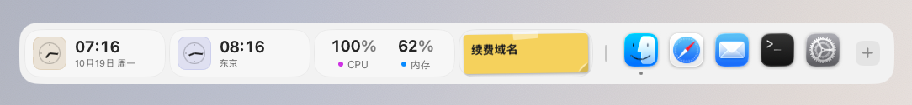

<sub>所有截图都是应用自己的界面，由仓库中的截图工具在 macOS 上实际拍摄（见文末“截图是怎么来的”）。</sub>

</div>

---

## 这是什么

码头（Dockling，原名 Docket 中文版）是 [Docket](https://github.com/nparashar150/dockset) 的**非官方简体中文本地化分支**。
上游 Docket 是一个 MIT 许可的开源 macOS 应用，本分支做了这些改动：

- 把所有用户可见的界面文字翻译成简体中文：菜单栏菜单、设置面板、小组件库、
  小组件卡片与详情面板、提示文字、弹窗、权限说明、空状态等；
- 调整构建配置，让任何人 clone 后都能直接构建（ad-hoc 签名、独立的 bundle ID
  `com.docket-zh.app`，可与上游英文版同时安装）；
- 新增二十多种小组件（相册、最近截图、下载、文件暂存、剪贴板、取色器、单位换算、
  截图工具、表情符号、搜索、音量、快速开关；v0.4.0 又加入壁纸切换、应用切换器、书签、录音、
  邮件、计算器、汇率换算、GitHub；v0.4.1 加入麦克风、圆环仪表、久坐提醒），时钟样式与天气扩展，
  扩展栏外观预设、单个小组件的条件显示与背景开关、放不下时自动缩小，
  以及三种切换布局的方式，见下方“新增功能：更快地切换布局”。

与上游一致的基础能力：

- **跟随真实的程序坞**：大小、所在边缘、放大效果和自动隐藏都实时读取系统设置。
- **应用分组**：把一个图标拖到另一个图标上并停留，即可像 iOS 一样建立分组。
- **布局**：可保存多套布局，并可写回系统程序坞（只改动 `persistent-apps`，带校验和回滚）。
- **点按小组件会打开详情面板**，显示更多内容和操作。

---

## 小组件一览

四十多种小组件，按用途分成五类，最后两节集中展示 v0.4.0 与 v0.4.1 新增的内容。每一类都可以自由组合，放在同一条扩展栏上。

<sub>下面每类第一张图是放着该类小组件的真实扩展栏，小组件显示的是小组件库自带的示例数据
（日历、提醒事项、音乐等需要授权的内容不会读取拍摄机器上的真实数据）；详情面板截图中
标注“示例数据”的同理，其余为拍摄时的实时读数。</sub>

### 应用、文件和快速访问

把常用应用、刚下载的文件和要来回拖动的文件都放在手边，不用再打开访达翻找。

**包含：** 应用图标与分组、应用切换器、书签、下载、文件暂存、搜索（网页搜索或查找文件）、隔空投送、快捷指令

- **应用切换器**：正在运行的应用图标（与 ⌘Tab 的范围相同），当前应用排在最前，点按即切换；
  放不下时最后一格显示“+n”，详情中列出全部应用，可隐藏或退出。
- **书签**：多个常用网址，点按用默认浏览器打开。在 **设置 > 小组件** 中编辑，每项写成
  “标题 网址”（例如 `必应 cn.bing.com`），用逗号分隔。不抓取网站图标，用标题首字代替。

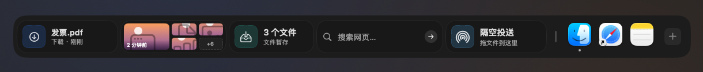

<table>
  <tr>
    <td width="50%" valign="top">
      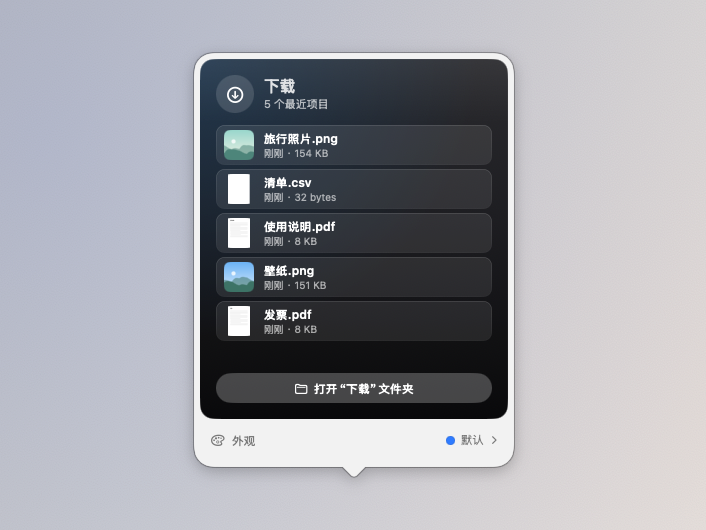
      <p align="center"><sub>下载：最近下载的文件，点按打开，拖出即用</sub></p>
    </td>
    <td width="50%" valign="top">
      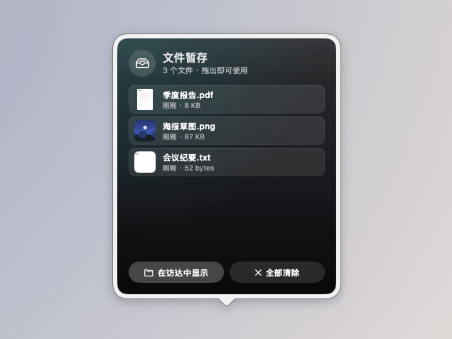
      <p align="center"><sub>文件暂存：先把文件拖进来，稍后再拖出去</sub></p>
    </td>
  </tr>
</table>

### 生产力和日常专注

把今天的日程、待办和专注节奏放在眼前，一眼就知道接下来要做什么。

**包含：** 日历、提醒事项、邮件、专注计时（番茄钟）、喝水、久坐提醒、便签、时钟、世界时钟、秒表、倒计时、闹钟、时间进度

- **时钟样式**：标准、模拟表盘（带秒针）、翻页、像素，在 **设置 > 小组件** 的“样式”中选择。
- **邮件**：“邮件”App 收件箱的未读数量，点按打开“邮件”。通过 AppleScript 读取，只在“邮件”已运行时读取，
  首次使用会请求“自动化”权限；被拒绝时小组件会提示，并可一键打开对应的设置。


<table>
  <tr>
    <td width="50%" valign="top">
      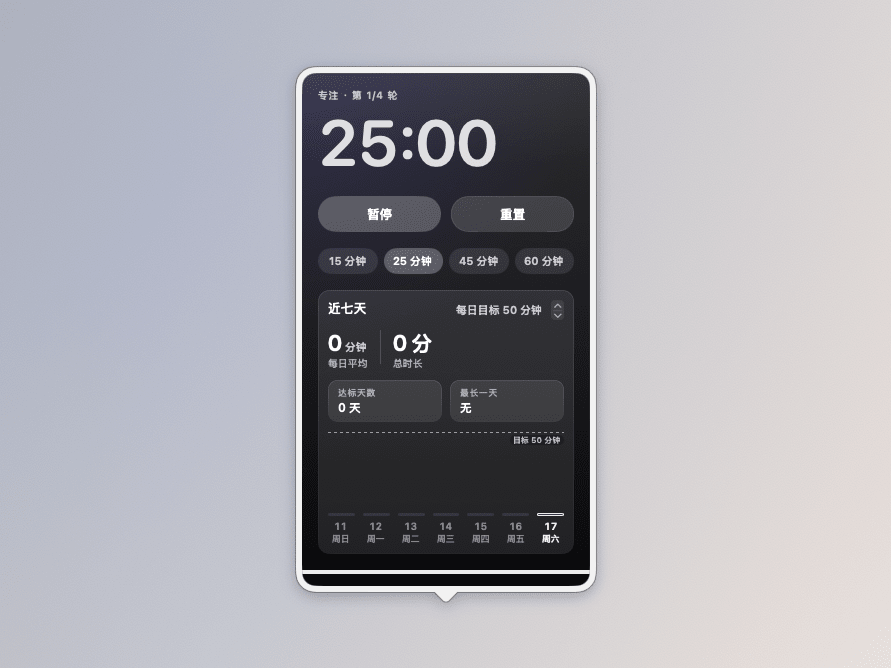
      <p align="center"><sub>专注计时：专注、休息、长休息交替进行</sub></p>
    </td>
    <td width="50%" valign="top">
      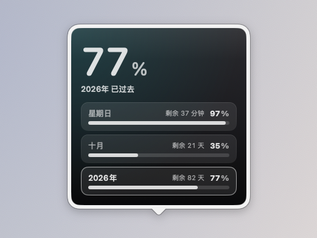
      <p align="center"><sub>时间进度：今天、本月、今年过去了多少</sub></p>
    </td>
  </tr>
</table>

### Mac 控制和系统工具

不用打开控制中心或活动监视器，常用的开关和系统状态就在扩展栏上。

**包含：** 正在播放（音乐）、音量、快速开关（暗色模式、锁屏、屏幕保护程序、清空废纸篓）、壁纸切换、录音、麦克风、系统活动、网络活动、电池、圆环仪表

- **壁纸切换**：选择一个文件夹（默认“图片”），上一张 / 下一张 / 随机切换桌面壁纸，卡片显示当前壁纸；
  详情中点按任意图片即设为壁纸。可选择应用到所有显示器或仅主显示器，只改变当前空间的壁纸。
- **录音**：一键开始 / 停止，显示录音时长，保存为 .m4a（默认“下载”文件夹，可在详情中更换），
  详情中列出最近的录音，可播放、拖出或删除。首次使用会请求麦克风权限。

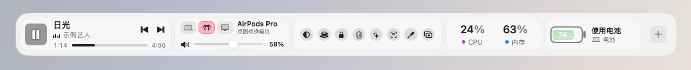

<table>
  <tr>
    <td width="50%" valign="top">
      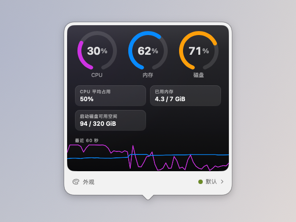
      <p align="center"><sub>系统活动：CPU、内存、磁盘的最近一分钟</sub></p>
    </td>
    <td width="50%" valign="top">
      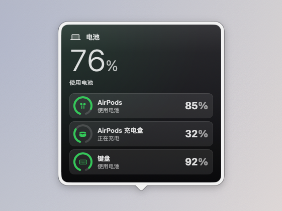
      <p align="center"><sub>电池：Mac 和配件的电量（示例数据）</sub></p>
    </td>
  </tr>
</table>

### 实用小工具

一些随手就要用的小工具：找回刚才拷贝的内容、换算单位、插入表情、看看天气。

**包含：** 剪贴板、单位换算、计算器、汇率换算、表情符号、天气、GitHub、股票、自选股

- **计算器**：离线计算，详情中有键盘也可直接输入，支持 + − × ÷、乘方 ^、百分号和括号，
  中文输入法的全角符号也能识别。输入有误时只提示，不会出错退出。
- **汇率换算**：默认美元换人民币，可选二十种常用币种。汇率来自
  [ExchangeRate-API](https://www.exchangerate-api.com)（open.er-api.com，免费、无需密钥，每日更新），
  保存在本地，离线时使用最近一次的汇率并标明日期。
- **天气**：新增风向与风力等级、湿度，以及按城市坐标在本地计算的日出日落；新样式“风与日出日落”。
- **GitHub**：公开仓库的星标、议题、拉取请求等，默认显示本仓库。在详情中可填入个人访问令牌（可选），
  令牌只保存在钥匙串中，用于提高请求上限并显示未读通知数。

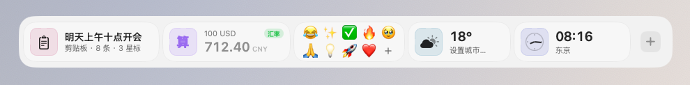

<table>
  <tr>
    <td width="50%" valign="top">
      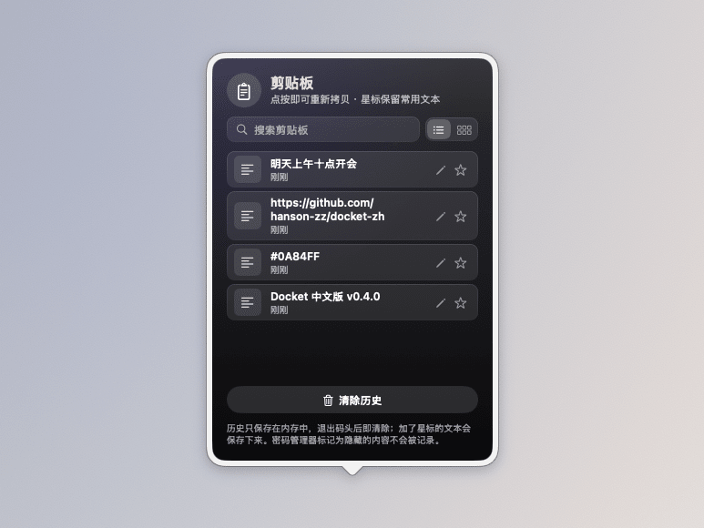
      <p align="center"><sub>剪贴板：最近拷贝的内容，点按即可重新拷贝</sub></p>
    </td>
    <td width="50%" valign="top">
      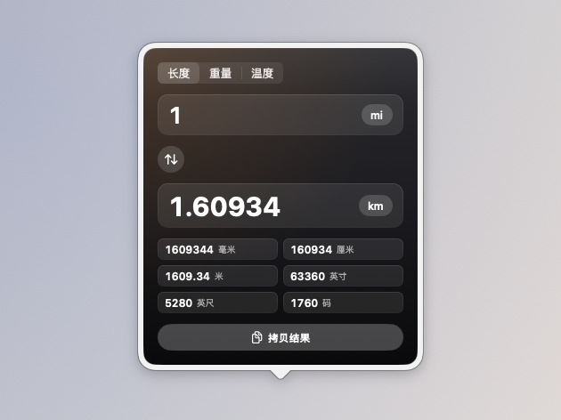
      <p align="center"><sub>单位换算：长度、重量、温度</sub></p>
    </td>
  </tr>
</table>

### 图片与截图

看看喜欢的图片，随时截图，最近的截图和取到的颜色都能直接拖走或拷贝。

**包含：** 相册、最近截图、截图工具、取色器

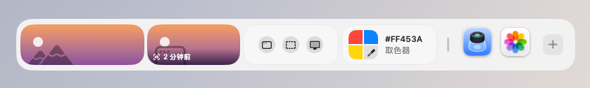

<table>
  <tr>
    <td width="50%" valign="top">
      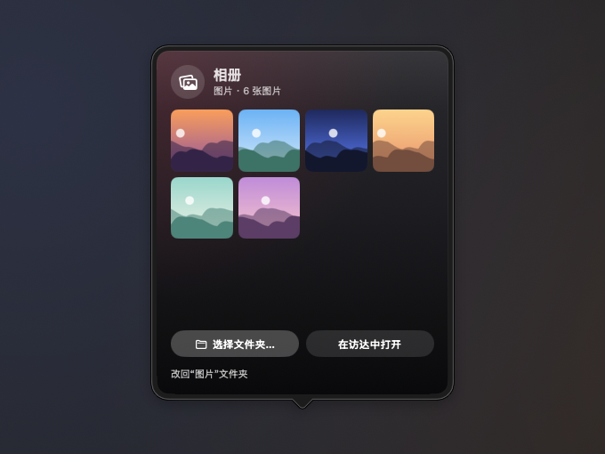
      <p align="center"><sub>相册：轮播一个文件夹里的图片</sub></p>
    </td>
    <td width="50%" valign="top">
      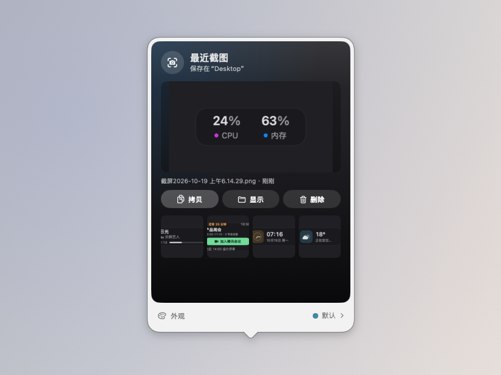
      <p align="center"><sub>最近截图：拷贝、显示、删除，或直接拖进聊天窗口</sub></p>
    </td>
  </tr>
</table>

### v0.4.0 新增

效率工具、桌面与应用，以及新的外观预设。

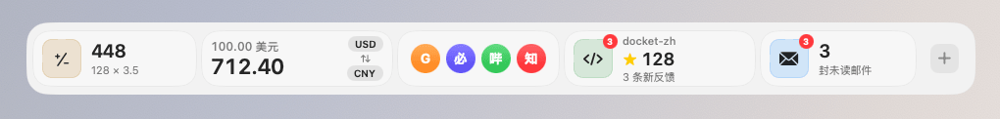

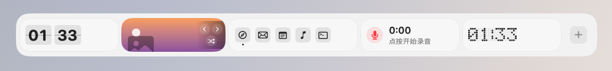

<table>
  <tr>
    <td width="50%" valign="top">
      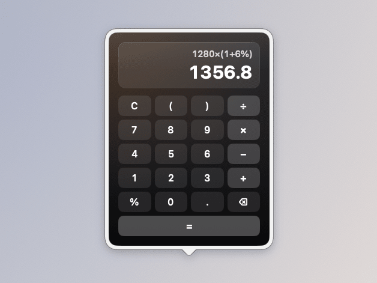
      <p align="center"><sub>计算器：键盘与直接输入</sub></p>
    </td>
    <td width="50%" valign="top">
      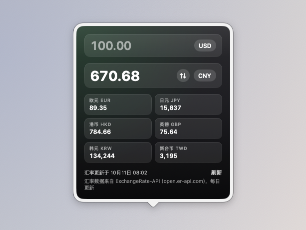
      <p align="center"><sub>汇率换算：每日汇率，离线可用</sub></p>
    </td>
  </tr>
  <tr>
    <td width="50%" valign="top">
      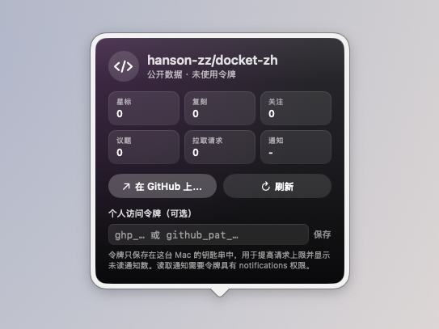
      <p align="center"><sub>GitHub：公开仓库的数据，令牌可选</sub></p>
    </td>
    <td width="50%" valign="top">
      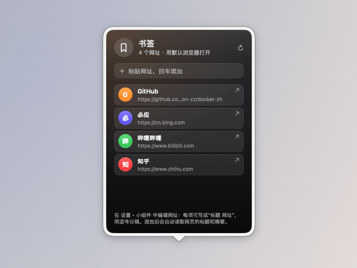
      <p align="center"><sub>书签：点按用默认浏览器打开</sub></p>
    </td>
  </tr>
</table>

**外观预设**（**设置 > 扩展栏 > 外观**）：玻璃、清透玻璃、浅色玻璃、深色玻璃、磨砂、白色、黑色、透明
（透明即不绘制底板，每个小组件保留自己的卡片）。另有“小组件颜色：原色 / 单色”和“降低透明度”开关；
macOS 开启“降低透明度”时会自动使用不透明底板。下图是深色玻璃加单色，配模拟表盘时钟和“风与日出日落”天气：

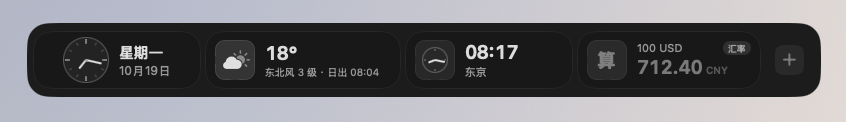

### v0.4.1 新增

三种小组件，以及每个小组件自己的显示设置。

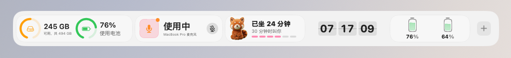

- **麦克风**：通过 Core Audio 读取默认输入设备是否正被某个应用使用，显示设备名称；设备支持时可一键输入静音。
  只读取状态，不录音，不需要麦克风权限。
- **圆环仪表**：存储空间（启动磁盘的可用 / 总容量，与访达的算法一致）和电池的圆环，可在设置中只保留其中一个。
  CPU 温度没有公开接口，因此不提供。
- **久坐提醒**：一个随坐着的时间填满的圆环，可设提醒间隔和提醒时段（默认 09:00 到 18:00），到时发送系统通知，
  并记录今天起身了几次。首次提醒时会请求通知权限。
- **条件显示**：右键小组件选择“显示条件”：始终显示、满足条件时显示或隐藏。目前支持条件的有：
  正在播放（仅播放时）、电池（仅使用电池时，可加电量阈值）、麦克风（仅使用中）、邮件（仅有未读时）。
  被隐藏的小组件列在扩展栏右键菜单和菜单栏的“已隐藏的小组件”中，点按即可恢复。
- **隐藏背景和边框**：右键小组件选择“隐藏背景和边框”，或在 **设置 > 小组件** 的“显示”中打开，
  只去掉这个小组件自己的卡片，便签纸色、封面等内容保留。
- **放不下时自动缩小**：**设置 > 扩展栏 > 行为** 中“放不下时”可选“横向滚动”（原有行为）或“自动缩小”。
  自动缩小最多缩到所选大小的一半，仍放不下时再滚动。

开启“自动缩小”后，比屏幕还长的一排小组件整体缩小，放在同一条扩展栏上：

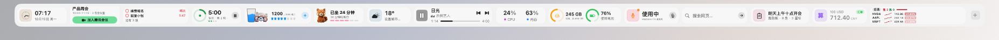

<p align="center">
  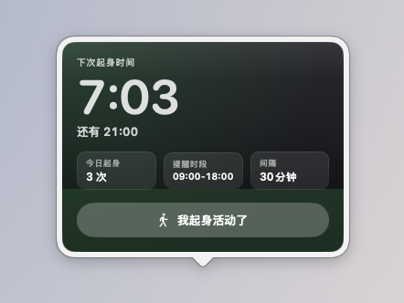<br>
  <sub>久坐提醒：下次起身时间与今日次数（示例数据）</sub>
</p>

以上 v0.4.1 功能已通过自动化构建和单元测试，但尚未在真机上逐项验证，见
[路线图](ROADMAP-zh.md)中的“需要在真机上验证”。

### v0.5.0 新增：Codex 用量

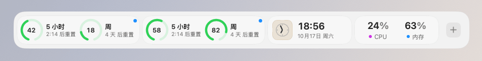

<p align="center">
  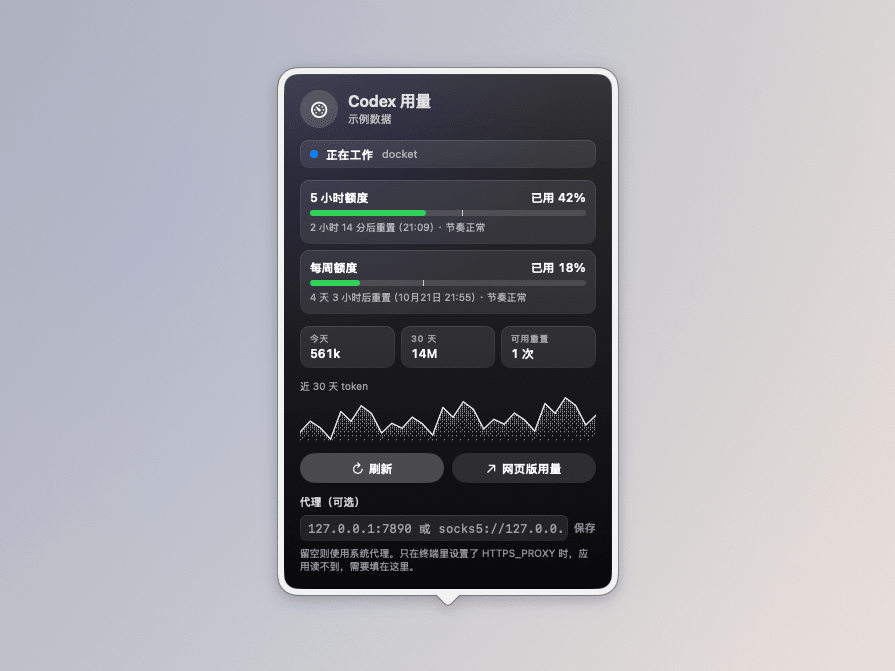<br>
  <sub>Codex 用量：两种额度、重置时间和近 30 天 token（示例数据）</sub>
</p>

- **两个圆环**：Codex 的 5 小时额度和每周额度，旁边是距离重置的时间。可在设置中切换显示“已用”或“剩余”，
  70% 以上变橙色，90% 以上变红色。
- **Codex 在做什么**：读取 Codex 最新的会话日志，在圆环右上角用小圆点显示“正在工作”（蓝色闪烁）、
  “等你确认”（橙色）或“已完成”（绿色）。完成或需要你批准命令时可发送系统通知。
- **详情面板**：每个额度的进度条（白线是“匀速使用”应到的位置）、重置的具体时间、
  “按当前速度约几点用完”的预测，以及今天和近 30 天的 token 用量、可用的额度重置次数。
  可选显示 Spark 与代码审查的额外额度。
- **额度提醒**：用量第一次超过设定阈值（默认 80%）、95% 和用完时各提醒一次，不会每 5 分钟重复提醒。
- **代理**：国内访问 chatgpt.com 需要代理。从访达打开的应用读不到终端里设置的 `HTTPS_PROXY`，
  可以在详情面板填写 `127.0.0.1:7890` 或 `socks5://127.0.0.1:7891`；留空则使用系统代理。
- **离线缓存**：断网或被限流时显示上次的读数并标明时间，重试间隔逐步加长（最长 30 分钟），并遵守服务器的 Retry-After。
- **条件显示**：可设为只在 Codex 工作中或等你确认时出现在扩展栏上。

**它怎么读取**：直接使用你 Mac 上 Codex 已登录的 ChatGPT 账号（`~/.codex/auth.json`），不需要另外登录，
也不会修改这个文件；令牌只发送给 chatgpt.com。用的是 Codex 自己 `/status` 背后的接口，**不是 OpenAI 公开的 API**，
OpenAI 随时可能改动，到时小组件会提示“接口有变动”。用 API 密钥（而不是 ChatGPT 账号）登录的 Codex 没有这些额度，无法显示。
如果你把 Codex 的登录保存在钥匙串里（`cli_auth_credentials_store = "keyring"`），目前读取不到。

这部分的接口和日志格式参考了开源项目 [Codenotch](https://github.com/vinzdg/codenotch)（MIT 许可），见 [NOTICE.md](NOTICE.md)。
尚未在真机上验证。

### v0.5.2 新增：赞助者专属表盘、时钟显示秒

- **赞助者专属配色和表盘**：在“支持码头”窗口点“我已赞助，解锁专属配色和表盘”后，可在 设置 ▸ 扩展栏 ▸ 外观
  给扩展栏换上小熊猫橙、樱花粉、薄荷绿、海盐蓝、星空紫、琥珀金；时钟小组件多出霓虹、实景（辉光管）、
  简约（液晶）、极简（翻页）4 款表盘。码头不联网验证，全凭诚信；所有功能仍然免费。
- **时钟显示秒**：翻页、像素、大号数字和专属表盘都会显示秒，可在小组件设置里关闭；
  另有大号数字、秒圈、中文三种免费样式。
- 扩展栏里的“小间隔”缩小为一个普通间距，新布局不再默认插入。

### v0.5.1 新增：快速待办、环境音、农历与假期、废纸篓、剪贴板收藏、更多快速开关

- **快速待办**：一份只属于码头的待办清单，不读写系统“提醒事项”，不需要任何权限。
  卡片上显示下一件要做的事和剩余数量，点勾即可完成；点开面板输入一件事按回车添加，
  双击文字可修改，完成的项目沉到底部，可一键清除，也可在设置里隐藏已完成的项目。
  可设为只在还有未完成待办时出现在扩展栏上。
- **环境音**：雨声、海浪、风声、篝火、白噪音、粉红噪音、棕色噪音，可以同时选几种混在一起播放。
  声音由程序实时合成，安装包里没有音频文件，也不会听出循环。面板里可以调音量、
  设定 15 分钟到 90 分钟后自动停止（渐弱结束）。切换耳机等输出设备时会自动接着播放。
- **农历与假期**：日期旁边显示农历和节气、传统节日（除夕、元宵、七夕、重阳…），
  以及“距元旦还有 N 天”。调休前一天提醒“明天调休，要上班”，放假前一天提醒“明天开始放假”。
  节气按太阳黄经在本机计算；放假安排内置 2026 年，之后的年份在国务院通知发布后自动更新
  （数据来自 holiday-cn），未公布时只显示节日当天并注明“放假安排未公布”。
- **废纸篓**：显示废纸篓占用的空间和项目数，把文件拖到卡片上即可移到废纸篓，
  右键可打开或清空。垃圾超过设定的大小（10 MB 到 5 GB 可选）就会有苍蝇绕着飞，
  垃圾越多、放得越久，苍蝇越多（每小时多一只），鼠标移上去会把它们吓跑。
  读取大小需要“完全磁盘访问权限”。苍蝇的灵感来自 BananaBin。
- **剪贴板收藏与搜索**：给常用文本加星标，星标内容会一直保留；面板顶部可以搜索历史和星标。
  打开“点按后直接粘贴”后，点一下就粘贴到前台应用（需要辅助功能权限）。
- **快速开关可自选**：在小组件设置里勾选要显示的开关：深色模式、保持唤醒、锁屏、屏幕保护程序、
  清空废纸篓、显示隐藏文件、隐藏桌面图标、显示文件扩展名、麦克风静音、推出所有磁盘、
  清空剪贴板、清洁屏幕和键盘、退出其他应用。参考了开源项目 OnlySwitch（MIT）。
- **赞助者专属配色**：在“支持码头”窗口点“我已赞助”后，可在 设置 ▸ 扩展栏 ▸ 外观
  给扩展栏换上小熊猫橙、樱花粉、薄荷绿、海盐蓝、星空紫、琥珀金。码头不联网验证，全凭诚信；
  所有功能仍然免费。
- 菜单栏图标默认不再显示布局名称（“日常”等），布局名称在菜单的子菜单里查看；
  想恢复可在 设置 > 菜单栏 中打开。

尚未在真机上验证。

### 开发中（下一版）

- **码头 Pro 收费授权**：新增 设置 ▸ 码头 Pro 页和付费墙弹窗。码头 Pro 一次买断 $9.90（早鸟价 $6.90），在 Creem 购买后用许可证密钥激活，也可以输入赠送的兑换码 DKG-XXXX-XXXX-XXXX；一码一机，可以在设置里“解绑本机”后换到另一台 Mac。可以免费试用 7 天，首次启动不会自动开始，要在付费墙里点“开始试用”。激活后每天最多联网校验一次，离线最多保留 30 天。授权信息存在钥匙串里，重装不丢、试用不会重置。没解锁时：添加小组件面板点 Pro 卡片弹付费墙；选 Pro 样式或外观弹付费墙；已经放在扩展栏上的 Pro 小组件不删除，盖一层小锁遮罩写“Pro 专属 · 解锁”，点一下弹付费墙；原来的赞助者外观和电池的液态外观退回免费外观显示，不盖遮罩。以前按过“我已赞助”的老用户照旧全部解锁。授权经 Cloudflare Worker 中转（server/license-relay，含中文部署说明），App 里不放 Creem 密钥，只认码头 Pro 的产品，拾掇的许可证和兑换码不能解锁码头。状态机、试用天数、离线宽限、响应解析、兑换码格式、打码和错误文案放在 Core 并补了测试。赞助窗里的“我已赞助”凭诚信解锁按钮已隐藏，改为提示老赞助者联系作者领取兑换码；新手引导只按用途添加免费小组件（开发改为剪贴板、取色器），电池也用经典外观，不再默认液态。中转服务尚未部署，尚未在真机上验证。
- **Pro 专属标识**：原来的“赞助者专属”统一改叫“Pro 专属”，并加了固定的小熊猫橙“Pro”小胶囊（不发光，鼠标停上去提示“码头 Pro 专属，正式版推出后需要激活码解锁”）。添加小组件面板里每张 Pro 卡片名称旁固定显示，替换原来的“赞助者专属”胶囊；设置 ▸ 小组件管理列表里 Pro 小组件（或正在用 Pro 外观的小组件）名称旁显示；设置里的样式和外观选择中 Pro 选项名字后标“（Pro 专属）”，选中 Pro 选项时“样式”“外观”旁显示 Pro；快速开关的工具列表里截图识字、二维码、演示模式、只锁键盘、低电量模式旁显示；设置 ▸ AI 的“AI 助手”和电池面板里的“充电上限”旁也显示。Pro 范围：摸鱼时钟、时间进度、环境音、播客、废纸篓、GitHub、应用切换器、Codex 用量、小熊猫的竹篮、电子宠物整种是 Pro；原来的赞助者外观（时钟的霓虹、实景、简约、极简表盘，喝水和电子宠物除小熊猫外的角色，Wi-Fi 的数字、点状、细线，电池的像素电池、能量粒子、小熊猫抱电池）；所有小组件的“液态”外观。这次只改标识和文字，不加新的锁：原来的赞助解锁照旧有效，已经在用的东西不会被锁。Pro 清单和判断放在 Core 并补了测试。尚未在真机上验证。
- **世界时钟可以选城市**：世界时钟的面板右上角新增“选择城市”，点开是可搜索的城市列表，设置窗口小组件页的“城市与时区”也是同一个列表，不用再手打时区。内置 50 个常用城市（北京、上海、香港、台北、东京、首尔、新加坡、曼谷、迪拜、莫斯科、伦敦、巴黎、柏林、纽约、洛杉矶、旧金山、芝加哥、多伦多、温哥华、悉尼、墨尔本、奥克兰等），中文名、英文名、拼音、国家和时区标识都能搜，每行显示那里现在几点；内置表里没有的地方可以直接搜系统时区（如 Kathmandu）。选中后卡片上的城市名和时区一起换。仍是一张卡片一个城市，旧卡片照常读取。城市表和搜索规则放在 Core 并补了测试（每个时区都能被系统解析）。尚未在真机上验证。
- **小组件颜色与背景**：设置窗口小组件页新增“颜色与背景”，做成两排圆形色块，选中的外面一圈绿色描边：第一格“默认”（回到这种小组件自己的颜色），第二格彩虹色是自定义取色（系统取色器），然后是粉、浅粉、玫红、红、黄、橙、琥珀、黄绿、薄荷绿、绿、青、天蓝、蓝、淡紫、紫十五种预设（每种自带一个对比色），最后一格跟随系统强调色；下面一排“背景”：无、深色、磨砂、渐变、网点、线条，全部用代码画，不用图片，深色和渐变背景上的字固定用浅色；最下面是同一张卡片在浅色和深色外观下的实时预览。时间进度的圆环描边、百分比进度条（端点小点用对比色）、进度条外观的填充、百分号和液态的水，专注计时的圆环和液态，喝水的液态都用选的颜色；系统活动、Codex 用量、摸鱼时钟和小熊猫的竹篮的液态默认保持原来的状态色、白水和竹叶色，选了颜色才换（系统活动过了 85% 照旧变红，Codex 用量过了 70% 照旧橙、红提醒）。专注计时在设置里换过的颜色在没选新颜色时照旧生效。颜色在浅色和深色外观下都会自动调深或调浅到看得清（对比度至少 3:1），压在颜色上的字自动选黑或白。照片、壁纸、便签、封面这类本身就是图片或底色的卡片不提供颜色或背景。打开“减少动态效果”时液态照旧静止，赞助者专属标记不变。配色、十六进制解析、读写和对比度规则放在 Core 并补了测试。尚未在真机上验证。
- **小组件不再一片单色**：每种小组件有了自己的默认主题色和一个对比辅助色，按性格挑：日历红、待办橙、喝水青蓝、专注计时绿、时间进度紫、世界时钟靛蓝、天气天蓝、行情红（对比色绿）、系统活动黄绿、Codex 用量紫红、摸鱼时钟琥珀、电池绿、下载蓝、剪贴板粉、电子宠物和小熊猫的竹篮小熊猫橙棕等，常一起放的卡片互相不撞色。只染原来是白、灰或统一强调色的部分：卡片左边的图标方底染一层淡淡的主题色（不发光），电池、待办、久坐提醒的小圆环和时间进度、专注计时的进度用主题色；封面、照片、天气图标、日历和提醒事项自己的颜色、电量低时的红橙这些本身有颜色的内容不动，深色玻璃风格不变。颜色面板里选了颜色就覆盖默认，点“默认”回到这种小组件自己的颜色。面板（点开卡片后的大面板）里的方底照旧是中性的玻璃。默认色表放在 Core 并补了测试（每种小组件都有、对比色和主色色相不同、常用卡片不撞色）。尚未在真机上验证。
- **添加小组件里可以直接移除**：已经放在扩展栏上的小组件，卡片右下角“＋”旁边多一个“－”，点一下从扩展栏移除；放了好几个同样的会显示数量，每次移除最后添加的那个。分组里的小组件不受影响。尚未在真机上验证。
- **设置里可以退出码头**：设置 ▸ 通用 最下面新增“退出码头”按钮（也可按 ⌘Q），关掉菜单栏图标后也能从设置窗口退出，退出前照常保存设置和数据。尚未在真机上验证。
- **全局视觉规矩**：保留原来的深色玻璃风格，把卡片里散落的数字收成一套设计常量：卡片圆角 18、内边距 10、图标方底 40pt（小一号 34、竖排 32，圆角取边长的 0.26）、方底到文字的间距 10，字号三级 24pt 粗体主数字、13pt 标题、11pt 说明，原来最常见的写法都换成了常量，卡片尺寸不变，各卡片值下面的说明统一成 11pt。状态统一：悬停只轻微提亮、放大不超过 2%；拖入用隔空投送那种蓝色虚线框，抽成共用样式，文件暂存（卡片和面板）、翻译也用上，废纸篓用同样的虚线框但是红色，表示删除；禁用降透明度；缺权限的日历、一周日程、提醒事项、邮件、废纸篓卡片上有小锁和“需要 xx 权限 · 去开启”，点按直接弹系统授权或打开对应的隐私设置，权限名和新手引导、小组件库里写的一样。浅色模式：拖入的蓝在浅色外观下换深一档；逐个检查了卡片上写死的白字和黑底，都在彩色角标、封面遮罩或固定深色的面板里，没有压在浅色卡片上的。空状态换成小熊猫：待办为空、待办都做完了、剪贴板为空、下载文件夹为空、文件暂存为空时，方底里是小熊猫（用电子宠物现成的小熊猫图），旁边一句话。打开“减少动态效果”时卡片悬停不放大、拖入时图标不放大、电子宠物的泡泡和小心心停在原地只淡出、收音机的小竖条静止。常量、状态先后、权限文案和空状态的规则放在 Core 并补了测试。尚未在真机上验证。
- **关于里加上开源致谢和用户协议**：设置 ▸ 通用 最下面新增“许可”一节，“开源致谢与许可…”打开一个窗口，列出原作 Docket 作者 Naman Parashar 的版权声明和 MIT 许可原文，以及 Codenotch、OnlySwitch、阿喵收音机 meowRadio（MIT）和 AudioCap（BSD 2-Clause）的许可原文和数据来源署名；“最终用户许可协议…”打开协议全文（免费使用，禁止反编译、二次分发和去除授权声明）。仓库新增 LICENSING.md 和 EULA.md，原来的 LICENSE 保持不变；关于里的文字和这两个文件由测试保证一致。检查新版本查询的仓库改成在打包时写入，默认还是原来的仓库，现有用户的更新提醒不受影响。尚未在真机上验证。
- **小组件分类重排、添加面板和设置整理**：添加小组件面板的分类改成：所有小组件、推荐、应用和文件夹、时间与日历、待办与笔记、健康与习惯、AI 与效率、小工具、媒体、文件、系统、天气、行情，每个分类换了合适的图标，卡片按新顺序排；“商业”去掉，股票、自选股和加密货币行情归到“行情”。“推荐”是单独的一组：时钟、天气、日历、快速待办、喝水、AI 助手、正在播放、电池，再加上标“新”的小组件，不改它们本来的分类。应用切换器和快捷指令放进“应用和文件夹”，排在常用应用和文件夹下面。面板里应用名不再带“.app”，主目录文件夹显示为“个人”（图标还是小房子）；侧栏的数字改成小组件个数，同一个小组件的多个样式只算一个；没有小组件的分类不显示；上一个正式版之后新加的小组件（摸鱼时钟、AI 助手、翻译、喝水、电子宠物、小熊猫的竹篮、播客）卡片上有“新”角标，需要权限的照旧有小锁。设置侧栏新增“小组件管理”：列出当前扩展栏布局里的小组件，开关就是原来的“隐藏”（关掉后扩展栏右键“已隐藏的小组件”里也能放回来），拖动排序，应用、文件夹和分组留在原位，不新增任何存储。AI 助手的设置和常用提示词搬到单独的“AI”页，展开对话的快捷键和各个布局的切换快捷键集中到新的“快捷键”页（布局页里的快捷键按钮照旧可用），“通用”里不再放这些。分类只在添加面板里用，不写进配置；旧的分类名（时钟、提醒、日历、便签、商业）读取时也能对上新分类，已经放好的小组件和布局不受影响。分组、推荐、计数、显示名和管理页的开关排序规则放在 Core 并补了测试。尚未在真机上验证。
- **时间进度三种新外观**：时间进度按新的设计稿改成三种外观，统一 24pt 粗体主数字加 11pt 说明、留白一致、卡片一样宽。圆环版是新放卡片的推荐默认：去掉圆环后面的方块，圆环直接画在卡片上、蓝色渐变描边，右边是百分比和“2026年 · 剩 80 天”这样的说明（按当前周期算，日按小时、不到一小时按分钟，其余按天，今天也算一天）。百分比版：数字靠左、周期靠右，底部一条渐变进度条，端点一颗带光的小点。液态版：整张卡片是一杯水，水从底边满宽涨到进度，水面一道亮线，水里几颗气泡慢慢往上冒；设置里新增“水面动效（波纹和气泡）”，关掉或开启系统“减少动态效果”时水面静止，卡片不在屏幕上时也不动。周期新增“周”（日、周、月、年，点卡片上的周期名轮换，悬停时才露出小箭头），面板也多一行本周。已经放好的卡片保存的外观不变，原来的进度条外观还在样式里。周期、标签、剩余时间和默认外观的规则放在 Core 并补了测试。尚未在真机上验证。
- **隔空投送卡片能拖文件发送**：卡片改成横排，左边圆角方底的同心弧图标（和其它卡片同样的 40pt 底），右边“隔空投送”和“拖文件到这里”。把文件拖到卡片上时出现蓝色虚线高亮，文字换成“松手发送”和“N 个文件”；松手后打开系统的隔空投送面板选设备发送，卡片上不显示发送结果。只在竖排货架这类空间不够的地方用竖排：图标在上，“隔空投送”拆两行。悬停时图标变蓝；拖来的不是文件（文字、链接）或这台 Mac 没有隔空投送时卡片灰掉并说明原因；深浅色模式都适配。点卡片照旧打开访达。状态和文字的规则放在 Core 并补了测试。尚未在真机上验证。
- **待办：全部完成的庆祝先播完再隐藏**：快速待办设成“有未完成的待办时显示”时，勾掉最后一项后小熊猫的庆祝动效会先完整播完（约两秒半），之后卡片才从扩展栏上收起，不再一勾完就消失。卡片上和面板里勾掉最后一项都一样；面板中途关掉时卡片到点也会自己收起。尚未在真机上验证。
- **待办：多步撤销，放回原位**：面板里滑动删除、点叉号删除和勾掉一项都能撤销，最近 5 步按先后一步步撤回，删掉的放回原来的位置，勾掉的重新打开并回到原来的位置，不再追加到末尾；撤销条显示最近一步做了什么和还能再撤几步，最后一次改动 6 秒后收起。卡片上直接勾掉的不记进撤销。尚未在真机上验证。
- **减少动态效果补齐**：打开系统的“减少动态效果”时，行情、汇率和下载百分比的数字不再滚动，改成原地淡入淡出；音乐、播客、收音机的播放键不再变形，两个图标淡入淡出；待办全部完成时小熊猫只淡入淡出，不弹、不跳、不撒星点；往左拖删一行时删除改成原地淡掉，不够远时平平退回、不回弹，垃圾桶不放大，新加和撤销回来的行、撤销条只淡入淡出；剪贴板货架的卡片不滑进来、不缩小；下载图标的水位直接跳到新进度，“正在下载”一栏只淡入淡出。折叠翻页、套圈圆环、天气拖动、断网插头、吞纸、呼吸引导、周格子、聚光灯引导、液态水和正在播放小竖条原来就已经在开启时静止。尚未在真机上验证。
- **新手引导不再被“检查更新”提示盖住**：全新安装第一次打开时，“要检查码头的新版本吗？”的提示框会等新手引导关掉（走完、跳过或点关闭）两秒后再弹，不会在引导进行中弹出来挡住它；等的这段时间里已经在设置里选过的，就不再问。老用户和不弹引导的情况照旧在启动约 5 秒后询问。尚未在真机上验证。
- **喝水、Codex 用量、小熊猫的竹篮的液态外观**：三个小组件都可以选“液态”，和专注计时、时间进度是同一种双层波浪水，原来的样子保持默认不变。喝水在样式里多了“液态”：整张卡片是一杯水，水位就是今天的进度，满了水面盖过卡片上沿，喝到达标的那一下水面闪几秒金光，数字和“+”浮在水上，侧边栏也有竖排。Codex 用量在设置里的“外观”选“圆环”（默认）或“液态”：每个额度一个小水杯，水位跟着原来圆环显示的数（已用或剩余），颜色照旧按用掉多少变绿、橙、红，快用完时水波更急。小熊猫的竹篮在设置里的“外观”选“竹叶”（默认）或“液态”：整张卡片一篮竹叶色的水，水位是今天参加的几项的平均进度，竹叶、标题和三个小圆环叠在水上。整张卡片的水撑满卡片、左右不露底，满水时顶上不留黑边。省电：只有扩展栏显示在屏幕上时才有 10 帧的慢波纹，看不见或打开“减少动态效果”时是静止的图。完全免费。尚未在真机上验证。
- **喝水卡片渴成骷髅**：角色样式的喝水卡片在提醒时段里 5 小时没喝水（时段开始前喝的不算），或者时段过去六成以后进度还不到 25%，角色换成骷髅（小熊猫是趴姿骷髅，其他角色用电子宠物的骷髅图），说明文字变成红色的“渴成骷髅了”；喝一杯或达标就复活，刚喝下举杯子的那几秒不变，时段外照旧在睡觉。设置里的“很久没喝水时角色渴成骷髅”可以关掉，默认开；圆环和液态样式没有角色，不受影响。和电子宠物的“渴成骷髅”（连续三天没达标）是两回事。尚未在真机上验证。
- **电子宠物积灰和热化**：电子宠物接上了积灰和化成一滩两套图（每个角色都有）。积灰：24 小时没人亲手照顾它（喂食、玩耍、睡觉、清洁、看病都算，喝水、打卡、专注送的奖励不算），身上积灰长蘑菇，说明“积灰了，摸摸它”，做任何一件事就干净；睡着和生病时先显示睡着和生病。热化：Mac 的热状态到“严重”、系统活动小组件在跑时 CPU 最近 30 秒平均到 90%，或天气小组件取到的气温到 35°C，宠物化成一滩，说明“热化了，歇一歇”，凉下来就恢复，不改它的四项需求；宠物自己不开任何采样，没放系统活动或天气时只看热状态。优先级：刚做的动作、渴成骷髅、热化、睡着、生病、积灰、饿了、开心。旧宠物照常读取，从没碰过的不会一上来就积灰。尚未在真机上验证。
- **快速开关的新默认**：新放的“快速开关”默认带八个按钮：原来的深色模式、保持唤醒、锁屏、清空废纸篓，加上清洁屏幕和键盘、截图识字、取色器和演示模式，卡片按按钮数加宽。已经放好的卡片存着自己的选择，不会多出按钮；全部取消勾选的旧卡片仍退回原来四个。尚未在真机上验证。
- **快速开关新增 8 个工具**：“快速开关”小组件的设置里多了八项，截图识字、取色器和演示模式在新放的卡片里默认勾上（见下面“快速开关的新默认”），其余默认不勾，旧的选择照常读取。截图识字：框选屏幕上一块区域，用本机的文字识别（简体、繁体中文和英文，精确模式）把文字拷贝进剪贴板并轻提示，取消框选什么都不做。取色器：系统放大镜取任意一点的颜色，拷贝大写的 #RRGGBB，提示里同时给出 RGB。演示模式（开关）：隐藏桌面图标、保持唤醒、隐藏除最前面应用以外的其他应用，再点一次恢复到打开前的样子（原来就隐藏的桌面、原来就开着的保持唤醒都保持不变，只把演示模式藏起来的应用显示回来）。只锁键盘：屏幕不黑，和“清洁屏幕和键盘”用同一种键盘锁，屏幕上方一个小浮窗显示“键盘已锁定”，用鼠标长按按钮 3 秒解锁，10 分钟后自动解锁，没有辅助功能授权时给出和清洁模式一样的提示。二维码：小面板把剪贴板文字生成清晰的二维码（可拷贝图片），剪贴板为空时提示；“识别屏幕上的二维码”框选后识别并拷贝结果，是网址时多一个“打开网址”。镜子：小浮窗打开摄像头画面（水平镜像），点外面或按 Esc 关闭，关闭时停用摄像头，不录制也不保存。低电量模式（开关）：用 pmset 读取和切换，每次切换要在系统授权框里输入管理员密码，不支持的 Mac 会提示。重启程序坞和访达：确认后重新启动两者。需要的权限：只锁键盘要辅助功能，镜子要摄像头，截图识字和识别二维码要屏幕录制（没有时只能截到桌面和菜单栏），低电量模式要管理员密码。完全免费。尚未在真机上验证。
- **喝水：个性化推荐目标**：喝水面板新增“目标”页，每日目标不再只按体重算，而是按个人情况推荐，并逐项列出计算明细（基数 + 各项加减 = 推荐目标）。基数是体重 x 30 到 35 毫升：默认 33，65 岁以上或身材偏小（身高不到 155 厘米或体重不到 50 公斤）取 30，男性身高 175 厘米以上取 35，女性取 32；没填体重时按《中国居民膳食指南（2022）》的成人基准，男 1700、女 1500、未设性别 1600 毫升。日常活动量乘以系数（久坐 1.0、中等 1.1、重体力 1.2），今日运动每 30 分钟加 300 毫升（按分钟折算），炎热潮湿或高海拔加 500、干燥或暖气房加 250，怀孕加 300、哺乳加 700（性别为男时不计），发烧或腹泻加 500，最后取整到 50 毫升，限制在 1200 到 4500 毫升。新增的性别、年龄、身高、日常活动量、今日运动、气候、特殊状态、发烧或腹泻都可以不填，有默认值；今日运动和发烧或腹泻只算当天，第二天自动清零。也可以手动设定目标，明细里注明“已手动设置”，一键“恢复推荐”。面板提示“心脏、肾脏疾病需要限水的人请遵医嘱。”卡片照旧显示目标和进度，目标改用推荐值。旧配置照常读取：原来的体重继续生效；原来的目标是默认的 2000 毫升或旧的“按体重建议”值时改用推荐值，其他自己设过的数字当作手动目标保留。每日目标从设置窗口的小组件页移到了面板里。尚未在真机上验证。
- **AI 助手：剪贴板接力、快捷指令和常用提示词（P1）**：刘海对话的服务字牌下面多了一排按钮。“剪贴板”一键把当前剪贴板里的文字带进输入框（输入框空着就直接放进去，已经有字就另起一行接在后面，超过 2 万字只带前 2 万字并提示），下面一行显示剪贴板的一行预览（换行合成空格，太长截断加省略号），点预览也能带进去；面板开着时每秒看一次剪贴板有没有变，收起时不读。“翻译、总结、润色、解释”四个快捷指令把输入框里的文字（空着时用剪贴板）套上对应的提示词交给当前服务：API 模式直接发出去流式回答；网页模式没有输入框，用剪贴板里的文字，把套好的提示词复制好，在网页里粘贴发送；跳转模式和平时提问一样，能带问题的带着问题打开，其余复制再打开。翻译是中文译英文、其他语言译中文。右边的“常用”菜单列出自己存的提示词，用法和快捷指令一样，最后一项“管理常用提示词…”打开“设置 ▸ 通用 ▸ AI 助手的常用提示词”：可以添加、编辑、删除和上移下移，每条是名字加内容，内容里写 {文本} 的地方换成那段文字，没写时文字接在内容后面另起一段，有“插入 {文本}”按钮；名字最多 20 个字、内容最多 4000 字、最多 30 条，空的和重名的不收；存在设置文件里，旧的设置照常读取，坏掉的条目读取时跳过。几处修正：货架 AI 卡片面板里“自定义…”的名字和地址框按 Esc 取消编辑（清掉填了一半的内容、收起表单），表单收起后再按 Esc 关闭面板，回车等于“添加”；多显示器时“选 App…”选完或取消后，面板回到原来那块屏幕、从原来那张卡片长出来，还是管理页和展开的自定义表单，填了一半的内容都在；面板在“管理字牌”时关掉（点外面、Esc、再点卡片或换成别的小组件的面板），下次打开回到正常的提问页；中文输入法还有没确认的字时，点提交按钮（卡片面板的提问按钮、刘海对话的发送和跳转按钮、快捷指令、常用提示词、自定义表单的“添加”）不会提交，回车照旧只确认选字。占位替换、文字来源、剪贴板预览和接力、提示词的增删改排序与读写、面板回到哪块屏幕都放在 Core 并补了测试。尚未在真机上验证。
- **AI 助手：刘海对话**：刘海屏上入口就是刘海本身，刘海左右不多出任何黑块，不占菜单栏的水平空间，不会挡住菜单栏状态图标；指针移到刘海上时，刘海下沿往下长出一条约 18pt 高、和刘海同宽的黑色小条（底部圆角，只盖在菜单栏下方的内容区），里面是小熊猫，指针离开约 0.3 秒后收回，悬停本身不会展开；点一下刘海或按自己设的全局快捷键（默认不设，在“设置 ▸ 通用 ▸ AI 助手”里录制，录到 Option+空格这类常见组合会提醒避开 ChatGPT 等）才从刘海往下长出约 420 x 520 的对话面板；回答还在生成时刘海下沿那条小条里是三个跳动的小点（不需要悬停），完成后收回，收起面板也不打断生成；打开“减少动态效果”时小条不做伸缩动画，直接显示或隐藏。没有刘海的屏幕（外接屏）在菜单栏下沿正下方正中放一个约 44 x 18 的小胶囊（不在菜单栏里），只显示小熊猫，平时 40% 不透明，指针移上去才完全显示，可以设成“只在主屏显示”，也可以用总开关“在刘海显示 AI 助手”（默认开）关掉。灵动提示出现时 AI 入口暂时让位，收起后恢复。面板顶部是小熊猫、当前方式（如“API · deepseek-chat”“网页 · 你的账号”）、卡片上勾选的服务字牌（切换不丢草稿）和钉住按钮（钉住后点外面不收起），Esc 或点外面收起，再打开还是原来的对话；打开“减少动态效果”时不做长出动画。每个服务可以选三种打开方式：网页（面板里直接打开官方网页，用你自己的账号，登录信息存在系统的网页数据里，下次还在；每个服务保留自己的网页，切换不重载；有刷新和“在浏览器打开”；新窗口链接同一家网站在面板里打开，别的交给浏览器；遇到谷歌账号登录页会提示谷歌不允许在内嵌网页登录，请改用邮箱或 Apple 登录，或用浏览器打开），API（填了密钥才能选，兼容 OpenAI 的 /chat/completions 流式接口，内置 DeepSeek、Kimi、通义、智谱、豆包和 OpenAI 的默认地址和模型，地址和模型都能改，豆包要填接入点 ID，自定义服务也能填自己的对话接口；回答一个字一个字流出来带光标，可以停止生成、复制、重试、接着问（带最近 20 条上下文），粗体、行内代码和代码块会排版；超时 60 秒、断网、401 密钥错误、429 限流等都有中文提示；密钥只存在钥匙串里，不写进设置文件），跳转（打开 Mac App 或浏览器，就是原来的做法）。内置的十一家默认都是网页，自定义服务默认跳转，设置里有一张表逐个选，旧的设置照常读取。货架上 AI 卡片的小熊猫保留，当前服务是网页或 API 时点开的就是刘海里的同一个对话，是跳转时照旧打开原来的提问面板。和「拾掇」共处：拾掇的悬浮暂存架在指针碰到刘海或把文件拖到刘海时弹出，检测到拾掇正在运行时，码头不在刘海上放任何入口窗口（也不在刘海旁边放胶囊），刘海的点击和悬停都让给拾掇，入口改为快捷键和货架上 AI 卡片的小熊猫，快捷键打开的面板仍从刘海下面长出来；设置里会说明原因，还没设快捷键时说明旁有“录制快捷键”按钮。尚未在真机上验证。
- **AI 助手（P0）**：新的“AI 助手”小组件（工具分类，搜索 AI、提问、DeepSeek、豆包 都能找到）。宽卡片从左到右是小熊猫、一道细分隔线、勾选的 AI 服务字牌（单色玻璃字牌，只画首字或短缩写，不用官方图标）和虚线“＋”，默认服务的字牌右上角有小蓝点；另有“方块”样式（小熊猫加最多三块字牌）和侧边栏的竖排。内置豆包、DeepSeek、Kimi、通义、元宝、文心、智谱清言（国内）和 ChatGPT、Gemini、Perplexity、Grok（国外），默认显示 DeepSeek、Kimi、豆包，默认服务是 DeepSeek。点字牌打开它的 Mac App（装了的话），否则打开网页；右键字牌可以设为默认、左移、右移、隐藏；点“＋”按国内、国外勾选要显示的服务，勾完一项菜单会在原地再弹出，可以连着勾，最后一项“自定义…”填名字加网址，或者从“应用程序”里选一个 App（名字和地址都会校验，重复的不收）。一块字牌都没有时卡片上是“添加”。点小熊猫打开迷你提问面板：多行输入，Enter 提交，Shift+Enter 换行，中文输入法选字时的 Enter 不会提交，空白不提交，Esc 关闭；可以选发给哪个服务。只有 ChatGPT 和 Perplexity 官方支持把问题带进网址，这两家是“打开并提问”，在浏览器打开并带上问题；其他服务是“复制问题并打开”，复制到剪贴板再打开服务，面板提示“已复制，到 X 里粘贴即可”。码头不调用任何 AI 接口，不显示“已发送”“已回答”。写了一半的问题在面板关了再开时还在。右键卡片别处有“打开提问面板”和“管理字牌…”，管理页里可以勾选、排序、设默认、删除自定义服务。设置坏了或是旧数据时回到默认三块，不会崩。完全免费。尚未在真机上验证。
- **折叠翻页数字和套圈圆环**：时钟的样式里新增“折叠翻页”，时、分、秒每个数字一张深色翻页卡片，数字变化时上半张带着旧数字往下折，下半张带着新数字落下来，侧边栏竖排是三行；倒计时的设置里新增“数字外观”，可选“普通数字”（默认，原来的样子不变）或“折叠翻页”。喝水的圆环样式超过当日目标时不再停在满圈，而是在上面再画第二圈（第一圈变淡，第二圈带一点阴影，最多两圈）；圆环仪表用同一个圆环，读数超过 100% 时也会套圈，不过存储和电量本身不会超过 100%。打开“减少动态效果”时数字直接换，不翻。完全免费。尚未在真机上验证。
- **几处小动画**：环境音面板多了“呼吸引导”，可选舒缓 4-6、方块 4-4-4-4、助眠 4-7-8 三种节奏，圆圈吸气时变大、屏息时停住并亮一圈、呼气时缩小，外圈细弧走完就是这一步结束；习惯卡片右下角换成最近十周的周格子，GitHub 面板多了“近 5 周动静”，都像贡献图那样一列一周、越多越深，出现时一列一列亮起来；下载面板最上面多了“正在下载”，没下完的文件按下完后的类型画图标，彩色图标从下往上灌满（读访达同款的进度扩展属性和 Safari 的下载信息，读不到时一道光带反复扫过并显示“下载中”），卡片上也能看到；新手引导的欢迎页多了“先带我看看”，整个窗口压暗，聚光灯依次照出进度、跳过和开始按钮，旁边的小卡片说明用法，回车下一步、Esc 结束；剪贴板面板的搜索框旁边可以切到“货架”，拷贝过的东西像小卡片一样三张一层立在搁板上，微微歪着，鼠标移上去会扶正抬起，点一下拷贝时轻轻一跳。打开“减少动态效果”时这些动画都换成静止的样子。尚未在真机上验证。
- **摸鱼时钟**：新的“摸鱼时钟”小组件（时钟分类，搜索 摸鱼、moyu、my、下班、倒计时、发薪、工资 都能找到）。宽卡片左上是大标题，左下是半透明小格，右边是小熊猫：工作日的工作时间内显示“距离下班 02:35:18”每秒走动，小熊猫在敲电脑；上班前 2 小时内显示“距离上班 01:20”，更早显示“还没上班”，下班后 2 小时内显示“下班啦”，之后显示“休息时间”，小熊猫窝在沙发里喝茶；不上班的日子显示“周末快乐”（周一到周五里设成休息的那天显示“休息日快乐”），法定节日窗口里显示“国庆快乐”“春节快乐”，清明和端午是“清明安康”“端午安康”，小熊猫在码头上睡觉。四个小格可以在“显示更多”里任意勾选，默认全选：发薪还有几天（当天显示“今天发薪”，那个月没有设定的日子时按月末算）、周五还有几天（周五当天显示“就是今天”，不上班的日子改成“上班 N 天”）、下一个节日和天数（和小熊猫的竹篮节日徽章用同一份名单和日期窗口，含农历节日和节气）、今天赚了多少（每天的收入 x 已工作时长占比，保留两位小数，上班前是 0，下班后是满额；不上班的日子改成“本月已赚”= 每天的收入 x 本月已经过去的工作日数）。点开面板是放大的卡片和全部设置：工作日（周一到周日多选，“工作日”一键选周一到周五）、工作时间（下班时间必须晚于上班时间，暂不支持跨午夜）、背景（一排预设色加自定义取色和 #RRGGBB 输入，或选一张本地图片，图片会复制一份到应用支持目录的 Slacker 文件夹）、字体颜色、字体（系统、圆体、等宽、宋体）、显示更多、发薪日（每月 1 到 31 日，默认 15 日）、每天的收入（默认 100 元）和“按法定节假日和调休”（默认打开：法定放假日不上班，调休的周末要上班，安排和“农历与假期”小组件是同一份）。默认背景随状态变色：上班小熊猫橙、下班绿、周末蓝；选了背景色或图片后改用自己的背景，也可以再打开“随状态变色”。设置窗口的小组件页也能改这些选项（颜色和图片只在面板里改）。省电：只有扩展栏显示在屏幕上时才每秒重画，被自动隐藏或完全遮住时停下来（最多每分钟变一次），面板打开时照常每秒走；卡片没有动画，只是数字变化。工作时间按这台 Mac 的时区算，法定节假日按北京时间的日期认。小熊猫的三张图是码头自己的形象。完全免费。尚未在真机上验证。
- **摸鱼时钟的液态外观**：摸鱼时钟的面板和设置里新增“外观”，可选“小熊猫”（默认，旧卡片不变）和“液态”。液态在卡片后面加一层和电池液态同款的双层波浪水，小熊猫和文字照常显示：水位就是今天的工作进度，上班前是空的，上班中按已工作的比例慢慢涨，下班后满，下班后的第一分钟水面闪金光；不上班的日子水是满的而且静止。省电：只有扩展栏显示在屏幕上时才有 10 帧的慢波纹，闪金光时 30 帧，看不见、周末节假日或打开“减少动态效果”时是一张静止的图。完全免费。尚未在真机上验证。
- **专注计时、时间进度、系统活动的液态外观**：三个小组件都多了“液态”，和电池、摸鱼时钟是同一种双层波浪水，原来的样子保持默认不变。专注计时在设置里的“外观”选“圆环”（默认）或“液态”：圆环换成一个小水杯，水随专注时间慢慢涨，到点满杯，结束后的第一分钟水面闪金光，暂停或没开始时水面静止。时间进度和系统活动在样式里多了“液态”：时间进度整张卡片是一杯水，水位就是今天、本月或今年过去的比例，数字和时段叠在水上，点时段照常切换；系统活动每个读数一个小水杯，水位是占用率，占用越高水波越急，到 85% 变红。侧边栏也有对应的竖排。省电：只有扩展栏显示在屏幕上时才有 10 帧的慢波纹（闪金光时 30 帧），看不见或打开“减少动态效果”时是静止的图。完全免费。尚未在真机上验证。
- **正在播放的跳动小竖条**：“正在播放”卡片的艺人名前面多了一排四根小竖条，播小宇宙、网易云、Spotify、Apple Music 或浏览器视频时跟着节奏跳，暂停时停成一排高低错落的矮条。竖条是模拟的节奏，不读真实音频，所以不需要录音权限。侧边栏竖排也有。“播客”卡片在播小宇宙单集时，封面左下角也有同样的小竖条。省电：只在播放并且扩展栏显示在屏幕上时以 12 帧跳动，打开“减少动态效果”时静止。尚未在真机上验证。
- **播客的当前章节**：小宇宙单集的简介里写了时间轴（比如“00:00 开场”“12:30 聊 AI”“(1:02:30) 听众来信”，括号、方括号、序号、破折号和网页格式的简介都认）时，播客面板的进度条下面像歌词一样显示章节：当前章亮、上一章和下一章淡，跟着播放位置往上走，点哪一行就跳到那一章；码头上的播客卡片在播放时，说明文字换成当前章节。少于两条的不算时间轴，没有时间轴的单集照旧不显示。小宇宙没有逐句文稿的公开接口，所以用的是主播自己写的时间轴。旧的订阅存档照常读取，下次刷新时补上章节。尚未在真机上验证。
- **网页搜索的搜索站**：搜索小组件的面板里，输入框下面多了一排搜索站图标，默认是百度、必应、小红书、Google、抖音、哔哩哔哩和 GitHub。点一个就换成用它搜，框里已经有字时直接搜；右键可以设为默认或移除。最后一个“添加”可以加知乎、微博、淘宝、京东、YouTube、维基百科、DuckDuckGo 等内置站，也能自己填名字和搜索网址（用 %s 代表搜索词，不写就接在末尾），每张卡片最多 12 个。图标从网站自己那里读（先要 apple-touch-icon，再要 favicon）并缓存，读不到时画品牌色底的首字。原来选的搜索引擎照常生效。尚未在真机上验证。
- **充电上限**：电池小组件的面板里新增“充电上限”。充到上限（50% 到 100%，默认 80%）就暂停充电、由电源直接供电，掉到“上限减缓冲”（缓冲 2% 到 10%，默认 5%）再继续充，免得电池长时间停在满电。暂停充电要写电池控制芯片（SMC），需要 root 权限，所以第一次使用要点“安装助手”并输入一次管理员密码：码头把应用包里的小助手复制到 /Library/PrivilegedHelperTools，交给 launchd 开机运行，每 20 秒看一次电量；设置和状态放在 /Users/Shared/Dockling。新固件的 Apple 芯片 Mac 用 CHTE 键，旧固件用 CH0B/CH0C，Intel Mac 显示不支持。助手被停止、卸载或关机时会先恢复充电，读不到电量时也不限制，不会把电池留在不充电的状态。“卸载助手”会恢复正常充电并删掉助手。码头更新后如果助手版本不同，面板会提示“更新助手”。开关、上限滑块和缓冲随时都能调，没装助手或助手还没跑起来时先存下来，助手一跑起来就照着执行。助手在按时写状态时，即使码头看不到安装文件也认为已安装；助手没在运行时面板多一个“复制诊断”，把助手文件、状态文件和应用位置拷进剪贴板方便排查。尚未在真机上验证。
- **应用图标切换**：“设置 ▸ 通用”新增“应用图标”，三张可点选的缩略图卡片，选中的打勾：经典（原来的图标，默认）、小熊猫码头和小熊猫夜色（深蓝夜空、暗色水面的夜景版），两款小熊猫都免费，小熊猫是码头的品牌形象。选择保存在本机，启动时自动套用。访达“应用程序”文件夹里的图标也会跟着换：给应用贴一个自定义图标（和在“显示简介”里粘贴图标是同一回事），不改动应用包里签过名的文件，选回经典就揭掉；更新会整包替换，启动时检查后自动补贴。码头所在文件夹不可写时贴不上，设置里会提示把码头放进“应用程序”文件夹。程序坞、应用切换器、设置里的“关于”、新手引导和提示框显示运行时图标；启动台由系统缓存，可能要重新登录后才变；系统通知的图标由系统按应用包读取，仍是经典。以后可以继续往列表里加更多小熊猫图标。尚未在真机上验证。
- **电池：液态电量、新外观和更完整的面板**：电池小组件设置里新增“外观”，和原来的样式并列，共五种：经典（原来的圆环，免费）、液态（免费）、像素电池、能量粒子、小熊猫抱电池（后三种是赞助者专属外观，未解锁时显示经典）。已经添加的电池小组件保持经典不变，新添加的默认是液态。液态：圆形里是按电量高度的水位，水面两层波浪缓慢流动；充电时气泡从底部上浮（充电器功率越大气泡越快），闪电图标呼吸发光；插上电源的瞬间一串光点绕圆环飞一圈，数字轻轻弹一下；充到 100% 时水面泛起一次金光。像素电池是五格电池，充电时格子从当前电量开始依次点亮再循环；能量粒子是带柔光的渐变圆环，充电时光点沿圆环流动；小熊猫抱电池用小熊猫图片加一个 SwiftUI 画的小电池，充电时欢呼、电量低于 20% 时睡觉、其他时候坐着。新外观的颜色随电量变化：高于 50% 绿色，20% 到 50% 从橙到黄渐变，低于 20% 红色并缓慢脉动（充电时不脉动），打开低电量模式时为黄色。面板顶部的状态行显示“充电中 · 67W · 约 48 分钟充满”“已充满”“已接电源 · 暂未充电”或“使用电池 · 还能用约 2 小时”（功率是电源适配器的额定瓦数，时间是系统的估算，估算中时不显示）；下面是今天 0 到 24 时的电量曲线（每 5 分钟记录一次，保存最近 2 天，充电的时段用浅绿色背景标出，Mac 睡眠或码头没运行的时段留空），记录保存在应用支持目录的 battery-history.json 里，不包含在设置备份中；再下面是最大容量、循环次数和温度（读系统电池信息，这台 Mac 不提供的项目不显示），蓝牙设备列表照旧放在最下方。“系统活动”面板里的 Mac 电池一栏也改用同样的状态行。卡片上接着电源但没在充电时，说明文字由“使用电池”改为“已充满”或“已接电源”。省电：动画只在扩展栏显示在屏幕上（没有被自动隐藏或完全遮住）时运行，充电时最高每秒 30 帧，使用电池时只保留每秒约 10 帧的慢速水波和低电量脉动，其他外观静止；面板打开时照常播放；打开系统的“减少动态效果”时全部静止。经典样式完全不变。尚未在真机上验证。
- **小熊猫的竹篮（竹叶和码头木牌徽章）**：新的“小熊猫的竹篮”小组件（提醒分类，搜索 竹篮、竹叶、小熊猫、满篮、zl、打卡汇总、徽章 都能找到），把喝水、习惯打卡、专注计时三项汇总成每天给小熊猫的一片竹叶，图形全部是码头自己用 SwiftUI 画的竹叶、编织竹篮和码头木牌，没有用任何外部素材。达标定义：喝水达到当日目标；习惯当天全部完成（计数习惯要加满）；专注达到每日目标（沿用专注计时面板“近七天”里的每日目标，默认 50 分钟）。三项全部达标是“满篮一天”，小熊猫收到金竹叶；差一项是“丰收一天”，收到银竹叶；只达标一项是“小有收获”，收到铜竹叶；一项都没达标没有竹叶。没放喝水或专注计时小组件、或没设习惯时，那一项不计入：两项参与时都达标算金竹叶、达标一项算铜竹叶，只有一项参与时达标也只算铜竹叶。卡片显示今天的竹叶（还没得到时是虚线轮廓）和三项的小进度环。面板顶部是小熊猫和今天的竹叶，下面是今天三项、月份切换、本月竹篮（带提手的编织竹篮，本月收到的竹叶按日子顺序堆在篮里，透过藤条的缝隙能看到，空的时候提示“这个月的竹篮还空着”）、三档各自的数量、月度频率条（每天一格按竹叶颜色上色）和日历视图（每天下面一片对应颜色的竹叶，按系统设置从周日或周一开始，今天用竹绿色高亮），底部是 30 枚挂绳木牌样式的徽章，按分类分组展示（初级、隐藏、节日限定）。初级 10 枚：第一只满篮、三日靠岸、七日航程、码头常客（连续 30 天收到竹叶）、金叶之月（一个月 10 个满篮一天）、竹林小仓（累计 50 片竹叶）、潮水七日（喝水连续 7 天达标）、七日打卡（习惯连续 7 天全部完成）、静心 10 小时和静心 100 小时（专注累计时长），未解锁时是灰色并显示条件和进度，解锁后不会再收回。隐藏 8 枚，未解锁时只显示“？？？”和括号里的一句提示，解锁后才露出名称和条件：夜猫子（晚上 23 点到凌晨 4 点前完成一轮专注）、早起竹笋（当天第一杯水在早上 4 点到 7 点前）、失而复得（中间断了 3 天以上没有竹叶，又回来收到竹叶）、金色一周（连续 7 天都是金竹叶）、整月满篮（某个自然月每天都有竹叶）、千杯不醉（累计喝水 1000 杯，任何饮品每记一次算一杯）、两百小时（专注累计 200 小时；累计 100 小时已经是初级的静心 100 小时，所以隐藏的这枚定为 200 小时）、闰日竹叶（2 月 29 日收到竹叶）。节日限定 12 枚，在节日窗口内任意一天收到竹叶即得：元旦（1 月 1 日）、春节（农历除夕到正月初七，除夕不论是腊月廿九还是三十都算）、元宵（正月十五）、植树节（3 月 12 日）、世界水日（3 月 22 日，这一枚要当天喝水达标）、清明（清明节气当天）、端午（五月初五，竹叶包成粽叶）、七夕（七月初七）、中秋（八月十五）、国庆（10 月 1 日到 7 日）、重阳（九月初九）、冬至（冬至节气当天）。农历日期用系统的中国农历计算，节气按太阳黄经在本机计算、以北京时间的日期为准。节日徽章每年都能再得一次，面板记录收下的年份（如“已收 2026、2027”）；今年已收下时木牌亮起，今年的窗口过了还没收下时木牌变灰并标“明年再来”，窗口还没到时显示日期。喝水杯数和深夜专注是这一版新加的累计：喝水杯数在放着竹篮小组件时开始累计，升级时会从喝水记录里补上还保留的日子（最近 7 天按实际杯数，更早只剩总量的日子按 250 毫升一杯估算），之后只增不减；深夜专注从这一版开始记录，升级前的专注不会补算；专注累计时长沿用已有的累计分钟数。节日徽章按最近约 60 天的记录判断，应用很久没运行时，更早错过的节日不会补发。“分享本月竹篮”用竹林深绿底色、小熊猫、竹篮、三档计数、日历、码头名称和月份生成一张 PNG，可通过系统分享菜单发出，也可以“存储到桌面”或“拷贝图片”（文件名“码头竹篮-年月.png”）。记录从放上这个小组件那天开始，按本地日历结算，今天和昨天会随来源更新（补打昨天的卡也算），更早的日子固定不变；应用没运行的日子会按各来源自己的历史补上（最多 60 天）。记录保存在应用支持目录的 perfect-day.json 里，不包含在设置备份中；之前版本留下的记录、已解锁的徽章和已经放上扩展栏的这个小组件都照常可用。专注累计时长从这一版的专注记录开始计算，专注计时现在会另外保存一个只增不减的累计分钟数。不会额外给电子宠物发奖励。完全免费。尚未在真机上验证。
- **首次启动的新手引导**：全新安装第一次打开码头时，弹出一个约 560x640 的引导窗口（随时可以“跳过”），顶部是分段进度条和返回按钮，共六步：欢迎；选扩展栏位置（左侧、顶部、底部、右侧四张带示意图的卡片，默认底部，选中立即生效）；选用途（可多选：效率、健康、系统、娱乐、开发，每类自动挑两三个代表小组件，例如效率是快速待办、日历、专注计时，开发是 GitHub 和 Codex 用量）；权限（只列所选小组件真正需要的权限，比如日历、自动化（音乐 App），每项有“去授权”按钮和当前状态，可以跳过）；布置中（所选小组件的彩色图标像一艘艘小船，排着队从画面外沿水道驶来，一个接一个“靠岸”停进码头图标后面的扩展栏里；扩展栏的方向跟着上一步选的位置，左右两侧是竖着的、小组件从下方驶来，顶部和底部是横着的、小组件从右边驶来；百分比约 2.5 秒走到 100%，最后一个正好在走满时靠岸，下方三条清单逐条打勾，同时把小组件追加到当前布局末尾，已有的小组件不重复添加，也不删除任何东西）；完成（“码头已就绪”和“开始使用”）。已经有布局或配置的老用户升级后不会弹出。“设置 ▸ 通用 ▸ 新手引导”可以重新显示。打开系统的“减少动态效果”时，不播放靠岸动画，直接显示全部停好的扩展栏。选位置时如果原来跟随系统程序坞，会改为自行设置位置（大小保持不变）。尚未在真机上验证。
- **习惯打卡：卡片网格和编辑弹层**：习惯面板顶部改成两列圆角卡片，每张卡片左上角是彩色圆形图标，右上角是今天的打卡按钮，中间是名称和今天的状态（已完成、未完成或“3/8 杯”），底部是大号的每日目标和单位。点卡片打开编辑弹层，可改名称、从 24 个常用图标和 8 种颜色里选，并设置每日目标次数（默认 1 次，可设到 99 次）和单位（如杯、页、公里）；目标多于 1 次时每点一下打卡按钮加一次，加满才算完成，再点一下清零。网格末尾的“新建习惯”卡片里有早起、阅读、运动、冥想、喝水（每天 8 杯）、拉伸、写日记、不熬夜 8 个模板，一点即加，也可以自己起名字。右键卡片可以编辑、上移、下移和删除，删除前会再确认一次。面板下方照旧是每个习惯本月的打卡日历，可补打卡。扩展栏上的卡片样式不变，只是圆点和连续天数改用各自习惯的颜色，单个习惯时名称前多一个小图标，计数习惯今天的圆点按进度填充。旧的习惯和打卡记录完整保留，没设置过的习惯存档格式与以前相同；新加的图标、颜色和目标写在日期列表末尾单独一项，退回旧版本时打卡记录也不会丢。完全免费。尚未在真机上验证。
- **近七天报告**：喝水、专注计时和习惯打卡三个小组件的面板底部新增“近七天”区块（布局思路参考 Grow 的七天报告）。顶部两个大数字，下方 7 根柱状图，虚线标出每日目标，横轴是日期和周几；达标的柱子用小组件的主题色，未达标的用浅色，今天的柱子加白框高亮，悬停可看当天数值。喝水显示每日平均（毫升）、总量、日均杯数和达标天数，读原有的喝水记录，过去每天按当天的目标判断。专注计时显示每日平均分钟、总时长（x 小时 y 分）、达标天数和最长一天，每日目标默认 50 分钟，可在区块右上角调整；专注分钟从这一版开始记录（每轮专注完整结束时计入结束那天），所以升级前的专注不会出现在图里。习惯打卡显示每天的完成率（0 到 100%）、7 天完成次数、全勤天数和平均完成率。原来的面板内容不变，报告放在下方。完全免费。尚未在真机上验证。
- **电池：显示所有蓝牙设备的电量**：电池小组件除了这台 Mac，还会显示已连接蓝牙设备的电量，并按类型用不同图标：AirPods（能区分 AirPods Pro、AirPods Max）、普通耳机、鼠标、触控板、键盘、音箱、游戏手柄，认不出类型的显示通用蓝牙图标。类型先看苹果配件的产品 ID，再看系统报告的设备类型和名称里的中英文关键词（如“鼠标”“触控板”“音箱”“手柄”“耳机”、Mouse、Trackpad、Speaker、Controller、Buds）。苹果配件的电量每秒从系统读取；第三方耳机、音箱、手柄等由“系统信息”在后台补充，每 5 分钟读一次，所以这些设备的电量和断开状态最多晚几分钟。卡片在原来设置的设备之外多留两个位置给蓝牙设备，电量 20% 及以下且没在充电的优先，其次按耳机、鼠标、触控板、键盘、手柄、音箱的顺序；单个设备的“状态”样式在有蓝牙设备连接时改为同样大小的三个圆环。点开面板列出全部设备的名称、图标、百分比和充电标识，AirPods 显示左耳、右耳和充电盒。新设备同样有“蓝牙设备电量低于 15%”提醒，每台设备每次只提醒一次。小组件设置里新增“显示蓝牙设备”开关（默认打开），关掉后与以前一样；旧的设置照常读取。完全免费。尚未在真机上验证。
- **扩展栏可以放在顶部**：“设置 ▸ 扩展栏”的位置选项从三张卡片变成四张：左侧、顶部、底部、右侧。顶部扩展栏横向排列，贴在菜单栏下方，不会盖住菜单栏（刘海屏按刘海高度留出空间，菜单栏自动隐藏时也照样避开它的位置），每块显示器分别计算。点开的分组、小组件面板和应用名称提示都改为向下展开，面板的小尖角朝上指向图标；放大、启动跳动和运行指示点也都镜像过来（指示点在图标上方）。自动隐藏时，扩展栏收到屏幕顶端之外，把指针移到菜单栏正下方的一条窄带即可唤出，不会和菜单栏自己的自动显示冲突。系统程序坞没有顶部，所以打开“与系统程序坞保持一致”时仍只在左侧、底部、右侧之间跟随；“替换系统程序坞”模式不支持顶部，选顶部时会弹出说明并退回普通模式。旧的设置照常读取。顶部扩展栏会避让刘海下方的灵动提示：灵动提示出现时，扩展栏平滑下移到它下方再留 6pt 间距，点开的分组和小组件面板跟着一起移动，灵动提示收起后再回到原位；菜单栏下方的唤出窄带也会绕开灵动提示，悬停在灵动提示上不会顺带唤出扩展栏。只在两者位于同一块显示器时生效，左侧、底部、右侧不受影响。尚未在真机上验证。
- **播客（小宇宙订阅）**：新的“播客”小组件（媒体分类，搜索 播客、boke、bk、podcast、小宇宙 都能找到）。在面板里粘贴小宇宙节目链接（xiaoyuzhoufm.com/podcast/…）即可订阅，粘贴单集链接会订阅它所属的节目，可订阅多个节目，节目信息从小宇宙公开网页读取，不需要登录。卡片显示节目封面、正在播放或最新一集的标题和播放/暂停按钮，有没听过的新单集时封面右上角显示红色数字。面板里可切换节目（右键可刷新、全部标为已听、取消订阅），单集列表显示标题、日期和时长，点一集就在码头里直接播放，带可拖动的进度条、后退 15 秒、前进 30 秒，并记住每一集听到哪里（最后 15 秒内算听完，下次从头开始）。扩展栏上有播客小组件时每小时检查一次更新，发现新单集发系统通知（“有新单集时通知”默认打开，可在面板或设置里关闭）；断网或页面读不出时显示中文提示。所有播客小组件共用同一份订阅。网页只列出每个节目最新的若干集。完全免费。尚未在真机上验证。
- **书签：链接预览**：书签小组件添加网页链接后会自动读取网页的标题、摘要（`og:title`、`og:description`、`<title>`、`description`）和图标，保存在书签数据里，只读一次，不会每次重绘都联网；旧的书签照常可用。面板里每个链接显示标题和两行摘要，读不到时显示原网址（6 小时后自动重试），右上角可刷新全部预览，右键可刷新单个；卡片上的圆形字母在没有自定义标题时取网页标题的首字，悬停显示标题和摘要。面板顶部新增“粘贴网址，回车添加”。小宇宙节目或单集链接下方会出现“加到播客”，点一下就把该节目加入播客小组件。尚未在真机上验证。
- **Wi-Fi 信号**：网络活动小组件新增 Wi-Fi 样式，用系统 CoreWLAN 每 2 秒读取信号强度，画成缺口朝下的弧形圆环，中间是 Wi-Fi 图标，底部四个彩色圆点按信号强弱点亮，旁边显示“良好”和 dBm 数值；侧边扩展栏只显示圆环。点开面板可看信号强度、信号质量、信噪比和连接速率（网络名称需要定位权限，没有时不显示）。四种样式：经典免费，数字、点状、细线是赞助者专属外观（未解锁时显示经典）。不需要额外权限。尚未在真机上验证。
- **喝水**：取代原来的“喝水提醒”，已经添加的喝水提醒会自动变成喝水小组件，原来的提醒间隔会保留（就近换成 15 到 240 分钟里的一档）。小熊猫（或另选的角色）跟着今天喝的水“装满”：水位带着轻轻的波浪在小熊猫的轮廓里上升，达标时冒出小星星。卡片显示“1200 / 2000 毫升”，点 + 记一杯（容量可设，默认 250 毫升），也可以换成圆环样式，侧边扩展栏有竖向卡片。点开面板可选水、茶、咖啡、牛奶、果汁、汽水或自定义饮品（按不同比例计入），快速添加 100、250、500 毫升或自定义量，查看和删除今天每一杯、撤销上一杯，看连续达标天数、近 7 天柱状图和本月日历；每日目标默认 2000 毫升，可按体重 x 35 毫升给出建议。提醒在设定时段内（默认 9 点到 21 点）每隔一段时间（默认 60 分钟，可选 15 到 240 分钟或关闭）发通知，达标后当天不再提醒，刚喝过水会顺延；面板的“今天”页显示上次喝水的时间和下次提醒的时间，过了时间没喝会显示已超时多久。小熊猫免费，柴犬、橘猫、企鹅、水獭、章鱼是赞助者专属角色（在“支持码头”窗口解锁，未解锁时卡片显示小熊猫），可在小组件库、设置或面板里选择：它们刚喝完水会举着杯子，达标时举手欢呼，提醒时段外或很久没喝水时闭眼休息。可设为“今天未达标时显示”。灵感来自 Waterllama，角色都是码头自己的形象（小熊猫来自应用图标）。尚未在真机上验证。
- **翻译**：用 macOS 自带的本机翻译（Translation 框架），免费、不用密钥，文字不离开这台 Mac。卡片显示翻译图标、当前方向（如“中 ⇄ 英”）和上一次的译文，把文字拖到卡片上就地翻译；点按打开面板（也可在设置里改成“翻译剪贴板”）。面板里输入或粘贴原文，停顿约 0.6 秒自动翻译，⌘↩ 立即翻译；源语言默认自动检测，“智能方向”默认开启：中文译成英语，其他语言译成简体中文，也可以手动选目标语言或一键交换；两边都能朗读，译文一键拷贝，保留最近 20 条翻译（点按恢复，可清除），单次最多 5000 字。首次使用某对语言时系统会提示下载语言包。侧边扩展栏有竖向卡片。尚未在真机上验证。
- **添加和移除小组件的音效**：从小组件库添加小组件时一声轻响，从扩展栏移除时像程序坞一样“噗”一声（移除时的烟雾动画照旧）。在“设置 ▸ 扩展栏 ▸ 音效”里可以关闭，调音量，在“码头”（自带的合成音效，默认）和“系统”（这台 Mac 的程序坞音效，没有时用系统提示音）之间选择，并可试听。切换布局、启动和整理分组都不会出声；系统设置里关闭了“播放用户界面音效”时也不播放。尚未在真机上验证。
- **剪贴板：编辑条目**：星标文本和最近拷贝的文字都能直接修改。点条目右侧的铅笔（或右键选“编辑”）打开编辑框，“保存”把改好的内容放回原处（星标仍在星标里，历史条目留在原来的位置，和另一条重复时合并成一条），“保存并拷贝”同时放到剪贴板上，之后也可以像其他条目一样点按再次拷贝；按 Esc 取消。图片和文件不能编辑。尚未在真机上验证。
- **GitHub：关注多个项目和新反馈**：最多关注 8 个仓库（面板里粘贴“用户/仓库”或任意 GitHub 链接即可添加，先向 GitHub 核实再加入，可排序、移除；原来的单个仓库会自动迁移）。卡片显示项目名（或“N 个项目”）、星标和红色角标，角标是上次查看以来的新反馈数：新议题、新拉取请求、新评论、新星标、新复刻和新版本下载量。面板按项目切换，显示星标、复刻、关注、未解决议题、拉取请求，“新反馈”列表（未读加粗，点按在浏览器打开）、最新版本的发布日期和每个安装文件的下载次数，以及“全部标为已读”、打开仓库、新建议题。可选在出现新议题、拉取请求或评论时发通知（默认关闭，按项目合并），检查间隔 15、30 或 60 分钟；使用 ETag 条件请求和本地缓存，遇到请求上限会提示“请求太频繁，X 分钟后重试”并建议添加令牌。可设为“有新反馈时显示”。尚未在真机上验证。
- **电子宠物**：在扩展栏养一只小熊猫（或另选的角色）。它有饱食、心情、精力、清洁四项状态，会随时间慢慢下降，Mac 关机或睡眠期间也照常计算。卡片显示角色、当前状态（还不错、很开心、饿了、生病了、睡着了等）和整体状态条，点碗就能喂它；点开面板可以喂食、玩耍、哄睡（再点叫醒）和清洁，看四项状态和连续照顾天数。清洁时身上会冒出泡泡，玩耍时飘出爱心，太脏时身上会出现污渍；吃饱了、已经很开心或很干净时会说“吃不下了”等，不再加分。每晚 23 点到 7 点它会自己睡觉（半夜叫醒后当晚不再自动睡）；很久没人照顾（比如关机一个周末）时，超过 12 小时的部分最低只降到 20，回来时是饿了而不是生病。每个习惯每天只喂一次，取消再勾选不会重复奖励。有几只宠物时每只都能吃到奖励，宠物不在当前布局也不会漏掉专注奖励。生病时面板里会出现“带它看病”，看病后四项至少回到 40。可在面板里打开“需要照顾时通知”（默认关闭）：饿了、脏了、困了或生病时发通知，夜里的推到早上 7 点。污渍只画在角色身上，不会落到身体外面。喝一杯水、完成一项习惯打卡或一轮专注计时，都会自动喂它一点。角色和喝水小组件相同：小熊猫免费，柴犬、橘猫、企鹅、水獭、章鱼是赞助者专属，每个角色都有吃饭、饿了、生病等状态图。可设为“需要照顾时显示”。侧边扩展栏有竖向卡片。尚未在真机上验证。
- **赞助：微信、支付宝和 Ko-fi**：“支持码头”窗口改成三个带品牌色的标签，新增 Ko-fi（可用 PayPal 或信用卡），方便海外用户。系统语言是中文或地区是中国时默认打开微信，其他情况默认打开 Ko-fi；Ko-fi 页有二维码和“在 Ko-fi 上请我喝咖啡”按钮（右键可拷贝链接）。官网和 README 也加上了 Ko-fi，官网英文模式下 Ko-fi 排在最前。尚未在真机上验证。
- **小组件库：拼音搜索、应用和文件夹**：搜索支持拼音、首字母、英文和常见叫法（tianqi、tq、weather 都能找到天气，番茄钟能找到专注计时）。新增“应用和文件夹”分类，常用 App（访达、Safari、邮件等）和常用文件夹（下载、文稿、桌面等）点一下就加到扩展栏，“更多应用…”“更多文件夹…”可以自己选。侧边栏每个分类显示小组件数量，标题旁显示总数；需要系统权限的小组件带小锁图标，悬停可看是哪项权限。尚未在真机上验证。
- **电池提醒**：电池小组件设置里新增“电池提醒”。默认在充到 80%、电量低于 20%、蓝牙设备（AirPods、妙控键盘、鼠标、触控板）低于 15% 时发通知；90%、95%、10%、充满后仍插着电超过 2 小时、电池温度高于 40°C 可以勾选。每一档每次充电或放电只提醒一次，插上电时已经超过的档位不会补发；提醒时电池卡片会闪两下。尚未在真机上验证。
- **喝水设置可直接编辑和复位**：喝水面板的“设置”页里，提醒间隔、提醒时段可以直接改；“下次提醒”可以选具体时间，或一键改到 15 分钟、30 分钟、1 小时后，喝一口水或点“恢复自动”就回到原来的节奏。新增“复位喝水设置”，每日目标、体重、提醒间隔、时段和下次提醒恢复默认，喝水记录、角色和单位保留。尚未在真机上验证。
- **宠物渴成骷髅**：宠物面板新增“喝水不达标会渴成骷髅”（默认关闭）。打开后，喝水小组件连续 3 天没喝够，宠物会变成骷髅造型（六个角色各一张），当天喝够马上复活。尚未在真机上验证。
- **正在播放支持网易云音乐和小宇宙**：媒体分类的“正在播放”小组件现在能显示网易云音乐和小宇宙（App Store 版 iPhone App，需 Apple 芯片 Mac；网页版走原有的浏览器标签页来源）的歌名、歌手、专辑封面和进度，并可播放/暂停、上一首、下一首（设置里可单独关闭“网易云音乐”“小宇宙”来源）。两者都没有 AppleScript 接口，歌曲信息从系统“正在播放”读取，控制通过模拟媒体键完成，第一次使用会请求辅助功能权限；暂不支持拖动进度条和快进快退。尚未在真机上验证。
- **滚动数字和播放键变形**：股票、自选股、加密货币和汇率的卡片和面板里，价格、涨跌幅、输入金额和换算结果变化时数字会滚动过去，不再直接跳变，和系统活动、电池、时钟原有的滚动数字一致。音乐、播客和收音机的播放和暂停按钮切换时，图标会平滑变形成另一个，卡片、面板和播客单集列表都一样。尚未在真机上验证。
- **天气拖动看每小时，天气和 GitHub 的断网插头**：天气面板里按住逐小时预报左右拖，手指下的那一小时亮起来，上面的大数字在相邻两小时之间平滑变化，天气说明换成“14:00 的预报”，背景天空换成那个小时的天气，并按离当地日出日落多远变暗或泛起朝霞晚霞的暖色，下面一行显示那一小时的降水，松手回到现在。天气和 GitHub 面板连不上时改用同一个断网状态：一个拔出来的插头对着插座，电线轻轻晃，点“重新连接”插头推回插座、插口冒电光，还是没连上就再退出来，连上后换回正常内容；还有上次的数据时只在上面加一条“离线”细横幅，可以直接重连。天气的重新连接只在上次失败时放行，两次之间至少隔 30 秒，不打破 MET 的 15 分钟节流；GitHub 的重新连接会跳过刷新间隔立刻再读一次。插头和电线全部用 SwiftUI 形状画。省电：只有插头拔着时以 10 帧晃动，插着时和打开“减少动态效果”时是静止的图。尚未在真机上验证。
- **待办和废纸篓的小动画**：快速待办把最后一项勾掉时，小熊猫举着手从卡片或面板里跳出来，身边撒一圈小星点，两秒后自己消失；面板里把一行往左拖过一半左右（或用力一甩）就删除，后面先露出红底和垃圾桶，不够远就弹回去，删除或勾掉一项后清单下面停 6 秒“已删除某某”或“已完成某某”和“撤销”，最近 5 步可以一步步往回撤（按钮上写着“还有 N 步”），每一项都放回原来的位置而不是排到末尾，原来的叉号删除也能撤销。废纸篓被清空时（在码头里或在访达里清空都算），几张纸从上面依次落下，转着缩小掉进桶口，桶每吞一张就鼓一下，卡片和面板都有。打开“减少动态效果”时小熊猫只是出现再消失，没有星点，废纸篓不播动画。灵感来自 lucianlabs.dev 的界面动效合集，用 SwiftUI 重写。尚未在真机上验证。

### v0.6.0 新增：天气预报、习惯打卡、一周日程、加密货币、收音机、纪念日、应用音量

- **天气：未来 7 天、未来 10 天、多城市**：天气小组件新增三种样式。“未来 7 天”和“未来 10 天”在底部扩展栏上
  排成一行，每天显示星期（今天、周三…）、天气图标、最高和最低气温，以及一条像 iPhone 天气那样的气温范围条；
  侧边扩展栏里改为每天一行（分别显示 5 天和 7 天）。“多城市”并排显示 2 到 3 个城市的天气图标、当前气温和今天的最高最低气温，
  城市在小组件设置的“城市列表”里填写（用逗号分隔，最多 3 个，默认北京、上海、广州），不影响其他天气小组件的城市。
  详情面板新增未来 10 天列表（含降水概率）。逐日预报来自 [Open-Meteo](https://open-meteo.com/)（免费、无需密钥），
  每个地点最多 30 分钟请求一次，断网时保留上次的数据。尚未在真机上验证。
- **习惯打卡**：添加几个每天要做的事（最多 8 个），卡片上每个习惯一行，显示最近 7 天的圆点和连续打卡天数，
  点最右边今天的圆点即可打卡，再点一次取消。点开面板可以添加、双击改名、删除习惯，
  每个习惯有一张本月的打卡热力图，点某一天可以补打卡，并显示连续、本月和最长连续天数。
  不需要任何权限，数据只存在码头里。尚未在真机上验证。
- **一周日程**：读取系统日历里本周（周一到周日）的日程，底部扩展栏上排成 7 列，每天显示星期、日期和
  每个日程一条日历颜色的短条（超过 3 个时显示“+n”），今天高亮；侧边扩展栏里每天一行，用长短条表示忙闲并显示个数。
  点开面板按天列出本周所有日程（时间、日历），可筛选日历；和“日历”小组件一样，需要在面板里允许访问日历。
  尚未在真机上验证。
- **加密货币行情**：并排显示几种加密货币的价格、24 小时涨跌幅和最近 24 小时的走势线，默认 BTC、ETH、SOL，
  在小组件设置里可改币种（填 BTC、DOGE 等代码，或 CoinGecko ID）、选择人民币或美元计价，以及“涨跌颜色”
  （默认红涨绿跌，可改为绿涨红跌），也可以关掉走势线。点开面板可看全部币种并切换 CNY/USD。
  数据来自 [CoinGecko](https://www.coingecko.com) 免费接口，每 5 分钟最多刷新一次，断网或请求失败时保留上次的价格并变淡显示。
  行情仅供参考。尚未在真机上验证。
- **收音机**：收听网络电台，图标是[阿喵收音机 meowRadio](https://github.com/ca-x/meowRadio) 的猫耳复古收音机，播放时会发光并跳动音量条。
  卡片上显示当前电台和“正在收听”或“已暂停”，带播放/暂停和下一台按钮。点开面板是仿 meowRadio“弧光调谐”的界面：
  大号频道号和电台名、可拖动换台的弧形刻度、音量、定时关闭（15、30、60、120 分钟）、收藏列表，
  还能搜索 [Radio Browser](https://www.radio-browser.info) 电台目录：可按中文电台（默认）、大陆、香港、台湾、澳门或全球筛选并记住选择，搜索框为空时列出该范围收听最多的电台，也可以粘贴 http(s) 串流地址添加自定义电台。
  内置中国之声、经济之声、音乐之声、环球资讯广播、北京新闻广播、动感 101。支持 MP3、AAC 串流和 HLS，
  断流后按 2、4、8、16、30 秒自动重连，电台提供曲目信息时显示“正在播放”。可设为“正在收听时显示”。尚未在真机上验证。
- **纪念日**：倒数日（还有几天）和正数日（已经几天，按年和天显示），可每年重复、按农历计算（闰月按平月，没有三十的月份算廿九），卡片可显示单个（大数字、农历和进度圈）或并排 2 到 3 个；点开面板是时间线，红线标出今天，可添加、编辑、删除和固定到卡片，可设为“7 天内有纪念日时显示”。尚未在真机上验证。

---

## 新增功能：更快地切换布局

- **快捷键切换布局**：在 **设置 > 布局** 中，点按某个布局右侧的“录制快捷键”按钮，
  然后按下组合键（例如 `⌃⌥1`）即可为它设定全局快捷键；组合键须包含 ⌃、⌥ 或 ⌘ 之一，
  按 Esc 取消，按删除键清除。之后在任何应用中按下该组合键，都会切换到对应的布局
  （系统程序坞布局会同时写入程序坞）。快捷键不会自动分配，也不需要辅助功能权限。
  同一组合键只能属于一个布局，录给新布局时会从原布局上移除。
- **随专注模式自动切换**：打开 **系统设置 > 专注模式**，选择一个专注模式，在
  “专注模式过滤条件”中点按“添加过滤条件”，选择码头并挑选一个布局。
  该专注模式开启时码头会切换到这个布局，结束时恢复开启前的布局。
  码头未运行时，macOS 一般会在后台启动它来完成切换。
- **⌘ + 滚轮 / 双指轻扫切换**：指针位于扩展栏上时，按住 ⌘ 滚动滚轮，或在触控板上
  双指左右轻扫，即可在扩展栏布局之间循环切换，并短暂显示新布局的名称。
  一次手势只切换一步。扩展栏内容超出屏幕时，左右轻扫仍用于滚动扩展栏，
  不按 ⌘ 的普通滚动行为不变。可在 **设置 > 布局 > 切换布局** 中关闭。

---

## 安装

1. 从本仓库的 [Releases 页面](../../releases) 下载最新的 `.dmg` 或 `.zip`，
   把 `Dockling.app` 移到“应用程序”文件夹。
2. **构建未签名、未经公证**，首次打开时 macOS 26 会提示无法验证该应用。处理方法：
   - 双击打开，出现拒绝提示后关闭它；
   - 打开 **系统设置 > 隐私与安全性**，在“安全性”部分点按码头旁边的 **仍要打开**；
   - 验证身份后再次打开并确认。

   或者在终端中移除隔离属性：

   ```sh
   xattr -dr com.apple.quarantine /Applications/Dockling.app
   ```

3. **首次运行请看菜单栏。** 码头是辅助型应用：没有程序坞图标，也没有主窗口，
   设置、小组件库和布局切换都在菜单栏图标里。

### 已知限制

- ad-hoc 签名的辅助型应用收不到 macOS 的定位授权弹窗，天气小组件请在
  **设置 > 小组件** 中手动输入城市。
- “正在播放”需要在 **隐私与安全性 > 自动化** 中允许码头；读取浏览器标签页还需要在
  浏览器的“开发”菜单中开启“允许来自 Apple 事件的 JavaScript”。
- “录音”需要麦克风权限，“邮件”需要对“邮件”的“自动化”权限；ad-hoc 签名的版本更新后可能需要重新授权。
- “壁纸切换”通过系统接口只设置当前空间的壁纸，其他空间不受影响。
- “久坐提醒”的系统通知需要在首次提醒时允许；ad-hoc 签名的版本能否正常收到通知需要在真机上确认。
- CPU 温度没有公开 API，圆环仪表不提供。
- 天气数据来自 [MET Norway](https://api.met.no/)，逐日预报和多城市来自 [Open-Meteo](https://open-meteo.com/)。城市名称通过 Apple 地图（MapKit）解析，
  一般可以直接输入中文城市名；如果识别不到，可改用英文名（如 `Beijing`）。

---

## 从源码构建

需要 macOS 26 和 Xcode。Xcode 工程由 `project.yml` 生成，不在仓库中：

```sh
brew install xcodegen
xcodegen generate
xcodebuild -scheme Docket -configuration Release build
```

运行测试：

```sh
xcodebuild -scheme DocketTests -configuration Debug test
```

`project.yml` 默认使用 ad-hoc 签名（`CODE_SIGN_IDENTITY: "-"`），不需要开发者证书。
如果希望系统能弹出定位授权，可以把 `CODE_SIGN_IDENTITY` 换成你自己的 Apple Development
证书，并加上 `DEVELOPMENT_TEAM`。

发布自己的构建前，请把 `Sources/Services/UpdateService.swift` 中的
`releasesRepository` 改成你的仓库路径，这样“检查更新”才会指向本分支的 Releases。

---

## 截图是怎么来的

README 里的图片都由仓库自带的截图工具拍摄：`Tools/Shots` 把应用真实的扩展栏和详情面板
放进屏幕上的真实窗口，`scripts/capture-shots.sh` 再用 `screencapture` 拍下来。
不是设计稿，也没有手工修改过数字。每张图都会标明是实时读数（live）、
小组件库的示例数据（sample）还是空状态（empty）。

- 相册、文件暂存展示的图片和文件由截图工具当场生成，不会读取你自己的照片或文件；
- 下载、最近截图、剪贴板只有在设置了 `SHOTS_DISPOSABLE=1` 的一次性机器上
  （例如 GitHub Actions）才会写入示例文件并以实时状态拍摄，在你自己的 Mac 上会改用示例数据，
  不会往你的“下载”、桌面或剪贴板里写任何东西。

**在自己的 Mac 上重新拍摄：**

1. 安装 Xcode 和 XcodeGen（`brew install xcodegen`），在仓库目录运行 `xcodegen generate`。
2. 在 **系统设置 > 隐私与安全性 > 录屏与系统录音** 中允许你使用的终端应用（例如“终端”），
   然后重新打开终端。
3. 运行 `SHOTS_OUT=docs/images/zh scripts/capture-shots.sh`。拍摄需要几分钟，
   期间屏幕会被一张背景盖住，请不要操作电脑，等它打印出汇总。
4. 只想重拍其中几张时，可以加上 `SHOTS_ONLY=photos,shelf-files`。

也可以在本仓库的 **Actions > Screenshots** 中手动运行工作流，在 GitHub 的 macOS
虚拟机上拍摄，拍好的图片会作为构件（artifact）上传，下载后检查再提交。

---

## 支持码头

码头完全免费、开源，是我用下班和周末时间做的。如果它让你的 Mac 用起来更顺手，欢迎请我喝杯咖啡 ☕，金额随意；不方便赞助也没关系，分享给朋友或在 GitHub 上点个星，同样是很大的鼓励。应用里也能找到：菜单栏图标 ▸ **支持码头…**，或 **设置 ▸ 通用** 底部的“赞助”。

<p align="center">
  
  &nbsp;&nbsp;
  
  &nbsp;&nbsp;
  <a href="https://ko-fi.com/hanson528"></a>
</p>

海外用户可以在 [Ko-fi](https://ko-fi.com/hanson528) 用 PayPal 或信用卡打赏。


## 致谢

- **[Docket](https://github.com/nparashar150/dockset)**：本分支的上游项目，MIT 许可，
  版权归其原作者所有。扩展栏、小组件框架和大部分小组件都来自上游；本分支负责中文本地化，
  并新增了上文列出的小组件和布局切换功能。
- **[Dockset](https://dockset.app)**：Docket 的灵感来源，是由独立开发者打造的**原创付费应用**。
  如果你喜欢这个想法，想要打磨更完善、有售后支持的正式产品，请购买 Dockset，支持独立开发者。
- 天气数据来自 **[MET Norway](https://api.met.no/)**，依 CC BY 4.0 许可使用。
- 逐日天气预报来自 **[Open-Meteo](https://open-meteo.com/)**，依 CC BY 4.0 许可使用。
- **[Codenotch](https://github.com/vinzdg/codenotch)**（MIT 许可）：Codex 用量小组件读取的接口和会话日志格式参考了它的源码。
- **[阿喵收音机 meowRadio](https://github.com/ca-x/meowRadio)**（MIT 许可，Copyright (c) 2026 ca-x）：收音机小组件的图标和“弧光调谐”面板的设计参考了它；电台目录来自 **[Radio Browser](https://www.radio-browser.info)**。
- 工程由 **[XcodeGen](https://github.com/yonaskolb/XcodeGen)** 生成。

本分支与 Dockset、CoolDock、Docket 上游及其作者均**无任何关联**，也未获得其认可或赞助。
README 的分类介绍方式参考了同类应用的常见写法，所有截图均为本应用自己的界面。
完整的署名与商标说明见 [NOTICE.md](NOTICE.md)。

## 许可证

[MIT](LICENSE)。第三方署名与商标说明见 [NOTICE.md](NOTICE.md)。
