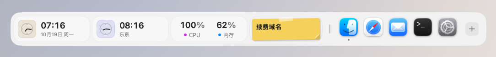
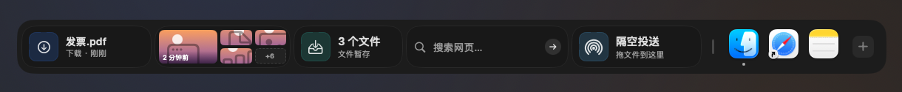
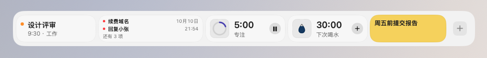
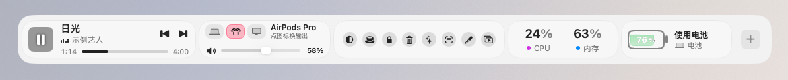
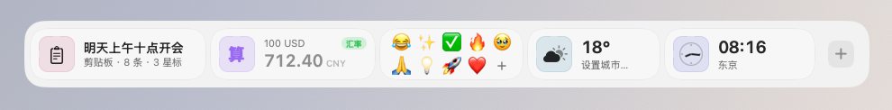

<div align="center">


# 码头 Dockling

### 免费下载、可升级 Pro 的 macOS 程序坞扩展栏，带小熊猫桌宠，简体中文界面。

**官网：[docket.shiduo.app](https://docket.shiduo.app)** · 简体中文 | [English](README.en.md)

[](#安装)
[](project.yml)
[](LICENSE)

<br>



</div>

---

## 码头能做什么

- **扩展栏**：贴在系统程序坞旁边，摆上实时小组件、应用分组和文件夹，也可以直接替代程序坞。
- **60 多种小组件**：日历、待办、专注计时、天气、收音机、剪贴板、截图、「算」（换算 + 汇率 + 计算器）等，点开有详情面板。
- **桌面宠物小熊猫**：住在程序坞上，帮你暂存文件、叼来刚下载的文件、提醒起来活动。
- **窗口与应用切换**：⌘Tab 式应用切换器、窗口切换三种样式和全尺寸预览。
- **消息灵动岛**：微信等消息从刘海弹出。
- **多套布局**：快捷键、专注模式、⌘ + 滚轮都能切换，还能写回系统程序坞。

基础功能免费；**码头 Pro** 一次性买断，解锁更多小组件、外观和工具，详见[官网](https://docket.shiduo.app)。

## v1.0 新增

- 🐼 **桌面宠物小熊猫**：可停在屏幕四边，拖文件到它身上就暂存，下载完成叼过来，专注完成会欢呼
- 🎨 **程序坞自定义**：给任意 App 换显示图标，按住 Option 拖图片即可（Pro）
- ⌨️ **打字音效**：7 款机械键盘 / 打字机声音，可导入 Mechvibes 声音包（Pro）
- 🌐 **输入法自动切换**：切到哪个 App 就换成它的输入法
- 🪟 **应用切换器 v2**：大图标网格 + 窗口缩略图（Pro）
- 🔮 **新小组件**：卜卦（观音灵签 + 真黄历）、拔牙、扫雷
- 📌 **钉在桌面、系统小组件**（测试版）

完整更新记录见 [更新记录](docs/更新记录.md) 或 [官网更新页](https://docket.shiduo.app/changelog.html)。

## 小组件一览

| 分类 | 包含 |
| --- | --- |
| 应用与文件 | 应用分组、应用切换器、书签、下载、文件暂存、搜索、隔空投送、快捷指令 |
| 效率与专注 | 日历、提醒事项、邮件、专注计时、快速待办、便签、喝水、久坐提醒、时钟、世界时钟、倒计时、闹钟、时间进度 |
| Mac 控制 | 正在播放、音量、快速开关、壁纸切换、录音、麦克风、系统活动、网络活动、电池、圆环仪表 |
| 实用工具 | 剪贴板、算、表情符号、天气、GitHub、股票、加密货币、收音机、播客、Codex 用量 |
| 图片与截图 | 相册、最近截图、截图工具、取色器 |
| 小游戏 | 卜卦、拔牙、扫雷、电子宠物 |

每个小组件的详细说明和面板截图见 [小组件详解](docs/小组件详解.md)。

<table>
<tr>
<td></td>
<td></td>
</tr>
<tr>
<td></td>
<td></td>
</tr>
</table>

<sub>截图均为应用真实界面，由仓库自带的截图工具拍摄（见 [docs/截图说明.md](docs/截图说明.md)）。</sub>

## 安装

1. 从 [Releases](../../releases) 下载最新的 `.dmg`，把 `Dockling.app` 拖进「应用程序」。
2. 首次打开若提示无法验证：到 **系统设置 ▸ 隐私与安全性**，点码头旁边的 **仍要打开**。
   或在终端运行：`xattr -dr com.apple.quarantine /Applications/Dockling.app`
3. 码头没有程序坞图标，**设置和小组件库都在菜单栏的小熊猫图标里**。

需要 macOS 26 或更高版本。权限说明和已知限制见 [常见问题](docs/常见问题.md)。

## 从源码构建

```sh
brew install xcodegen
xcodegen generate
xcodebuild -scheme Docket -configuration Release build
```

默认 ad-hoc 签名，不需要开发者证书。更多构建说明见 [CONTRIBUTING.md](CONTRIBUTING.md)。

## 支持码头

码头的基础功能免费，Pro 解锁额外的小组件、外观和工具，是我用下班和周末时间做的。如果它让你的 Mac 用起来更顺手，欢迎请我喝杯咖啡 ☕，金额随意；不方便赞助也没关系，分享给朋友或在 GitHub 上点个星，同样是很大的鼓励。应用里也能找到：菜单栏图标 ▸ **支持码头…**，或 **设置 ▸ 通用** 底部的“赞助”。

<p align="center">
  
  &nbsp;&nbsp;
  
  &nbsp;&nbsp;
  <a href="https://ko-fi.com/hanson528"></a>
</p>

海外用户可以在 [Ko-fi](https://ko-fi.com/hanson528) 用 PayPal 或信用卡打赏。


## 致谢

- **[Docket](https://github.com/nparashar150/dockset)**：本分支的上游项目，MIT 许可，
  版权归其原作者所有。扩展栏、小组件框架和大部分小组件都来自上游；本分支负责中文本地化，
  并新增了上文列出的小组件和布局切换功能。
- **[Dockset](https://dockset.app)**：Docket 的灵感来源，是由独立开发者打造的**原创付费应用**。
  如果你喜欢这个想法，想要打磨更完善、有售后支持的正式产品，请购买 Dockset，支持独立开发者。
- 天气数据来自 **[MET Norway](https://api.met.no/)**，依 CC BY 4.0 许可使用。
- 逐日天气预报来自 **[Open-Meteo](https://open-meteo.com/)**，依 CC BY 4.0 许可使用。
- **[Codenotch](https://github.com/vinzdg/codenotch)**（MIT 许可）：Codex 用量小组件读取的接口和会话日志格式参考了它的源码。
- **[阿喵收音机 meowRadio](https://github.com/ca-x/meowRadio)**（MIT 许可，Copyright (c) 2026 ca-x）：收音机小组件的图标和“弧光调谐”面板的设计参考了它；电台目录来自 **[Radio Browser](https://www.radio-browser.info)**。
- 工程由 **[XcodeGen](https://github.com/yonaskolb/XcodeGen)** 生成。

本分支与 Dockset、CoolDock、Docket 上游及其作者均**无任何关联**，也未获得其认可或赞助。
README 的分类介绍方式参考了同类应用的常见写法，所有截图均为本应用自己的界面。
完整的署名与商标说明见 [NOTICE.md](NOTICE.md)。

## 许可证

[MIT](LICENSE)。第三方署名与商标说明见 [NOTICE.md](NOTICE.md)。

