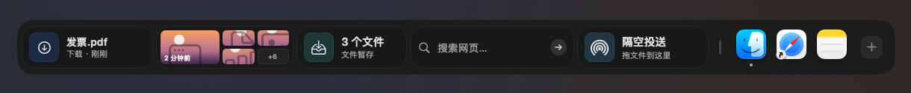
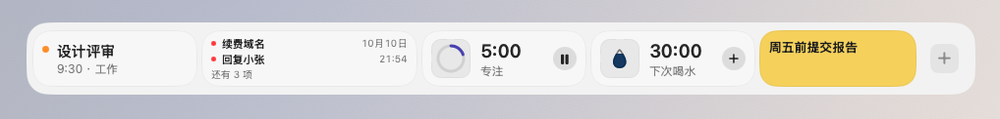
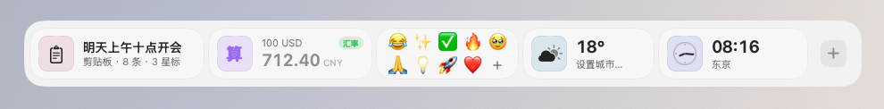
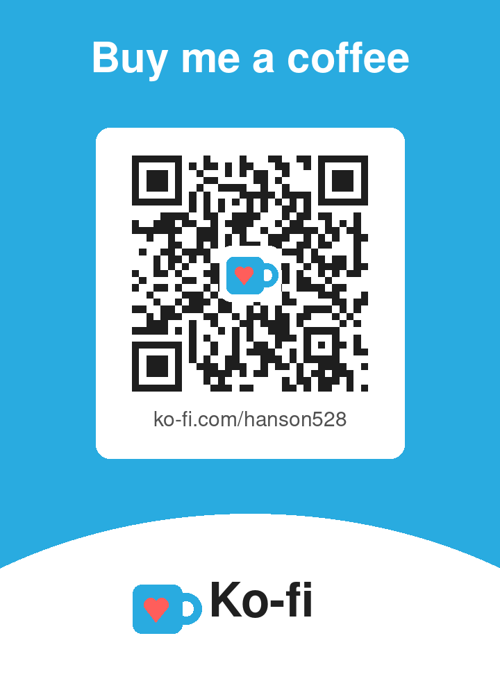

<div align="center">


# 码头 Dockling

### 免费下载、可升级 Pro 的 macOS 程序坞扩展栏，带小熊猫桌宠，简体中文界面。

**官网：[docket.shiduo.app](https://docket.shiduo.app)** · 简体中文 | [English](README.en.md)

[](#安装)
[](project.yml)
[](LICENSE)

<br>


</div>

---

## 码头能做什么

- **扩展栏**：贴在系统程序坞旁边，摆上实时小组件、应用分组和文件夹，也可以直接替代程序坞。
- **60 多种小组件**：日历、待办、专注计时、天气、收音机、剪贴板、截图、「算」（换算 + 汇率 + 计算器）等，点开有详情面板。
- **桌面宠物小熊猫**：住在程序坞上，帮你暂存文件、叼来刚下载的文件、提醒起来活动。
- **窗口与应用切换**：⌘Tab 式应用切换器、窗口切换三种样式和全尺寸预览。
- **消息灵动岛**：微信等消息从刘海弹出。
- **多套布局**：快捷键、专注模式、⌘ + 滚轮都能切换，还能写回系统程序坞。

基础功能免费；**码头 Pro** 一次性买断，解锁更多小组件、外观和工具，详见[官网](https://docket.shiduo.app)。

## 开发中（下一版）

- 📅 **动态图标：日历**（设置 ▸ 扩展栏 ▸ 动态图标，新子开关「日历」默认开）：日历图标换成码头画的日历，红色页眉写星期、中间是几号，都按今天走。下一场日程开始前 30 分钟（「提前开始：」可选 10 / 15 / 30 / 45 / 60 分钟）起，图标下部一层液面随剩余时间从满降到底，平时是克制的灰蓝，剩 5 分钟以内变暖橙；底部小胶囊写倒计时「24 分」（13pt 等宽数字，放不下就写「24分」或「24」，字不缩小），不到 1 分钟写「即将开始」，开始后写「进行中」一分钟，然后先轻轻放大一下，整枚图标在屏幕平面上顺时针转一圈（约 0.9 秒，转到一半倒立时换成下一场），转完显示新场次的液位和倒计时；同一场绝不重复转，日程库一阵连着变时 10 秒内只转一次，系统开了减弱动态效果时不转直接换。不是动画循环：只在倒计时分钟数变、液面降 1 像素时重画，低电量模式只跟分钟。悬停日历图标时名称旁多一张玻璃小卡片，列今天剩下的日程（日历颜色彩点、时间、名称，最多 4 条）。只读今天的定时日程，不含全天和自己已拒绝或已取消的，不读备注、不上传；复用已有的日历权限，不另外弹框，没有权限或今天没有要倒数的日程时仍是码头的日历面（星期和日期，不画液面和胶囊），关掉开关时图标保持系统原样。尚未在真机上验证。
- 🐼 **AI 助手面板精修**：输入框默认约 100 点高（放 3 行），字多了跟着长，到 200 点后在框里滚动；一排是截图提问、剪贴板总结、翻译、润色和「更多」（其余快捷操作、常用提示词、调整快捷操作），不再被挤掉；底部分左右两栏：左边当前服务始终排第一、带勾，再露一个别的服务和「…」，下面一句说明这次会怎么处理（App 和网页方式写明「到那边粘贴发送」）；右边是打开方式下拉（不能选的灰掉写原因）和唯一的主按钮「发送」「去网页提问」「复制并打开 豆包」。尚未在真机上验证。
- 🐼 **AI 助手按效果图改版**：小组件负责发起，刘海负责对话，专注计时和提醒显示时对话卡片自动挪到它们下面。小组件面板顶上是小熊猫、「AI 助手」和副标题「码头 · 快捷工作台」，刘海对话开关和设置收进右边「…」；中间是大输入框，左下角写「Enter 提交 · Shift+Enter 换行」；下面四个快捷胶囊默认是截图提问、剪贴板总结、翻译、润色（剪贴板总结只用剪贴板里的文字，不动输入框；助手设置里仍可换成处理剪贴板、总结、解释）；底部一排是服务分段按钮（卡片上启用的前三个，其余收进「…」，放不下时少露一个）、模式胶囊（API 模式 / 网页模式 / App 模式，点一下换到下一种能用的，没填 API 密钥时跳过 API）和发送。刘海收起态是从刘海下沿长出的黑色胶囊「● AI 助手」，回答生成中是「ChatGPT 正在思考」加三个跳动的小点，小熊猫从胶囊下沿探头；胶囊宽度和刘海小岛同一套规则（13 点字，放得进刘海就和刘海同宽，放不下每侧最多加 70 点），整个在菜单栏下面，不盖右边的菜单栏图标。点开的对话卡片 400×520，放在菜单栏下面空 6 点，不再接在刘海上：顶上是小熊猫、「AI 助手」（下面一行小字是当前服务，几个服务时点开换）和 API / 网页 / App 分段控件（没填密钥或没有网页版的那一段变淡，悬停写原因）；我的提问是靠右带头像的浅色气泡，回答是靠左带小熊猫头像的气泡，下面有「复制」「继续追问」（光标回到输入条）和重新生成；底部输入条是「+」（快捷指令、常用提示词和新对话）、「继续追问……」和「↑」。网页模式的刷新和在浏览器打开挪到网页下面一行。全部是液态玻璃，跟随浅色 / 深色，最小 13 点字，只有发送按钮用强调色；减弱动态效果时胶囊不伸缩、小熊猫不升起、小点不跳。尚未在真机上验证。
- 🌧️ **专注环境音修好「没声」，合成声做细**：环境音小组件设成「正在播放时显示」时，专注一开始放声音它就冒出来，并把播放器换成自己的组合（没选声音时直接停掉），专注那一轮随即被当成「用户换了」不再放回，这是听不到声音的主要原因，现在小组件出现时不再改动专注或试听正在放的声音；没解锁 Pro 时每小时和每次唤醒的锁定检查也会把专注的环境音停掉，现在只停环境音小组件自己放的，媒体键也能控制专注的环境音；环境音小组件的定时关闭不再管专注和试听；没有可用输出设备时直接算失败，换输出设备后从 0 淡入、仍算专注放的。专注面板环境音一行下面多一行小字写当前状态（正在播放、开始专注时自动播放、休息时停下），这一轮因为让给环境音小组件、你手动停了或换了、声音设备没准备好而没放时写明原因，在面板里改选别的声音算明确要放；设置里选「不播放」以外的声音或点「换」时先试听约 4 秒；全新安装默认选雨声，老用户存过的选择（包括「不播放」）不动。七种合成声都改成多层叠加：雨声是中频沙沙声加远处低频、近处稀疏清脆和远处密集细小两种雨滴，雨势慢慢起伏；海浪是两层长度、高度、涨落快慢都随机的浪，浪头带泡沫，底下一直有暗涌；风声是快慢两层阵风，大风时带一点呼啸；篝火是随火势变化的低沉火声、火苗闪动、一阵一阵 1 到 5 下的噼啪和零星火星；白、粉红、棕色噪音有轻微的音量呼吸，白噪音压掉刺耳高频。所有起伏都是随机游走，没有固定周期；雨滴和噼啪带约半毫秒起音，总输出去直流、柔化高频、软削波，开关某种声音约 1.2 秒线性过渡，整体淡入淡出各 1.5 秒。尚未在真机上验证。
- 🖼️ **相册标准版与宽幅版面板分开**：顶栏写「相册 · 标准」或「相册 · 宽幅」。标准面板以单张为主，大图下面是「第 12 / 300 张」和真实剩余的换图时间，上一张、暂停 / 继续、下一张和「接下来」4×2 照旧；宽幅面板和宽幅小组件一样是胶片条，主图旁边上下两张接下来的小图，下面写拍摄日期、地点和那年今天（没有的字段不写），按钮位置和标准一致，最底下一行露 4 张预览，横着滑看更多。悬停缩略图不再盖一层大「排除」遮罩，改成右上角小「…」菜单（排除 / 撤销排除、打开原图）；原来面板底部那行说明挪进鼠标停留的提示里。设置新增「显示方式」：完整显示（默认，竖图两边垫一层同图模糊底，不裁人物）或铺满裁切，小组件和面板一起跟着变；老卡片没有这项时按完整显示，间隔等旧设置照读。没有文件夹权限、文件夹为空、读不了文件夹时各有一句清楚的提示。两种面板都是 320 宽，每张相册卡片的进度、暂停和排除各管各的，换样式时正在放的那张和倒计时不变。尚未在真机上验证。
- 🐾 **桌宠更活泼**：六只吉祥物（小熊猫、柴犬、橘猫、企鹅、水獭、八爪鱼）坐着、发呆、趴着时身子轻轻呼吸起伏；发呆时隔几秒随机穿插左右张望、歪头、点头、原地小跳、开心扭一下，什么时候做哪个按时间算，不连着重复。只有几张图的五只用现有帧加变换补出伸懒腰（往上拉长）、打哈欠和抬头看（微微后仰）、蔫了（压矮）。随意放置时不再一直死坐，偶尔在原处左右一小段里走几步再走回来，记住的位置不变，不出屏幕可见区。专注计时陪伴时只呼吸不乱动；开了减弱动态效果时不呼吸不转不跳，只换朝向和姿势；低电量模式下静止时刷新减半，小动作也不开高频刷新。尚未在真机上验证。
- ✦ **AI 助手小组件与刘海对话联动**：小组件提问面板重排成顶栏（当前服务、模式标签、「Pro 刘海对话」开关、设置齿轮）、居中的大输入框（「想让 AI 帮你做什么？」，右下写着 Enter 提交 · Shift+Enter 换行，中文输入法选字时回车照旧只确认选字）、一排快捷操作胶囊（默认截图提问、处理剪贴板、翻译、总结，可在设置页勾选换成润色、解释，最多四个）和底栏（切换服务、按提交会发生什么、发送）；字牌管理、打开方式和 API 密钥收进齿轮里的「助手设置」二级页。小组件和刘海对话共用当前服务；API 和网页方式提交后先收起小组件面板，再从刘海长出对话，请求挂在共享的会话上，收起面板也照样答完；网页方式只复制问题并提示「请粘贴后发送」，不假装已发送；App 方式只负责跳转。刘海对话顶栏加了模式标签和关闭按钮，快捷指令默认折叠，对话区更大，每条回答下面有复制，最后一条可重新生成，底部是「继续追问……」；收起时刘海下沿悬停显示「✦ AI 助手」，生成中显示「某服务 正在思考」加三个小点（减弱动态效果时不跳）。专注计时、下载等刘海小岛正显示时，对话面板挪到小岛下面，不盖住它。尚未在真机上验证。
- 🐼 **刘海小岛跟随所选吉祥物，专注面板加道具**：刘海上的专注计时改成跟着专注面板选的吉祥物走（没解锁 Pro 时和面板一样是小熊猫），收起时的小头、展开后专注中、暂停打盹、刚完成和休息各用这只吉祥物自己的图；专注面板进度环右边（小熊猫竹竿那一侧）给柴犬、橘猫、企鹅、水獭、八爪鱼各放一件道具，专注进行中轻轻浮动，开了减弱动态效果时不动，小熊猫照旧爬竹竿。五只的 20 张刘海图和 5 件道具已放入；以后缺图时刘海回退倒挂小熊猫（眨眼只在小熊猫时有），收起时的小头回退面板状态图，道具缺图就不画。尚未在真机上验证。
- 💧 **AI 额度水位改成剩余，并支持 Claude**：动态图标里的水位改成还剩多少额度（不再是已用多少），取 5 小时和每周里更紧的那个，某个窗口没数据或已过重置时间就看另一个；百分比小字也显示剩余。新增 Claude 子开关（默认开）：读本机 Claude 命令行已登录的账号（先读钥匙串，再读 ~/.claude/.credentials.json），只读不上传，令牌只发给 Anthropic，过期了不自己刷新；没登录时不画，不用填 API key。第一次读取时 macOS 可能弹框问是否允许码头使用钥匙串里的这一项。按效果图换了样子：水按 App 上色（ChatGPT 蓝、Claude 深橙、Codex 紫），水面一条亮线低帧率轻晃，扩展栏不在屏幕上时停，减弱动态效果时静止；百分比改成左下角白色粗体大字；鼠标停在 AI 图标上，名称下面多一颗玻璃胶囊显示「1天 18小时后重置」这类倒计时。设置里改成「AI 额度水位」总开关加 ChatGPT、Claude、Codex 三个勾选（Codex 拆出自己的开关，老设置照搬），「显示：」可选 5 小时、每周或取更紧的（默认），固定某个窗口时它没数据就不画；ChatGPT 和 Codex 共用 Codex 额度数据。按真机反馈收敛：水只占图标下半截（满额约六成高），上半截 App 标志始终露出，水稍透；百分比限制在图标里，放不下时缩小；剩余低于 15% 时水变暖红提醒；右键 ChatGPT、Codex 图标多一项「查看额度用量」，直接弹出 AI 用量面板，左键照旧打开 App。尚未在真机上验证。
- 💬 **动态图标：消息未读**：信息、微信、邮件图标右上角显示未读数，来新消息时角标和图标轻弹一次，1 秒内连着来的合并成一次。未读数只取系统程序坞上它们自己的角标（需要辅助功能权限），只读数字，不读消息内容、不截屏；读不到时图标保持原样，不画假数字。两种风格：简洁（默认）保持原色；趣味按未读数换色，2 到 3 条蓝、4 到 6 条紫、7 到 8 条紫粉、9 条及以上红粉，角标旁分别挂闪光、火焰、液滴（静态，不持续闪）。设置 ▸ 扩展栏 ▸ 动态图标里有三个 App 的勾选、风格切换和 0 到 9 条的预览。邮件另按参考图加三样：来新信时左上角闪三道暖光；开着写信窗口时右下角挂橙色铅笔（辅助功能看窗口工具栏有没有「发送」按钮）；发件箱里有信时挂一圈转动的小蓝环（AppleScript 只数发件箱封数）。信封开合要重画官方图标，不做。减弱动态效果时不弹不闪，小环静止。尚未在真机上验证。
- 🧭 **动态图标：Chrome 与 Safari**：鼠标停在图标上时，Chrome 中间的彩色圆盘轻转一下弹回，Safari 表盘轻摆两下停住，外壳都不动。Chrome 当前标签页在加载时，改成沿图标边缘走一道细蓝弧，加载完淡出（原来整个图标转圈和启动转一圈都去掉了）。Safari 网页加载时也走这道细弧（看工具栏「停止载入」按钮，要辅助功能权限）。「下载」文件夹里有正在下的文件时右下角挂蓝色下载徽标，Safari 带真实进度；浏览器在出声时挂紫色播放徽标加一圈柔光。读不到就不画，不画假进度。Safari 有自己的开关，减弱动态效果时不转不走弧，徽标静态照挂。尚未在真机上验证。
- 🗑️ **小组件管理可以删除**：设置 ▸ 小组件管理里每个已放上的小组件多了垃圾桶按钮（右键也有），确认后从扩展栏删掉并清掉设置；只想暂时不显示仍然用开关隐藏。尚未在真机上验证。
- 🌗 **收音机、相框、壁纸、完美一天面板默认跟随外观**：和其他面板一样，浅色外观下是浅色液态玻璃深色字，深色外观下是深色面板白字，不再固定深色；压在照片、壁纸上的字仍是白字，分享出去的竹篮图仍是深绿。收音机经典外观和灯阵、瓷白圆盘、掌机像素、墨白直尺跟着浅色/深色走（灯阵的黑色 LED 机身不变），三款复古皮肤和烟晶只有深色设计，选了仍是深色。尚未在真机上验证。
- 🎞️ **相册宽幅改成胶片条**：左边大图是正在放的这张，右边上下两格是接下来要放的两张，和标准那张纯照片一眼分得开；大图下沿始终有一行字，有拍摄日期写“那年今天”和日期地点，没有就写文件夹名和第几张。尚未在真机上验证。
- 🏝️ **刘海小岛**（Pro）：下载进度、专注倒计时、收音机和插电提示从刘海两侧长出黑色小岛，两件事同时进行时分出右边的小圆岛，悬停展开成液态玻璃卡片，可暂停、换台、调音量；无刘海屏幕在顶部居中显示同样形状。倒计时卡片的计时器也会上小岛（同时几个显示最先结束的，暂停、结束作用到那一个），会议倒计时并入小岛排在计时器之后，音量、亮度提示出现时小岛先收起，和灵动提示胶囊不再重叠。尚未在真机上验证。
- ✨ **动态图标**（默认关，设置 ▸ 扩展栏，访达、Chrome、ChatGPT/Codex 各有子开关）：图标本身动起来，不再贴小挂件。Chrome 当前标签页真在加载时图标匀速转，加载完缓缓停回原位（需要允许码头控制 Chrome，不允许时只在启动那一下转一圈）；ChatGPT 和 Codex 图标里有一层半透明水位，显示 Codex 5 小时额度已用多少，没有数据时不画，Codex 正在干活时一道白光沿图标边缘绕圈；访达图标整张换成小熊猫访达，两颗眼珠跟着鼠标指针看（不需要辅助功能权限），指针停下 3 秒后慢慢回正，每隔几秒眨一下眼，偶尔连眨两下。开了减弱动态效果时不转、不流动，小熊猫眼珠居中、不眨眼，低电量模式下放慢。尚未在真机上验证。
- 🦊 **专注吉祥物**：专注面板里可选小熊猫、柴犬、橘猫、企鹅、水獭、八爪鱼六只吉祥物（默认小熊猫，小熊猫免费，其余五只是 Pro），各有等开始、专注中、休息、刚完成四种样子，刘海小岛专注时左边是吉祥物、右边是剩余时间；选小熊猫时专注进行中照旧爬竹竿。专注没开始时左右拖剩余时间的大数字按 5 分钟一档定时长（5 到 90 分钟，每换一档触控板轻震），专注结束、休息结束各选一种系统提示音（可试听、可连响几次、可不响），结束时发本机通知，另有“跳过”和今日完成数。尚未在真机上验证。
- 🎋 **倒挂小熊猫**：专注计时在刘海小岛上收起时，选小熊猫的话左边是从刘海底下探出来的小脑袋；指针停上去，小熊猫用尾巴缠着细绳从刘海倒挂下来，爪子捧着液态玻璃计时牌（第几轮、剩余时间、暂停或继续、结束、进度条）。专注中睁眼、隔几秒眨一下、轻轻左右摆，暂停时闭眼打盹、头上飘 zZ、时间变淡，刚完成和休息时开心大笑；开了减弱动态效果时不摆不眨。倒计时卡片的计时器照旧是卡片。尚未在真机上验证。
- 🐾 **桌宠让开扩展栏**：桌宠蜷在屏幕下边缘时，码头扩展栏在底边（自动隐藏滑出来时也算）就挪到扩展栏旁边，不再躲在它后面只露出几根草或一对耳朵；两边都放不下时先不出来。尚未在真机上验证。
- 🤝 **给拾掇让位**：拾掇的刘海暂存架展开时，码头的刘海小岛先收起，暂存架收起后回来。尚未在真机上验证。
- 🐾 **桌宠跟随所选吉祥物**：解锁 Pro 并在专注面板选了柴犬、橘猫、企鹅、水獭或八爪鱼时，程序坞上的桌宠也换成那只：走路、跑、叼文件时两帧交替一颠一颠，睡觉、团起来时趴睡，欢呼、挥手时欢呼，探头时探头，吊在屏幕上边、抱着左右边、被拎起来也各有专门的样子，其余时候坐着；小熊猫仍是整套逐帧动画，缺图时回退小熊猫。尚未在真机上验证。
- 👀 **桌宠指针旁探头、通话时藏起**：设置 ▸ 小组件 ▸ 桌面宠物新增「指针旁探头」（默认关）：鼠标约 20 秒没动，所选吉祥物（没解锁 Pro 时是小熊猫，专注中换专注的样子）在指针左下方探出头，一动鼠标、按键、点按或滚动就收起，正在打字时不出来，人走开约 3 分钟也收起；静止时只是一张图，不开显示刷新，减弱动态效果时只淡入。新增「通话时藏起」（默认开）：麦克风在用（通话、开会）时桌宠和探头先藏起来，挂断后再出来，只看麦克风开没开，不录音。探头窗口不接鼠标、不抢焦点，系统支持时不进屏幕共享和录屏。六只都有专用探头图，缺图时回退专注面板的站姿图。尚未在真机上验证。
- 🐶 **指针旁的小伙伴改成扒边探头，刘海专注计时更窄**：鼠标停着时出现在指针旁的吉祥物改成从一条看不见的水平边后面扒边探头：只露头、耳朵、两只前爪和一点胸口，六只换成新画的扒边探头图，耳朵尖和前爪压边那条线统一对齐，遮罩边就放在这条线上，爪子圆底（柴犬还有垂下来的围巾尖）藏到边后面，边上一道极淡的接触阴影，头约占露出部分的四分之三；可见高度六只统一 40 点（原来整张 64 点，柴犬宽约 55 → 47 点，最宽的水獭约 57 点），整体朝指针歪 4 度；出场先从边下升起 8 点、停住轻轻压一下、再回弹 1.5 点落定，减弱动态效果时直接出现没有动画。刘海小岛两侧只留刚好放下内容的宽度，字统一 13 点等宽数字：专注计时左边吉祥物 44 → 30 点，右边剩余时间 70 → 45 点（暂停不再加暂停号、只调暗数字，宽度不变；一小时以上 57 点）；插电、下载、会议、电台的耳朵也一起收窄（图标一侧 40 → 28 点，插电 62 → 47，下载 76 → 61，电台 44 → 30）。展开后的卡片和倒挂计时牌整个挪到菜单栏下面，菜单栏那一条只占刘海本身，不再往两侧盖住状态栏图标。尚未在真机上验证。

## v1.0 新增

- 🐼 **桌面宠物小熊猫**：可停在屏幕四边，拖文件到它身上就暂存，下载完成叼过来，专注完成会欢呼
- 🎨 **程序坞自定义**：给任意 App 换显示图标，按住 Option 拖图片即可（Pro）
- ⌨️ **打字音效**：7 款机械键盘 / 打字机声音，可导入 Mechvibes 声音包（Pro）
- 🌐 **输入法自动切换**：切到哪个 App 就换成它的输入法
- 🪟 **应用切换器 v2**：大图标网格 + 窗口缩略图（Pro）
- 🔮 **新小组件**：卜卦（观音灵签 + 真黄历）、拔牙、扫雷
- 📌 **钉在桌面、系统小组件**（测试版）

完整更新记录见 [更新记录](docs/更新记录.md) 或 [官网更新页](https://docket.shiduo.app/changelog.html)。

## 小组件一览

| 分类 | 包含 |
| --- | --- |
| 应用与文件 | 应用分组、应用切换器、书签、下载、文件暂存、搜索、隔空投送、快捷指令 |
| 效率与专注 | 日历、提醒事项、邮件、专注计时、快速待办、便签、喝水、久坐提醒、时钟、世界时钟、倒计时、闹钟、时间进度 |
| Mac 控制 | 正在播放、音量、快速开关、壁纸切换、录音、麦克风、系统活动、网络活动、电池、圆环仪表 |
| 实用工具 | 剪贴板、算、表情符号、天气、GitHub、股票、加密货币、收音机、播客、Codex 用量 |
| 图片与截图 | 相册、最近截图、截图工具、取色器 |
| 小游戏 | 卜卦、拔牙、扫雷、电子宠物 |

每个小组件的详细说明和面板截图见 [小组件详解](docs/小组件详解.md)。

<table>
<tr>
<td></td>
<td></td>
</tr>
<tr>
<td></td>
<td></td>
</tr>
</table>

<sub>截图均为应用真实界面，由仓库自带的截图工具拍摄（见 [docs/截图说明.md](docs/截图说明.md)）。</sub>

## 安装

1. 从 [Releases](../../releases) 下载最新的 `.dmg`，把 `Dockling.app` 拖进「应用程序」。
2. 首次打开若提示无法验证：到 **系统设置 ▸ 隐私与安全性**，点码头旁边的 **仍要打开**。
   或在终端运行：`xattr -dr com.apple.quarantine /Applications/Dockling.app`
3. 码头没有程序坞图标，**设置和小组件库都在菜单栏的小熊猫图标里**。

需要 macOS 26 或更高版本。权限说明和已知限制见 [常见问题](docs/常见问题.md)。

## 从源码构建

```sh
brew install xcodegen
xcodegen generate
xcodebuild -scheme Docket -configuration Release build
```

默认 ad-hoc 签名，不需要开发者证书。更多构建说明见 [CONTRIBUTING.md](CONTRIBUTING.md)。

## 支持码头

码头的基础功能免费，Pro 解锁额外的小组件、外观和工具，是我用下班和周末时间做的。如果它让你的 Mac 用起来更顺手，欢迎请我喝杯咖啡 ☕，金额随意；不方便赞助也没关系，分享给朋友或在 GitHub 上点个星，同样是很大的鼓励。应用里也能找到：菜单栏图标 ▸ **支持码头…**，或 **设置 ▸ 通用** 底部的“赞助”。

<p align="center">
  
  &nbsp;&nbsp;
  
  &nbsp;&nbsp;
  <a href="https://ko-fi.com/hanson528"></a>
</p>

海外用户可以在 [Ko-fi](https://ko-fi.com/hanson528) 用 PayPal 或信用卡打赏。


## 致谢

- **[Docket](https://github.com/nparashar150/dockset)**：本分支的上游项目，MIT 许可，
  版权归其原作者所有。扩展栏、小组件框架和大部分小组件都来自上游；本分支负责中文本地化，
  并新增了上文列出的小组件和布局切换功能。
- **[Dockset](https://dockset.app)**：Docket 的灵感来源，是由独立开发者打造的**原创付费应用**。
  如果你喜欢这个想法，想要打磨更完善、有售后支持的正式产品，请购买 Dockset，支持独立开发者。
- 天气数据来自 **[MET Norway](https://api.met.no/)**，依 CC BY 4.0 许可使用。
- 逐日天气预报来自 **[Open-Meteo](https://open-meteo.com/)**，依 CC BY 4.0 许可使用。
- **[Codenotch](https://github.com/vinzdg/codenotch)**（MIT 许可）：Codex 用量小组件读取的接口和会话日志格式参考了它的源码。
- **[阿喵收音机 meowRadio](https://github.com/ca-x/meowRadio)**（MIT 许可，Copyright (c) 2026 ca-x）：收音机小组件的图标和“弧光调谐”面板的设计参考了它；电台目录来自 **[Radio Browser](https://www.radio-browser.info)**。
- 工程由 **[XcodeGen](https://github.com/yonaskolb/XcodeGen)** 生成。

本分支与 Dockset、CoolDock、Docket 上游及其作者均**无任何关联**，也未获得其认可或赞助。
README 的分类介绍方式参考了同类应用的常见写法，所有截图均为本应用自己的界面。
完整的署名与商标说明见 [NOTICE.md](NOTICE.md)。

## 许可证

[MIT](LICENSE)。第三方署名与商标说明见 [NOTICE.md](NOTICE.md)。

