# Dockling screenshots

← [Back to README](../../README.en.md)

## Screenshots

Widgets on the shelves below show the widget library's own sample data, so nothing is read from the capture machine's calendar, music or files. Panels marked "sample data" do the same; the rest are live readings taken at capture time.

**Apps, files and quick access**

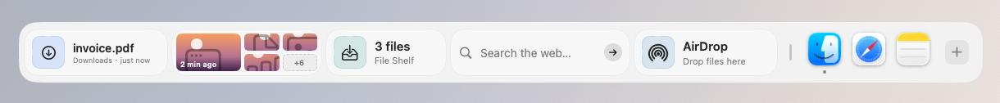

**Productivity and focus**

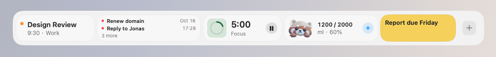

**Mac control and system**

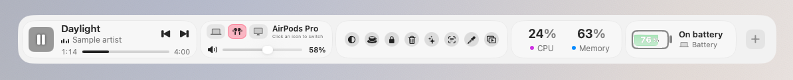

**Handy tools**

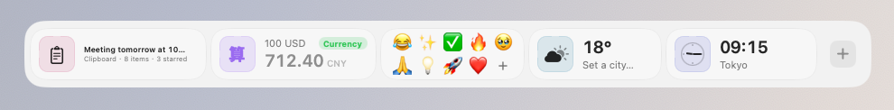

**Shelf looks**: dark glass with monochrome widgets.

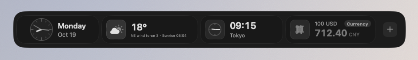

**Liquid looks** (Dockling Pro): Time Progress, Water, Focus Timer, System Activity and Battery as a glass of water that fills with progress, load or charge.

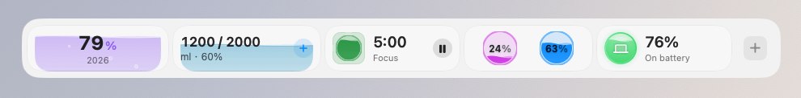

**Colors and backgrounds**: fifteen preset colors, a custom color or the system accent, on no background, a dark card or a gradient.

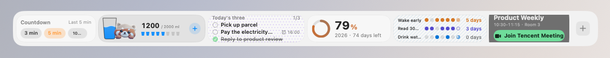

**World clocks with a city picker**

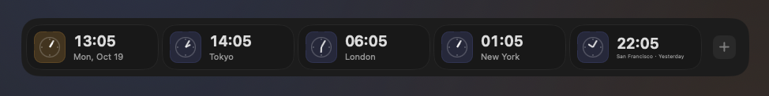

**New quick tools**: Text from Screen, QR Code, Color Picker, Mirror, Presentation Mode and Keyboard Lock, next to the AI Assistant card and Capture.

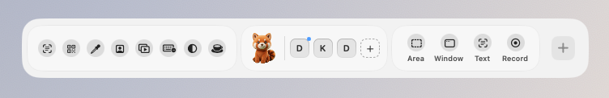

**Calendar, Week, Lunar and Holidays, Anniversary**: Calendar shows the next event, Week how busy the seven days are, Lunar the solar terms and make-up workdays, Anniversary counts the days.

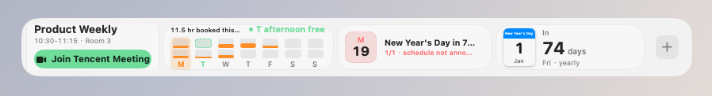

**Eight clock faces**: Standard, Analog, Flip, Pixel, LCD, Chinese, Neon and Photo.

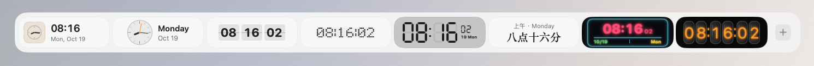

**Stocks, Watchlist, Crypto, gold and silver**: Stocks follows one symbol, Watchlist a list, and gold and silver show per gram in yuan by default.

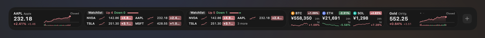

**Timers by scale**: Countdown, Stopwatch, Alarm and Focus Timer.

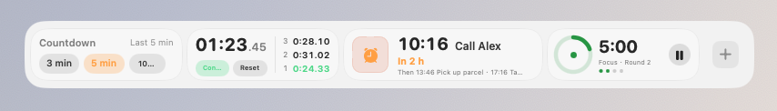

**Battery cells**: charge drawn as a sideways battery; rings are left to Ring Gauges.

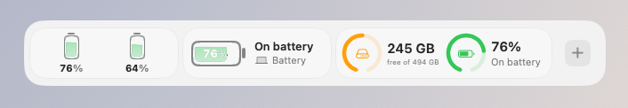

  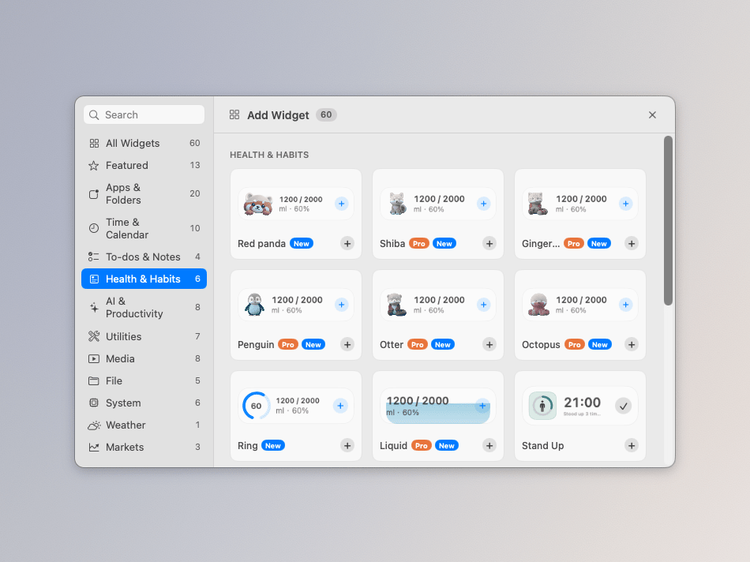 
  Add Widget: category sidebar and Pro capsules

<table>
  <tr>
    <td width="50%" valign="top">
      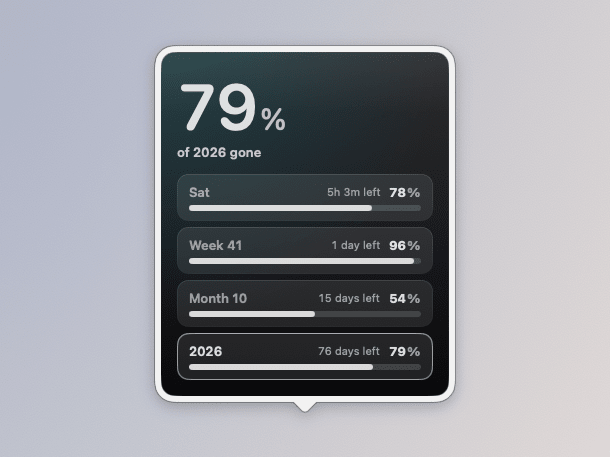
      
Time Progress: day, week, month and year

    </td>
    <td width="50%" valign="top">
      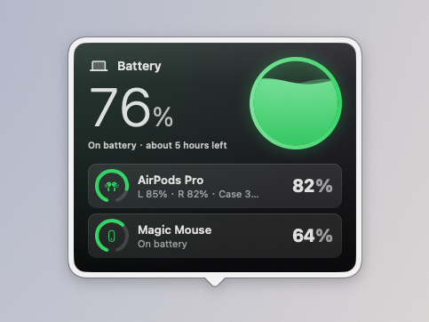
      
Battery: the Mac and accessories (sample data)

    </td>
  </tr>
  <tr>
    <td width="50%" valign="top">
      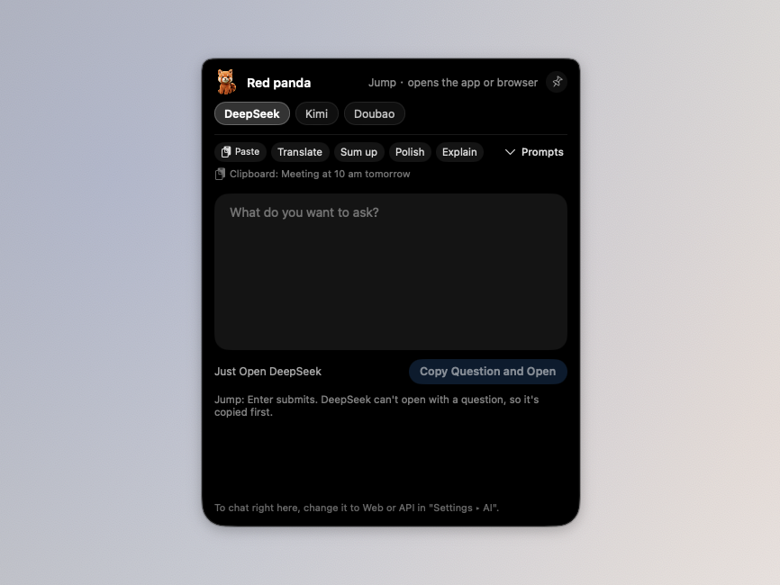
      
AI chat that grows out of the notch (Jump mode)

    </td>
    <td width="50%" valign="top">
      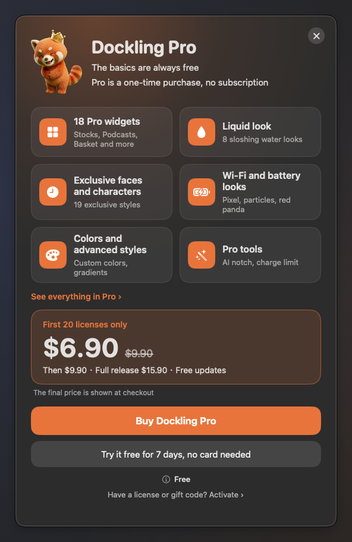
      
Dockling Pro: features, trial, purchase and license key

    </td>
  </tr>
</table>

<table>
  <tr>
    <td width="50%" valign="top">
      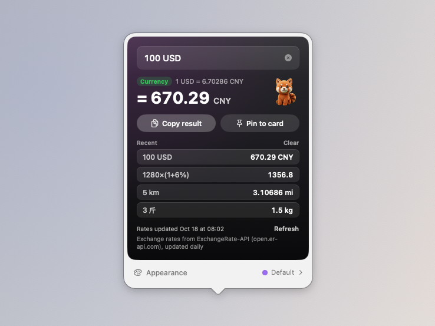
      
Calc: currency, units and sums in one box

    </td>
    <td width="50%" valign="top">
      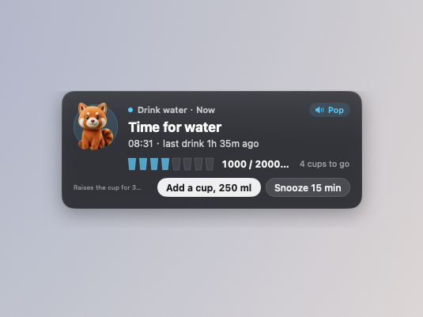
      
Pop-up reminder card under the notch (sample data)

    </td>
  </tr>
  <tr>
    <td width="50%" valign="top">
      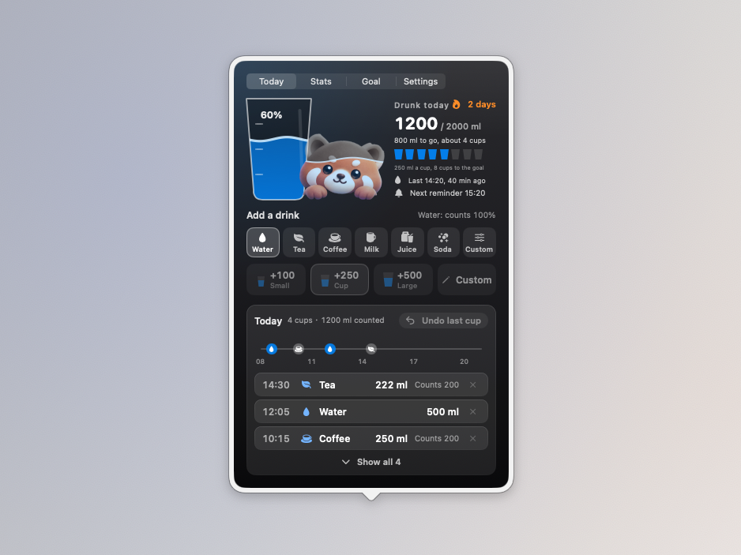
      
Water: the cup page (sample data)

    </td>
    <td width="50%" valign="top">
      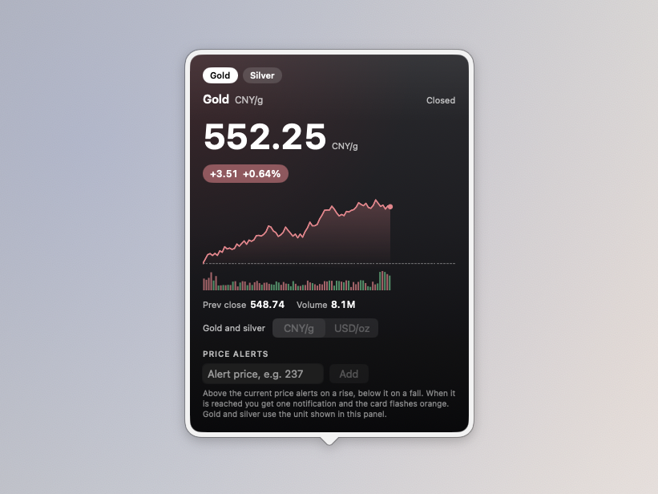
      
Gold and silver, per gram or per ounce (sample data)

    </td>
  </tr>
  <tr>
    <td width="50%" valign="top">
      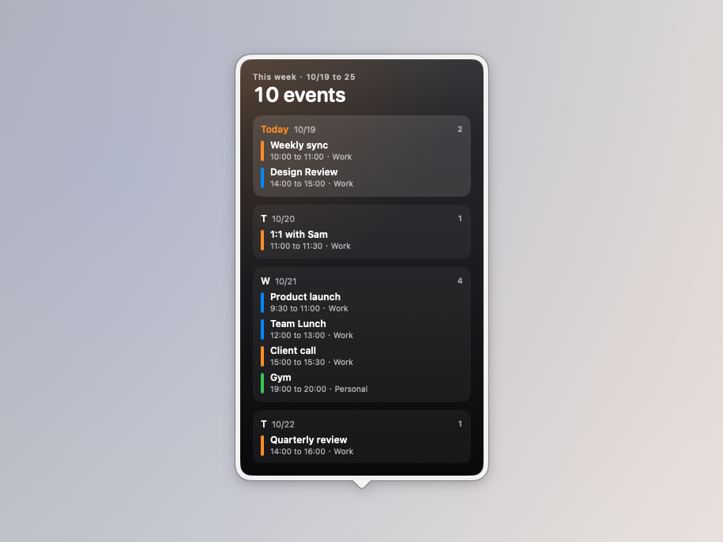
      
Week: seven days at a glance (sample data)

    </td>
    <td width="50%" valign="top">
      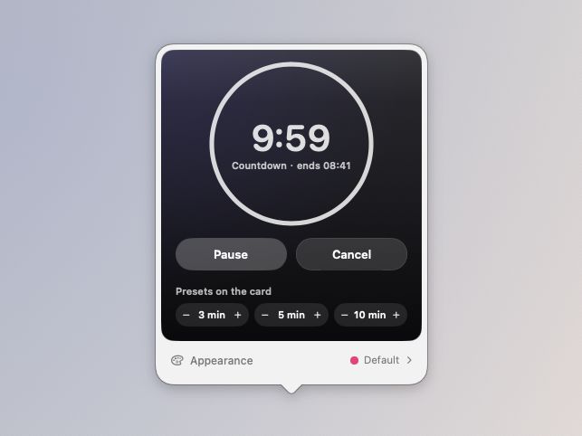
      
Countdown: ten real minutes

    </td>
  </tr>
</table>

  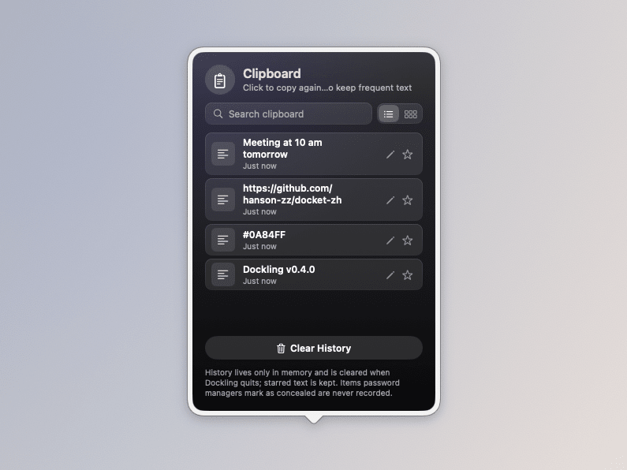 
  Clipboard: recent copies, searchable, with starred items

## How the screenshots are made

Every image in this README is taken by the screenshot tool in this repository: `Tools/Shots` puts the app's real shelf and panels in real windows on screen, and `scripts/capture-shots.sh` captures them with `screencapture`. They are not mockups and no number is edited by hand.

Run `scripts/capture-shots.sh` for the Chinese interface (written to `../images/zh`) or `SHOTS_LANG=en scripts/capture-shots.sh` for English (written to `../images/en`). It needs Screen Recording permission for your terminal and takes a few minutes. The **Actions > Screenshots** workflow takes both sets on a GitHub macOS runner and uploads them as an artifact.

