# 码头 Dockling 小组件详解

← [返回主页](../README.md)

## 小组件一览

四十多种小组件，按用途分成五类，最后两节集中展示 v0.4.0 与 v0.4.1 新增的内容。每一类都可以自由组合，放在同一条扩展栏上。

下面每类第一张图是放着该类小组件的真实扩展栏，小组件显示的是小组件库自带的示例数据
（日历、提醒事项、音乐等需要授权的内容不会读取拍摄机器上的真实数据）；详情面板截图中
标注“示例数据”的同理，其余为拍摄时的实时读数。

## 应用、文件和快速访问

把常用应用、刚下载的文件和要来回拖动的文件都放在手边，不用再打开访达翻找。

**包含：** 应用图标与分组、应用切换器、书签、下载、文件暂存、搜索（网页搜索或查找文件）、隔空投送、快捷指令

- **应用切换器**：正在运行的应用图标（与 ⌘Tab 的范围相同），当前应用排在最前，点按即切换；
  放不下时最后一格显示“+n”，详情中列出全部应用，可隐藏或退出。
- **书签**：多个常用网址，点按用默认浏览器打开。在 **设置 > 小组件** 中编辑，每项写成
  “标题 网址”（例如 `必应 cn.bing.com`），用逗号分隔。不抓取网站图标，用标题首字代替。

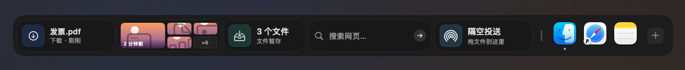

<table>
  <tr>
    <td width="50%" valign="top">
      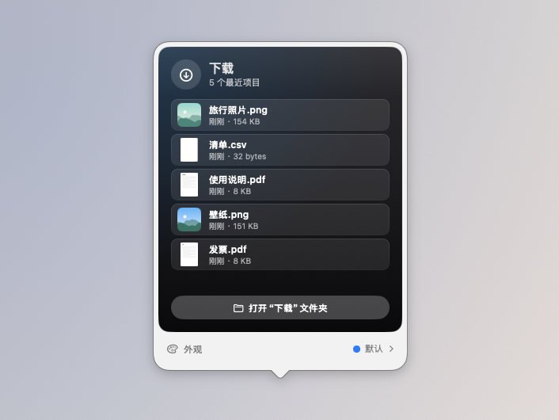
      
下载：最近下载的文件，点按打开，拖出即用

    </td>
    <td width="50%" valign="top">
      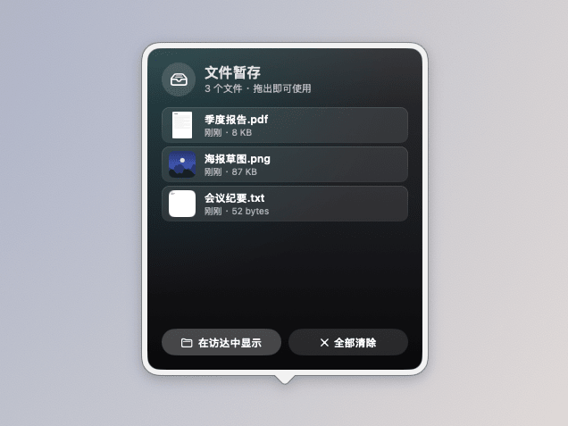
      
文件暂存：先把文件拖进来，稍后再拖出去

    </td>
  </tr>
</table>

## 生产力和日常专注

把今天的日程、待办和专注节奏放在眼前，一眼就知道接下来要做什么。

**包含：** 日历、提醒事项、邮件、专注计时（番茄钟）、喝水、久坐提醒、便签、时钟、世界时钟、秒表、倒计时、闹钟、时间进度

- **时钟样式**：8 个，标准、模拟表盘、翻页、像素、液晶、中文、霓虹、实景（液晶、霓虹、实景是 Pro），在 **设置 > 小组件** 的“样式”中选择；
  标准可选大小和粗细，模拟表盘可选指针或秒圈，翻页可选翻法和卡片。
- **邮件**：“邮件”App 收件箱的未读数量，点按打开“邮件”。通过 AppleScript 读取，只在“邮件”已运行时读取，
  首次使用会请求“自动化”权限；被拒绝时小组件会提示，并可一键打开对应的设置。

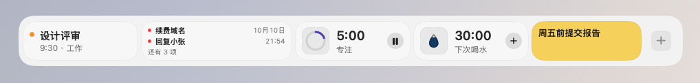

<table>
  <tr>
    <td width="50%" valign="top">
      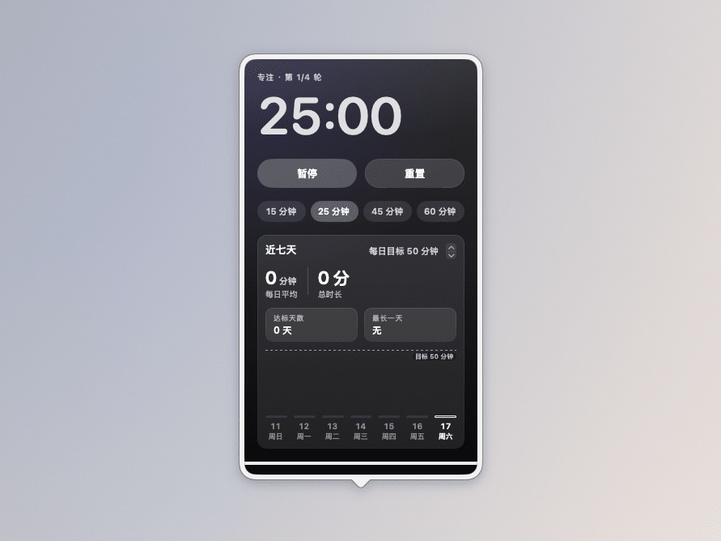
      
专注计时：专注、休息、长休息交替进行

    </td>
    <td width="50%" valign="top">
      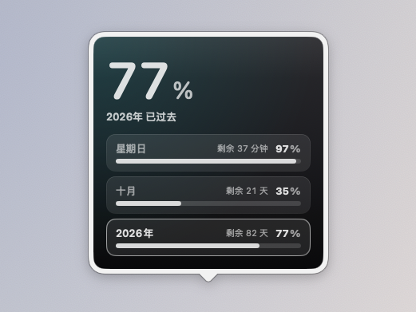
      
时间进度：今天、本周、本月、今年过去了多少

    </td>
  </tr>
</table>

## Mac 控制和系统工具

不用打开控制中心或活动监视器，常用的开关和系统状态就在扩展栏上。

**包含：** 正在播放（音乐）、音量、快速开关（暗色模式、锁屏、屏幕保护程序、清空废纸篓）、壁纸切换、录音、麦克风、系统活动、网络活动、电池、圆环仪表

- **壁纸切换**：选择一个文件夹（默认“图片”），上一张 / 下一张 / 随机切换桌面壁纸，卡片显示当前壁纸；
  详情中点按任意图片即设为壁纸。可选择应用到所有显示器或仅主显示器，只改变当前空间的壁纸。
- **录音**：一键开始 / 停止，显示录音时长，保存为 .m4a（默认“下载”文件夹，可在详情中更换），
  详情中列出最近的录音，可播放、拖出或删除。首次使用会请求麦克风权限。

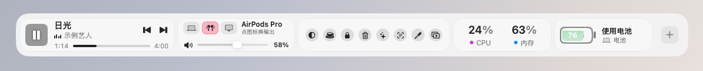

<table>
  <tr>
    <td width="50%" valign="top">
      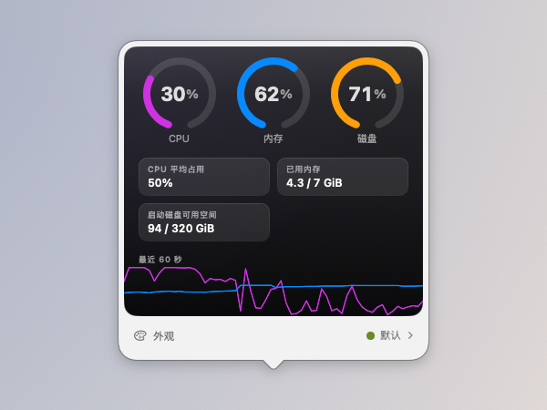
      
系统活动：CPU、内存、磁盘的最近一分钟

    </td>
    <td width="50%" valign="top">
      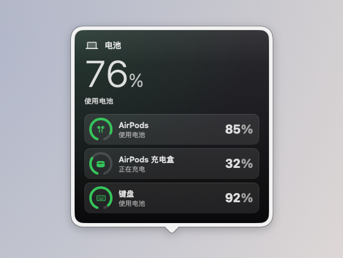
      
电池：Mac 和配件的电量（示例数据）

    </td>
  </tr>
</table>

## 实用小工具

一些随手就要用的小工具：找回刚才拷贝的内容、换算单位、插入表情、看看天气。

**包含：** 剪贴板、算（单位换算、汇率换算、计算器合一）、表情符号、天气、GitHub、股票、自选股

- **算**：单位换算、汇率换算和计算器合成一张，一个输入框自动认：带币种（100 USD、100美元）算汇率，
  带单位（5 km、3 斤、72°F）做换算，其余当算式（+ − × ÷、乘方 ^、百分号和括号），中文输入法的全角符号
  也能识别，输入有误时只提示。汇率来自 [ExchangeRate-API](https://www.exchangerate-api.com)
  （open.er-api.com，免费、无需密钥，每日更新），保存在本地，离线时使用最近一次的汇率并标明日期。
- **天气**：新增风向与风力等级、湿度，以及按城市坐标在本地计算的日出日落；新样式“风与日出日落”。
- **GitHub**：公开仓库的星标、议题、拉取请求等，默认显示本仓库。在详情中可填入个人访问令牌（可选），
  令牌只保存在钥匙串中，用于提高请求上限并显示未读通知数。

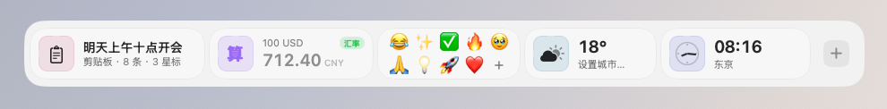

<table>
  <tr>
    <td width="50%" valign="top">
      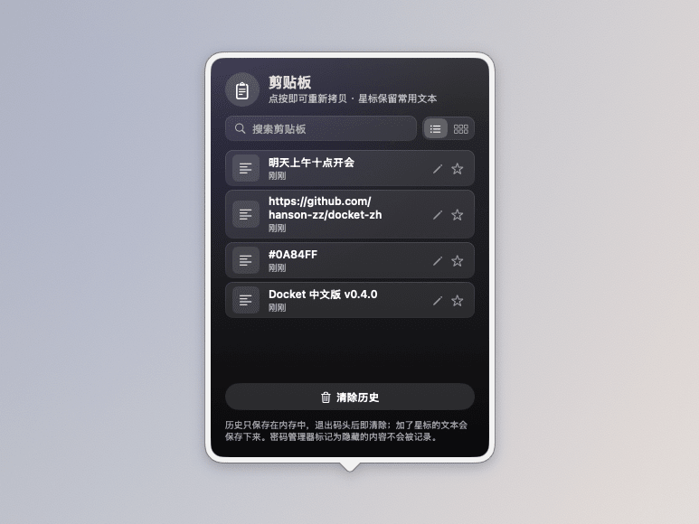
      
剪贴板：最近拷贝的内容，点按即可重新拷贝

    </td>
    <td width="50%" valign="top">
      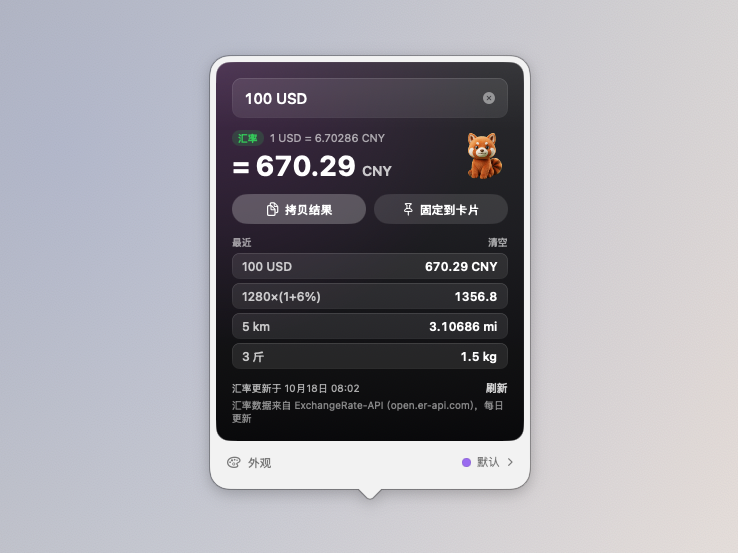
      
算：汇率、单位换算和计算器合成一个输入框

    </td>
  </tr>
</table>

## 图片与截图

看看喜欢的图片，随时截图，最近的截图和取到的颜色都能直接拖走或拷贝。

**包含：** 相册、最近截图、截图工具、取色器

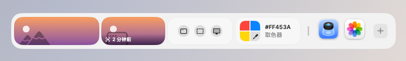

<table>
  <tr>
    <td width="50%" valign="top">
      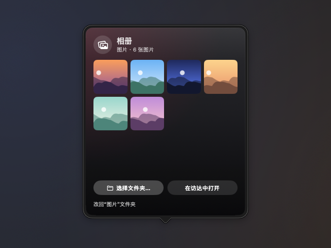
      
相册：轮播一个文件夹里的图片

    </td>
    <td width="50%" valign="top">
      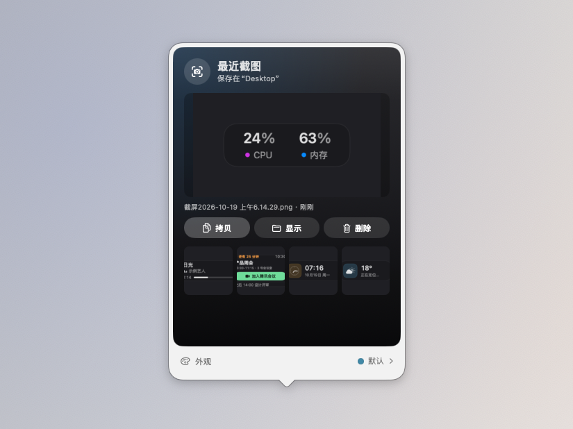
      
最近截图：拷贝、显示、删除，或直接拖进聊天窗口

    </td>
  </tr>
</table>

